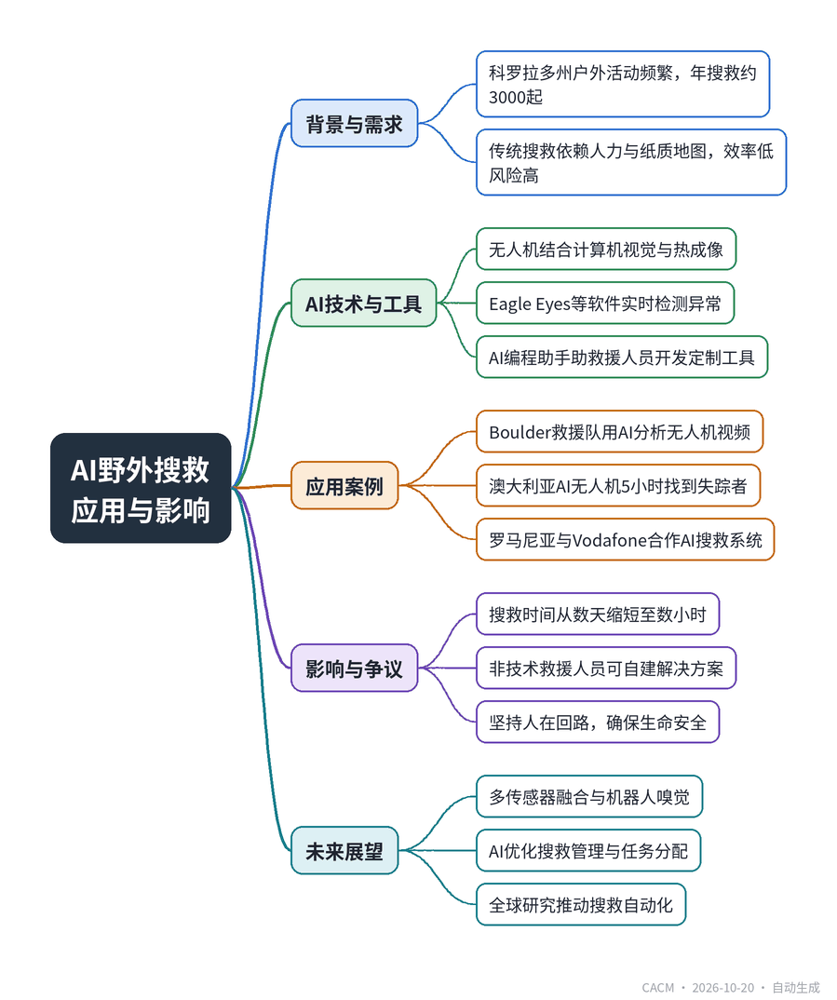

# AI Finds its Way Into Backcountry Search and Rescue

## AI助力野外搜救

**来源**：Communications of the ACM（News）　|　**发布**：2026-10-19 14:12（美东）　|　**北京时间**：2026-10-20 02:12　|　**作者**：Karen Emslie

[原文链接](https://cacm.acm.org/news/ai-finds-its-way-into-backcountry-search-and-rescue/)　·　生成于 2026-10-25 16:19

---

## 一、摘要

> AI正帮助搜救队定位和营救失踪者，并让部分救援人员变身程序员。

在科罗拉多州，每年约发生3000起搜救事件，传统搜救依赖人力与纸质地图，耗时且风险高。自2013年起，Boulder紧急救援队开始使用无人机，如今结合计算机视觉、热成像和AI软件（如Eagle Eyes），能实时分析无人机视频，识别异常颜色、形状或运动，从而快速定位失踪者。AI还使非技术救援人员能借助编程助手开发定制工具，如无人机定位器和视频流系统，并优化搜救管理流程。全球范围内，澳大利亚、罗马尼亚、英国和意大利的研究团队也在探索AI搜救应用。尽管AI提升了效率，救援人员强调必须保持“人在回路”的验证，确保生命安全。

## 二、核心要点

1. 科罗拉多州每年约发生3000起搜救事件，Boulder紧急救援队自2013年起使用无人机，结合AI技术提升搜救效率。
2. AI软件如Eagle Eyes能实时分析无人机视频，通过颜色、形状异常检测定位失踪者，热成像可穿透森林等视觉障碍。
3. 救援人员利用AI编程助手开发定制工具，如无人机定位器和视频流系统，满足特定技术和隐私需求。
4. AI还用于优化搜救管理，自动化签到和表单填写，并在搜救第一小时提供初步规划和任务分配建议。
5. 全球多个团队在研究AI搜救，如澳大利亚用AI无人机5小时内找到失踪徒步者，罗马尼亚与Vodafone合作开发AI搜救系统。
6. 救援人员坚持“人在回路”原则，强调AI决策必须经过经验丰富的救援人员验证，以确保生命安全。

## 三、关键词对照

| English | 中文 |
| --- | --- |
| Search and Rescue (SAR) | 搜救 |
| computer vision | 计算机视觉 |
| thermal imaging | 热成像 |
| anomaly detection | 异常检测 |
| human-in-the-loop | 人在回路 |
| deep reinforcement learning | 深度强化学习 |
| drone swarm | 无人机集群 |
| georeferenced aerial maps | 地理参考航空地图 |

## 四、中英对照全文

Encountering a drone during a revitalizing mountain hike can feel irksome and intrusive unless you are lost or injured; then, it just might save your life. Drone technologies and AI are increasingly vital components of search and rescue (SAR) assignments. In some cases, SAR efforts that previously took days can be reduced to hours. AI is not only transforming how SAR is carried out, but it is also enabling rescuers to build bespoke solutions for their teams.

> 在令人心旷神怡的山间徒步时遇到无人机可能会让人感到厌烦和侵扰，除非你迷路或受伤；那时，它可能正好能救你一命。无人机技术和人工智能正日益成为搜救（SAR）任务中至关重要的组成部分。在某些情况下，过去需要数天的搜救工作可以缩短到数小时。人工智能不仅正在改变搜救的实施方式，还使救援人员能够为其团队构建定制化解决方案。

A New Team Member

> 新团队成员

Think Colorado, think wilderness. The 103,717.5 sq. mi. state abounds with mountains, canyons, ravines, rivers, and forests; it has an average altitude of 6,800 ft., rising to a peak of 14,433 ft. at Mount Elbert. It is an outdoor enthusiast’s paradise. According to a report by market research firm Longwoods International, Colorado received 96.8 million visitors in 2025. In summer, millions of people safely enjoy activities like hiking, climbing, and whitewater rafting, but inevitably, some get lost or injured. Each year, the Colorado Search and Rescue Association (CSAR) responds to around 3,000 SAR incidents, which can also include urban SAR when, for example, a child or an Alzheimer’s patient becomes lost.

> 想到科罗拉多，就想到荒野。这个面积103,717.5平方英里的州遍布山脉、峡谷、沟壑、河流和森林；平均海拔6,800英尺，在埃尔伯特山达到14,433英尺的顶峰。它是户外爱好者的天堂。根据市场研究公司Longwoods International的一份报告，科罗拉多州在2025年接待了9680万游客。夏季，数百万人安全地享受徒步、攀岩和激流漂流等活动，但不可避免地，有些人会迷路或受伤。每年，科罗拉多搜救协会（CSAR）响应约3,000起搜救事件，其中也可能包括城市搜救，例如儿童或阿尔茨海默病患者走失。

CSAR is an umbrella organization that coordinates volunteer SAR networks in the state, including Boulder Emergency Squad (BES), Rocky Mountain Rescue, and Front Range Rescue Dogs. Steve Lanaghen is a long-serving rescuer with the special tactics group of BES: “We’re a very multifaceted group,” he said. “We do water rescue, dive rescue, airplane crashes, backcountry search, urban search, law support, fire support.”

> CSAR是一个伞形组织，协调该州的志愿者搜救网络，包括博尔德紧急救援队（BES）、落基山救援队和Front Range救援犬队。Steve Lanaghen是BES特种战术组的一名长期救援人员：“我们是一个非常多元化的团队，”他说。“我们做水上救援、潜水救援、飞机坠毁救援、野外搜索、城市搜索、执法支持、消防支持。”

Lanaghen has witnessed how technology has changed SAR over the decades. “We’ve gone from using pencils and paper maps on the hood of a car to figure out where people are, to now having a mobile command center with multiple monitors and Starlink; we can stream video back into our emergency operations center in the city.”

> Lanaghen见证了几十年来技术如何改变搜救。“我们从在汽车引擎盖上用铅笔和纸质地图来确定人们的位置，发展到如今拥有带多个显示器和Starlink的移动指挥中心；我们可以将视频流回传到城市的应急运营中心。”

BES has been using drones since 2013. They transformed SAR by enabling what Lanaghen called “a bird’s eye view” of a search area, while reducing risk by providing overwatch for rescuers in hazardous conditions, like steep vertical work or river rescues. Today, the squad’s fleet of drones is augmented by AI technologies like computer vision for anomaly detection and thermal imaging, which uses temperature variation to spot missing people in visually obscured areas, like forests.

> BES自2013年以来一直在使用无人机。它们通过提供Lanaghen所说的搜索区域“鸟瞰视图”改变了搜救，同时通过在陡峭垂直作业或河流救援等危险条件下为救援人员提供监视来降低风险。如今，该队的无人机机队得到了人工智能技术的增强，如用于异常检测的计算机视觉和热成像，后者利用温度变化来发现视觉上被遮挡区域（如森林）中的失踪人员。

Mike Kabjian, who works alongside Lanaghen at BES, sees AI as “a search team member that can do things we can’t.” Models can now analyze drone footage pixel-by-pixel in real time and identify subtle color, shape, or motion anomalies that could signal the location of a person. Kabjian pointed to software such as Eagle Eyes, which “draws a little circle on the screen when it sees a color that statistically shouldn’t be there,” he said. “We’re looking for a person, but it could also be a jacket, a shoe, a backpack.”

> 与Lanaghen一起在BES工作的Mike Kabjian将人工智能视为“一个能做我们做不到的事情的搜索团队成员”。模型现在可以实时逐像素分析无人机 footage，并识别可能表明人员位置的细微颜色、形状或运动异常。Kabjian指出了Eagle Eyes等软件，“当它看到统计上不应存在的颜色时，会在屏幕上画一个小圆圈，”他说。“我们在寻找一个人，但也可能是一件夹克、一只鞋、一个背包。”

The squad also can analyze data from drone live streams, georeferenced aerials maps, and thermal imagery via tools like Nova Maps and ADIAT, and are working with a Boulder-based technology startup, Odin Autonomy, to automate and streamline the operation of swarms of drones on SAR missions.

> 该队还可以通过Nova Maps和ADIAT等工具分析来自无人机直播流、地理参考航空地图和热成像的数据，并正在与博尔德的技术初创公司Odin Autonomy合作，以自动化和简化搜救任务中无人机群的 operation。

Lanaghen sees no tension between technology and the outdoors. “We have a lot of people who are very comfortable in the woods and very comfortable behind a computer.” He keeps a keen eye on how the latest AI advances could improve SAR, flagging robotic olfaction or e-nose systems as “out there” but full of potential. Lanaghen said future SAR AI systems could be made up of multiple sensors working together: “Some super-mobile sensor that can fly, swim, crawl under rocks or whatever; that can sense all these different things. It’ll give us a completely different view of what’s out there.”

> Lanaghen认为技术与户外之间没有矛盾。“我们有很多人在树林里非常自在，在电脑前也非常自在。”他密切关注最新的人工智能进展如何改善搜救，将机器人嗅觉或电子鼻系统标记为“超前”但充满潜力。Lanaghen说，未来的搜救人工智能系统可能由多个传感器协同工作组成：“某种超级移动的传感器，可以飞、游泳、在岩石下爬行或其他；它能感知所有这些不同的东西。它将为我们提供关于外面世界的完全不同的视角。”

On a planet full of wilderness, it is unsurprising for AI SAR to have global reach. In June, Fire and Rescue New South Wales in Australia found two missing hikers in Kosciuszko National Park within five hours using an AI-powered drone. Meanwhile, Salvamont, Romania’s National Mountain Rescuers Association, has partnered with Vodafone to build an AI-powered SAR system that captures and analyzes geolocated images to find missing hikers and climbers. In research, a team from Glasgow University, Scotland, has developed a deep reinforcement learning model for optimizing drones’ search paths, and an Italian team has presented an automated object detection pipeline for finding people lost in forests using real-time thermal video.

> 在一个充满荒野的星球上，人工智能搜救具有全球影响力并不令人意外。6月，澳大利亚新南威尔士州消防与救援局使用人工智能驱动的无人机在5小时内找到了科修斯科国家公园的两名失踪徒步者。与此同时，罗马尼亚国家山地救援协会Salvamont与Vodafone合作，构建了一个人工智能驱动的搜救系统，捕获并分析地理定位图像以找到失踪的徒步者和登山者。在研究方面，苏格兰格拉斯哥大学的一个团队开发了一种深度强化学习模型，用于优化无人机的搜索路径，一个意大利团队提出了一种自动化物体检测流程，利用实时热视频寻找在森林中失踪的人。

The SAR Programmer

> 搜救程序员

It is not only developers and researchers who are innovating AI for SAR. For Kabjian, one of the greatest impacts of AI on SAR is enabling non-technical rescuers to build solutions. Tools for de-confliction, that is, knowing the position of other drones in an area to avoid accidents, exist, but can be expensive or not an exact fit for a SAR team’s needs, so Kabjian built his own. Using AI as a programming assistant, he created a drone finder that plots positional data onto CalTopo, the backcountry map software the squad uses. Design of the hardware—external antenna on the command vehicle—also was assisted by AI. As Kabjian puts it, “AI’s not in the product, but AI built the product.”

> 不仅是开发人员和研究人员在为搜救创新人工智能。对Kabjian来说，人工智能对搜救的最大影响之一是使非技术救援人员能够构建解决方案。用于冲突消除（即了解区域内其他无人机的位置以避免事故）的工具存在，但可能昂贵或不能完全符合搜救团队的需求，因此Kabjian构建了自己的工具。使用人工智能作为编程助手，他创建了一个无人机查找器，将位置数据绘制到CalTopo上，这是该队使用的野外地图软件。硬件设计——指挥车上的外部天线——也得到了人工智能的协助。正如Kabjian所说，“人工智能不在产品中，但人工智能构建了产品。”

It is an approach he and Lanaghen currently are deploying to design an SAR video streaming system that fits the squad’s specific technical and privacy needs. “We need it fed without any lag into our command vehicle,” said Kabjian. “Simultaneous to that, we need an encrypted stream going to the cloud, not using RTSP [Real-Time Streaming Protocol], but using SRT [Secure Reliable Transport].”

> 他和Lanaghen目前正在采用这种方法来设计一个符合该队特定技术和隐私需求的搜救视频流系统。“我们需要它无任何延迟地馈送到我们的指挥车中，”Kabjian说。“与此同时，我们需要一个加密流传输到云端，不使用RTSP [实时流协议]，而是使用SRT [安全可靠传输]。”

Another area ripe for improvement with AI is SAR management. Kabjian described “the madness that is the first hour of a search,” when information like a person’s description and where they might have gone need to be processed and rescuers are mustering. “There’s people talking to you, there’s trucks coming, and everybody’s excited to go do something. It’s cognitive overload,” he said. Kabjian and Lanaghen aim to make this process “a more efficient machine” by automating rescuer check-in and form filling, and using AI to carry out initial planning and suggest rescue assignments.

> 另一个适合用人工智能改进的领域是搜救管理。Kabjian描述了“搜索第一小时的疯狂”，当时需要处理人员描述和可能去向等信息，救援人员正在集结。“有人在跟你说话，有卡车开来，每个人都兴奋地想去做什么。这是认知超载，”他说。Kabjian和Lanaghen旨在通过自动化救援人员签到和表格填写，并使用人工智能进行初步规划和建议救援任务，使这个过程成为“更高效的机器”。

Despite enthusiastically embracing AI, both seasoned rescuers stressed they will always take a strict “human-in-the-loop” verification approach. Said Kabjian, “Our key focus is life safety, we won’t be able to turn that completely over to a computer. We need experienced rescuers’ eyes on it to make sure that no one is endangered by the technology’s decision-making.”

> 尽管热情拥抱人工智能，两位经验丰富的救援人员强调，他们将始终采取严格的“人在回路”验证方法。Kabjian说：“我们的重点是人命安全，我们无法将其完全交给计算机。我们需要有经验的救援人员盯着它，以确保没有人因技术的决策而受到危害。”

For many, time in the wilderness means a break from technology, but when it comes to search and rescue, an AI-loaded drone whirring overhead will likely to be very welcome.

> 对许多人来说，在荒野中意味着远离技术，但在搜救方面，一架满载人工智能的无人机在头顶嗡嗡作响很可能会非常受欢迎。

Karen Emslie is a location-independent freelance journalist and essayist.

> Karen Emslie是一位地点独立的自由记者和散文家。

---
*英文原文版权归 Communications of the ACM 及作者所有；中文译文由 AI 辅助生成，仅供学习参考。*