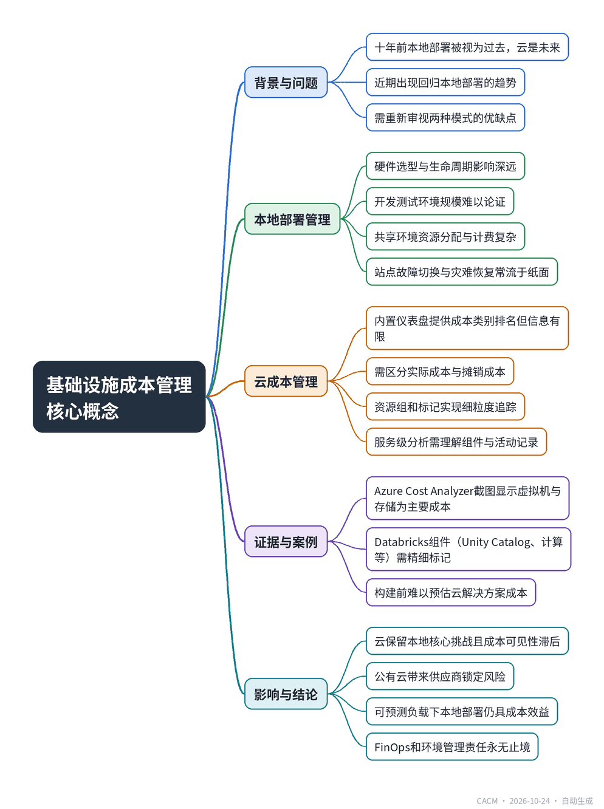

# Core Concepts in Infrastructure Cost Management

## 基础设施成本管理的核心概念

**来源**：Communications of the ACM（Blog@CACM）　|　**发布**：2026-10-23 15:37（美东）　|　**北京时间**：2026-10-24 03:37　|　**作者**：Doug Meil

[原文链接](https://cacm.acm.org/blogcacm/core-concepts-in-infrastructure-cost-management/)　·　生成于 2026-10-26 18:10

---

## 一、摘要

> 重新审视本地与云部署模式的优缺点。

十年前，本地部署被视为过去，云计算代表未来。然而，近期出现了一些回归本地部署的显著趋势，促使人们重新评估两种模式。本地部署涉及硬件、机架、网络、冷却等全套设施，其管理挑战包括硬件选型与生命周期、开发测试环境规模、共享环境资源分配以及站点故障切换与灾难恢复。云部署虽由供应商管理基础设施，但成本管理同样复杂：内置仪表盘仅提供表面信息，需深入分析服务利用率、资源标记、实际成本与摊销成本差异，以及服务级明细。以Databricks为例，其组件（Unity Catalog、计算、SQL仓库、AI功能）可能运行在同一资源组内，需精细标记以区分团队、工作负载和阶段。文章指出，云环境保留了本地核心挑战，且成本可见性滞后，构建前难以预估。历史地看，自建计算环境曾代表战略优势与运营控制，公有云虽提供弹性与广度，却带来供应商锁定风险。对于可预测的工作负载，本地部署仍具成本效益和控制力。最终，无论选择何种路径，有效的FinOps（财务运营分析）和环境管理责任永无止境。

## 二、核心要点

1. 本地部署的挑战包括硬件选型与生命周期、开发测试环境规模、共享环境资源分配以及站点故障切换与灾难恢复。
2. 云平台内置成本仪表盘（如Azure Cost Analyzer）提供成本类别排名，但无法回答虚拟机数量、利用率、存储细节等关键问题。
3. 云成本管理需区分实际成本与摊销成本，并利用资源组和标记进行细粒度追踪。
4. 以Databricks为例，服务级利用率分析需要理解Unity Catalog、计算、SQL仓库、AI功能等组件，并依赖精细标记。
5. 历史表明，自建计算环境曾代表战略优势，公有云虽提供弹性但带来供应商锁定风险。
6. 对于可预测的工作负载，本地部署仍具成本效益和控制力；无论何种模式，FinOps和环境管理责任持续存在。

## 三、关键词对照

| English | 中文 |
| --- | --- |
| on-premise | 本地部署 |
| cloud computing | 云计算 |
| FinOps | 财务运营分析 |
| resource group | 资源组 |
| tagging | 标记 |
| amortized cost | 摊销成本 |
| vendor lock-in | 供应商锁定 |
| Databricks | Databricks平台 |
| Unity Catalog | 统一目录 |
| serverless | 无服务器 |

## 四、中英对照全文

“All that glitters is not gold.” – William Shakespeare

> “闪光的未必都是金子。”——威廉·莎士比亚

“. . . but all that glitters and blinks must have a cost center” – Doug Meil

> “……但所有闪光和闪烁的东西都必须有一个成本中心”——道格·梅尔

When discussing and comparing on-premise and cloud deployment patterns a decade ago, there would have been a straight line drawn from the first to the second: On-premise was the past and cloud computing was the future, even if people weren’t entirely sure what “cloud computing” was at the time. It is worth re-examining the strengths and weaknesses of both deployment modalities, especially given some notable movements back to on-premise deployments.

> 十年前，在讨论和比较本地部署与云部署模式时，人们会从前者到后者画一条直线：本地部署是过去，云计算是未来，即使当时人们并不完全确定“云计算”是什么。值得重新审视这两种部署模式的优势和劣势，尤其是考虑到近期出现了一些显著回归本地部署的趋势。

### On-Premise Cost Management
*本地部署的成本管理*

At the risk of stating the obvious, “on-premise” in the context of this post refers to deployments either within an organization’s physical premises (office or datacenter) or a third party co-located commercial datacenter. Equipment might be purchased or leased, but being on-premise generally refers not just to bare metal servers, but to racks, cables, power supplies, top of rack networking, routers, cooling, raised floors, physical security, and everything else that goes with running a functioning and stable computing environment.

> 显而易见，本文中的“本地部署”指的是在组织自有物理场所（办公室或数据中心）或第三方托管的商业数据中心内的部署。设备可以购买或租赁，但本地部署通常不仅指裸金属服务器，还包括机架、电缆、电源、机架顶部网络、路由器、冷却、活动地板、物理安全，以及运行一个功能正常且稳定的计算环境所需的所有其他设施。

On-premise deployments are sometimes viewed as inflexible and static; however, they can be quite adaptable when commodity hardware is paired with infrastructure as service frameworks and container frameworks for automated deployments of configurations and software releases. Being comparatively static is true enough as new equipment needs time to be provisioned, but the “static-ness” of the environment is point-in-time, not a permanent condition. The top environment management and scaling challenges are typically:

> 本地部署有时被视为不灵活和静态的；然而，当商用硬件与基础设施即服务框架和容器框架结合以实现配置和软件发布的自动化部署时，它们可以具有相当的适应性。相对静态的说法确实成立，因为新设备需要时间进行配置，但环境的“静态性”是时间点上的，而非永久状态。最主要的环境管理和扩展挑战通常包括：

- Choice / Lifespan of Hardware Especially with purchased equipment, decisions regarding hardware (CPU/GPU, storage, networking) have years of impact, both in terms of technical solution delivery and financials (capital expenses, depreciation).

  > 硬件的选择/生命周期 尤其是对于购买的设备，有关硬件（CPU/GPU、存储、网络）的决策会对技术解决方案交付和财务（资本支出、折旧）产生多年影响。

- Dev and QA Environments Sizing a production environment is one matter, but properly sizing lower environments can be a challenge—specifically justifying the budgets and proposed/expected utilization to management.

  > 开发和QA环境的规模 确定生产环境的规模是一回事，但合理确定较低级别环境的规模可能是一个挑战——特别是要向管理层证明预算和提议/预期使用率的合理性。

- Shared Environment Management Data and analytic environments are designed to bring data together across sources and teams, but ensuring everybody gets their fair share of resources (and is appropriately paying for it) isn’t always easy.

  > 共享环境管理 数据和数据分析环境旨在将跨来源和团队的数据汇集在一起，但确保每个人都获得公平的资源份额（并为此适当付费）并不总是容易的。

- Site Failover and Disaster RecoveryThis is a particularly hard problem because a fully built-out environment just sitting around waiting to get used is something that most organizations cannot afford. This all too often turns into a paper exercise for most organizations.

  > 站点故障转移和灾难恢复 这是一个特别困难的问题，因为一个完全构建好、闲置等待使用的环境是大多数组织无法承受的。对大多数组织来说，这往往变成纸上谈兵。

There is a benefit to the clarity that comes with knowing what was racked and the associated costs. What you see in the racks is exactly what you have.

> 清楚知道机架上有什么以及相关成本是有好处的。你在机架上看到的就是你拥有的。

### Cloud Cost Management
*云成本管理*

Given the complexities of managing on-premise environments, it can be tempting to assume that moving to the cloud will be an easier path because someone else can manage the infrastructure. As with so many things in life the answer is “it depends,” and it especially depends on which pain points are prioritized and which specific cloud features are being leveraged. There is truth in the saying “the cloud is just somebody else’s computer,” but this does not adequately capture the complexity of public cloud platforms like Azure, AWS, and Google Cloud, which are not merely a sets of servers in somebody else’s datacenter, but a vast array of services, many of which are provided by the cloud platform vendor, and some are provided by third parties.

> 鉴于管理本地环境的复杂性，人们很容易认为迁移到云将是更简单的路径，因为其他人可以管理基础设施。正如生活中的许多事情一样，答案是“视情况而定”，尤其取决于哪些痛点被优先考虑以及利用了哪些特定的云功能。“云只是别人的计算机”这句话有道理，但这并不能充分体现Azure、AWS和Google Cloud等公有云平台的复杂性，它们不仅仅是别人数据中心里的一组服务器，而是庞大的服务阵列，其中许多由云平台供应商提供，有些由第三方提供。

How does one manage a cloud environment? As with on-premise deployments, looking at costs is a good place to start and the major cloud platforms have built-in cost management dashboards. Below is a screenshot of Azure Cost Analyzer from documentation:

> 如何管理云环境？与本地部署一样，从成本入手是个好起点，主要云平台都有内置的成本管理仪表板。下面是文档中Azure成本分析器的截图：

There are a lot of great numbers and graphs in this dashboard, so it might seem at first glance that our cost management problems are solved. Let’s take a look and find out.

> 这个仪表板中有很多漂亮的数字和图表，所以乍一看似乎我们的成本管理问题已经解决了。让我们仔细看看，找出答案。

### Service Utilization
*服务利用率*

Looking closer at the example screenshot provides a useful summary of services, providing a stack-rank of cost categories: Virtual Machines in first place, and Storage in second place. This is useful insight, but this also raises further questions:

> 仔细观察示例截图，可以看到有用的服务摘要，提供了成本类别的排名：虚拟机第一，存储第二。这是有用的洞察，但也引发了进一步的问题：

- Virtual Machines. Money is clearly being spent on compute, but on how many VMs? What are they doing? Are they fully utilized?

  > 虚拟机。显然在计算上花了钱，但花了多少台VM上？它们在做什么？是否被充分利用？

- Storage. “Storage” in cloud computing can mean everything from local storage to VMs to cloud storage services, and charges can be accrued for writing, storing, and reading data. What exactly is being stored where, and at what cost? Storage services also have optional replication and redundancy capabilities available for up-charges.

  > 存储。云计算中的“存储”可以指从本地存储到VM再到云存储服务的任何东西，并且写入、存储和读取数据都会产生费用。究竟什么被存储在哪里，成本如何？存储服务还提供可选的复制和冗余功能，需要额外付费。

None of these initial questions address how well this cloud-hosted solution is functioning. Performance diagnostics and tuning are enormous topics outside the scope of this post, but should still be mentioned because they wind up invariably having a cost impact somewhere. So many questions from a single pie chart! Getting access to diagnostic logs, as well as detailed billing records, are highly recommended for deeper analysis.

> 这些初步问题都没有涉及这个云托管解决方案的运行状况如何。性能诊断和调优是巨大的话题，超出了本文的范围，但仍应提及，因为它们最终总会在某处产生成本影响。一张饼图引出这么多问题！强烈建议获取诊断日志以及详细的计费记录以进行更深入的分析。

It should also be clear by this point that pretty much all the core on-premise challenges still remain in the cloud, but there are just a more tools that can be brought to bear. One construct is to configure appropriate “resource groups” around services and provisioned resources, which can align on major groups of functionality for solutions. Such reporting can be seen in the lower right-hand corner of the high-level cost dashboard, though in the example data nearly all the costs are rolling up to a single resource group. Resource and activity tagging can also be used for more detailed breakdowns (e.g., function = ABC, department = XYZ).

> 至此也应该清楚，几乎所有核心的本地挑战在云中依然存在，只是有更多工具可以运用。一种构造是围绕服务和已配置资源配置适当的“资源组”，这可以与解决方案的主要功能组对齐。这种报告可以在高级成本仪表板的右下角看到，不过在示例数据中，几乎所有成本都汇总到一个资源组。资源和活动标记也可用于更详细的细分（例如，功能 = ABC，部门 = XYZ）。

First-generation cloud deployments generally looked like the above and consisted primarily of VMs and and storage. Today, however, higher-level services are often driving the largest expenditures—especially data and analytic services (for example, Databricks and Snowflake)—and this presents another level of management and observability requirements. A fundamental challenge when building with cloud services is that it is often difficult to know exactly how much something will cost. While cloud services offer flexibility, they also introduce a level of complexity that is under-appreciated.

> 第一代云部署通常如上所述，主要由VM和存储组成。然而，如今更高级别的服务往往驱动着最大的支出——尤其是数据和分析服务（例如，Databricks和Snowflake）——这提出了另一层管理和可观测性要求。使用云服务构建时的一个根本挑战是，通常很难确切知道某样东西会花费多少。虽然云服务提供了灵活性，但也引入了未被充分认识的一定程度的复杂性。

Understanding the difference between actual costs vs. amortized costs also matters. Cloud resources and services can often be purchased (or reserved) in blocks with discounts. This can be useful where workloads requirements are better understood, but it also increases complexity of reporting with respect to “cash out the door” vs. reserved resource/service utilization.

> 理解实际成本与摊销成本之间的差异也很重要。云资源和服务通常可以以折扣价批量购买（或预留）。在工作负载需求被更好理解的情况下，这可能有用，但它也增加了关于“现金支出”与预留资源/服务利用率的报告复杂性。

### Service-Detail Utilization
*服务详情利用率*

To understand what is happening within any given cloud service will require access to service-specific activity and billing records, as well as a thorough understanding of the constructs of the service. Using Databricks as an example, there are major service components such as:

> 要了解任何给定云服务内部发生了什么，需要访问特定服务的活动和计费记录，以及对该服务构造的透彻理解。以Databricks为例，主要服务组件包括：

- Unity Catalog — the overarching catalog for assets (data and code).

  > Unity Catalog — 资产（数据和代码）的总体目录。

- Compute — classic compute for notebooks, which execute in the customer account and accrue cloud VM and Storage charges plus Databricks runtime charges, and “serverless,” which executes entirely in the Databricks control plane but at a higher rate of Databricks runtime charges.

  > 计算 — 用于笔记本的经典计算，在客户账户中执行，产生云VM和存储费用以及Databricks运行时费用，以及“无服务器”，完全在Databricks控制平面中执行，但Databricks运行时费用更高。

- SQL Warehousing — classic (customer account), serverless.

  > SQL仓库 — 经典（客户账户）、无服务器。

- AI functions — SQL functions, Genie spaces for LLMs, coding assistants, etc.

  > AI功能 — SQL函数、用于LLM的Genie空间、编码助手等。

As all of this may execute entirely within a single cloud resource group, proper tagging becomes critical to differentiate activity and billing from a variety of teams, workloads, and stages (for example, Dev/QA/Prod). Otherwise, developers and administrators will be flying blind. The cost summary of the service will be visible, of course, but that isn’t enough to manage a solution, much less an enterprise rollout.

> 由于所有这些都可能完全在一个云资源组内执行，适当的标记对于区分来自各种团队、工作负载和阶段（例如，开发/QA/生产）的活动和计费变得至关重要。否则，开发人员和管理员将盲目飞行。当然，服务的成本摘要将是可见的，但这不足以管理一个解决方案，更不用说企业推广了。

Adding to the pressure is that it often is not easy to see what cloud-based solutions cost until they have been built. Service-level utilization analysis and tagging is truly a skill within a skill.

> 雪上加霜的是，通常直到构建完成才能容易地看到基于云的解决方案的成本。服务级利用率分析和标记确实是技能中的技能。

### Haven’t We Been Here Before?
*我们以前不是来过这里吗？*

Today people can joke about a server running under someone’s desk, but up until roughly the 1980s that would have been highly aspirational, if not science fiction. In the very old days, computing time often was leased on shared systems because only the largest organizations could afford not just to own their own computers but also to build out and operate datacenters to house them. Owning and operating one’s own computing environment represented not only a significant strategic advantage for purpose-built systems, but also operational control and stability. There were good reasons on-premise systems deployments were preferred by so many, once they became economically feasible.

> 今天人们可以开玩笑说服务器在某人桌子下运行，但直到大约20世纪80年代，那将是高度理想化的，甚至是科幻小说。在非常古老的日子里，计算时间通常是在共享系统上租赁的，因为只有最大的组织才能负担得起不仅拥有自己的计算机，而且还要建设和运营容纳它们的数据中心。拥有和运营自己的计算环境不仅代表了专用系统的显著战略优势，还代表了运营控制和稳定性。一旦在经济上可行，本地系统部署被如此多的人所青睐是有充分理由的。

Public cloud computing appeared in the late 2000s and took hold the following decade. When dynamic resource provisioning and scaling is combined with the wide breadth of services available, this modality can be an especially powerful paradigm. This, however, comes with the age-old tradeoff of vendor lock-in; if a cloud platform decides to raise the rates on a critical dependency, in the short-term there often isn’t much of a choice other than to absorb those costs.

> 公有云计算出现在2000年代末，并在接下来的十年中扎根。当动态资源供应和扩展与广泛可用的服务相结合时，这种模式可以成为一个特别强大的范式。然而，这伴随着古老的供应商锁定权衡；如果云平台决定提高关键依赖项的价格，短期内通常除了吸收这些成本外别无选择。

It should not come as a surprise, then, that there have been some notable examples in the “back-to-on-premise” movement. If workloads are thoroughly understood and predictable, on-premise deployments still can represent not only a cost-effective approach, but one with control down to bare metal if one so chooses.

> 因此，在“回归本地”运动中看到一些显著例子并不奇怪。如果工作负载被透彻理解且可预测，本地部署仍然不仅可以代表一种成本效益高的方法，而且如果愿意，还可以控制到裸金属。

All of this, whether on-premise or in the public cloud, is part of effective FinOps (financial operational analytics). Whichever deployment path is taken, the responsibility of environment management never ends, and there are no free lunches.

> 所有这些，无论是本地还是公有云，都是有效FinOps（财务运营分析）的一部分。无论采取哪种部署路径，环境管理的责任永远不会结束，也没有免费的午餐。

## 附录：参考与脚注（原文）

References

1. Meil, D. Delivering Cloud Data and Analytic Solutions. BLOG@CACM (January 7, 2025).

2. State of Tokenomics: September 2026. FinOps Foundation.

3. Engro Technologies. Cloud Repatriation: Why Some Enterprises Are Moving Back On-Prem? LinkedIn.

4. Wikipedia. All That Glitters is Not Gold.

Doug Meil is a software architect in healthcare data management and analytics, and an ACM Senior Member. He also founded the Cleveland Big Data Meetup in 2010. His BLOG@CACM posts can be found at https://www.linkedin.com/pulse/publications-doug-meil

---
*英文原文版权归 Communications of the ACM 及作者所有；中文译文由 AI 辅助生成，仅供学习参考。*