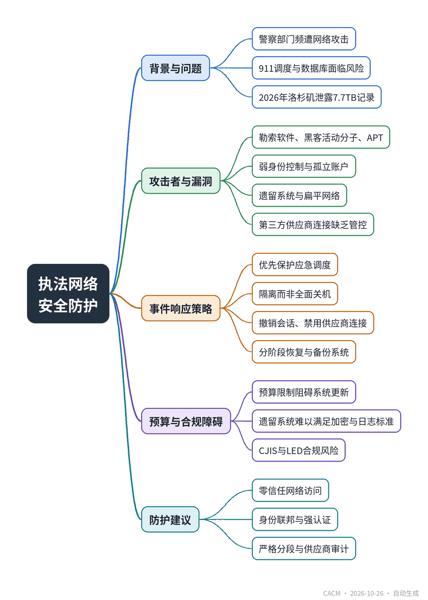

# Securing Global Law Enforcement Networks Against Cyberattacks

## 全球执法网络如何抵御网络攻击

**来源**：Communications of the ACM（News）　|　**发布**：2026-10-26 11:19（美东）　|　**北京时间**：2026-10-26 23:19　|　**作者**：David Geer

[原文链接](https://cacm.acm.org/news/securing-global-law-enforcement-networks-against-cyberattacks/)　·　生成于 2026-10-27 13:45

---

## 一、摘要

> 外部软件在访问控制与监控不足时可泄露警方机密记录。

全球警察部门频繁遭受网络攻击，攻击者加密911调度工具、窃取机密文件，导致应急响应中断。2026年3月，洛杉矶市检察官办公室使用的文件共享平台遭WorldLeaks组织入侵，泄露7.7TB敏感警方记录，涉及337,000份文件，包括警员人事记录、证人病史和内部事务档案。尽管核心警察基础设施未受影响，但事件凸显外部软件在访问控制和监控不足时对警方机密记录的威胁。文章分析了攻击者类型（勒索软件团伙、黑客活动分子、有组织犯罪和国家支持的APT），指出身份管理薄弱、遗留系统、扁平网络和供应商连接是主要漏洞。专家建议采用零信任网络访问、身份联邦、严格分段和定期供应商审计，在预算限制下保护公共安全网络。

## 二、核心要点

1. 2026年3月洛杉矶市检察官办公室文件共享平台遭WorldLeaks攻击，泄露7.7TB、337,000份敏感警方记录。
2. 攻击者包括勒索软件团伙（如LockBit）、黑客活动分子（如Guacamaya）和国家支持的APT（如APT41），针对执法网络窃取情报或施压。
3. 主要攻击向量是弱身份控制（孤立账户、高权限）、遗留系统、扁平网络和第三方供应商工具缺乏强认证。
4. 事件响应应优先保护911调度，通过撤销会话、禁用供应商连接隔离问题，而非全面关机。
5. 预算限制迫使机构在遗留系统上叠加中间件，难以符合CJIS安全政策和欧盟执法指令（LED）的加密、日志和认证要求。
6. 专家建议将每个供应商连接视为潜在 breach 点，实施零信任、身份联邦、分段和定期审计。

## 三、关键词对照

| English | 中文 |
| --- | --- |
| Computer-Aided Dispatch (CAD) | 计算机辅助调度 |
| Ransomware | 勒索软件 |
| Advanced Persistent Threat (APT) | 高级持续性威胁 |
| Identity Federation | 身份联邦 |
| Zero-Trust Network Access | 零信任网络访问 |
| Microsegmentation | 微隔离 |
| CJIS Security Policy | CJIS安全政策 |
| EU Law Enforcement Directive (LED) | 欧盟执法指令 |

## 四、中英对照全文

Cyber attackers routinely target police departments across the globe. Threat actors can encrypt 911 computer-aided dispatch (CAD) tools and breach police station databases to steal confidential files. System outages can take down emergency call lines, freeze access to forensic evidence, and stall cross-border record checks.

> 网络攻击者经常将全球各地的警察部门作为目标。威胁行为者可以加密911计算机辅助调度（CAD）工具，并入侵警察局数据库窃取机密文件。系统中断可能导致紧急呼叫线路瘫痪、法医证据访问冻结，以及跨境记录检查停滞。

One such breach occurred on March 20, 2026, when a file sharing platform that Los Angeles City Attorney Hydee Feldstein Soto’s office used to transfer litigation case files to opposing counsel was hit, according to the Los Angeles Times and other outlets. The unauthorized access leaked 7.7 terabytes of sensitive police records across 337,000 files, including officer personnel records, witness medical histories, internal affairs files, and unredacted criminal complaints, some of which subsequently surfaced online, but did not compromise core police infrastructure.

> 据《洛杉矶时报》和其他媒体报道，2026年3月20日发生了一起此类泄露事件，洛杉矶市检察官Hydee Feldstein Soto办公室用于向对方律师传输诉讼案件文件的文件共享平台遭到攻击。未经授权的访问泄露了7.7TB的敏感警方记录，涉及337,000个文件，包括警员人事记录、证人病史、内部事务文件以及未经删节的刑事投诉，其中一些随后在网上浮出水面，但并未危及核心警察基础设施。

An official statement from the Los Angeles Police Department (LAPD) noted that the intrusion remained isolated to the City Attorney’s external server and affected files from closed civil lawsuits.

> 洛杉矶警察局（LAPD）的一份官方声明指出，入侵仅限于市检察官的外部服务器，受影响的是已结民事案件的文件。

“LAPD is aware of an incident within the LA City Attorney’s Office, where unauthorized individuals gained access to a digital storage system,” the statement said. “This digital storage contained discovery documents from previously adjudicated or settled LAPD civil litigation cases. The breach does not involve any LAPD systems or networks. We take this incident very seriously and are working with the LA City Attorney’s Office to gain access to the impacted files to understand the full scope of the data breach. LAPD is committed to safeguarding its sensitive personnel and investigative information.”

> 声明称：“LAPD知悉市检察官办公室发生了一起事件，未经授权的人员访问了一个数字存储系统。该数字存储包含此前已裁决或已和解的LAPD民事诉讼案件中的证据开示文件。此次泄露不涉及任何LAPD系统或网络。我们非常重视这一事件，正在与市检察官办公室合作获取受影响文件，以了解数据泄露的全面范围。LAPD致力于保护其敏感的人事和调查信息。”

The attack was attributed to WorldLeaks, a cyber-extortion group, which publicly claimed responsibility for the intrusion. Investigators have yet to verify the precise entry point into the City Attorney’s storage system, but security analysts said that WorldLeaks usually breaks in via valid credentials or exposed Web services missing multi-factor authentication. Rather than deploying ransomware, the group generally conducts reconnaissance, moves laterally, steals vast caches of restricted files, and threatens public exposure on its leak site.

> 此次攻击被归咎于网络勒索组织WorldLeaks，该组织公开声称对入侵负责。调查人员尚未核实进入市检察官存储系统的确切入口点，但安全分析师表示，WorldLeaks通常通过有效凭证或缺乏多因素认证的暴露Web服务闯入。该组织一般不部署勒索软件，而是进行侦察、横向移动、窃取大量受限文件，并威胁在其泄露网站上公开曝光。

The breach underscores how external software can compromise confidential police records whenever access controls and monitoring fall short.

> 此次泄露凸显了当访问控制和监控不足时，外部软件如何危及机密警方记录。

Targeting Police Infrastructure and Vendor Platforms

> 针对警察基础设施和供应商平台

Anar Israfilov, founder of cybersecurity firm Cyberoon Enterprise Corporation, said criminals target law enforcement networks because connected systems house criminal intelligence, legal records, evidence, and 911 response tools. Attackers include ransomware syndicates looking for leverage, hacktivists, organized crime groups searching for witness rosters, and state-sponsored actors seeking intelligence, said Israfilov.

> 网络安全公司Cyberoon Enterprise Corporation创始人Anar Israfilov表示，犯罪分子瞄准执法网络，因为互联系统存储着犯罪情报、法律记录、证据和911响应工具。Israfilov说，攻击者包括寻求筹码的勒索软件团伙、黑客活动分子、寻找证人名单的有组织犯罪集团，以及寻求情报的国家支持的行为者。

High-profile incidents highlight several distinct actors or actions:

> 备受关注的事件凸显了几类不同的行为者或行动：

Ransomware Syndicates. Law enforcement agencies took down the LockBit ransomware syndicate in February 2024, dismantling a prolific network that regularly hit municipal police departments, courts, and public-safety software vendors worldwide.

> 勒索软件团伙。执法机构于2024年2月捣毁了LockBit勒索软件团伙，瓦解了一个经常攻击全球市政警察部门、法院和公共安全软件供应商的多产网络。

Hacktivists and Crime Groups. A September 2022 intrusion by the hacktivist collective Guacamaya compromised military and police institutions across Latin America, leaking internal emails and records.

> 黑客活动分子和犯罪集团。2022年9月，黑客活动组织Guacamaya的入侵破坏了拉丁美洲各地的军事和警察机构，泄露了内部电子邮件和记录。

State-Sponsored Advanced Persistent Threats (APTs). From May 2021 through February 2022, the state-backed threat group APT41 breached at least six U.S. state government networks housing police and public-safety infrastructure, exploiting vulnerable Web applications for long-term espionage.

> 国家支持的先进持续威胁（APT）。从2021年5月到2022年2月，国家支持的威胁组织APT41入侵了至少六个容纳警察和公共安全基础设施的美国州政府网络，利用易受攻击的Web应用程序进行长期间谍活动。

Because law enforcement operations run on interconnected digital networks, penetrating a single entry point can hand threat actors access to cross-border intelligence feeds, informant registries, and active evidence files. This structural division of public safety IT creates significant operational security gaps.

> 由于执法行动运行在互联的数字网络上，渗透单个入口点就可能让威胁行为者访问跨境情报源、线人登记册和活跃证据文件。公共安全IT的这种结构性分割造成了重大的操作安全缺口。

According to Israfilov, technical prevention responsibilities are often divided between departments. Law enforcement officers may be responsible for the systems they use, while the local city department may be responsible for infrastructure issues. Vendors will be responsible for third-party platforms used in the processes and the courts are accountable for legal discoveries, said Israfilov.

> 据Israfilov称，技术预防责任通常由各部门分担。执法人员可能负责他们使用的系统，而当地城市部门可能负责基础设施问题。Israfilov说，供应商将负责流程中使用的第三方平台，法院负责法律证据开示。

When security duties split among separate organizations, enforcement breaks down, turning external vendor platforms into unchecked entry points into sensitive data pipelines, he said.

> 他说，当安全职责分散在不同组织之间时，执行就会失效，使外部供应商平台成为进入敏感数据管道的未受检查的入口点。

Attack Vectors and System Vulnerabilities

> 攻击向量和系统漏洞

“The most common entry point is weak identity control, especially orphaned or poorly managed accounts with elevated permissions to the critical systems. Third-party tools like legal discovery and evidence systems can also create risk if they do not use strong [phishing-resistant] authentication or proper identity federation,” said Kishore Bitra, lead, collaboration engineering team at Baltimore City Information & Technology.

> 巴尔的摩市信息技术协作工程团队负责人Kishore Bitra表示：“最常见的入口点是身份控制薄弱，尤其是对关键系统拥有高权限的孤立或管理不善的账户。法律证据开示和证据系统等第三方工具如果不使用强[抗钓鱼]认证或适当的身份联合，也可能带来风险。”

Advisories from the U.S. Cybersecurity and Infrastructure Security Agency (CISA) and the SANS Institute repeatedly highlight identity management failures as a primary route into local public-safety networks.

> 美国网络安全和基础设施安全局（CISA）和SANS研究所的公告反复强调身份管理失败是进入地方公共安全网络的主要途径。

“When attackers get in, older on-premises systems usually fail first. Flat networks make it easier for attackers to move around, which can quickly affect file shares, Active Directory, and user workstations,” said Bitra.

> Bitra说：“当攻击者进入时，较旧的本地系统通常首先失效。扁平网络使攻击者更容易移动，这可能迅速影响文件共享、Active Directory和用户工作站。”

Lacking internal microsegmentation, a breached workstation or unpatched web tool would let intruders pivot across an entire municipal network.

> 缺乏内部微隔离，被入侵的工作站或未打补丁的Web工具会让入侵者在整个市政网络中横向移动。

Wanderson Castilho, chief executive officer of Enetsec, a digital forensics and cybercrime investigation firm, said the primary security gaps lie in legacy hardware, outdated software, weak passwords, excessive access privileges, and poorly secured agency-vendor connections.

> 数字取证和网络犯罪调查公司Enetsec首席执行官Wanderson Castilho表示，主要安全缺口在于遗留硬件、过时软件、弱密码、过度的访问权限以及保护不善的机构-供应商连接。

These technical flaws multiply when public safety agencies attempt to connect modern cloud-hosted discovery platforms directly to legacy database architectures.

> 当公共安全机构试图将现代云托管证据开示平台直接连接到遗留数据库架构时，这些技术缺陷会成倍增加。

Incident Response Sequences

> 事件响应顺序

“The first goal is to protect emergency dispatch and keep services running. Instead of shutting everything down, teams should isolate the problem by revoking active sessions, blocking risky sign-ins, and disabling compromised vendor connections,” said Bitra.

> Bitra说：“首要目标是保护紧急调度并保持服务运行。团队不应关闭一切，而应通过撤销活动会话、阻止高风险登录和禁用受损的供应商连接来隔离问题。”

Focusing on containment rather than total shutdowns keeps 911 CAD tools online while forensic isolation occurs, a process relying on pre-configured failover protocols designed to isolate compromised software without severing emergency field communications.

> 专注于遏制而非全面关闭，可以在进行取证隔离的同时保持911 CAD工具在线，这一过程依赖于预先配置的故障转移协议，旨在隔离受损软件而不切断紧急现场通信。

“Then, affected service accounts should be turned off and compromised endpoints rebuilt using clean images. Meanwhile, dispatch should continue through backup systems such as isolated communication tools or mobile-managed devices on separate networks so emergency traffic is not interrupted,” said Bitra.

> Bitra说：“然后，应关闭受影响的服务账户，并使用干净镜像重建受损端点。同时，调度应通过备份系统继续，例如隔离的通信工具或位于独立网络的移动管理设备，以免紧急通信中断。”

Such a phased recovery workflow keeps threat actors from maintaining a foothold inside core police infrastructure during remediation.

> 这种分阶段恢复工作流程可防止威胁行为者在补救期间在核心警察基础设施内保持立足点。

Budgetary and Compliance Barriers

> 预算和合规障碍

“Public agencies often cannot afford to replace legacy systems all at once due to various reason[s] including the operational budget. Because of that, they keep old platforms running and add vendor integrations, middleware, and scripts on top of them,” said Bitra.

> Bitra说：“公共机构往往无法一次性更换遗留系统，原因包括运营预算等多种因素。因此，他们保持旧平台运行，并在其上添加供应商集成、中间件和脚本。”

Budget constraints force municipal IT teams to layer custom middleware and scripts around aging databases instead of installing unified modern architectures, making consistent security policy enforcement difficult, he said.

> 他说，预算限制迫使市政IT团队在老化数据库周围分层定制中间件和脚本，而不是安装统一的现代架构，这使得一致的安全策略执行变得困难。

“That creates a compliance problem because older systems usually do not support modern encryption, logging, or authentication standards well. Agencies end up trying to wrap security around fragile legacy systems, which increases complexity, technical debt, and audit risk,” said Bitra.

> Bitra说：“这造成了合规问题，因为旧系统通常不能很好地支持现代加密、日志记录或认证标准。机构最终试图将安全包裹在脆弱的遗留系统周围，这增加了复杂性、技术债务和审计风险。”

As a result, departments run afoul of mandates under the U.S. Criminal Justice Information Services (CJIS) Security Policy and the EU Law Enforcement Directive (LED) while operating legacy codebases. CJIS mandates controls for protecting police data, including multi-factor logins, data encryption, and access logs. Meanwhile, the LED sets data-protection and tracking rules across European law enforcement agencies.

> 结果，各部门在运行遗留代码库时违反了美国刑事司法信息服务（CJIS）安全政策和欧盟执法指令（LED）的要求。CJIS规定了保护警察数据的控制措施，包括多因素登录、数据加密和访问日志。同时，LED为欧洲执法机构设定了数据保护和跟踪规则。

Isolating Vendor Tools Within Resource Limits

> 在资源限制内隔离供应商工具

“Every vendor tool housing police records, discovery documentation, pieces of evidence, or HR data must be regarded as an element of law enforcement attack surface. If the third-party [provider] accesses police information, such access must be segmented, kept under supervision, restricted in time, and subject to auditing,” said Israfilov.

> Israfilov说：“每个包含警察记录、证据开示文件、证据片段或人力资源数据的供应商工具都必须被视为执法攻击面的一部分。如果第三方[提供商]访问警察信息，这种访问必须分段、受到监督、有时间限制并接受审计。”

In the end, protecting public-safety networks demands treating every vendor connection as a potential breach point, experts said. Enforcing zero-trust network access, identity federation, tight segmentation, and routine vendor audits allows agencies to safeguard evidence and emergency operations without exceeding municipal budgets.

> 专家表示，最终，保护公共安全网络要求将每个供应商连接视为潜在的泄露点。实施零信任网络访问、身份联合、严格分段和常规供应商审计，使机构能够在不超过市政预算的情况下保护证据和紧急行动。

David Geer is a journalist who focuses on issues related to cybersecurity. He writes from Cleveland, OH, USA.

> David Geer是一名专注于网络安全相关问题的记者。他在美国俄亥俄州克利夫兰写作。

---
*英文原文版权归 Communications of the ACM 及作者所有；中文译文由 AI 辅助生成，仅供学习参考。*