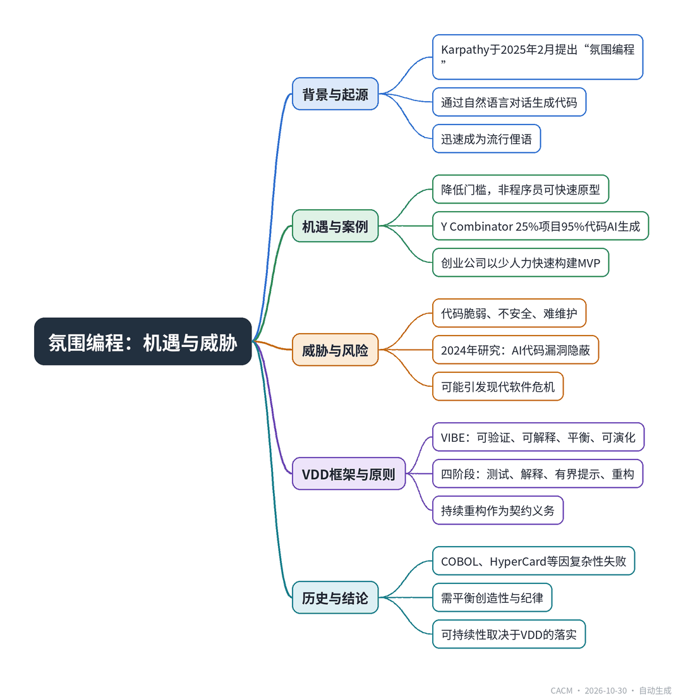

# Can VIBE Drive Development? Threats and Opportunities

## 氛围编程能否驱动开发？

**来源**：Communications of the ACM（）　|　**发布**：2026-10-30 09:40（美东）　|　**北京时间**：2026-10-30 21:40　|　**作者**：

[原文链接](https://cacm.acm.org/opinion/can-vibe-drive-development-threats-and-opportunities/)　·　生成于 2026-11-01 15:47

---

## 一、摘要

> 可持续采用AI生成代码需将纪律与问责嵌入工作流，确保软件韧性、可扩展性与长期可靠性。

2025年初，Andrej Karpathy提出“氛围编程”（vibe coding），即开发者通过自然语言与AI对话生成代码，迅速流行。这种方式降低了编程门槛，让非专业者也能快速构建应用，Y Combinator 2025冬季批次中四分之一项目95%代码由AI生成。然而，其威胁同样明显：AI生成代码常脆弱、不安全、难以维护，2024年研究指出其漏洞隐蔽难察。文章借鉴历史教训（COBOL、HyperCard、无代码平台均因复杂性受阻），提出“氛围驱动开发”（VDD）框架，将VIBE原则——可验证、可解释、平衡、可演化——融入工作流，强调持续重构、测试与文档，避免“氛围”沦为“垃圾软件”。结论认为，氛围编程能否从历史注脚变为基础性变革，取决于我们是否严肃对待VDD的纪律。

## 二、核心要点

1. Andrej Karpathy于2025年2月提出“氛围编程”，开发者通过对话生成代码，Merriam-Webster将其列为俚语。
2. Y Combinator报告2025冬季批次中25%的初创公司代码库95%由AI生成，显示其创业应用潜力。
3. 2024年大规模研究表明AI生成代码常含隐蔽漏洞，非专家难以检测，带来安全风险。
4. 文章提出VIBE原则：可验证、可解释、平衡、可演化，作为氛围驱动开发（VDD）的核心框架。
5. VDD实践包括四阶段：测试验证、解释文档、有界提示、重构扩展，强调持续重构如同契约义务。
6. 历史类比显示，COBOL、HyperCard、无代码平台均因复杂性未达预期，氛围编程需避免重蹈覆辙。

## 三、关键词对照

| English | 中文 |
| --- | --- |
| vibe coding | 氛围编程 |
| vibe-driven development (VDD) | 氛围驱动开发 |
| VIBE | 可验证、可解释、平衡、可演化 |
| SOLID principles | SOLID原则 |
| refactoring | 重构 |
| automation complacency | 自动化自满 |
| no-code | 无代码 |
| Y Combinator | Y Combinator |

## 四、中英对照全文

In February 2025, Andrej Karpathy, the computer scientist who had once steered Tesla’s AI division, introduced a phrase that quickly seeped into both Silicon Valley Slack threads and college dorm rooms: vibe coding. At first it sounded like a joke, another meme-friendly coinage that belonged next to “YOLO” investing and “fail fast.” But within weeks, Merriam-Webster had listed it as slang, and The New York Times was running stories of non-coders building apps by simply chatting with large language models. Suddenly, “going with the vibes” was not about playlists or weekend moods, but about software development itself.

> 2025年2月，曾执掌特斯拉AI部门的计算机科学家Andrej Karpathy提出了一个迅速渗透硅谷Slack讨论和大学宿舍的短语：氛围编程（vibe coding）。起初它听起来像个玩笑，又一个适合与“YOLO”投资和“快速失败”并列的模因式造词。但几周之内，Merriam-Webster就将其列为俚语，《纽约时报》也开始报道非程序员仅通过与大语言模型聊天就能构建应用的故事。突然之间，“跟着感觉走”不再关乎播放列表或周末心情，而是关乎软件开发本身。

To understand vibe coding, you have to picture a developer setting aside the rigid syntax of Java or Python and instead conversing with a chatbot. The machine produces code, the human accepts it, tests it, and asks for refinements. The emphasis shifts from construction to direction, from keystrokes to conversation. Karpathy himself described the process as “forgetting that the code even exists” and instead leaning into a rhythm of prompts and prototypes. The danger and thrill of vibe coding lies in this surrender. Unlike pair programming or even Copilot-assisted typing, vibe coding asks the human to stop micromanaging and to let the AI fill in the scaffolding.

> 要理解氛围编程，你必须想象一位开发者放下Java或Python的 rigid 语法，转而与聊天机器人对话。机器生成代码，人类接受、测试并要求改进。重点从构建转向指导，从击键转向对话。Karpathy本人将这一过程描述为“忘记代码甚至存在”，转而投入提示与原型的节奏。氛围编程的危险与刺激就在于这种放手。与结对编程甚至Copilot辅助输入不同，氛围编程要求人类停止微观管理，让AI填充脚手架。

Vibe coding has already drawn thoughtful attention with Communications readers, with editorial content describing the effect of early experiments on the work of programmers and product managers. But for this exploratory use of vibe coding to become a permanent part of the craft, it needs enough discipline to avoid drifting into slopware. This Opinion column therefore examines both the opportunities that vibe coding opens for wider participation and rapid prototyping, and the threats it poses in the form of fragility, opacity, and undisciplined software practice.

> 氛围编程已经引起了《Communications》读者的深思，编辑内容描述了早期实验对程序员和产品经理工作的影响。但要使这种探索性的氛围编程使用成为工艺的永久组成部分，它需要足够的纪律，以避免滑向粗制滥造的软件。因此，本观点专栏既探讨氛围编程为更广泛参与和快速原型开发带来的机遇，也探讨它以脆弱性、不透明性和无纪律的软件实践形式构成的威胁。

Once we recognize this shift, the path leads toward vibe-driven development (VDD), a framework that seeks to bring order to the chaos, discipline to the improvisation. The story of computer science is full of such inflection points, where wild freedom was later tamed by structure. In the 1960s, spaghetti code dominated early software projects until Edsger Dijkstra’s famous letter, “GoTo Statement Considered Harmful,” inspired programmers to rethink their practices. In the 1990s, object-oriented design became the lodestar. In the 2000s, Agile and SOLID principles emerged as antidotes to bloat and rigidity. Each time, structure saved creativity from collapsing under its own weight. The same must happen with vibe coding.

> 一旦我们认识到这一转变，道路就通向氛围驱动开发（VDD），一个试图为混乱带来秩序、为即兴带来纪律的框架。计算机科学的历史充满了这样的转折点，狂野的自由后来被结构所驯服。20世纪60年代，意大利面条式代码主导了早期软件项目，直到Edsger Dijkstra那封著名的信《GoTo语句被认为有害》启发程序员重新思考他们的实践。20世纪90年代，面向对象设计成为指路明灯。21世纪初，敏捷和SOLID原则作为臃肿和僵化的解药出现。每一次，结构都拯救了创造力，使其免于在自身重量下崩溃。氛围编程也必须如此。

### The Expanded Form of VIBE
*VIBE的扩展形式*

If vibe coding is to evolve into something credible, it cannot remain a slang term tossed around in incubators. It needs a foundation, something that veterans of the craft can respect. One way forward is to treat VIBE as an acronym:

> 如果氛围编程要演变成可信的东西，它就不能停留在孵化器里随口说的俚语。它需要一个基础，一个行业老手能够尊重的东西。前进的一种方式是将VIBE视为一个首字母缩略词：

VIBE = Verifiable, Interpretable, Balanced, Evolvable:

> VIBE = 可验证（Verifiable）、可解释（Interpretable）、平衡（Balanced）、可演化（Evolvable）：

Verifiable: Any AI-generated code must be testable, measurable, and accountable. The early days of vibe coding often ignored this, leading to software that worked in demos but broke in production. Verification anchors vibes to reality. It also calls for a small degree of care around copyright, since the legal status of model-generated code is still unsettled. Simple provenance checks and quick license scans help keep this in view.

> 可验证：任何AI生成的代码都必须是可测试、可度量、可问责的。氛围编程的早期常常忽视这一点，导致软件在演示中能运行，在生产中却崩溃。验证将氛围锚定在现实中。它还要求对版权给予一定程度的关注，因为模型生成代码的法律地位仍未确定。简单的来源检查和快速许可证扫描有助于保持这一视野。

Interpretable: Black-box code is a breeding ground for bugs and vulnerabilities. VIBE insists that even if the AI writes the code, the human must be able to interpret its logic. This draws from the SOLID principle of Single Responsibility, clarity instead of cleverness.

> 可解释：黑盒代码是缺陷和漏洞的温床。VIBE坚持认为，即使AI编写代码，人类也必须能够解释其逻辑。这借鉴了SOLID原则中的单一职责原则：清晰而非聪明。

Balanced: Vibe-driven work should balance speed with maintainability, novelty with stability. This is the antidote to the excesses of “just ship it” culture. Balance recalls the clean code philosophy that prioritizes readability instead of wizardry.

> 平衡：氛围驱动的工作应在速度与可维护性、新颖性与稳定性之间取得平衡。这是对“只管发布”文化过度行为的解药。平衡让人想起优先考虑可读性而非奇技淫巧的整洁代码哲学。

Evolvable: Refactoring must not be an afterthought but part of the workflow. Codebases written under the influence of vibes must be designed to evolve, not ossify. Here we borrow directly from the SOLID principle of Open/Closed: software should be open to extension but closed to reckless modification. Some models tend to recreate framework code rather than use the intended abstractions, which erodes reusability. Regular refactoring and a preference for clean, modular APIs help the system grow without losing shape.

> 可演化：重构不能是事后想法，而必须是工作流程的一部分。在氛围影响下编写的代码库必须设计为可演化，而非僵化。这里我们直接借鉴SOLID原则中的开闭原则：软件应对扩展开放，对鲁莽修改关闭。一些模型倾向于重新创建框架代码，而不是使用预期的抽象，这侵蚀了可重用性。定期重构和对干净、模块化API的偏好有助于系统在不失形态的情况下成长。

In short, vibe coding may be born from spontaneity, but VIBE-driven development asks it to mature into a philosophy of responsibility.

> 简而言之，氛围编程可能诞生于自发性，但VIBE驱动开发要求它成熟为一种责任哲学。

### The Historical Echo
*历史的回响*

The excitement around vibe coding is not new in spirit. History is littered with movements that promised to democratize programming. In the 1960s, COBOL was pitched as a language “any manager could read.” In the 1980s, Apple’s HyperCard allowed non-programmers to build interactive applications with drag-and-drop stacks. In the 2010s, the “no-code” movement reemerged with platforms like Bubble and Webflow.

> 围绕氛围编程的兴奋在精神上并不新鲜。历史上充斥着承诺使编程民主化的运动。20世纪60年代，COBOL被宣传为一种“任何管理者都能读懂”的语言。20世纪80年代，苹果的HyperCard允许非程序员通过拖放堆栈构建交互式应用。2010年代，“无代码”运动随着Bubble和Webflow等平台重新出现。

Each of these moments carried the same utopian hope: that one day, to tell a computer what to do, you would only need to speak in plain language. Karpathy’s quip that “the hottest new programming language is English” echoes a dream that stretches back to Alan Turing’s own musings on natural language as a programming interface.

> 每一个时刻都承载着同样的乌托邦希望：有一天，要告诉计算机做什么，你只需要用平实的语言说话。Karpathy的俏皮话“最热门的新编程语言是英语”呼应了一个可以追溯到Alan Turing本人对自然语言作为编程接口的思考的梦想。

But each wave also hit the same wall: complexity. COBOL programs grew unwieldy. HyperCard stagnated because serious developers dismissed it. No-code platforms empowered hobbyists but rarely powered billion-dollar infrastructures. The threat today is that vibe coding, if left unchecked, may meet the same fate: lots of novelty, little durability.

> 但每一波浪潮也都撞上了同一堵墙：复杂性。COBOL程序变得笨重。HyperCard因严肃开发者不屑一顾而停滞。无代码平台赋予了爱好者能力，但很少支撑起十亿美元级的基础设施。今天的威胁在于，氛围编程如果放任不管，可能遭遇同样的命运：大量新奇，极少持久。

### Opportunities in the Vibe Era
*氛围时代的机遇*

And yet, the opportunities are undeniable. Kevin Roose, a New York Times journalist with no professional coding background, built small applications using vibe coding: an app that analyzed his fridge and suggested packed lunches, a tool that generated shopping lists. Amateurish? Perhaps. But they embodied a profound shift: the barrier to entry had collapsed. What once required years of study could now be prototyped over a weekend.

> 然而，机遇不可否认。《纽约时报》记者Kevin Roose没有专业编程背景，却使用氛围编程构建了小型应用：一个分析他的冰箱并建议打包午餐的应用，一个生成购物清单的工具。业余？也许。但它们体现了一个深刻的转变：进入门槛已经崩塌。曾经需要多年学习的东西，现在可以在一个周末内原型化。

Startups have already taken note. Y Combinator reported that a quarter of its Winter 2025 batch ran codebases that were 95% AI-generated. For cash-strapped founders, vibe coding is not just fun, it is survival. Why hire a team of ten when two people and a chatbot can build a minimum viable product? The vibes are, quite literally, venture capital’s new fuel.

> 初创公司已经注意到了。Y Combinator报告称，其2025年冬季批次中四分之一运行的代码库95%由AI生成。对于资金紧张的创始人来说，氛围编程不仅仅是乐趣，而是生存。当两个人加一个聊天机器人就能构建最小可行产品时，为什么要雇十个人的团队？氛围，毫不夸张地说，是风险资本的新燃料。

This democratization mirrors another historical moment: the rise of open source in the 1990s. Back then, Linux allowed anyone, anywhere, to contribute to the world’s most ambitious operating system. Today, vibe coding allows anyone, anywhere, to create functional software without credentials. The creative floodgates are wide open.

> 这种民主化映照了另一个历史时刻：20世纪90年代开源的兴起。那时，Linux允许任何人在任何地方为世界上最雄心勃勃的操作系统做出贡献。今天，氛围编程允许任何人在任何地方无需资质就能创建功能性软件。创造力的闸门大开。

### The Threats Beneath the Surface
*表面之下的威胁*

But open floodgates also drown fields. Critics warn that vibe coding produces fragile, insecure, and inscrutable code. Simon Willison, a seasoned open source programmer, bluntly stated: “Vibe coding your way to a production codebase is clearly risky.” The problem is not just that AI may hallucinate functions or fabricate fake reviews (as Roose discovered), but that the resulting code is often unmaintainable.

> 但敞开的闸门也会淹没田野。批评者警告说，氛围编程会产生脆弱、不安全且难以理解的代码。经验丰富的开源程序员Simon Willison直言：“用氛围编程的方式走向生产代码库显然是有风险的。”问题不仅在于AI可能幻觉出函数或捏造虚假评论（正如Roose所发现的），还在于生成的代码往往无法维护。

The dangers resemble the early days of assembly-line software in the 1970s, when productivity soared but quality plummeted. Back then, “software crisis” became the watchword, as bugs, overruns, and crashes plagued the industry. If vibe coding follows the same trajectory, proliferation without discipline, it risks triggering a modern version of that crisis, this time at AI speed.

> 这些危险类似于20世纪70年代流水线软件的早期，当时生产力飙升但质量骤降。那时，“软件危机”成为口号，缺陷、超支和崩溃困扰着行业。如果氛围编程遵循同样的轨迹，无纪律地扩散，它有可能引发那场危机的现代版本，这次是以AI的速度。

Security adds another layer of concern. A 2024 large-scale study indicated AI-generated code often contained vulnerabilities that were subtle, non-obvious, and difficult for non-experts to detect. In an era where software runs hospitals, banks, and cars, trusting vibes over verification borders on negligence.

> 安全性增加了另一层担忧。2024年的一项大规模研究表明，AI生成的代码通常包含微妙、不明显且非专家难以检测的漏洞。在软件运行医院、银行和汽车的时代，信任氛围而非验证近乎疏忽。

### Refactoring as a Ritual
*重构作为仪式*

One way to avert disaster is to elevate refactoring into the very DNA of VDD. In traditional practice, refactoring is the quiet craft of cleaning up messy code without changing its behavior. British software developer Martin Fowler once likened it to gardening, where you prune branches, rearrange stems, and guide the growth so it stays healthy.

> 避免灾难的一种方法是将重构提升为VDD的DNA。在传统实践中，重构是清理混乱代码而不改变其行为的安静工艺。英国软件开发者Martin Fowler曾将其比作园艺，你修剪枝条、重新排列茎干、引导生长以保持健康。

In vibe coding, this becomes even more urgent. Since the AI writes with little concern for style, humans must step in not just to refactor once, but continuously. Think of it as pair programming where one partner is a machine that never learned etiquette. Every commit must be an opportunity to enforce clarity, modularity, and SOLID discipline.

> 在氛围编程中，这变得更加紧迫。由于AI编写时很少考虑风格，人类必须介入，不仅要重构一次，还要持续重构。可以将其视为结对编程，其中一个伙伴是从未学过礼仪的机器。每次提交都必须是强制执行清晰性、模块化和SOLID纪律的机会。

If vibe coding is jazz, refactoring is the sheet music that ensures future musicians can still play the tune. Without it, today’s improvisation becomes tomorrow’s chaos.

> 如果氛围编程是爵士乐，重构就是确保未来音乐家仍能演奏曲调的乐谱。没有它，今天的即兴就会变成明天的混乱。

### VDD: A Framework for Explainable Vibes
*VDD：可解释氛围的框架*

So, what does VDD look like in practice? It begins with four stages, aligned with VIBE:

> 那么，VDD在实践中是什么样子？它始于四个阶段，与VIBE一致：

Testing and Verification (Verifiable): Unit tests, integration tests, and automated checks must accompany every generation cycle. Code without tests is vibes without proof.

> 测试与验证（可验证）：每个生成周期都必须伴随单元测试、集成测试和自动化检查。没有测试的代码是没有证据的氛围。

Interpretation and Documentation (Interpretable): Before accepting code, developers must ensure they can explain its logic, at least at a high level. This transforms black boxes into glass boxes.

> 解释与文档（可解释）：在接受代码之前，开发者必须确保他们能够解释其逻辑，至少在高层次上。这将黑盒转变为玻璃盒。

Prompting with Purpose (Bounded): Developers must frame requests with care, keeping the prompt bounded by giving enough detail to guide the model while preserving flexibility. A sloppy prompt produces sloppy code.

> 有目的的提示（有界）：开发者必须谨慎地构建请求，通过提供足够细节来指导模型同时保持灵活性，使提示有界。草率的提示产生草率的代码。

Refactoring and Extension (Evolvable): Each iteration should include explicit refactoring, not as a luxury but as a contractual obligation. Only then can the system evolve without rot.

> 重构与扩展（可演化）：每次迭代都应包括明确的重构，不是奢侈品而是合同义务。只有这样，系统才能演化而不腐烂。

This mirrors the clean code ethos: functions that do one thing, classes that bear clear names, systems that are legible. The irony of vibe coding is that it tempts us to throw these principles away. Vibe-driven development insists we bring them back, even more rigorously.

> 这映照了整洁代码的精神：做一件事的函数、具有清晰名称的类、可读的系统。氛围编程的讽刺之处在于，它诱使我们抛弃这些原则。氛围驱动开发坚持我们将其带回，甚至更加严格。

### The Human Factor
*人的因素*

One overlooked dimension of vibe coding is psychological. Many developers describe the experience as liberating, less typing, more ideation. It recalls Alan Kay’s 1977 dream of computers as “metamedia,” amplifiers for human thought. Yet liberation can slip into complacency. When an AI writes every line, developers may lose the intimate knowledge of systems that once made debugging second nature.

> 氛围编程一个被忽视的维度是心理上的。许多开发者将这种体验描述为解放，更少打字，更多构思。这让人想起Alan Kay 1977年的梦想：计算机作为“元媒体”，人类思维的放大器。然而解放可能滑向自满。当AI编写每一行时，开发者可能失去对系统的亲密知识，而这些知识曾使调试成为第二天性。

This is not unlike the pilots of the 1980s who, flying increasingly automated planes, grew dependent on autopilot systems. The result was “automation complacency,” a contributing factor in several accidents. Software engineering faces a similar risk: if vibe coding reduces coders to prompt jockeys, will they still know what to do when the vibes go wrong?

> 这与20世纪80年代的飞行员不无相似，他们驾驶越来越自动化的飞机，变得依赖自动驾驶系统。结果是“自动化自满”，这是几起事故的促成因素。软件工程面临类似风险：如果氛围编程将程序员降为提示骑师，当氛围出错时，他们还会知道该怎么做吗？

### Closing the Loop
*闭环*

Every revolution in computing forces us to renegotiate the boundary between human and machine. In the 1940s, programmers wired plugboards. In the 1960s, they punched cards. In the 1980s, they typed into glowing CRTs. In 2025, they talk to chatbots. The interface keeps shifting, but the underlying tension remains the same: creativity versus control, freedom versus responsibility.

> 计算领域的每一次革命都迫使我们重新协商人与机器之间的边界。20世纪40年代，程序员连接插线板。20世纪60年代，他们打孔卡片。20世纪80年代，他们在发光的CRT上打字。2025年，他们与聊天机器人交谈。界面不断变化，但底层的张力依然相同：创造力与控制，自由与责任。

Vibe-driven development offers one possible synthesis. It allows us to embrace the spontaneity of vibes while embedding the rigor of verification, interpretation, balance, and evolvability. It does not reject AI creativity but channels it, much as SOLID principles once channeled the chaos of object oriented sprawl.

> 氛围驱动开发提供了一种可能的综合方案。它让我们既能拥抱氛围的自发性，又能嵌入验证、解释、平衡和可演化性的严谨性。它并不排斥 AI 的创造力，而是对其加以引导，正如 SOLID 原则曾经引导了面向对象代码无序蔓延的混乱。

The opportunity is vast: more people building more ideas faster than ever before. The threat is equally clear: brittle codebases, opaque systems, and an abdication of accountability. Whether vibe coding becomes a historical footnote like HyperCard or a foundational shift like open source depends on how seriously we take the discipline of VDD.

> 机遇是巨大的：更多人能够比以往更快地构建更多想法。威胁同样清晰：脆弱的代码库、不透明的系统，以及责任的放弃。氛围编程究竟会像 HyperCard 一样成为历史脚注，还是像开源一样成为根本性转变，取决于我们对 VDD 这一 discipline 的重视程度。

The vibes are strong. The question is whether we can make them sustainable.

> 氛围很强烈。问题在于我们能否让它们可持续。

---
*英文原文版权归 Communications of the ACM 及作者所有；中文译文由 AI 辅助生成，仅供学习参考。*