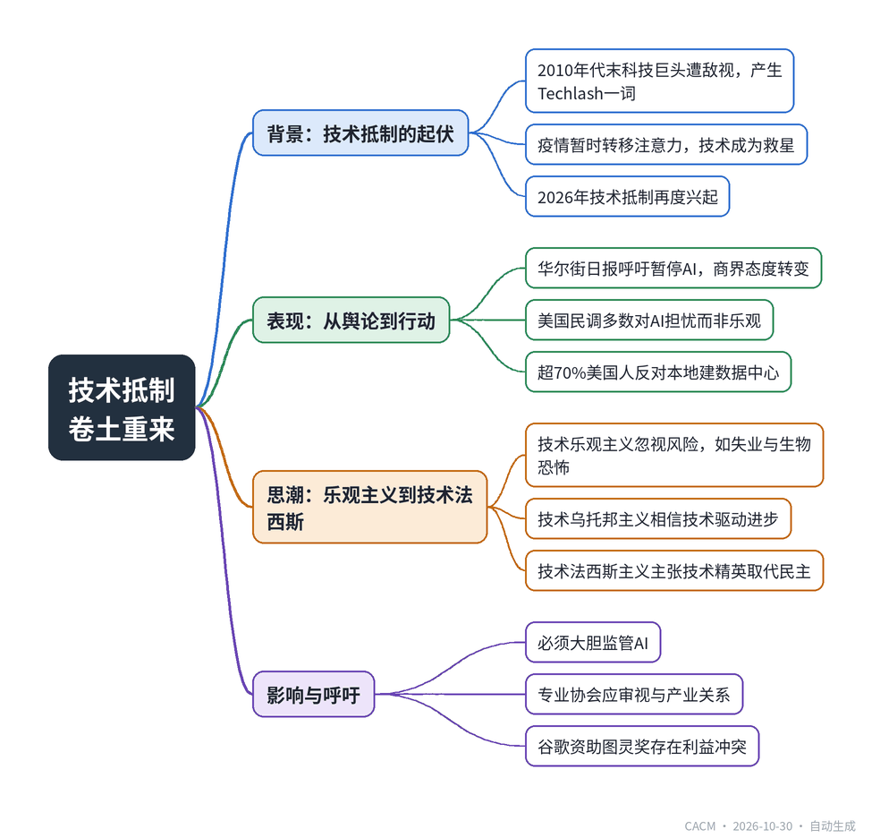

# The Techlash Is Back

## 技术抵制卷土重来

**来源**：Communications of the ACM（）　|　**发布**：2026-10-30 11:19（美东）　|　**北京时间**：2026-10-30 23:19　|　**作者**：

[原文链接](https://cacm.acm.org/opinion/the-techlash-is-back/)　·　生成于 2026-11-01 15:47

---

## 一、摘要

> 对AI的敌意再度兴起，监管呼声高涨。

2010年代末，随着科技巨头影响力扩张，公众敌意催生了“技术抵制”（Techlash）一词。新冠疫情暂时转移了注意力，技术成为社交隔离时期的救星。然而，2026年技术抵制卷土重来：华尔街日报专栏作家呼吁暂停AI，美国民调显示多数人对AI的社会影响感到担忧而非乐观，超过70%的美国人反对在本地建设数据中心，认为其加剧水电资源紧张并带来噪音污染。科技乐观主义催生了“技术乌托邦主义”，甚至滑向“技术法西斯主义”——部分硅谷精英认为民主阻碍创新，主张由技术精英治理。文章认为，必须大胆监管AI，并呼吁专业协会重新审视与科技产业的关系，例如谷歌资助ACM图灵奖存在利益冲突。

## 二、核心要点

1. 《华尔街日报》专栏作家佩吉·努南2026年9月呼吁“为人类暂停AI”，反映商界对AI态度的转变。
2. 2026年AI指数报告显示，美国公众对AI的情绪转为负面，多数人担忧其社会影响。
3. 2026年美国中期选举中，数据中心 backlash 成为重要议题，超70%美国人反对本地建设数据中心。
4. 科技乐观主义演变为“技术乌托邦主义”，并催生“技术法西斯主义”思潮，主张技术精英取代民主治理。
5. 文章呼吁大胆监管AI，并批评专业协会与产业界关系过密，如谷歌全额资助ACM图灵奖100万美元奖金。

## 三、关键词对照

| English | 中文 |
| --- | --- |
| Techlash | 技术抵制 |
| techno-optimism | 技术乐观主义 |
| techno-utopianism | 技术乌托邦主义 |
| Technofascism | 技术法西斯主义 |
| datacenter | 数据中心 |
| AI Index | AI指数 |
| Computing Research Association | 计算研究协会 |
| ACM A.M. Turing Award | ACM图灵奖 |

## 四、中英对照全文

Peggy Noonan is a weekly columnist for The Wall Street Journal. I often disagree with her opinions, but I find her to be one of the most astute observers of the American social-economical-political zeitgeist. When she described in 2018 Silicon Valley executives as “moral Martians who operate on some weird new postmodern ethical wavelength,” I realized that the popular view of Silicon Valley as a fountain of technical innovation and cool gadgets had changed. Indeed, in my January 2019 column, I also quoted Niall Ferguson, a Hoover Institution historian, who described cyberspace as “cyberia, a dark and lawless realm where malevolent actors range.” The Economist magazine coined the term Techlash to describe what was then a new phenomenon of growing hostility toward the tech giants. The COVID pandemic distracted us from the techlash of the late 2010s. In fact, technology was our salvation during those dark days of social distancing. But now, the techlash is back!

> Peggy Noonan 是《华尔街日报》的每周专栏作家。我常常不同意她的观点，但我认为她是对美国社会—经济—政治时代精神最敏锐的观察者之一。当她在 2018 年将硅谷高管描述为“道德上的火星人，按照某种怪异的新后现代伦理波长行事”时，我意识到，硅谷作为技术创新和酷炫小装置之源泉的大众形象已经改变。事实上，在我 2019 年 1 月的专栏中，我也引用了胡佛研究所历史学家 Niall Ferguson 的话，他将网络空间描述为“网络利亚，一个黑暗且无法无天的领域，恶意行为者在此游荡”。《经济学人》杂志创造了 Techlash 一词，用来描述当时正在兴起的一种新现象，即对科技巨头日益增长的敌意。新冠疫情让我们从 2010 年代末的科技抵制潮中分心。事实上，在保持社交距离的那些黑暗日子里，技术是我们的救星。但现在，科技抵制潮又回来了！

In her Sept. 10, 2026 column “Pause AI for Humanity’s Sake,” Noonan argued, “When something speeds up and gets out of control, it isn’t alarmist to demand prudence and deliberation.” This is not the first call to slow down AI development. “Pause Giant AI Experiments: An Open Letter” was a letter published by the Future of Life Institute in March 2023. But The Wall Street Journal is, in essence, the flagship publication of the U.S. business community; the publication objects practically always to government regulation. A day earlier, Paul Tudor Jones, another columnist at The Wall Street Journal, warned that “AI May Become the Third Superpower”, and called for U.S. president Donald Trump and China president Xi Jingping to “develop a shared strategy to confront it.” As reported in the 2026 AI Index, U.S. sentiment has turned negative on AI, with the majority concerned rather than optimistic about AI’s societal impact.

> 在 2026 年 9 月 10 日的专栏《为了人类，暂停 AI》中，Noonan 主张：“当某事物加速并失控时，要求审慎和深思熟虑并非危言耸听。”这并非首次呼吁放缓 AI 发展。2023 年 3 月，Future of Life Institute 发表了公开信《暂停巨型 AI 实验》。但《华尔街日报》本质上是美国商界的旗舰刊物；该刊物几乎总是反对政府监管。一天前，《华尔街日报》另一位专栏作家 Paul Tudor Jones 警告称“AI 可能成为第三大超级大国”，并呼吁美国总统 Donald Trump 和中国国家主席习近平“制定共同战略来应对它”。正如 2026 年 AI Index 所报道的，美国公众对 AI 的情绪已转为负面，多数人对 AI 的社会影响感到担忧而非乐观。

The negative view of AI has taken a concrete form in the backlash against datacenters, which emerged as a major factor in the November 2026 mid-term U.S. elections. A recent poll found that more than 70% of Americans oppose the constructions of datacenters in their areas because of “the strain on water and electricity resources but also the disruption to communities with noise and pollution.” The darkening view of AI technology and its impact is also translating into a darkening view of Big Tech. “Even the tech gods who once had good intentions have gone to the dark side, seduced by the billions to be made on [AI],” wrote The New York Times columnist Maureen Dowd last February.

> 对 AI 的负面看法已在对数据中心的反击中具体化，这成为 2026 年 11 月美国中期选举的一个主要因素。最近一项民调发现，超过 70% 的美国人反对在其所在地区建设数据中心，原因是“对水和电力资源的压力，以及噪音和污染对社区的干扰”。对 AI 技术及其影响日益黯淡的看法，也正转化为对大型科技公司日益黯淡的看法。《纽约时报》专栏作家 Maureen Dowd 去年二月写道：“就连曾经怀有善意的科技之神们也走向了黑暗面，被 [AI] 所能带来的数十亿美元所诱惑。”

Last year, I argued that the pie-in-the-sky techno-optimism of some in the tech industry is bound to lead to adverse consequences. Bill Gates seems to agree with me; he recently warned that his industry was downplaying the risks, which he believes include mass unemployment and bioterrorism. Techno-optimism naturally leads to “techno-utopianism,” which is the belief that new and speculative technologies are the primary drivers for human progress, societal transformation, and the extension of life

> 去年，我曾主张，科技行业中某些人那种空中楼阁式的技术乐观主义必然导致不良后果。Bill Gates 似乎同意我的看法；他最近警告说，他所在的行业正在淡化风险，他认为这些风险包括大规模失业和生物恐怖主义。技术乐观主义自然导致“技术乌托邦主义”，即相信新的和投机性技术是人类进步、社会变革和延长寿命的主要驱动力。

But in some segments of the tech industry, techno-utopianism has led to what is being called “Technofascism.” If technology is an unalloyed good, then objections to it are simply bad and must be eliminated. Some techno-optimists are now advocating an authoritarian political model where unelected technology elites and corporate actors fuse private infrastructure with state power, using digital tools such as AI and ubiquitous surveillance to bypass and undermine democratic oversight. In a recent book, The Nerd Reich, journalist Gil Durán argues that a small circle of Silicon Valley billionaires and venture capitalists have concluded that democracy is in their way—and that they should be governing in its place. Undoubtedly, the technofascist view represents a very narrow segment in the Tech industry, but it is a very loud segment, and the rest of the industry does not object loudly.

> 但在科技行业的某些细分领域，技术乌托邦主义已导致所谓的“技术法西斯主义”。如果技术是纯粹的好东西，那么对它的反对就是坏的，必须被消除。一些技术乐观主义者现在倡导一种威权政治模式，即未经选举的技术精英和企业行为者将私人基础设施与国家权力融合，利用 AI 和无处不在的监控等数字工具来绕过和破坏民主监督。在最近出版的《书呆子帝国》（The Nerd Reich）一书中，记者 Gil Durán 主张，一小圈硅谷亿万富翁和风险投资家已经得出结论：民主挡了他们的路——他们应该取而代之进行统治。毫无疑问，技术法西斯主义观点只代表科技行业中非常狭窄的一部分，但它是非常喧闹的一部分，而行业其余部分并没有大声反对。

Clearly, the time has come to boldly regulate AI. Beyond that, however, our professional associations still conduct their business as if academia and industry are two sides of the same coin. The Computing Research Association calls for increasing interaction between industry and academia. Google provides financial support for the ACM A.M. Turing Award, fully funding the prestigious $1 million cash prize, in an apparent conflict of interest. If our professional associations are truly committed to the public good, then they must re-examine their relationship with the tech industry.

> 显然，大胆监管 AI 的时候已经到了。然而，除此之外，我们的专业协会仍然像学术界和产业界是同一枚硬币的两面那样行事。Computing Research Association 呼吁增加产业界与学术界之间的互动。Google 为 ACM A.M. Turing Award 提供资金支持，全额资助这项享有盛誉的 100 万美元现金奖，这显然存在利益冲突。如果我们的专业协会真正致力于公共利益，那么它们必须重新审视与科技行业的关系。

---
*英文原文版权归 Communications of the ACM 及作者所有；中文译文由 AI 辅助生成，仅供学习参考。*