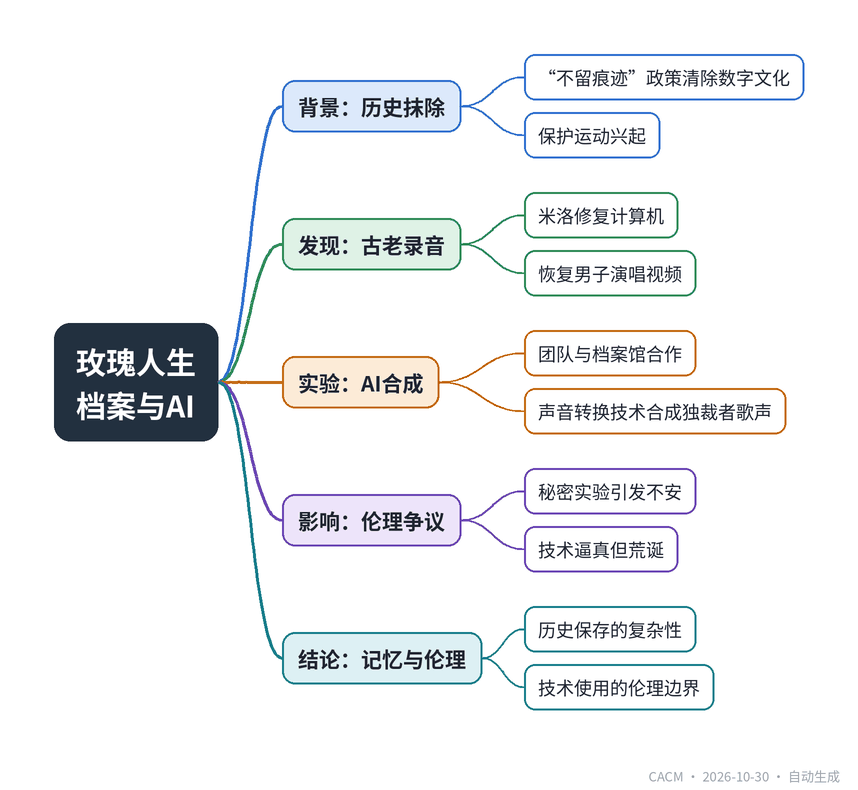

# Une Vie En Rose

## 玫瑰人生：一段被抹去的历史

**来源**：Communications of the ACM（）　|　**发布**：2026-10-30 09:34（美东）　|　**北京时间**：2026-10-30 21:34　|　**作者**：

[原文链接](https://cacm.acm.org/future-tense/une-vie-en-rose/)　·　生成于 2026-11-01 15:47

---

## 一、摘要

> 档案管理员发现罕见录音，不知为何被保存。

在“不留痕迹”政策下，人类数千年的数字文化被系统性清除。随着记忆淡化，保护运动兴起，档案管理员米洛被雇来修复一台古老计算机。他成功恢复了一个视频文件，其中一名男子在指挥并演唱一首优雅的歌曲。场景切换到现代，一个三人团队与国家安全档案馆合作，利用AI模型进行声音转换，将一位独裁者的声音合成到这首歌曲上。他们秘密生成了一段视频，看到独裁者唱出《玫瑰人生》，感到荒诞又不安。故事探讨了历史保存、技术伦理与记忆的复杂关系。

## 二、核心要点

1. “不留痕迹”政策导致人类数千年的数字文化被清除，保护运动随后兴起。
2. 档案管理员米洛修复古老计算机，恢复了一个男子演唱歌曲的视频文件。
3. 现代团队与国家安全档案馆合作，训练AI模型以重建历史演讲。
4. 团队秘密使用声音转换技术，将独裁者的声音合成到歌曲《玫瑰人生》上。
5. 生成的视频让团队感到荒诞和伦理不安，但模型输出非常逼真。

## 三、关键词对照

| English | 中文 |
| --- | --- |
| archival specialist | 档案管理员 |
| National Archive Institute | 国家档案馆 |
| timbral transfer | 音色转换 |
| source-separation algorithm | 源分离算法 |
| La Vie en Rose | 玫瑰人生 |

## 四、中英对照全文

The position was evasively titled “archival specialist,” and the job requirements listed off dead technologies and languages alike. On their first day, Milo stood in front of a rusty, dented, black storage cabinet.

> 这个职位的名称含糊其辞，叫“档案专家”，职位要求里列出的都是些过时的技术和语言。第一天，米洛站在一个生锈、凹陷的黑色储物柜前。

“That’s the beast,” said the manager as he made his way out of the office. Once he left, there was nothing else but Milo, their desk, silence, and the cabinet.

> “就是这玩意儿，”经理一边说一边走出办公室。他走后，只剩下米洛、他们的桌子、寂静和那个柜子。

It towered over them. Inside, a column of decrepit computers stacked on uneven racks. It must have been centuries since these had been turned on. Despite having spent years assiduously studying ancient technologies, Milo barely recognized the hardware, which made the challenge of data retrieval even more interesting to them.

> 柜子高耸在他们面前。里面，一列破旧的电脑堆放在不平整的架子上。这些电脑肯定有几个世纪没开过机了。尽管米洛多年来刻苦研究古代技术，但他们几乎认不出这些硬件，这使得数据检索的挑战对他们来说更加有趣。

The newly appointed archival specialist spent their first week examining the material. It was tempting to simply press the power button and hope for the best, but half-melted plastic shells and scratched-out aluminium parts did not indicate safety. There was precious data inside each of the disks still lodged within these rough-edged machines—being brisk carried a risk Milo could not take, even though they could barely contain their enthusiasm handling these rare relics, fingers buzzing at every key press.

> 这位新上任的档案专家第一周都在检查这些材料。直接按下电源按钮然后听天由命很诱人，但半熔化的塑料外壳和刮花的铝制部件并不表明安全。这些粗糙边缘的机器里仍然卡着的每个磁盘中都存有宝贵的数据——操之过急会带来米洛无法承担的风险，尽管他们几乎无法抑制处理这些稀有遗物时的热情，每次按键手指都兴奋不已。

The “nothing left behind” policy had been in place for so long that no one remembered exactly when it began. It had led to the erasure of millennia of human existence and culture to remedy the unmanageable amount of stuff consistently created by a species that could not stop itself from making.

> “不留痕迹”政策实施已久，没人记得具体何时开始。它导致了数千年人类存在和文化的抹除，以解决一个无法停止制造的物种不断产生的难以管理的物品数量。

But now, as the memory of this digital overload faded, efforts for conservation started bubbling up. Activists fought to frame preservation as resistance, and in some places, they succeeded. When machine artifacts were pieced together, dug up, or simply found, they were no longer immediately destroyed. Milo trained to sort through the useful and the useless, to spot value in the discarded, to understand the essential and the superfluous.

> 但现在，随着这种数字过载的记忆逐渐消退，保护的努力开始涌现。活动人士力争将保存视为抵抗，在一些地方，他们成功了。当机器遗物被拼凑起来、挖掘出来或 simply 被发现时，它们不再立即被销毁。米洛接受了训练，学会区分有用和无用，发现丢弃物中的价值，理解必要和多余。

So, Milo cleaned these computers with careful fingers, clearing dust and debris, re-attaching disconnected pins and boards, until finally, one machine was ready to be turned on.

> 于是，米洛用小心翼翼的手指清洁这些电脑，清除灰尘和碎屑，重新连接断开的引脚和板卡，直到终于有一台机器准备好开机。

For a few agonizing seconds, nothing happened.

> 几秒钟令人煎熬，什么也没发生。

An unhappy mechanical rumble growled, followed by a low purring hum. A small LED pin turned green before flickering back to darkness.

> 一阵不悦的机械隆隆声响起，接着是低沉的嗡嗡声。一个小LED引脚变绿，然后闪烁回黑暗。

Once this first stride was made, it was not long before the archival specialist could access what was left of the hard drives. Most files were encrypted or incomplete. Some held phantoms of databases of which the meaning had long been forgotten, and some used languages no one had spoken in eons. Diligently, Milo made their way through the digital rubble.

> 一旦迈出这第一步，档案专家很快就能够访问硬盘上剩余的内容。大多数文件被加密或不完整。有些包含早已被遗忘含义的数据库幻影，有些使用了几纪元无人使用的语言。米洛勤勉地穿过数字废墟。

The largest file was tucked under a long path name. It was a video file, ready to be consumed by modern eyes in all its inefficient storage requirements.

> 最大的文件藏在一个很长的路径名下面。这是一个视频文件，以其低效的存储需求准备被现代眼睛消费。

The image was black and white. Cracks faded in and out from the corners. There was a man behind a microphone. He looked solemn, like he was preparing to give the performance of a lifetime. He raised his hand, commanding the orchestra to begin. The audio was clearly altered, having been converted, compressed, or damaged in some other way. The sound was distorted and echoed as if it was recorded in a large hall.

> 图像是黑白的。裂缝从角落时隐时现。有一个男人在麦克风后面。他看起来很严肃，像准备进行一生一次的表演。他举起手，指挥管弦乐队开始。音频明显被改动过，被转换、压缩或以其他方式损坏。声音失真并回响，仿佛是在一个大礼堂里录制的。

The man behind the microphone began to sing. The melody was regal, but delicate, almost like a prayer. The singer hit each consonant with brio, like his mouth was a percussion instrument. Milo was fascinated; it was like he didn’t even need to breathe, but still pronounced each syllable perfectly. He must have been an acclaimed performer. The music died down after one song, cutting to black abruptly. The room was silent again, aside from the buzz of the computer.

> 麦克风后面的男人开始唱歌。旋律庄严而细腻，几乎像祈祷。歌手每个辅音都唱得生动有力，仿佛他的嘴是打击乐器。米洛着迷了；他好像甚至不需要呼吸，却仍完美地发出每个音节。他一定是一位广受赞誉的表演者。一首歌后音乐平息，突然切到黑屏。房间里再次安静下来，除了电脑的嗡嗡声。

* * *

> * * *

“I’m not sure it’s right,” I say with a wince.

> “我不确定这是对的，”我皱着眉头说。

The three of us sit around my desk, elbow to elbow on our swivel chairs. Jean brushes my concerns off with a hand gesture. “No one will see it or even know it exists.”

> 我们三个围坐在我的桌子旁，在旋转椅上肘碰肘。让用手势打消了我的担忧。“没人会看到它，甚至不知道它存在。”

“Although…” Guy interrupts, “maybe they should? Can we add a link in the Readme on the repository?”

> “虽然……”盖伊插话，“也许他们应该？我们能在仓库的Readme里加个链接吗？”

His eyes are shining with an excitement I find altogether disturbing. I shut him down: “That’s definitely against our agreement with the National Archive Institute, and honestly, borderline unethical.”

> 他眼中闪烁着一种让我完全不安的兴奋。我打断他：“那绝对违反我们与国家档案馆的协议，而且老实说，近乎不道德。”

We had been granted access to the training data we needed via a partnership with the NAI. This agreement benefited both parties: We got to train a cutting-edge model, and they got to use its outputs in an exhibition with our common goal being to recreate historical speeches of which recordings had been lost or damaged.

> 我们通过与NAI的合作获得了所需训练数据的访问权限。这项协议对双方都有利：我们得以训练一个尖端模型，他们则能在展览中使用其输出，我们的共同目标是重现录音已丢失或损坏的历史演讲。

“What’s the harm?” asks Jean. “I’m the only one here who could be offended, and I want to hear that. The model is already trained, and we have all the inputs we need. It’s one line of code for five minutes of trailblazing weirdness.”

> “有什么害处？”让问。“我是这里唯一可能被冒犯的人，而我想听。模型已经训练好了，我们需要的所有输入都有了。只需一行代码，就能带来五分钟的开创性怪事。”

I’m still not convinced. Guy pokes my arm. “You don’t even have to see it if it makes you uncomfortable. And we can delete it immediately!”

> 我仍然不信服。盖伊戳了戳我的手臂。“如果让你不舒服，你甚至不必看。而且我们可以立即删除它！”

I don’t have any arguments to counter that. If we are the only ones to see whatever the output will be, it’s almost like it hasn’t happened, right?

> 我没有任何论据反驳。如果只有我们会看到输出结果，那几乎就像它没发生过，对吧？

So, I run the command. It will take less than an hour to generate the full file with the matching video. Our model uses timbral transfer to match a person’s voice onto another. Traditionally, we would use actors to read archive speeches before applying the real speakers’ vocal identity to them, but here, we transfer the speaker’s voice onto a melody. We got the bare vocal line by running a simple source-separation algorithm on a recording off of YouTube. And just like that, the console log on my terminal window grows over our lunch break, as our secret experiment is carried out quietly.

> 于是，我运行了命令。生成带有匹配视频的完整文件不到一小时。我们的模型使用音色迁移将一个人的声音匹配到另一个人身上。传统上，我们会用演员朗读档案演讲，然后应用真实演讲者的声音身份，但在这里，我们将演讲者的声音迁移到一段旋律上。我们通过对YouTube上的一段录音运行简单的源分离算法，得到了纯人声线。就这样，在我终端窗口的控制台日志在我们午餐休息时增长，我们的秘密实验悄然进行。

When the processing stops, a single video file appears in an output folder. Jean and Guy wheel their chairs next to me again, eyes locked on my 15-inch laptop screen.

> 处理停止后，一个视频文件出现在输出文件夹中。让和盖伊又把椅子挪到我旁边，眼睛紧盯着我15英寸的笔记本电脑屏幕。

”We’re only watching it once,” I declare under the misguided assumption they would listen to me, “and then in the bin it goes!”

> “我们只看一次，”我错误地以为他们会听我的，宣布道，“然后扔进垃圾桶！”

I hear Guy whisper something like “buzzkill,” but he is quickly distracted by the footage starting to play on my computer. We sit there, wide-eyed. The speaker raises a hand, and I cringe. Then, he starts singing, and Jean chuckles. Did I run a model just to make a man laugh?

> 我听到盖伊低声说了句“扫兴”，但他很快被开始在我电脑上播放的镜头分散了注意力。我们坐在那里，瞪大眼睛。演讲者举起一只手，我畏缩了。然后，他开始唱歌，让轻笑。我运行模型只是为了逗一个人笑吗？

The video feels absurd, like a portal into an alternate reality, or the curtains being raised on a play of poor taste. Like an anachronistic painting hanging in Versailles, or the drunken dream of someone who has just watched The Sound of Music. It is everything I did not want it to be, and yet, a part of me revels at how convincing the output of our model is.

> 视频感觉荒谬，像通往另一个现实的门户，或者像一场低俗戏剧的帷幕升起。像挂在凡尔赛宫的一幅时代错误的画，或者像刚看完《音乐之声》的人的醉酒梦。它完全不是我想要的样子，然而，我的一部分却陶醉于我们模型的输出如此令人信服。

On my computer screen, a despot sings:

> 在我的电脑屏幕上，一个暴君唱道：

Quand il me prend dans ses bras, et me parle tout bas, je vois la vie en rose.

> 当他将我拥入怀中，轻声对我诉说，我看见玫瑰色的人生。

A nonsensical piece of fabricated history: no meaning, no harm. Unseen by the world outside of this room.

> 一段无意义的伪造历史：没有意义，没有伤害。在这个房间之外的世界看不见。

---
*英文原文版权归 Communications of the ACM 及作者所有；中文译文由 AI 辅助生成，仅供学习参考。*