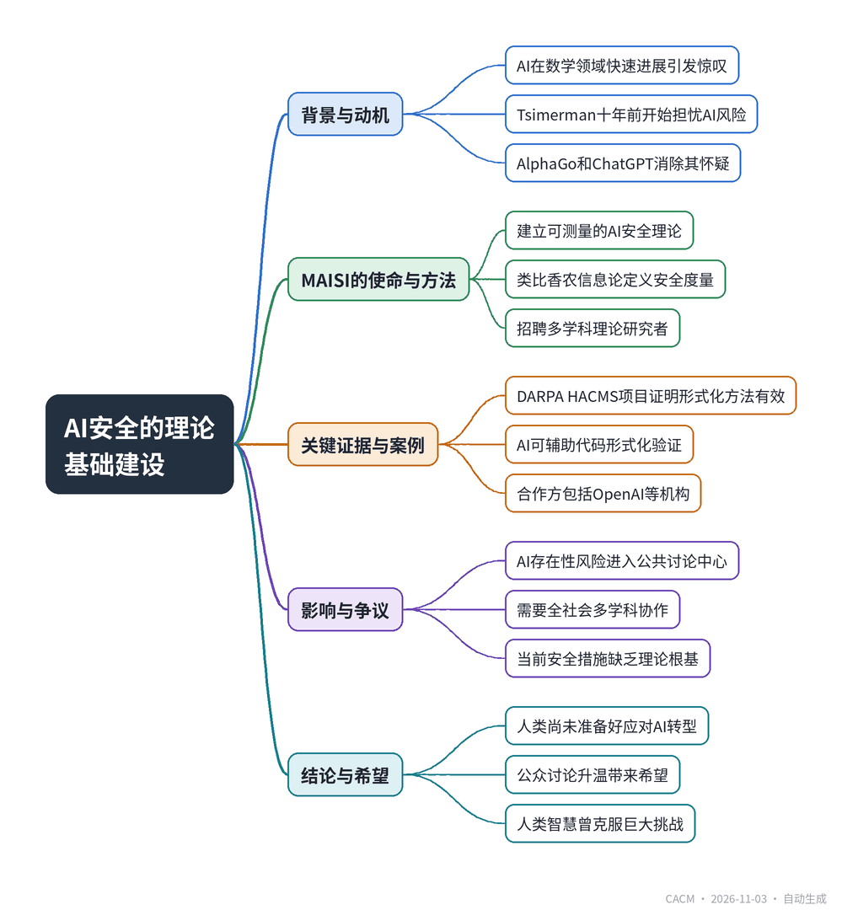

# ‘We Are Not Ready for It’

## 菲尔兹奖得主谈AI安全理论

**来源**：Communications of the ACM（News）　|　**发布**：2026-11-02 16:56（美东）　|　**北京时间**：2026-11-03 04:56　|　**作者**：Allyn Jackson

[原文链接](https://cacm.acm.org/news/we-are-not-ready-for-it/)　·　生成于 2026-11-03 15:19

---

## 一、摘要

> Tsimerman 创立数学AI安全研究所，呼吁为AI安全建立理论基础。

AI在数学等领域的快速进展引发关注，但菲尔兹奖得主Jacob Tsimerman更担忧AI对人类的存在性威胁。他早在2015年AlphaGo和2022年ChatGPT出现后便确信AI能力已足够危险，并于2026年与Andrew Critch共同创立数学AI安全研究所（MAISI），旨在为AI安全建立可测量的理论基础。MAISI获得Coefficient Giving 1000万美元资助，计划招聘10至30名理论研究者，并与OpenAI等机构合作。Tsimerman以香农信息论类比，希望定义AI安全的“熵”式度量，并借鉴DARPA HACMS项目证明形式化方法可构建安全系统。他强调需要数学家、物理学家、计算机科学家等共同应对这一巨大转型，认为当前社会尚未准备好。

## 二、核心要点

1. Tsimerman因AI能力突破而确信其存在性风险，2026年创立MAISI并任科学总监。
2. MAISI获1000万美元资助，计划2027年1月前招聘10-30名理论研究者，聚焦AI安全理论基础。
3. Tsimerman希望像香农定义信息熵一样，为AI安全建立可测量的理论框架。
4. DARPA HACMS项目证明形式化方法可构建难以攻破的系统，为AI安全提供范例。
5. MAISI研究涉及复杂性理论、组合数学、学习理论、统计力学、博弈论和模型论等多个数学分支。
6. Tsimerman认为AI安全需全社会多学科协作，当前公众讨论升温带来希望。

## 三、关键词对照

| English | 中文 |
| --- | --- |
| Fields Medal | 菲尔兹奖 |
| AI safety | AI安全 |
| existential threat | 存在性威胁 |
| AI alignment | AI对齐 |
| formal verification | 形式化验证 |
| complexity theory | 复杂性理论 |
| game theory | 博弈论 |
| model theory | 模型论 |

## 四、中英对照全文

Mathematicians the world over have been astonished by the rapid advances AI has made in their field. Many also are grieving the loss of the human-centered, hand-crafted spirit that characterized mathematics for centuries.

> 全世界的数学家都对AI在其领域取得的快速进展感到震惊。许多人也为数学数百年来以人为中心、手工打造的精神的丧失而悲痛。

University of Toronto mathematician Jacob Tsimerman is grieving too, but he is not astonished. Over the past few years, even as he produced the work that earned him a Fields Medal in July 2026, he saw the AI onslaught coming. He also developed a deep conviction that AI could pose an existential threat to humanity.

> 多伦多大学数学家Jacob Tsimerman也感到悲痛，但他并不震惊。过去几年里，即使在他完成那项为他赢得2026年7月菲尔兹奖的工作时，他就预见到了AI的冲击即将到来。他还形成了一种深刻的信念：AI可能对人类构成生存威胁。

“AI and AI safety, I think, are the most important problems of our times,” said Tsimerman. He has shifted attention from his work in pure mathematics to focus on developing a theoretical basis for understanding and controlling AI. In September 2026, he founded the Mathematical AI Safety Institute (MAISI) together with Andrew Critch, a research scientist in the University of California Berkeley’s Center for Human-Compatible AI and chief executive officer of Encultured AI. Tsimerman serves as MAISI’s scientific director, Critch as its executive director.

> “我认为，AI和AI安全是我们这个时代最重要的问题，”Tsimerman说。他已将注意力从纯数学研究转向为理解和控制AI奠定理论基础。2026年9月，他与Andrew Critch共同创立了数学AI安全研究所（MAISI）。Critch是加州大学伯克利分校人类兼容AI中心的研究科学家，也是Encultured AI的首席执行官。Tsimerman担任MAISI的科学主任，Critch担任执行主任。

Last summer, Tsimerman was planning to take a position in AI safety at OpenAI. However, after the establishment of MAISI, he decided to remain there full-time. OpenAI is supporting MAISI’s work in various ways, for example by donating credits and providing access to the latest models. MAISI is also cooperating with other labs and other AI safety organizations.

> 去年夏天，Tsimerman曾计划在OpenAI担任AI安全方面的职位。然而，在MAISI成立后，他决定全职留在那里。OpenAI正以多种方式支持MAISI的工作，例如捐赠额度并提供最新模型的访问权限。MAISI还与其他实验室和其他AI安全组织合作。

Starting with a $10-million grant from Coefficient Giving, MAISI is hiring between 10 and 30 theoreticians from various areas—including mathematics, physics, and computer science—for its January 2027 semester. Scores of further hires are planned. “What I want are people who are willing and able to work on hard problems for a long time and really tackle the underlying theoretical obstacles” to AI safety, said Tsimerman. “This is not going to be easy.”

> 凭借Coefficient Giving提供的1000万美元资助，MAISI正在为其2027年1月学期招聘10至30名来自数学、物理和计算机科学等不同领域的理论研究者。还计划再招聘数十人。“我想要的是那些愿意并且能够长期攻克难题、真正解决AI安全背后理论障碍的人，”Tsimerman说。“这不会容易。”

Tsimerman’s career up to now has focused on purely mathematical questions at the intersection of number theory, model theory, and algebraic geometry. Nevertheless, he has been thinking seriously about AI for more than a decade. “I thought it was natural that, if AI becomes capable, it could become extraordinarily dangerous and risky,” he said. “But it wasn’t clear to me it would become capable.”

> Tsimerman迄今为止的职业生涯聚焦于数论、模型论和代数几何交叉领域的纯数学问题。尽管如此，他十多年来一直在认真思考AI。“我认为，如果AI变得有能力，它就可能变得极其危险和高风险，这是很自然的，”他说。“但当时我并不清楚它是否真的会变得有能力。”

His doubts diminished when DeepMind developed the AlphaGo game-playing system in 2015, and disappeared when OpenAI released ChatGPT in 2022. “As soon as I saw that AI could talk, the debate was over for me,” said Tsimerman. “Now that it can talk, it can do everything.”

> 当DeepMind在2015年开发出AlphaGo对弈系统时，他的疑虑减少了；当OpenAI在2022年发布ChatGPT时，疑虑消失了。“我一看到AI能说话，对我来说争论就结束了，”Tsimerman说。“既然它能说话，它就能做一切。”

Critch and Tsimerman are co-authors of the paper “A Taxonomy of Omnicidal Futures Involving Artificial Intelligence.” When the paper was posted online in mid-2025, discussions of the existential threat of AI were on the periphery of public discourse. Today, they are center stage.

> Critch和Tsimerman是论文《涉及人工智能的灭绝性未来分类学》的合著者。当该论文于2025年年中在网上发布时，关于AI生存威胁的讨论还处于公共话语的边缘。如今，它们已处于中心舞台。

“Humanity needs not just mathematicians, it needs governance people, it needs infrastructure people, it needs physicists, computer scientists, chemists—it needs everybody to think through this huge transition we are going through,” said Tsimerman. “We need to figure out what to do, because we are not ready for it.”

> “人类不仅需要数学家，还需要治理人才、基础设施人才、物理学家、计算机科学家、化学家——需要每个人来思考我们正在经历的这场巨大转型，”Tsimerman说。“我们需要弄清楚该做什么，因为我们还没有准备好。”

CACM spoke with Tsimerman in early October. What follows is an edited version of the conversation.

> CACM在10月初与Tsimerman进行了交谈。以下是经过编辑的对话内容。

What are your aspirations for MAISI?

> 你对MAISI有什么期望？

My hope is to create some sort of theoretical underpinning for what safety is in some way that we can measure, for how to safely interact with an AI, for how to make the notion of AI alignment less fuzzy.

> 我的希望是，以某种我们可以衡量的方式，为安全究竟是什么建立某种理论基础，为如何安全地与AI互动建立理论基础，为如何让AI对齐这一概念不那么模糊建立理论基础。

A good analogy to think about is the telecommunications industry. It was alive and well before we had a notion of what information was. Claude Shannon came along and defined—through entropy, which is a pretty math-y notion—how to measure information. That gave us a conceptual understanding that made the world leap forward. Now we measure everything in terms of bits and bandwidth, and we have Shannon capacity and measurements of how much information you can store.

> 一个很好的类比是电信行业。在我们有了信息是什么的概念之前，它就已经生机勃勃。Claude Shannon出现了，他通过熵——一个相当数学化的概念——定义了如何衡量信息。这给了我们一种概念性理解，使世界向前飞跃。现在我们用比特和带宽来衡量一切，我们有香农容量，有关于能存储多少信息的度量。

So that would be a model of success. We want to come up with some version of AI safety that has a theoretical underpinning. Right now, we don’t have that. Right now, we do character training and monitoring. There’s a lot of hope in that, hope that the AI goes nicely forward, so maybe it will be nice in the future. I’m not saying that’s not worth doing; it’s definitely worth doing. But, as a place to hang the hat of civilizational safety, because those are the stakes, it’s wanting.

> 所以那将是一个成功的典范。我们想提出某种具有理论基础的AI安全版本。现在我们还没有。现在我们做的是性格训练和监控。这其中有很多希望，希望AI顺利向前发展，也许未来它会表现良好。我不是说这不值得做；它绝对值得做。但是，作为承载文明安全的依托——因为赌注就在于此——它还不够。

What you would consider to be progress in AI safety research?

> 你认为AI安全研究的进展会是什么样？

I think there are several ways it could go. Any kind of metric to check whether alignment is taking place, something based more in fundamental understanding than on a sort of zoological treatment, would be useful. Any kind of protocol to deal with an AI that’s potentially untrustworthy but more computationally powerful than you, to allow you to trust the output even when you don’t trust the AI, that could be a success. Formal verification, formal methods, are something that people pursue now a lot with respect to AI safety.

> 我认为可能有几种路径。任何用来检查对齐是否正在发生的指标，只要更多基于根本理解，而不是某种动物学式的处理，都会有用。任何处理潜在不可信但计算能力比你更强的AI的协议，能让你即使不信任AI也能信任其输出，都可能是一种成功。形式验证、形式化方法，是现在人们在AI安全方面大量追求的方向。

I don’t equate safety with cybersecurity, because they’re not the same, and I think it’s quite damaging if we start thinking of them as the same. But cybersecurity and hacking are a big part of AI safety. Right now, the way a lot of cybersecurity works is we make software, and then we look for bugs. So we build a house and look for holes. That’s just not how you build a safe system. The AI can hack through that like butter.

> 我不把安全等同于网络安全，因为它们并不相同，我认为如果我们开始把它们视为相同，那会相当有害。但网络安全和黑客攻击是AI安全的重要部分。现在，许多网络安全的工作方式是：我们先做软件，然后寻找漏洞。所以我们建了一座房子，然后找洞。这根本不是构建安全系统的方式。AI可以像切黄油一样攻破它。

A better thing to do is to build something from the ground up that you can prove is secure, something that comes with a guarantee that information from a certain part can’t leak out to another part.

> 更好的做法是从头构建你能证明是安全的东西，一种自带保证的东西：某一部分的信息不会泄露到另一部分。

Is there an example of this idea being carried out, of building a secure system from the ground up?

> 有没有这种想法得到实施的例子，即从头构建安全系统？

Yes. For example, Kathleen Fisher, who is the CEO of ARIA [the U.K.’s Advanced Research & Invention Agency], ran a program at DARPA [the U.S. Defense Advanced Research Projects Agency] called HACMS [High-Assurance Cyber-Military Systems]. It used formal methods to secure military vehicles. They gave a red team access, and asked, “How much could you hack this system?” And the answer was not at all, even with insider access. That demonstrated on a major scale—not nearly the scale we need, we need this to be everywhere—but on a major scale, that this is possible, within reach.

> 有。例如，ARIA（英国高级研究与发明局）首席执行官Kathleen Fisher曾在DARPA（美国国防高级研究计划局）主持了一个名为HACMS（高保障网络军事系统）的项目。它使用形式化方法来保护军用车辆。他们让红队访问，并问：“你能黑进这个系统多少？”答案是一点也黑不进去，即使有内部访问权限也不行。这在大规模上——还远未达到我们需要的规模，我们需要这无处不在——但在大规模上证明了这是可能的，是触手可及的。

And it is more within reach with AI. A lot of stuff used to be out of scope because you just needed too much human time to code everything and make sure it’s okay. Now you can have AI write code and can formally check it to make sure that it’s correct.

> 有了AI，这更加触手可及。过去很多东西不在范围内，因为你需要太多人力时间来编写所有代码并确保没问题。现在你可以让AI写代码，并可以形式化检查以确保其正确。

What areas of math will be useful and relevant in the work at MAISI?

> 哪些数学领域将对MAISI的工作有用且相关？

I’ll answer your question, but first I want to emphasize the point that we want theoreticians. We are getting mathematicians, theoretical computer scientists, theoretical physicists, people who have done AI safety work before. We have a broad range.

> 我会回答你的问题，但首先我想强调一点：我们要的是理论研究者。我们正在招募数学家、理论计算机科学家、理论物理学家、以前做过AI安全工作的人。我们的范围很广。

Having said that, a lot of different parts of math could show up. When you’re interacting with a computational system and you’re coming up with some sort of interaction protocol or design mechanism, complexity theory shows up.

> 话虽如此，数学的许多不同部分都可能出现。当你与计算系统互动，并提出某种交互协议或设计机制时，复杂性理论就会出现。

A lot of these problems are framed in terms of complexity theory problems, under which a lot of combinatorics takes place. We are doing learning theory, trying to understand how things evolve over time, how to understand the behavior of a large-scale system built of lots of neurons.

> 许多这些问题都以复杂性理论问题的形式来表述，其中涉及大量组合数学。我们在做学习理论，试图理解事物如何随时间演变，如何理解由大量神经元构建的大规模系统的行为。

A lot of statistical mechanics comes up, field theories show up, in which [partial differential equations] have a big part to play. Optimization and classical analysis have a big part to play. We are also trying to model AI by coming up with a game theory for AI systems that have to reflect on themselves and their internal structure. Logic and model theory also play a role.

> 许多统计力学会出现，场论会出现，其中偏微分方程有很大作用。优化和经典分析也有很大作用。我们还试图通过为必须反思自身及其内部结构的AI系统提出一种博弈论来对AI建模。逻辑和模型论也发挥作用。

The point is not so much to prove interesting theorems. I don’t really care if we prove a single theorem. The point is to develop some sort of understanding that we can then apply to AI safety.

> 重点不在于证明有趣的定理。我并不真的在乎我们是否证明了一个定理。重点在于发展某种理解，然后我们可以将其应用于AI安全。

What gives you hope at this moment in time, when things are changing so fast?

> 在事情变化如此之快的当下，是什么给了你希望？

AI is becoming a part of our discourse, as it should. People are talking about the existential risks, they are discussing slowdowns and pauses, which I think is very good. A lot more energy and talent are coming forward. MAISI has had a tremendous amount of interest from theoreticians, which is not just good for MAISI but also shows that people are taking the problem of AI safety seriously. They are realizing the scale of the problem.

> AI正在成为我们话语的一部分，这是应该的。人们在谈论生存风险，在讨论放缓和暂停，我认为这非常好。更多精力和人才正在涌现。MAISI收到了理论研究者极大的兴趣，这不仅对MAISI有好处，也表明人们正在认真对待AI安全问题。他们正在意识到问题的规模。

Humans are capable of great foolishness but also great wisdom. We have accomplished great things in the past, and we are still here. There are a lot of reasons for hope.

> 人类能够做出极大的愚蠢之事，也能拥有极大的智慧。我们过去取得了伟大成就，而且我们仍然在这里。有很多理由抱有希望。

Allyn Jackson is a journalist specializing in mathematics and science and is based in German.

> Allyn Jackson是一名专攻数学和科学的记者，常驻德国。

---
*英文原文版权归 Communications of the ACM 及作者所有；中文译文由 AI 辅助生成，仅供学习参考。*