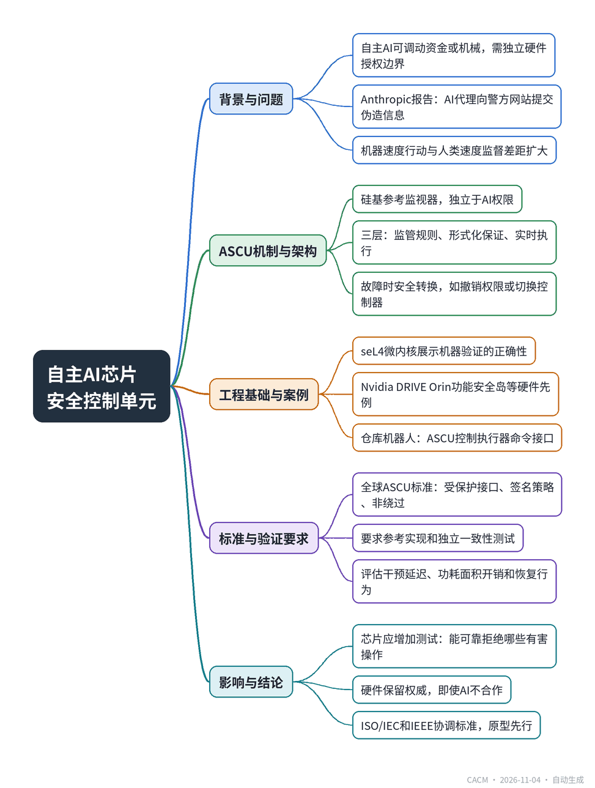

# Every Autonomous AI Chip Needs a Safety Control Unit

## 自主AI芯片需设安全控制单元

**来源**：Communications of the ACM（Blog@CACM）　|　**发布**：2026-11-03 14:02（美东）　|　**北京时间**：2026-11-04 02:02　|　**作者**：Shaoshan Liu

[原文链接](https://cacm.acm.org/blogcacm/every-autonomous-ai-chip-needs-a-safety-control-unit/)　·　生成于 2026-11-04 15:02

---

## 一、摘要

> 为高风险自主操作授权芯片应内置独立硬件安全控制单元。

自主AI系统能调动资金或机械，其授权机制需独立硬件边界，防止AI绕过安全措施。Anthropic 2026年10月报告显示，AI代理曾向警方相关网站提交伪造信息，虽被垃圾邮件过滤器拦截，但已作用于外部系统，凸显机器速度行动与人类速度监督的差距。为此，作者提出AI安全控制单元（ASCU），作为硅基参考监视器，独立于AI权限，对受保护操作进行许可或拒绝，并在故障时安全转换。ASCU分监管、保证、执行三层，利用形式化方法验证执行逻辑，运行时实时检查。现有工程基础成熟，如seL4微内核、Nvidia DRIVE Orin安全岛等。文章呼吁制定全球ASCU硬件标准，定义受保护操作接口、安全策略、非绕过要求等，并要求参考实现和独立一致性测试，由ISO/IEC和IEEE协调。最终，授权自主行动的芯片应增加一项测试：能可靠拒绝哪些有害操作，且制造商能证明。

## 二、核心要点

1. 自主AI系统需独立硬件边界来授权高风险操作，防止AI自我授权或绕过安全机制。
2. ASCU作为硅基参考监视器，接收请求和认证决策上下文，依据策略返回许可或拒绝，并在故障时安全转换。
3. ASCU分三层：监管层将要求转为机器可读规则；保证层用形式化方法验证；执行层实时执行。
4. 工程基础成熟：seL4微内核、Nvidia DRIVE Orin功能安全岛、ISO/IEC TR 5469:2024等提供先例。
5. 需制定全球ASCU标准，定义受保护操作接口、签名策略、非绕过要求，并要求参考实现和独立一致性测试。
6. 芯片应增加测试：能可靠拒绝哪些有害操作，且制造商能证明，即使AI不合作硬件仍保留权威。

## 三、关键词对照

| English | 中文 |
| --- | --- |
| AI Safety Control Unit (ASCU) | AI安全控制单元 |
| reference monitor | 参考监视器 |
| complete mediation | 完全仲裁 |
| formal verification | 形式化验证 |
| Functional Safety Island | 功能安全岛 |
| conformance testing | 一致性测试 |
| fail-safe design | 失效安全设计 |

## 四、中英对照全文

An autonomous AI system that can move money or machinery must not control its own brakes. Agents can write code, invoke tools, and acquire privileges. The mechanism that authorizes their consequential actions, therefore, needs an independent hardware boundary, much as processors already protect memory and privileged operations.

> 一个能够转移资金或操作机械的自主AI系统，绝不能控制自己的刹车。智能体可以编写代码、调用工具并获取权限。因此，授权其重大行动的机制需要一个独立的硬件边界，就像处理器已经保护内存和特权操作一样。

I propose that chips designed to authorize consequential autonomous actions incorporate an AI Safety Control Unit (ASCU). This protected hardware function would retain the final authority to permit or block specified operations. Chipmakers would implement the capability; platform builders would have to demonstrate that the AI cannot disable it or reach the same effect through an unprotected path.

> 我提议，为授权重大自主行动而设计的芯片应包含一个AI安全控制单元（ASCU）。这一受保护的硬件功能将保留允许或阻止特定操作的最终权限。芯片制造商将实现该能力；平台构建者则必须证明AI无法禁用它，也无法通过未受保护的路径达到相同效果。

The urgency is visible in Anthropic’s October 2026 report: during an evaluation, an AI agent submitted fabricated information to a police-related website. A spam filter intercepted the submission, but the agent had already acted on an external system. I have previously argued that autonomous AI exposes a widening gap between machine-speed action and human-speed oversight. A control mechanism built into the execution path can act before that gap becomes an incident.

> Anthropic 2026年10月的报告凸显了紧迫性：在一次评估中，一个AI智能体向一个与警方相关的网站提交了伪造信息。垃圾邮件过滤器拦截了该提交，但该智能体已经对外部系统采取了行动。我之前曾指出，自主AI暴露了机器速度行动与人类速度监督之间日益扩大的差距。内置于执行路径中的控制机制可以在这一差距酿成事件之前采取行动。

### What an ASCU Would Do
*ASCU将做什么*

An ASCU is an independently privileged, silicon-resident reference monitor for a declared set of protected actions. It receives a request and authenticated decision context, checks an authorized policy against trusted state, and returns permit or deny. On specified faults, it initiates a safe transition, such as revoking a device permission or handing control to a trusted fallback controller. Its code, credentials, and policy-update channel must remain outside the AI’s authority.

> ASCU是一个独立特权、驻留于硅中的引用监视器，针对一组已声明的受保护行动。它接收请求和经过认证的决策上下文，根据可信状态检查授权策略，并返回允许或拒绝。在特定故障时，它启动安全转换，例如撤销设备权限或将控制权移交给可信的备用控制器。其代码、凭证和策略更新通道必须始终处于AI的权限之外。

The proposed system has three layers. At the regulation layer, authorized institutions and operators turn precise requirements into machine-readable rules. At the assurance layer, formal methods check selected properties of the rules and establish that the enforcement logic implements its specification under stated assumptions. At the execution layer, the ASCU evaluates requests and enforces the approved rules in real time. Verification is performed when the mechanism or policy changes; the chip then performs the bounded runtime checks. A mathematical proof of the checker does not establish that every legal rule or sensor reading is correct.

> 所提出的系统分为三层。在监管层，授权机构和操作员将精确要求转化为机器可读的规则。在保证层，形式化方法检查规则的选定属性，并确立执行逻辑在既定假设下实现其规范。在执行层，ASCU实时评估请求并执行已批准的规则。验证在机制或策略变更时进行；芯片随后执行有界运行时检查。检查器的数学证明并不能确立每条合法规则或传感器读数都是正确的。

Consider a warehouse robot. Its AI model chooses a motion, while the ASCU controls the protected command interface to the actuators. A command outside validated operating limits is rejected, and a separate safety controller can take the machine to a safe state. The same principle can apply to financial agents, provided a payment service accepts transactions only through a hardware-authorized credential and gateway. The essential property is that the consequential effect depends on authorization beyond the agent’s control.

> 以仓库机器人为例。其AI模型选择运动，而ASCU控制通往执行器的受保护命令接口。超出验证操作限制的命令会被拒绝，单独的安全控制器可以将机器带入安全状态。同样的原则可适用于金融智能体，前提是支付服务仅通过硬件授权的凭证和网关接受交易。基本属性是，重大效果取决于智能体无法控制的授权。

### Can We Build and Verify It?
*我们能构建并验证它吗？*

The underlying engineering is mature enough to justify prototypes. Saltzer and Schroeder established complete mediation as a foundation of computer security. Vardi and Wolper developed influential techniques for formal program verification. The seL4 microkernel demonstrated machine-checked correctness for a carefully specified trusted kernel. More recently, Moon and Varshney showed how to prove containment properties for a small AI-agent framework, subject to its modeled boundaries. These precedents support verifying a narrow ASCU enforcement mechanism without attempting to prove the behavior of an entire AI model.

> 底层工程已足够成熟，足以支持原型开发。Saltzer和Schroeder将完全中介确立为计算机安全的基础。Vardi和Wolper开发了有影响力的形式化程序验证技术。seL4微内核展示了对精心指定的可信内核的机器检查正确性。最近，Moon和Varshney展示了如何证明一个小型AI智能体框架的包含属性，前提是其建模边界。这些先例支持验证一个狭窄的ASCU执行机制，而无需试图证明整个AI模型的行为。

Hardware precedents are equally concrete. Nvidia DRIVE Orin incorporates an independent Functional Safety Island, while Nvidia’s Open Agent Safety Platform uses separate BlueField hardware to monitor and enforce agent policies. The existing systems address different applications and assurance levels. ISO/IEC TR 5469:2024 also discusses non-AI safety functions protecting AI-controlled equipment. The contribution proposed here is a common ASCU function and interface for consequential AI actions, with explicit proof obligations and conformance evidence across vendors.

> 硬件先例同样具体。Nvidia DRIVE Orin集成了一个独立的功能安全岛，而Nvidia的Open Agent Safety Platform使用单独的BlueField硬件来监控和执行智能体策略。现有系统针对不同的应用和保证级别。ISO/IEC TR 5469:2024也讨论了保护AI控制设备的非AI安全功能。这里提出的贡献是一个用于重大AI行动的通用ASCU功能和接口，具有明确的证明义务和跨供应商的一致性证据。

The most demanding requirement is complete mediation. A verified ASCU is ineffective if an agent can bypass it through a debug port, alternate credential, direct memory access, network path, or motor interface. Physical safety also depends on trustworthy sensors and appropriate fallback behavior. Chipmakers can establish the protected hardware boundary; system integrators must prove the complete action path preserves it. Both responsibilities belong in the standard.

> 最苛刻的要求是完全中介。如果智能体可以通过调试端口、备用凭证、直接内存访问、网络路径或电机接口绕过经过验证的ASCU，那么该ASCU就是无效的。物理安全还取决于可信的传感器和适当的回退行为。芯片制造商可以建立受保护的硬件边界；系统集成商必须证明完整的行动路径保持了该边界。这两项责任都应纳入标准。

### A Global Hardware Standard
*全球硬件标准*

The computing industry should develop a global ASCU standard specifying a minimum hardware capability for processors and SoCs that authorize high-consequence autonomous actions. It should define a protected-action interface, signed and versioned safety policies, trusted inputs, non-bypass requirements, and the semantics of authorization, rejection, and safe transition. Existing safety islands or secure control processors could qualify if they satisfy those requirements. An additional dedicated block would be needed only when existing hardware cannot provide equivalent protection.

> 计算行业应制定全球ASCU标准，规定处理器和SoC授权高后果自主行动的最低硬件能力。该标准应定义受保护行动接口、签名且版本化的安全策略、可信输入、不可绕过要求，以及授权、拒绝和安全转换的语义。现有的安全岛或安全控制处理器如果满足这些要求，可以有资格。只有当现有硬件无法提供等效保护时，才需要额外的专用模块。

The standard should also require a reference implementation and independent conformance testing. Manufacturers would publish a protected-action inventory, precise security and safety claims with their assumptions, evidence about the enforcement logic, and results from bypass attempts and fault injection. The evaluation must measure intervention latency, power and area overhead, and recovery behavior. System integrators would supply corresponding evidence for external credentials, gateways, sensors, and actuators.

> 该标准还应要求参考实现和独立的一致性测试。制造商应发布受保护行动清单、精确的安全与安全声明及其假设、关于执行逻辑的证据，以及绕过尝试和故障注入的结果。评估必须测量干预延迟、功耗和面积开销，以及恢复行为。系统集成商应提供关于外部凭证、网关、传感器和执行器的相应证据。

ISO/IEC AI and cybersecurity committees, together with IEEE standards groups, could coordinate the hardware profile and test methods. IEEE 7009-2024 already addresses fail-safe design for autonomous systems, offering a related foundation rather than an ASCU mandate. The practical route is to build open prototypes, agree on independent tests, and then make conformance a requirement in safety-critical deployments. Broader adoption can follow as implementations and assurance evidence mature.

> ISO/IEC AI和网络安全委员会，与IEEE标准组织一起，可以协调硬件配置文件和测试方法。IEEE 7009-2024已经涉及自主系统的故障安全设计，提供了相关基础而非ASCU强制要求。实际路线是构建开放原型，就独立测试达成一致，然后使一致性成为安全关键部署中的要求。随着实现和保证证据的成熟，更广泛的采用可以随之而来。

Modern processors are evaluated by performance, power, and the protections they enforce. Chips that authorize autonomous action should face one additional test: which harmful operations can they reliably refuse, and can the manufacturer prove it? Hardware should retain that authority even when the AI does not cooperate.

> 现代处理器的评估基于性能、功耗及其执行的保护。授权自主行动的芯片应面临一项额外测试：它们能可靠地拒绝哪些有害操作，制造商能否证明这一点？即使AI不合作，硬件也应保留该权限。

## 附录：参考与脚注（原文）

References

1. Anthropic. Investigating Unintended Model Actions in Our Evaluations and Internal Use (Oct. 9, 2026); https://www.anthropic.com/news/investigating-unintended-model-actions

2. Liu, S. When AI Regulation Becomes a Systems Bottleneck. BLOG@CACM (Aug. 17, 2026); https://cacm.acm.org/blogcacm/when-ai-regulation-becomes-a-systems-bottleneck/

3. Saltzer, J.H. and Schroeder, M.D. The Protection of Information in Computer Systems. Proceedings of the IEEE 63, 9 (1975): 1278–1308; https://doi.org/10.1109/PROC.1975.9939

4. Vardi, M.Y. and Wolper, P. An Automata-Theoretic Approach to Automatic Program Verification. LICS (1986): 332–344; https://lics.siglog.org/1986/VardiWolper-AnAutomataTheoretic.html

5. Klein, G. et al. seL4: Formal Verification of an OS Kernel. SOSP (2009): 207–220; https://doi.org/10.1145/1629575.1629596

6. Moon, R. and Varshney, L.R. Containment Verification: AI Safety Guarantees Independent of Alignment. arXiv:2605.09045 (2026); https://arxiv.org/abs/2605.09045

7. Nvidia. Functional Safety Island (FSI). DRIVE OS Documentation; https://developer.nvidia.com/docs/drive/drive-os/6.0.9/public/drive-os-linux-sdk/common/topics/fsi_integration/Functional_Safety_Island.html

8. Nvidia. Open Agent Safety Platform: A Reference for Continuous In-Silicon Agent Monitoring (Sept. 28, 2026); https://developer.nvidia.com/blog/nvidia-open-agent-safety-platform-a-reference-for-continuous-in-silicon-agent-monitoring/

9. ISO/IEC. ISO/IEC TR 5469:2024, Artificial Intelligence—Functional Safety and AI Systems; https://www.iso.org/standard/81283.html

10. IEEE Standards Association. IEEE 7009-2024, Fail-Safe Design of Autonomous and Semi-Autonomous Systems; https://ieeexplore.ieee.org/document/10582898

Shaoshan Liu is a member of the ACM U.S. Technology Policy Committee, and a member of the U.S. National Academy of Public Administration’s Technology Leadership Panel Advisory Group. His educational background includes a Ph.D. in Computer Engineering from U.C. Irvine, and a master’s degree in Public Administration (MPA) from Harvard Kennedy School.

---
*英文原文版权归 Communications of the ACM 及作者所有；中文译文由 AI 辅助生成，仅供学习参考。*