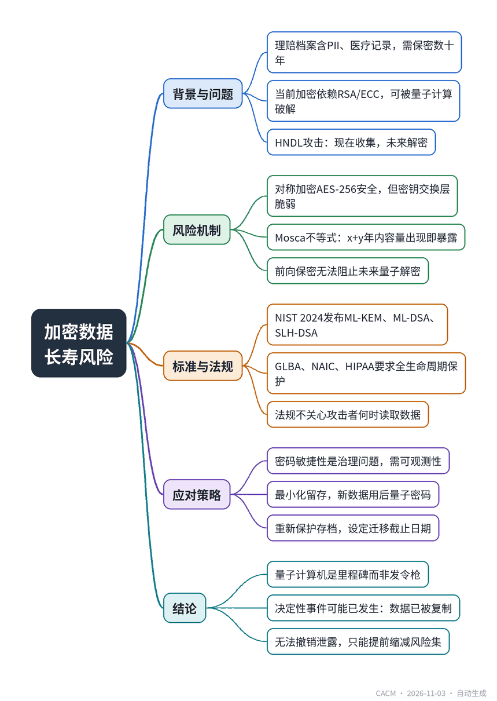

# The Claim File That Keeps Its Secrets for Decades

## 加密数据的长寿风险

**来源**：Communications of the ACM（Blog@CACM）　|　**发布**：2026-11-03 09:49（美东）　|　**北京时间**：2026-11-03 21:49　|　**作者**：Sai Charan Obuladinne


[原文链接](https://cacm.acm.org/blogcacm/the-claim-file-that-keeps-its-secrets-for-decades/)　·　生成于 2026-11-04 15:02

---

## 一、摘要

> 加密数据可能比保护它的假设活得更久。

保险理赔档案包含姓名、驾照、社保号、车辆信息、医疗记录等敏感数据，需保密数十年。然而，当前加密依赖的RSA和椭圆曲线密钥交换可被未来量子计算机的Shor算法破解，攻击者今天可复制加密数据，待量子能力成熟后解密，即“先收集，后解密”（HNDL）。对称加密AES-256虽能抵抗Grover算法，但密钥交换层脆弱。Mosca不等式表明，若数据需保密x年、迁移需y年，则量子能力在x+y年内出现即暴露。保险业x达数十年，y数年，风险迫近。2024年NIST已发布ML-KEM、ML-DSA等后量子标准，GLBA、NAIC等法规要求保护数据全生命周期。文章建议立即行动：最小化数据留存、对新交换采用后量子密码、重新保护存档、建立密码敏捷性治理，并设定高优先级数据不再依赖量子脆弱密钥交换的截止日期。

## 二、核心要点

1. 保险理赔档案中的PII、医疗记录等敏感数据需保密数十年，而当前公钥加密可被未来量子计算机破解。
2. HNDL攻击：攻击者现在复制加密数据，待量子能力成熟后解密，过程无 breach 迹象。
3. Mosca不等式：数据保密期x加迁移期y，若量子能力在x+y年内出现则暴露；保险业x达数十年，风险极高。
4. 2024年NIST发布ML-KEM（FIPS 203）、ML-DSA（FIPS 204）、SLH-DSA（FIPS 205）后量子标准。
5. GLBA、NAIC模型法、HIPAA等法规要求保护数据整个生命周期，不关心攻击者何时读取。
6. 密码敏捷性是治理问题：需能定位脆弱加密系统，而不仅是更换算法。

## 三、关键词对照

| English | 中文 |
| --- | --- |
| Harvest Now, Decrypt Later (HNDL) | 先收集，后解密 |
| Shor's algorithm | Shor算法 |
| Grover's algorithm | Grover算法 |
| Mosca's inequality | Mosca不等式 |
| Post-Quantum Cryptography (PQC) | 后量子密码 |
| Crypto-Agility | 密码敏捷性 |
| ML-KEM | 模块格密钥封装机制 |
| GLBA Safeguards Rule | GLBA保障规则 |
| NAIC Insurance Data Security Model Law | NAIC保险数据安全示范法 |

## 四、中英对照全文

Insurers are in the business of long time horizons. A physical-damage auto claim you settle this month leaves behind a file with data that stays sensitive for years—the policyholder’s name, address, driver’s license, and Social Security number; the VIN and photos of the damaged vehicle; repair estimates, total-loss and salvage records; bank and payment details; and, when an injury rides along with the claim, medical records. That file doesn’t stop being sensitive when the check clears. Litigation, subrogation, fraud review, and retention rules keep it alive for years, and the identity data inside it is sensitive for a lifetime.

> 保险公司经营的是长周期业务。本月结算的一笔车险物理损坏索赔会留下一个文件，其中的数据在多年内仍属敏感——投保人的姓名、地址、驾照和社保号；车辆识别码（VIN）和受损车辆照片；维修估价、全损和残值记录；银行和支付详情；若索赔涉及人身伤害，还包括医疗记录。支票兑现后，该文件并不会失去敏感性。诉讼、代位求偿、欺诈审查和保留规则使其存续多年，其中的身份数据更是终身敏感。

Now pair that with a quiet fact about cryptography: the encryption protecting that file today may not protect it forever. This is Harvest Now, Decrypt Later (HNDL). An adversary could copy the encrypted data now, keep it with its context, and wait for the ability to read it. Nothing about that collection looks like a breach; there is often no detectable event at all. For a carrier, the data’s secrecy lifetime routinely outlasts any quantum timeline, so the confidentiality failure has already begun—the decryption is simply scheduled for later. The uncomfortable truth: encrypted data can outlive the assumption that protects it.

> 现在结合一个关于密码学的不起眼事实：今天保护该文件的加密可能无法永远保护它。这就是“先收集，后解密”（Harvest Now, Decrypt Later, HNDL）。对手现在可以复制加密数据，连同其上下文一并保存，等待能够读取它的能力。这种收集看起来不像入侵；通常根本没有可检测的事件。对于保险公司，数据的保密寿命通常超过任何量子时间线，因此机密性失效已经开始——解密只是被安排在以后。令人不安的事实是：加密数据可能比保护它的假设存续更久。

### The Asymmetry Hiding in Your Traffic
*流量中隐藏的不对称性*

The reassuring half is that symmetric cryptography survives: AES-256 faces only Grover’s algorithm, which weakens but doesn’t break it. The problem is what sits in front of it. That claim file is sealed with a symmetric cipher whose key was established through a public-key mechanism, and RSA and elliptic-curve systems are exactly what Shor’s algorithm dismantles. Recover that key-exchange layer later, reconstruct the symmetric secret, and the recorded data opens. The strong lock is bolted to a hinge that rusts on a known schedule.

> 令人欣慰的一半是对称密码学幸存：AES-256 只面临 Grover 算法，该算法削弱但不会破解它。问题在于它前面的部分。那个索赔文件由对称密码密封，其密钥通过公钥机制建立，而 RSA 和椭圆曲线系统正是 Shor 算法所瓦解的。以后恢复该密钥交换层，重建对称秘密，记录的数据就会打开。强锁被栓在一个按已知时间表生锈的铰链上。

### The Clock Already Started
*时钟已经开始*

The planning question isn’t “when will a quantum computer arrive?” It is whether the years a claim file must stay confidential, plus the years it takes to migrate a large carrier and its vendors, exceed the time until that capability might exist. Mosca’s inequality states it plainly: if data must stay secret for x years and migration takes y years, you are exposed once quantum capability could arrive within x + y. For an insurer, x is measured in decades and y in years — the sum clears almost any horizon. And forward secrecy won’t save you: a captured session still holds an ephemeral key-exchange problem a future quantum solution can undo, and the metadata alone — who filed, when, claim amounts — carries value on its own.

> 规划问题不是“量子计算机何时到来？”而是索赔文件必须保密的年数，加上迁移大型保险公司及其供应商所需的年数，是否超过该能力可能出现的时间。Mosca 不等式直白地指出：如果数据必须保密 x 年，迁移需要 y 年，那么一旦量子能力可能在 x + y 年内出现，你就暴露了。对于保险公司，x 以十年计，y 以年计——总和几乎超过任何时间范围。前向保密也救不了你：捕获的会话仍持有临时密钥交换问题，未来的量子解决方案可以撤销它，而仅元数据——谁提交、何时提交、索赔金额——本身就具有价值。

### What’s Actually Worth Harvesting
*真正值得收集的是什么*

Not all data has the same half-life. A payment authorization loses value in minutes. A claim file—PII, VIN, damage photos, adjuster notes, and any attached medical records—stays identifying and exploitable for years. A Social Security number is effectively permanent. And a retention schedule is not a confidentiality period: it says how long you must keep the file, not how long its contents can hurt the policyholder—and an attacker’s copy survives your lawful deletion.

> 并非所有数据都有相同的半衰期。支付授权在几分钟内失去价值。索赔文件——个人身份信息（PII）、VIN、损坏照片、理算员笔记以及任何附带的医疗记录——在多年内仍可识别和利用。社保号实际上是永久性的。保留时间表不是保密期：它规定你必须保留文件多久，而不是其内容能伤害投保人多久——而攻击者的副本在你合法删除后依然存在。

### Crypto-Agility Is a Governance Problem
*密码敏捷性是治理问题*

Swapping one algorithm for another is the easy half; the decisive half is whether you can find the vulnerable cryptography at all. Systems that label algorithm identifiers, key versions, retention periods, and data owners can locate what must move and prove it moved. A checklist that re-issues only public-facing certificates sails past code signing, database key-wrapping, backups, and the tunnels to repair networks, salvage vendors, and medical-bill review. Agility is observability and governance before it is a compiler flag.

> 换一种算法是容易的一半；决定性的一半是你能否找到易受攻击的密码学。标记算法标识符、密钥版本、保留期和数据所有者的系统可以定位必须迁移的内容并证明其已迁移。只重新签发面向公众证书的检查清单会漏过代码签名、数据库密钥包装、备份以及通往维修网络、残值供应商和医疗账单审查的隧道。敏捷性首先是可观测性和治理，然后才是编译器标志。

### Stop the Bleeding
*止血*

Because you can’t un-leak a claim file, the most useful milestone is blunt: the date after which high-priority new data no longer relies solely on quantum-vulnerable key establishment. The standards are ready—in 2024 NIST finalized ML-KEM (FIPS 203), ML-DSA (FIPS 204), and SLH-DSA (FIPS 205). And the obligations carriers already answer to point the same way: the GLBA Safeguards Rule, the NAIC Insurance Data Security Model Law, HIPAA for the medical portions of a claim, and state breach-notification laws—none of which care when the attacker finally reads the data, only that you protected it for its promised life. Hybrid schemes offer a controlled bridge while interoperability matures.

> 因为你无法让索赔文件不泄露，最有用的里程碑很直白：在此日期之后，高优先级的新数据不再仅依赖量子脆弱的密钥建立。标准已就绪——2024 年 NIST 最终确定了 ML-KEM (FIPS 203)、ML-DSA (FIPS 204) 和 SLH-DSA (FIPS 205)。保险公司已经承担的义务也指向同一方向：GLBA 保障规则、NAIC 保险数据安全示范法、针对索赔医疗部分的 HIPAA 以及州泄露通知法——这些都不关心攻击者最终何时读取数据，只关心你是否在其承诺的寿命内保护了它。混合方案在互操作性成熟期间提供了受控的桥梁。

### The Breach Outside Your Logs
*日志之外的泄露*

The first large quantum computer will be a milestone, not a starting gun. For an insurer, the decisive event may already be behind us—a quiet copy of a claims archive, a stolen backup export—made years before anyone can read it, and impossible to recall. So the exercise isn’t defending against a 2032 machine; it is deciding, today, which of your claim files would still harm a policyholder then, and shrinking that set before it is collected: minimize what you retain, protect new exchanges with standardized post-quantum cryptography, re-protect stored archives, and build the agility to do it again. The one thing you will never get to do is un-file the claim.

> 第一台大型量子计算机将是一个里程碑，而不是发令枪。对于保险公司，决定性事件可能已经过去——一份安静的索赔档案副本、一次被盗的备份导出——在任何人能读取它之前数年就已发生，且无法召回。因此，演习不是防御 2032 年的机器；而是今天决定，你的哪些索赔文件届时仍会伤害投保人，并在被收集之前缩小该集合：最小化你保留的内容，用标准化的后量子密码学保护新的交换，重新保护存储的档案，并建立再次这样做的敏捷性。你永远无法做的一件事是取消提交索赔。

Disclosure: AI tools were used for research assistance, reference gathering, and editorial support in preparing this post.

> 披露：在准备本文时，使用了 AI 工具进行研究协助、参考资料收集和编辑支持。

## 附录：参考与脚注（原文）

Footnotes

a. Shor’s algorithm. Wikipedia; https://en.wikipedia.org/wiki/Shor%27s_algorithm

b. Grover’s algorithm. Wikipedia; https://en.wikipedia.org/wiki/Grover%27s_algorithm

c. Global Risk Institute. Quantum Threat Timeline Report (2021); https://globalriskinstitute.org/mp-files/quantum-threat-timeline-report-2021-full-report.pdf/

d. NIST FIPS 203, Module-Lattice-Based Key-Encapsulation Mechanism (ML-KEM); https://csrc.nist.gov/pubs/fips/203/final

e. NIST FIPS 204, Module-Lattice-Based Digital Signature Algorithm (ML-DSA); https://csrc.nist.gov/pubs/fips/204/final

f. NIST FIPS 205, Stateless Hash-Based Digital Signature Algorithm (SLH-DSA); https://csrc.nist.gov/pubs/fips/205/final

g. FTC. Safeguards Rule (Gramm-Leach-Bliley Act); https://www.ftc.gov/legal-library/browse/rules/safeguards-rule

h. NAIC. Insurance Data Security Model Law (Model 668); https://content.naic.org/sites/default/files/modellaw-668.pdf

i. HHS, HIPAA Privacy and Security Rules; https://www.hhs.gov/hipaa/for-professionals/privacy/laws-regulations/index.html

j. IETF RFC 9954. Hybrid Key Exchange in TLS 1.3; https://www.rfc-editor.org/info/rfc9954

k. NIST CSWP 39. Considerations for Achieving Crypto Agility; https://csrc.nist.gov/pubs/cswp/39/upd1/considerations-for-achieving-crypto-agility/final

Sai Charan Obuladinne is a Staff Engineering Manager at GEICO, where he drives strategic technical initiatives for claims platforms in close collaboration with ML teams. Previously, he was a Staff Software Engineer at Meta, and he has spent over a decade building backend systems across advertising, healthcare, and logistics.

---
*英文原文版权归 Communications of the ACM 及作者所有；中文译文由 AI 辅助生成，仅供学习参考。*