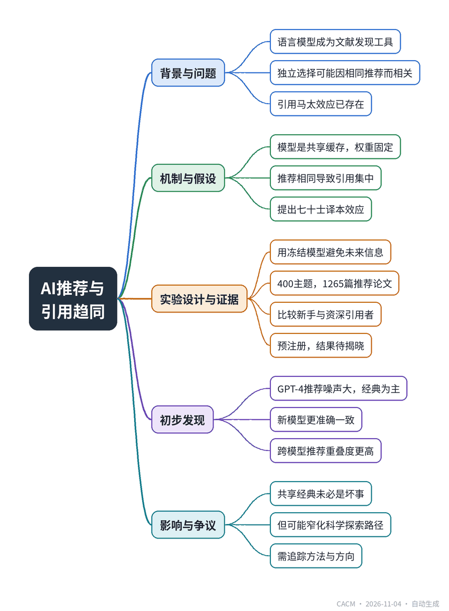

# The Septuagint Effect

## AI推荐如何影响论文引用

**来源**：Communications of the ACM（Blog@CACM）　|　**发布**：2026-11-03 19:55（美东）　|　**北京时间**：2026-11-04 07:55　|　**作者**：Carlos Baquero

[原文链接](https://cacm.acm.org/blogcacm/the-septuagint-effect/)　·　生成于 2026-11-04 15:02

---

## 一、摘要

> 语言模型推荐论文可能导致引用趋同，类似“七十士译本效应”。

语言模型正成为研究者查找文献的常用工具，但不同用户从同一模型获得相同推荐，可能使原本独立的引用选择变得高度相关，作者称之为“七十士译本效应”。文章回顾了引用的马太效应，指出模型像一个共享缓存，可能窄化注意力。已有实验显示不同厂商的模型有相似的论文偏好，但实验室选择不等于实际引用。为检测效应，作者利用2021年前训练的GPT-4和GPT-3.5，对400个主题提问并记录推荐论文，与相似引用数的对照论文比较，观察2024-2026年间新手的引用是否更偏向推荐论文。研究已预注册，结果待2026年12月和2027年4月揭晓。目前数据显示，GPT-4推荐噪声大，77%的论文只出现一次，但经典论文占主导；新模型更准确一致，Claude Sonnet 5.5和GPT-5.5的推荐重叠度更高。作者担忧，若所有实验室获得相同建议，科学探索的路径可能变窄，形成“认知单一文化”。

## 二、核心要点

1. 作者提出“七十士译本效应”：语言模型向所有用户提供相同推荐，使独立引用选择趋同。
2. 实验使用GPT-4（0613）和GPT-3.5，其训练数据截止2021年9月，无法反映之后的引用趋势。
3. 从OpenAlex抽取400个主题，GPT-4在至少三次回答中推荐的论文共1,265篇，覆盖349个主题。
4. 比较新手和资深引用者在2024-2026年对推荐论文与对照论文的引用变化，并设置安慰剂检验。
5. GPT-4推荐噪声大：77%的论文仅出现一次，11%的核心论文占29%的提及；新模型更准确一致。
6. 不同实验室的新模型推荐重叠度更高（Jaccard 0.30），可能加剧效应，科学探索路径或变窄。

## 三、关键词对照

| English | 中文 |
| --- | --- |
| Septuagint effect | 七十士译本效应 |
| Matthew effect | 马太效应 |
| preferential attachment | 优先连接 |
| shared cache | 共享缓存 |
| pre-registered | 预注册 |
| placebo test | 安慰剂检验 |
| Jaccard overlap | 杰卡德重叠度 |
| monoculture of knowing | 认知单一文化 |

## 四、中英对照全文

Imagine Alexandria, in the third century BC. Ptolemy II wants the Hebrew Torah in Greek for his new library, and Jerusalem sends 72 scholars, six from each tribe, to translate it. Later retellings embellish the story. In the version recorded in the Talmud, the king places the elders in 72 separate rooms and does not tell them why, so they cannot coordinate. In the end, each produces the same translation. The agreement was read as proof of divine inspiration, and the translation is still known by the round number of its translators: the Septuagint, “the 70.”

> 想象公元前三世纪的亚历山大城。托勒密二世想要将希伯来文《托拉》译成希腊文，供他的新图书馆收藏，于是耶路撒冷派出了72位学者，每个部落六人，前去翻译。后来的复述为这个故事增添了细节。在《塔木德》记载的版本中，国王将这些长老安置在72个独立的房间，不告诉他们原因，使他们无法协调。最终，每个人产出了相同的译文。这种一致性被解读为神圣启示的证明，而这部译本至今仍以其译者的整数而闻名：七十士译本（Septuagint），即“七十”。

Today, thousands of researchers sit in separate rooms and ask a language model which papers they should read on a topic. They do not coordinate, and yet the answers agree. No divine inspiration is needed: the same trained weights answer all of them. If they then go on to cite what they were told, many independent choices become one correlated choice. We tentatively call this the Septuagint effect. Empirically, I believe many of us feel that it is probably occurring right now, but actual detection requires a careful experiment.

> 如今，成千上万的研究者坐在各自的房间里，询问一个语言模型：关于某个主题，他们应该阅读哪些论文。他们并不协调，然而答案却一致。无需神圣启示：相同的训练权重为所有人作答。如果他们随后引用被告知的内容，许多独立的选择就变成了一个相关的选择。我们暂称其为“七十士译本效应”。从经验上看，我相信我们许多人觉得它可能正在发生，但实际检测需要精心设计的实验。

We start with an older effect with a biblical name: the Matthew effect.

> 我们从一个更古老、带有圣经名字的效应开始：马太效应。

A Shared Memory

> 共享记忆

The rich-get-richer dynamics of citations are well-known. Merton called it the Matthew effect, and we discussed it, together with preferential attachment, in an earlier post. In the classic picture, each researcher reaches the literature through their own mix of routes: an advisor, colleagues, a search engine, the reference lists of papers already read, and possibly some unconscious bias on what constitutes a good paper. Popular papers win because many partly independent routes lead to them.

> 引用中富者愈富的动态众所周知。默顿称之为马太效应，我们在之前的一篇文章中与优先连接一起讨论过。在经典图景中，每个研究者通过自己混合的路径接触文献：导师、同事、搜索引擎、已读论文的参考文献列表，以及可能对什么构成好论文的无意识偏见。热门论文胜出，是因为许多部分独立的路径都通向它们。

A language model shortcuts those routes. In distributed systems terms, it is a single shared cache that every client reads, and a cache that is never invalidated, since the weights can remain fixed for months or years. Whatever the model learned to consider “key” on a topic is served, identically, to everyone who asks.

> 语言模型为这些路径提供了捷径。用分布式系统的术语来说，它是一个所有客户端都读取的单一共享缓存，而且是一个永远不会失效的缓存，因为权重可以保持数月或数年不变。模型学到的关于某个主题的“关键”内容，会以相同的方式提供给每个提问者。

This is not the first time a technology has been suspected of narrowing attention. Evans found that as journals moved online, articles cited fewer and more recent papers, concentrated on fewer of them. For language models, a recent study by Alemohammad et al. asked 11 models from three vendors to pick papers from blind panels. The models shared one preference map, across vendors, while eight human experts did not. But laboratory choices are not citations, only written papers create them. Looking at realized citations, Kusumegi et al. report that authors who adopt LLMs cite more diverse and slightly less-cited work, which points the other way. So the question is open: do model recommendations actually show up in what people cite?

> 这并非第一次有技术被怀疑会收窄注意力。埃文斯发现，随着期刊转向在线，文章引用的论文更少、更新，且集中在更少的论文上。对于语言模型，阿莱莫哈马德等人最近的一项研究让来自三家供应商的11个模型从盲选面板中挑选论文。这些模型共享一个偏好图谱，跨供应商一致，而八位人类专家则不然。但实验室选择不是引用，只有写出的论文才产生引用。观察实际引用，库苏梅吉等人报告称，采用LLM的作者引用了更多样化且引用次数略少的作品，这指向相反方向。因此问题仍未解决：模型的推荐是否真的出现在人们引用的内容中？

Catching It in the Act

> 当场捕捉

The obvious test does not work. Models recommend papers that are already popular, and popular papers keep growing anyway, so a correlation between being recommended and later citations proves little. What we need is a recommendation that could not have known the future.

> 显而易见的测试行不通。模型推荐的是已经流行的论文，而流行论文无论如何都会继续增长，因此被推荐与后续引用之间的相关性证明不了什么。我们需要的是一个不可能预知未来的推荐。

One trick is to use models frozen in time. GPT-4 (snapshot 0613) and GPT-3.5 were trained on data up to September 2021, and they were the models behind ChatGPT in 2023 and 2024. Their recommendations cannot reflect any citation trend after 2021. OpenAI retired them on 23 October 2026, so we had to act quickly and record their answers before they went away. We sampled 400 research topics from OpenAlex (call each one T) across computer science, physical, life, health, and social sciences, and asked each model three different wordings of “which papers should I read on T?”, twice each. A paper that GPT-4 named in at least three of its six answers counts as recommended. That gave 1,265 recommended papers in 349 topics. Each was paired with up to three controls: papers on the same topic, from about the same year, with similar citation counts by the end of 2022, that no model named.

> 一个技巧是使用时间冻结的模型。GPT-4（快照0613）和GPT-3.5的训练数据截至2021年9月，它们是2023年和2024年ChatGPT背后的模型。它们的推荐不可能反映2021年之后的任何引用趋势。OpenAI于2026年10月23日停用了它们，因此我们必须迅速行动，在它们消失之前记录答案。我们从OpenAlex中抽取了400个研究主题（每个称为T），涵盖计算机科学、物理、生命、健康和社会科学，并向每个模型询问了“关于T我应该读哪些论文？”的三种不同措辞，每种问两次。GPT-4在其六次回答中至少三次提到的论文被视为推荐。这在349个主题中给出了1,265篇推荐论文。每篇论文与最多三个对照配对：同一主题、大约同一年、到2022年底引用次数相似、且没有模型提到的论文。

Next, we look at who cites them. Some citing papers cite just one paper from the model’s list for that topic; we call their authors newcomers. Others cite several; we call them engaged. Newcomers are the ones who would lean on an assistant, while experts already know the literature. The test is whether, from 2019–2022 to 2024–2026, newcomers shift their citations towards recommended papers and away from controls more than engaged citers do. Field-wide shocks, such as a topic becoming fashionable or a database change, should hit both groups and cancel out. A placebo test does the same comparison for 2019–2020 against 2021–2022, before ChatGPT existed, and should show nothing.

> 接下来，我们观察谁引用了它们。一些引用论文只引用了模型为该主题列出的列表中的一篇论文；我们称其作者为新来者。另一些引用了多篇；我们称他们为深度参与者。新来者才是可能依赖助手的人，而专家已经熟悉文献。测试的是，从2019–2022年到2024–2026年，新来者是否比深度引用者更多地将引用转向推荐论文并远离对照。领域范围的冲击，例如某个主题变得流行或数据库变更，应该同时影响两组并相互抵消。安慰剂测试对2019–2020年与2021–2022年（ChatGPT出现之前）进行同样的比较，应该显示无效果。

All of this is pre-registered on OSF, with two looks at the data: one in December 2026 and a final one in April 2027. Each look downloads some four to five million citing papers, with their reference lists. We do not know the answer yet, and by design we are not allowed to peek.

> 所有这些都在OSF上预注册，并计划对数据进行两次查看：一次在2026年12月，最终一次在2027年4月。每次查看下载约四到五百万篇引用论文及其参考文献列表。我们尚不知道答案，而且按照设计，我们不允许偷看。

What the Machines Remember

> 机器记得什么

What we can report now is what the models say, and there are interesting aspects. Asked the same question six times, GPT-4 is a noisy oracle. Of the papers it names on a topic, 77% appear in only one of its six answers. A small core of 11%, named in at least three, takes 29% of all mentions. The classics dominate: the median recommended paper is from 2004, and a third predate 2000.

> 我们现在可以报告的是模型说了什么，其中有一些有趣的方面。对同一个问题问六次，GPT-4是一个嘈杂的预言机。在它为一个主题列出的论文中，77%只出现在其六次回答中的一次。一个由11%组成的小核心（至少被提到三次）占据了所有提及的29%。经典作品占主导：推荐论文的中位数年份是2004年，三分之一早于2000年。

We also asked two current models, Claude Sonnet 5.5 and the slightly older GPT-5.5, the same questions, once per wording. On 188 topics that all four models answered in full, the share of mentions that go to papers named under all three wordings is about 12% for GPT-4 and GPT-3.5, against 28% for GPT-5.5 and 49% for Sonnet. The new models are also more accurate: we could find 93–94% of the papers they named in OpenAlex, against 70% for GPT-4. (Citation hallucination is not yet a thing of the past, but it is receding.) Those two distinct models, from different labs, agree with each other far more (a Jaccard overlap of 0.30 per topic) than either agrees with GPT-4 (0.12). It looks as if, as they become more capable and unabridged, they concur more often.

> 我们还向两个当前模型——Claude Sonnet 5.5和稍旧的GPT-5.5——询问了相同的问题，每种措辞一次。在所有四个模型都完整回答的188个主题上，三种措辞下都被提到的论文所占提及份额，GPT-4和GPT-3.5约为12%，而GPT-5.5为28%，Sonnet为49%。新模型也更准确：我们能在OpenAlex中找到它们提到的论文的93–94%，而GPT-4为70%。（引用幻觉尚未成为过去，但正在消退。）这两个来自不同实验室的不同模型彼此一致的程度（每个主题的Jaccard重叠为0.30）远高于它们各自与GPT-4的一致程度（0.12）。看起来，随着它们变得更强大、更完整，它们更经常地一致。

Noise, it turns out, is a form of diversity. The 2023 models scattered their answers, sometimes onto papers that do not exist. The newer ones are more accurate and more consistent; a step closer to 72 identical translations. Hence a conditional speculation: if the effect shows up with the noisy 2023 models, there is reason to expect it to be stronger with the current ones.

> 事实证明，噪声是一种多样性形式。2023年的模型分散了它们的答案，有时甚至指向不存在的论文。较新的模型更准确、更一致；更接近72个相同的译本。因此有一个有条件的推测：如果该效应在嘈杂的2023年模型上显现，就有理由预期它在当前模型上会更强。

Closing Thoughts

> 结语

A shared canon is not necessarily a bad thing. Newcomers reading the classics of a field is how fields are supposed to work, and search engines concentrated attention long before chatbots did. Models may also bring forgotten papers back into view. The concern is not that the canon exists, but that it is the same canon for everyone, and that it is chosen by a memory nobody curates.

> 共享的经典未必是坏事。新来者阅读一个领域的经典正是领域运作的方式，而搜索引擎早在聊天机器人之前就集中了注意力。模型也可能让被遗忘的论文重新进入视野。问题不在于经典存在，而在于它对每个人都是同一个经典，而且它是由无人策展的记忆选择的。

Citations are only the visible trace. When we ask a model which papers matter, we are also, perhaps without noticing, asking which methods to use and which questions are worth chasing. If the same weights give the same advice to thousands of labs, the risk is not only that a few papers get richer, but that science explores a narrower set of paths. Messeri and Crockett call this a “monoculture of knowing,” in which the questions and methods best suited to AI crowd out the rest. Detecting it would need a different experiment, one that follows methods and research directions rather than reference lists. The jury is still out. The seventy-two translators, the story goes, were praised precisely because they all wrote the same thing. In science, that would be a worrying compliment.

> 引用只是可见的痕迹。当我们问模型哪些论文重要时，我们可能也在不知不觉中问应该使用哪些方法、哪些问题值得追求。如果相同的权重给数千个实验室相同的建议，风险不仅在于少数论文变得更富有，还在于科学探索的路径变得更窄。梅塞里和克罗克特称之为“认知的单文化”，其中最适合AI的问题和方法挤占了其余。检测它需要不同的实验，一个跟踪方法和研究方向而非参考文献列表的实验。目前尚无定论。故事说，七十二位译者受到赞扬，正是因为他们都写了相同的东西。在科学中，那将是一种令人担忧的赞美。

Notes: This study was designed by the author, with Claude (Opus 5.5) writing and running the code. This text was planned by the author, drafted with Claude, and then rewritten by the author.

> 注：本研究由作者设计，Claude（Opus 5.5）编写并运行代码。本文由作者策划，与Claude共同起草，然后由作者重写。

## 附录：参考与脚注（原文）

References

1. Babylonian Talmud, Megillah 9a (William Davidson Edition). https://www.sefaria.org/Megillah.9a

2. Merton, R.K. The Matthew Effect in Science. Science 159, 3810 (1968); https://doi.org/10.1126/science.159.3810.56

3. Baquero, C. and Cabecinhas, R. Biases in Author Recognition. BLOG@CACM (2022); https://cacm.acm.org/blogcacm/biases-in-author-recognition/

4. Evans, J.A. Electronic Publication and the Narrowing of Science and Scholarship. Science 321, 5887 (2008); https://doi.org/10.1126/science.1150473

5. Alemohammad, S. et al. When AI Writes, Who Gets Cited? Evidence of Citation Monoculture Across Language Models. arXiv:2608.19230 (2026); https://arxiv.org/abs/2608.19230

6. Kusumegi, K. et al. Scientific production in the era of large language models. Science 390, 6779 (2025); https://doi.org/10.1126/science.adw3000

7. Baquero, C. Pre-registration: Do papers recommended by a pre-2022 language model gain citations from newcomers after 2023? OSF (2026); https://osf.io/d2jva

8. Messeri, L. and Crockett, M.J. Artificial intelligence and illusions of understanding in scientific research. Nature 627 (2024); https://doi.org/10.1038/s41586-024-07146-0

Carlos Baquero is a professor in the Department of Informatics Engineering within the Faculty of Engineering at Portugal’s Porto University and is also affiliated with INESC TEC. His research is focused on distributed systems and algorithms.

---
*英文原文版权归 Communications of the ACM 及作者所有；中文译文由 AI 辅助生成，仅供学习参考。*