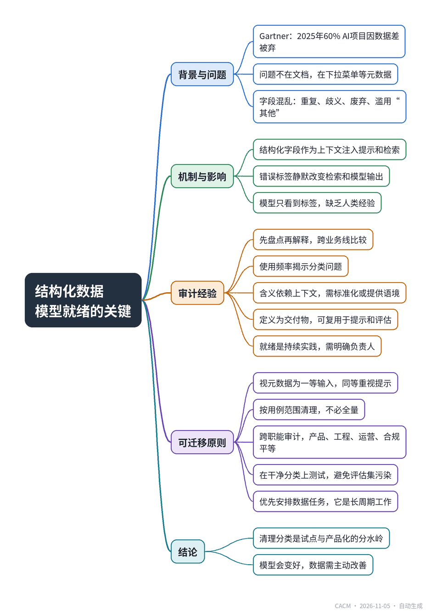

# Fix the Dropdown Before You Deploy the Model

## 部署模型前，先修好下拉菜单

**来源**：Communications of the ACM（Blog@CACM）　|　**发布**：2026-11-04 13:36（美东）　|　**北京时间**：2026-11-05 01:36　|　**作者**：Venkata Krishna Sai Neelisetti

[原文链接](https://cacm.acm.org/blogcacm/fix-the-dropdown-before-you-deploy-the-model/)　·　生成于 2026-11-05 15:28

---

## 一、摘要

> 结构化数据是模型的一等输入，而非后台管道。

生成式AI项目常因数据质量差而失败，Gartner预测2025年60%的AI项目会因缺乏AI就绪数据被放弃。文章基于财产险理赔平台的经验指出，问题不在非结构化文档，而在长期积累的结构化字段——下拉菜单、状态码等元数据。这些字段存在重复选项、跨业务线歧义、废弃代码和滥用“其他”等问题，人类靠经验理解，模型却只看到标签。在GenAI中，结构化字段作为上下文注入提示、检索过滤和评估标签，错误标签会静默改变检索结果和模型输出。作者团队审计所有下拉字段，总结五条经验：先盘点再解释、使用频率揭示问题、含义依赖上下文、定义为交付物、就绪是持续实践。文章提出可迁移原则：视结构化元数据为一等输入、按用例范围清理、跨职能审计、在干净分类上测试、优先安排数据任务。结论强调，清理分类虽不光鲜，却是试点与产品化的关键区别。

## 二、核心要点

1. Gartner预测2025年60%的AI项目因缺乏AI就绪数据被放弃，63%的组织缺乏合适的数据管理实践。
2. 结构化字段如下拉菜单、状态码是GenAI的上下文，错误标签会静默改变检索和模型输出。
3. 对财产险理赔平台所有下拉字段审计发现：重复选项、跨业务线歧义、废弃代码和滥用“其他”是主要问题。
4. 五条经验：先盘点再解释、使用频率揭示问题、含义依赖上下文、定义为交付物、就绪是持续实践。
5. 可迁移原则：视元数据为一等输入、按用例范围清理、跨职能审计、在干净分类上测试、优先安排数据任务。
6. 清理分类是AI项目最长周期的任务，需明确每个字段的负责人和变更流程。

## 三、关键词对照

| English | 中文 |
| --- | --- |
| Generative AI (GenAI) | 生成式人工智能 |
| Retrieval-Augmented Generation (RAG) | 检索增强生成 |
| Structured Data | 结构化数据 |
| Metadata | 元数据 |
| Taxonomy | 分类体系 |
| Data Readiness | 数据就绪 |
| Prompt | 提示 |
| Evaluation Set | 评估集 |

## 四、中英对照全文

My team was in the early planning stages of new generative AI capabilities for a property and casualty insurance claims management platform when the dialogue began (common these days) at model choice, retrieval architecture, and prompting. But it ended up somewhere less glitzy. We had to prove, before we trusted a language model to write a claim summary or recommend a next course of action, what the fields in our application truly represented.

> 我的团队正在为财产和意外伤害保险理赔管理平台规划新的生成式AI能力，对话一开始（如今很常见）就围绕模型选择、检索架构和提示展开。但最终却落脚在没那么光鲜的地方。在信任语言模型撰写理赔摘要或推荐下一步行动之前，我们必须证明应用程序中的字段究竟代表什么。

It appears we have plenty of company. Gartner in 2024 forecast that by the end of 2025, no less than 30% of GenAI initiatives will have been abandoned subsequent to proof of idea because of poor information high quality. In early 2025, Gartner went even further, projecting that this year, organizations will abandon 60% of AI initiatives because they lack AI-ready data, and 63% of organizations do not need or do not know if they have suitable information administration practices for AI.

> 看来我们有很多同伴。Gartner在2024年预测，到2025年底，不少于30%的GenAI计划将在概念验证后因数据质量差而被放弃。2025年初，Gartner更进一步，预计今年组织将放弃60%的AI计划，因为它们缺乏AI就绪的数据，而63%的组织不需要或不知道他们是否有适合AI的信息管理实践。

The lesson I want to offer is that the problem of preparedness actually lives somewhere else; not in the free-form documents you want to dump into a model, but around the free-form documents, the dropdowns, picklists, status codes, and other metadata that quietly go into every record.

> 我想提供的教训是，准备就绪的问题实际上存在于别处；不在于你想倒入模型的自由格式文档，而在于围绕自由格式文档的下拉菜单、选择列表、状态代码和其他元数据，这些元数据悄然进入每条记录。

### The Problem Hiding in Plain Sight
*隐藏在眼皮底下的问题*

Enterprise workflow systems have stack up shaped fields for many years. Each dropdown value was created by a responsible individual, for a responsible reason. What happens over many years is fairly obvious: nearly identical options (“Water Damage,” “Water – Pipe Burst,” “Water/Plumbing”); labels that have different meanings in different lines of business; retired codes that are still just an option; and an “Other” that almost silently becomes the most frequently used option. With experience, people manage this with tribal knowledge. They know which value the team really uses, and what it really means. A model has no such knowledge; it sees only the label.

> 企业工作流系统多年来积累了堆叠式字段。每个下拉值都是由负责任的个人出于负责任的原因创建的。多年后发生的事情相当明显：几乎相同的选项（“水损”、“水管爆裂”、“水/管道”）；在不同业务线中含义不同的标签；已停用但仍作为选项的代码；以及几乎悄然成为最常用选项的“其他”。凭借经验，人们用部落知识来管理这一点。他们知道团队真正使用哪个值，以及它真正意味着什么。模型没有这样的知识；它只看到标签。

It’s more important for GenAI than dashboards. The impact of a disorganized category is limited to a badly visualized bar in a BI report that a human analyst might pick up on. In a GenAI system, structured fields are context. They’re injected into prompts, used as retrieval filters, attached as metadata to document chunks, and used as labels in evaluation sets.

> 对GenAI来说，这比仪表盘更重要。混乱类别的影响仅限于BI报告中可视化糟糕的条形图，人类分析师可能会发现。在GenAI系统中，结构化字段是上下文。它们被注入提示、用作检索过滤器、作为元数据附加到文档块，并用作评估集中的标签。

An incorrectly labeled field isn’t just a false bar on a chart; it’s a lock that silently changes which documents get retrieved and what the model says, and what the model says, it says convincingly. Structured data is the scaffolding on which retrieval-augmented generation is built.

> 错误标记的字段不仅仅是图表上的错误条形图；它是一把锁，悄然改变哪些文档被检索以及模型说什么，而模型说的话，它说得令人信服。结构化数据是检索增强生成所建立的脚手架。

### What a Field-level Audit Taught Us
*字段级审计教给我们什么*

We performed a comprehensive audit of all dropdown fields in the app, across all lines of business. Five lessons emerged.

> 我们对应用程序中所有业务线的所有下拉字段进行了全面审计。得出了五个教训。

1. Take inventory before you interpret. Breaking down each field and all its values, and what lines of business to support, was eye-opening. Many issues were difficult to see until values could be compared across lines of business.

> 1. 先盘点再解释。分解每个字段及其所有值，以及要支持哪些业务线，令人大开眼界。许多问题在能够跨业务线比较值之前很难看到。

2. Usage speaks volumes. Values that are never used, or overused “catch-all” values both indicate a taxonomy that no longer describes how work is being done. How do you interpret a heavily used “Other”? A requirements document written by your users.

> 2. 使用情况说明一切。从未使用的值，或过度使用的“包罗万象”值，都表明分类法不再描述工作是如何完成的。你如何解释一个被大量使用的“其他”？由用户编写需求文档。

3. Meaning is context-sensitive. A label might have different meanings in different lines of business. Provide a model with a label without the context and it will fuse the different meanings. Standardize the values or provide context (line of business, definition) in the metadata a model receives.

> 3. 含义是上下文相关的。一个标签在不同业务线中可能有不同含义。给模型一个没有上下文的标签，它会融合不同的含义。标准化值或在模型接收的元数据中提供上下文（业务线、定义）。

4. Definitions are a deliverable. Giving each value a one-sentence definition required real decision making. It also gave us content that we could reuse in prompts and rubrics for evaluation. The data dictionary became a prompt resource.

> 4. 定义是可交付成果。为每个值提供一句话定义需要真正的决策。它也给了我们可以在提示和评估标准中重用的内容。数据字典成为提示资源。

5. Readiness is a practice, not a project. Values drift because products, rules, and processes change. We agree: AI-ready data is not one and done. Every field needs a named owner and a change process.

> 5. 就绪是一种实践，不是一个项目。值会漂移，因为产品、规则和流程会变化。我们同意：AI就绪的数据不是一劳永逸的。每个字段都需要一个指定的所有者和一个变更流程。

### Principles that Transfer
*可迁移的原则*

All of this applies not just to insurance, not just to a particular model or platform. Any organization that sticks language models on over their long-running production systems will get a variant of this. These are the things I’d take to any domain:

> 所有这些不仅适用于保险，也不仅适用于特定模型或平台。任何将语言模型叠加在长期运行的生产系统上的组织都会遇到这种情况的变体。这些是我会带到任何领域的东西：

Think of structured metadata as a first-class model input, not background plumbing. Look at it with the same level of care you’d give your prompt.

> 将结构化元数据视为一等模型输入，而不是背景管道。以对待提示的同样细心程度对待它。

Scope readiness in the use case. You do not need to clean out every single field. You only need to clean the fields your use case pulls, filters, or reasons over. Gartner also recommends preparing data to a distinct set of AI use cases.

> 在用例中界定就绪范围。你不需要清理每一个字段。你只需要清理你的用例拉取、过滤或推理的字段。Gartner也建议为特定的AI用例集准备数据。

Use a cross-functional audit. Make the product, engineering, operations, and compliance audits all equal. Different teams will see different failure modes and no one team can be the sole arbiter of a value.

> 使用跨职能审计。让产品、工程、运营和合规审计都平等。不同的团队会看到不同的故障模式，没有一个团队可以成为价值的唯一仲裁者。

Test on the cleaned taxonomy. If your evaluation labels are in the same dirty fields, then your test set is dirty, too, and your metrics will be optimistic.

> 在清理过的分类法上测试。如果你的评估标签在同样脏的字段中，那么你的测试集也是脏的，你的指标会过于乐观。

Prioritize data. Data readiness is not pre-work for the AI project. It is the AI project’s longest-lead task; schedule and resource accordingly.

> 优先考虑数据。数据就绪不是AI项目的前期工作。它是AI项目最长的前置任务；相应地安排时间和资源。

### The Unglamorous Prerequisite
*不起眼的前提条件*

No one demos a cleaned-up picklist. It doesn’t show up in keynote slides and it never gets its own line on a GenAI roadmap. But I have started to think that it’s the sharpest and most meaningful distinction between pilots that wow and products that stick around. Our models are only going to get better, but our own data will only get better if we choose to make it better.

> 没有人演示清理过的选择列表。它不会出现在主题演讲幻灯片中，也永远不会在GenAI路线图上拥有自己的一行。但我开始认为，这是令人惊叹的试点与持续存在的产品之间最尖锐、最有意义的区别。我们的模型只会变得更好，但我们自己的数据只有在我们选择让它变得更好时才会变得更好。

I wonder how people have done this. If you layered language models on top of legacy operational data, what did you discover in your structured fields, and who in your organization did you hand ownership of the fix to?

> 我想知道人们是如何做到这一点的。如果你将语言模型叠加在遗留运营数据之上，你在结构化字段中发现了什么，你将修复的所有权交给了组织中的谁？

Disclosure: The language of this post has been assisted by AI tools that the author has reviewed.

> 披露：本文的语言得到了AI工具的协助，作者已审阅。

## 附录：参考与脚注（原文）

References

1. Gartner. Gartner Predicts 30% of Generative AI Projects Will Be Abandoned After Proof of Concept By End of 2025 (July 29, 2024).

2. Gartner. Lack of AI-Ready Data Puts AI Projects at Risk (February 26, 2025).

Venkata Krishna Sai Neelisetti is a Generative AI Product Analyst at a large property and casualty insurer based in the U.S. The views expressed in this article are solely his own. Examples have been anonymized to remove references to the insurer.

---
*英文原文版权归 Communications of the ACM 及作者所有；中文译文由 AI 辅助生成，仅供学习参考。*