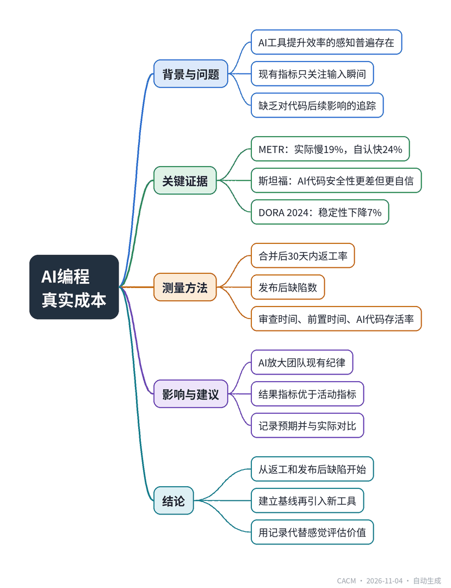

# The Real Cost of AI Code Shows Up 30 Days Later

## AI编程的真实成本30天后才显现

**来源**：Communications of the ACM（Blog@CACM）　|　**发布**：2026-11-04 11:52（美东）　|　**北京时间**：2026-11-04 23:52　|　**作者**：Shubham Kumbhalkar

[原文链接](https://cacm.acm.org/blogcacm/the-real-cost-of-ai-code-shows-up-30-days-later/)　·　生成于 2026-11-05 15:28

---

## 一、摘要

> AI工具让程序员更快还是更忙？

METR研究发现，开发者使用AI工具时实际速度慢19%，却自认为快24%。这种感知与现实的差距普遍存在：斯坦福实验显示AI辅助写出的代码安全性更差，而开发者却更自信；GitHub调查基于自报数据，90%开发者称更快完成。现有指标如代码行数、建议采纳率只关注输入瞬间，无法追踪后续成本。DORA 2024报告发现，AI采用率上升时交付稳定性下降约7%。文章提出应关注合并后30天内的返工率和发布后缺陷数等结果指标，这些指标读取git历史和CI日志，能反映代码的真实成本。DORA 2025报告指出AI是放大器，会放大团队已有的纪律或混乱。建议团队从返工和发布后缺陷两个指标开始，建立基线，用记录而非感觉回答AI工具的价值。

## 二、核心要点

1. METR研究发现开发者使用AI工具时实际速度慢19%，但自认为快24%，感知与测量相差近40个百分点。
2. 斯坦福实验表明AI辅助写出的代码安全性更差，但开发者对其安全性更有信心。
3. DORA 2024报告显示AI采用率上升时，代码审查变快但交付稳定性下降约7%。
4. 建议追踪合并后30天内的返工率和发布后缺陷数，这些指标基于git历史和CI日志。
5. DORA 2025报告指出AI是放大器，会放大团队已有的纪律或混乱，结果指标优于活动指标。
6. 团队应记录开发者预期并与30天后的实际结果对比，以判断工具是否真正有效。

## 三、关键词对照

| English | 中文 |
| --- | --- |
| METR | 模型评估与威胁研究机构 |
| DORA | DevOps研究与评估 |
| rework | 返工 |
| lead time | 前置时间 |
| acceptance rate | 采纳率 |
| self-report | 自报数据 |
| CI logs | 持续集成日志 |
| git blame | 代码追溯 |

## 四、中英对照全文

Last year, a group of experienced developers sat down to fix real bugs in code they knew well. Half the time they used AI tools, half the time they did not. Beforehand, they predicted the AI would make them about 24% faster. Afterward, they believed it had. The measured result went the other way: they were 19% slower with the AI, a METR study found. The study is small and the authors list real caveats, yet the gap it found is the point. People felt fast, but the clock said otherwise.

> 去年，一群经验丰富的开发者坐下来修复他们熟悉的代码中的真实缺陷。一半时间他们使用 AI 工具，一半时间不用。事前，他们预测 AI 会让他们快约 24%。事后，他们相信自己确实变快了。但实测结果恰恰相反：METR 的一项研究发现，使用 AI 时他们慢了 19%。这项研究规模不大，作者也列出了真实的注意事项，但它发现的差距正是关键所在。人们感觉自己很快，但时钟给出了不同的答案。

I am not quoting this to bury AI tools. I use them, Amazon Q, GitHub Copilot, Claude Code, and Kiro, every day at my current employer, so read this as field notes, not a pitch. My team ships real features with them. The trouble is that for months I could not say whether they made us faster or just busier. Most teams are in the same spot, and most of the ways we measure the answer are looking at the wrong moment.

> 我引用这些并不是要否定 AI 工具。我每天都在现在的雇主那里使用它们——Amazon Q、GitHub Copilot、Claude Code 和 Kiro，所以请把这当作实地笔记，而非推销。我的团队用它们交付真实功能。问题在于，几个月来我无法说清它们究竟是让我们更快了，还是只是更忙了。大多数团队都处于同样的境地，而我们衡量答案的大多数方式都看错了时机。

### Feelings are The Worst Available Instrument
*感觉是最糟糕的测量工具*

The gap repeats across the evidence. In the trial above, developers overrated the AI by nearly 40 points against their own measured time. A Stanford experiment found a second version of the same problem: people with an AI assistant wrote less secure code and were more sure it was safe. GitHub’s own survey, often cited as proof of a boost, rests on self-report, with more than 90% of developers saying they finished faster. Self-report is useful for morale; it is a poor meter for output or quality, since the people holding the stopwatch are the same people being timed.

> 这一差距在证据中反复出现。在上述试验中，开发者对 AI 的高估与其自身实测时间相比接近 40 个百分点。斯坦福的一项实验发现了同一问题的另一个版本：使用 AI 助手的人写出的代码安全性更低，却更确信其安全。GitHub 自己的调查常被引为效率提升的证据，但它依赖自我报告，超过 90% 的开发者表示自己完成得更快。自我报告对士气有用，但对产出或质量而言是个糟糕的计量器，因为拿着秒表的人正是被计时的人。

### Most Dashboards Watch the Keystroke, Not the Consequence
*大多数仪表盘关注的是按键，而非后果*

Vendors push three numbers: lines of code written by the model, suggestion acceptance rate, and raw typing speed. All three measure the instant a suggestion lands, and none track what happens to that code later. DORA’s 2024 report found the pattern at scale. As AI adoption rose, teams reported faster code review and better documentation, yet delivery stability dropped about 7%. More code arrived, and more of it broke. A metric that stops at the keystroke cannot see that cost. The metrics that can see it all share one trait: they read git history and CI logs, the record of what the code did after someone wrote it.

> 供应商推崇三个数字：模型编写的代码行数、建议采纳率和原始打字速度。这三者衡量的都是建议落下的瞬间，没有一个追踪该代码后来发生了什么。DORA 的 2024 年报告在大规模上发现了这一模式。随着 AI 采用率上升，团队报告代码审查更快、文档更好，但交付稳定性下降了约 7%。更多代码到来了，其中更多出了问题。一个止步于按键的指标看不到这一成本。能看到这一成本的指标都有一个共同特征：它们读取 git 历史和 CI 日志，即代码在被人编写之后做了什么的记录。

### The Honest Numbers Show Up Weeks Later
*诚实的数字在数周后才显现*

Two metrics carry most of the weight, and both read merged code.

> 两个指标承担了大部分分量，且都读取已合并的代码。

Rework within 30 days of merge counts how often fresh code gets rewritten soon after it ships. For each merge, note the files it touched, then scan the next 30 days of commits for more edits to the same lines. git log, --follow, and git blame give the per-line history, and the share of merged lines changed again inside the window is your number. A little rework is normal. A jump after a rollout means the team is shipping drafts and paying for them later.

> 合并后 30 天内的返工统计的是新代码在交付后不久被重写的频率。对每次合并，记录它触及的文件，然后扫描接下来 30 天的提交，查找对相同行的更多编辑。git log、--follow 和 git blame 提供逐行历史，而在该窗口内被再次修改的已合并行占比就是你的数字。少量返工是正常的。在推广后出现跃升，意味着团队在交付草稿，并在之后为此付出代价。

Defects found after release counts the bugs that reach production, traced back to the change that caused them. Tag each release, link every filed bug to its release and commit, then track defects per release and per thousand lines shipped. The link is the hard part, so start tagging now, since history cannot be rebuilt later. This is the metric that catches the stability cost DORA saw.

> 发布后发现的缺陷统计的是到达生产环境的 bug，并追溯到导致它们的变更。为每个发布打标签，将每个提交的 bug 关联到其发布和提交，然后按发布和每千行交付代码追踪缺陷。关联是困难的部分，所以现在就开始打标签，因为历史无法在事后重建。这个指标能捕捉到 DORA 所看到的稳定性成本。

Three more fill in the picture. Review time per change, the gap from pull request open to merge, shows whether AI code clears review faster or slower, and your code host API carries the timestamps. Time from first commit to deploy is lead time, and it answers a sharp question: if AI shortens coding but lengthens review and rework, does the change reach production any sooner? Often it does not. Share of AI-written code that survives review tells you how much of the model’s output actually ships, but it works only if you first decide what counts as AI-written, through commit tagging or editor telemetry, and say so plainly. Skip that step and it becomes the same vanity number as acceptance rate.

> 另外三个指标补全了图景。每次变更的审查时间，即从拉取请求打开到合并的间隔，显示 AI 代码通过审查是更快还是更慢，你的代码托管 API 带有时间戳。从首次提交到部署的时间是前置时间，它回答一个尖锐的问题：如果 AI 缩短了编码但延长了审查和返工，变更是否更早到达生产环境？通常并不会。AI 编写的代码中通过审查并存活下来的占比告诉你模型输出实际交付了多少，但前提是你首先通过提交打标签或编辑器遥测确定什么算作 AI 编写，并明确说明。跳过这一步，它就会变成和采纳率一样的虚荣数字。

### Pair Every Number with What the Team Believed
*让每个数字与团队此前的信念配对*

Here is the part most measurement skips. Record what developers expect before the data comes in, then set it against the 30-day reality. The METR and Stanford gaps exist for one reason: nobody checked perception against outcome. When you log both, you learn two things: whether the tool helped, and whether your team can tell. That second answer decides how much to trust self-report the next time a tool shows up.

> 这是大多数测量所跳过的一环。在数据到来之前记录开发者的预期，然后将其与 30 天的现实对照。METR 和斯坦福的差距存在的原因只有一个：没有人将感知与结果进行核对。当你把两者都记录下来，你会学到两件事：工具是否有帮助，以及你的团队能否分辨。第二个答案决定了下次新工具出现时该在多大程度上信任自我报告。

### AI Amplifies the Team You Already Are
*AI 放大的是团队本来的样子*

DORA’s 2025 report lands on a clean idea: AI is an amplifier. It magnifies the discipline a team already has, good or bad. A team with tight review and real post-release tracking gets faster and holds quality. A team running on green dashboards and gut feel ships more bugs, faster. That is why outcome metrics beat activity metrics. They measure the thing AI amplifies.

> DORA 的 2025 年报告落在一个清晰的观点上：AI 是一个放大器。它放大团队已有的纪律，无论好坏。拥有严格审查和真实发布后追踪的团队会变得更快并保持质量。依赖绿色仪表盘和直觉的团队会更快地交付更多 bug。这就是为什么结果指标胜过活动指标。它们衡量的是 AI 所放大的东西。

You do not need all five on day one. Start with rework and post-release defects, the two that show the real cost. Measure a baseline before the next tool lands. Then, when someone asks whether the tool was worth it, you can answer from records instead of feelings.

> 你不需要在第一天就全部采用这五个指标。从返工和发布后缺陷开始，这两个能显示真实成本。在下一个工具落地前测量基线。然后，当有人问这个工具是否值得时，你可以依据记录而非感觉来回答。

Shubham Kumbhalkar is a software engineer with more than 10 years building distributed systems, cloud backends, and GenAI tools in production. Views are his own.

> Shubham Kumbhalkar 是一名软件工程师，拥有超过 10 年构建分布式系统、云后端和生产环境 GenAI 工具的经验。观点仅代表其个人。

---
*英文原文版权归 Communications of the ACM 及作者所有；中文译文由 AI 辅助生成，仅供学习参考。*