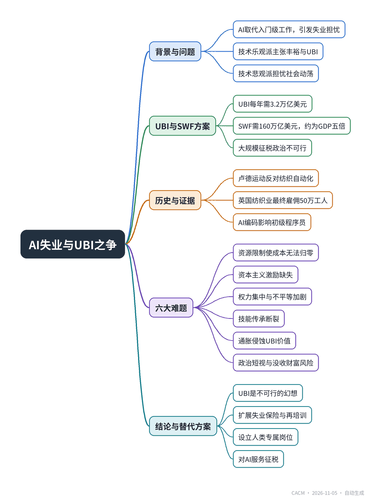

# AI Abundance or Luddite Revolution?

## AI丰裕还是卢德革命？

**来源**：Communications of the ACM（）　|　**发布**：2026-11-05 11:10（美东）　|　**北京时间**：2026-11-05 23:10　|　**作者**：

[原文链接](https://cacm.acm.org/opinion/ai-abundance-or-luddite-revolution/)　·　生成于 2026-11-06 15:27

---

## 一、摘要

> 全民基本收入无法解决AI失业，主权财富基金也难以支撑。

AI正在取代入门级工作，如编程和客服，引发对大规模失业的担忧。技术乐观派提出“丰裕”假说，认为AI将使商品和服务成本趋零，并主张用全民基本收入（UBI）保障生活，资金来自主权财富基金（SWF）。但文章指出，美国国债高达40万亿美元，许多欧洲国家债务超过GDP，财政空间有限。UBI每年需3.2万亿美元，若股市年回报2%，SWF需160万亿美元，约为美国GDP的五倍，且大规模征税在政治上不可行。此外，资源限制、资本主义激励缺失、权力集中、技能传承断裂、通胀风险和政治短视等六大难题使UBI难以实现。文章结论是，更务实的方案是扩展失业保险、提供再培训，并对AI服务征税，以应对AI带来的就业冲击。

## 二、核心要点

1. AI已开始取代入门级编程和客服工作，计算机科学毕业生就业难度增加。
2. 美国UBI提案为每位成人每年12,000美元，总计约3.2万亿美元，需SWF规模达160万亿美元（假设2%回报率），约为美国GDP的五倍。
3. 全球多国债务高企：美国债务40万亿美元（占GDP 123%），希腊、意大利、法国等国债务超过GDP。
4. 历史案例显示，英国纺织业自动化一个世纪后直接雇佣50万工人，法国雇佣超200万，占工业劳动力40%。
5. 文章列举UBI六大难题：资源限制、资本主义激励缺失、权力集中、技能传承断裂、通胀风险和政治短视。
6. 替代方案：扩展失业保险、提供再培训、设立“人类专属”岗位，并以AI服务税提供资金。

## 三、关键词对照

| English | 中文 |
| --- | --- |
| Universal Basic Income (UBI) | 全民基本收入 |
| Sovereign Wealth Fund (SWF) | 主权财富基金 |
| Luddite Revolution | 卢德革命 |
| Jevons Paradox | 杰文斯悖论 |
| Artificial Neural Network (ANN) | 人工神经网络 |
| Backpropagation | 反向传播 |
| Universal Function Approximation | 通用函数逼近 |
| Return on Investment (ROI) | 投资回报率 |

## 四、中英对照全文

Will AI lead to massive unemployment? In some sectors, AI is already replacing entry-level jobs. Computer science graduates are having increasing difficulty obtaining jobs as AI takes over junior programming jobs. Poorly designed customer-service robots are rapidly displacing customer service agents and forcing customers to submit to a company’s business model. Those whose jobs are being replaced find little comfort in economists’ forecasts that there will eventually be more new jobs than those replaced.

> 人工智能会导致大规模失业吗？在某些行业，人工智能已经在取代入门级工作。随着人工智能接管初级编程工作，计算机科学毕业生越来越难找到工作。设计糟糕的客服机器人正在迅速取代客服人员，并迫使客户接受公司的商业模式。那些工作被取代的人，对于经济学家关于最终新增就业岗位将多于被取代岗位的预测，并不感到宽慰。

Techno-optimists have advanced “abundance,” a vague hypothesis that AI automation will make most all goods and services so abundant that their costs will be zero and no one will need to work. They endorse a universal basic income (UBI) to cover residual costs remaining after abundance zeroes most costs. In the U.S., a common proposal for UBI is $12,000 for every adult, regardless of their economic status.

> 技术乐观主义者提出了“丰裕”这一模糊假设，即人工智能自动化将使几乎所有商品和服务变得如此丰富，以至于其成本降为零，无人需要工作。他们支持全民基本收入（UBI），以覆盖在丰裕使大多数成本归零后剩余的残余成本。在美国，常见的UBI提案是每位成年人每月1000美元，即每年12000美元，无论其经济状况如何。

Techno-pessimists are not persuaded that AI will generate widespread abundance. They believe there will be massive job losses, spread unevenly across sectors and mainly at the entry level. They are worried that mounting job losses will foment social upheaval, with a good chance of violent protests such as in the famous Luddite revolt against automation in the textile industry in 1811–1816. They believe the UBI would not alleviate the angst over loss of work, and its vast expense would provoke a massive economic crisis.

> 技术悲观主义者不相信人工智能会带来广泛的丰裕。他们认为将出现大规模失业，且在各行业分布不均，主要集中在入门级。他们担心不断增加的失业会引发社会动荡，很可能发生暴力抗议，如1811-1816年著名的卢德分子反对纺织业自动化的起义。他们认为UBI无法缓解失去工作的焦虑，而其巨额开支将引发大规模经济危机。

Here we will argue that UBI is not the solution to AI-induced unemployment, and that the sovereign wealth fund (SWF), a popular notion to pay for UBI, will fall far short. We will argue for the much more pragmatic approach of extending unemployment benefits and offering retraining for the new jobs. This approach is affordable, likely to provide a safety net for AI induced job losses, and likely to avoid violent social upheavals.

> 在此我们将论证，UBI并非人工智能导致失业的解决方案，而为UBI提供资金的热门主张——主权财富基金（SWF）——将远远不够。我们将主张采取更为务实的方法：扩大失业保险，并为新工作提供再培训。这种方法负担得起，可能为人工智能导致的失业提供安全网，并可能避免暴力社会动荡。

### The Debt Context
*债务背景*

Regardless of whether AI automation brings abundance or upheaval, many economies face difficult futures. Government assistance programs are popular and growing but taxes are insufficient to pay for them. This has resulted in large debts exceeding GDP in many countries. The U.S. national debt is $40 trillion (123% of GDP) and growing at more than $2 trillion per year. Several European countries have debts exceeding their GDPs: Greece (146.1%), Italy (137.1%), France (115.6%), Belgium (107.9%), Spain (100.7%) and the UK (100%). Greece and Sweden found the political courage to reduce their national debts, but it was a painful process for politicians and citizens alike. Some pundits argue that AI abundance will improve productivity so much that these countries will eliminate their debts. Given politicians’ proclivity to expand spending rather than shrink debt, that seems like a wishful fantasy. They are ill prepared for disruptions from AI induced unemployment.

> 无论人工智能自动化带来的是丰裕还是动荡，许多经济体都面临艰难的未来。政府援助项目广受欢迎且不断增长，但税收不足以支付。这导致许多国家债务超过GDP。美国国家债务为40万亿美元（占GDP的123%），且每年增长超过2万亿美元。几个欧洲国家的债务超过其GDP：希腊（146.1%）、意大利（137.1%）、法国（115.6%）、比利时（107.9%）、西班牙（100.7%）和英国（100%）。希腊和瑞典找到了政治勇气来减少国家债务，但这对政治家和公民来说都是一个痛苦的过程。一些权威人士认为，人工智能的丰裕将极大提高生产力，使这些国家消除债务。鉴于政治家倾向于扩大支出而非缩减债务，这似乎是一厢情愿的幻想。他们对人工智能引发的失业造成的破坏准备不足。

### Attack of the Luddites
*卢德分子的攻击*

In 1811, British artisans led by Ned Ludd fought back against automated machinery for making textiles by breaking the mechanized looms and knitting frames. They feared that unskilled machine operators were robbing them of their livelihood.

> 1811年，由内德·卢德领导的英国工匠通过破坏机械化织布机和针织框架，反击纺织制造的自动化机械。他们担心非熟练的机器操作员正在剥夺他们的生计。

The Jacquard Loom (1804) accelerated textile automation in the Industrial Revolution. The loom weaved faster than human hands and automated the incorporation of complex patterns into the cloths by storing weaving instructions on punched cards that controlled the movements of the machine. Patterns could be designed in advance and the cards sold to loom holders. Even with automated looms, there was a prosperous “cottage industry” of custom textiles in Europe. No machine could match their workmanship.

> 提花织布机（1804年）加速了工业革命中的纺织自动化。织布机比人手织得更快，并通过将编织指令存储在控制机器运动的打孔卡上，实现了将复杂图案自动织入布料。图案可以预先设计，卡片可以出售给织布机所有者。即使有了自动织布机，欧洲仍有一个繁荣的定制纺织品“家庭手工业”。没有机器能比得上他们的工艺。

Little did the Luddites suspect that, by the time of its peak a century later, the mechanized British textile industry would employ as many as 500,000 workers directly in spinning and weaving. France employed more than two million workers, nearly 40% of its industrial workforce.

> 卢德分子几乎没有料到，在一个世纪后的鼎盛时期，机械化的英国纺织业将直接雇佣多达50万名工人从事纺纱和织造。法国雇佣了超过200万名工人，占其工业劳动力的近40%。

Initial experience with the software industry seems to indicate that the new AI coders have impacted mostly entry-level programmers but not senior software developers. Because AI generated codes often contain errors, a new job category is emerging: software verification. The same can be said of other fields, such as accounting or legal services, where new specialists will verify the “work” done by AI.

> 软件行业的初步经验似乎表明，新的人工智能编码器主要影响入门级程序员，而非高级软件开发人员。由于人工智能生成的代码通常包含错误，一个新的职业类别正在出现：软件验证。其他领域也是如此，例如会计或法律服务，新的专家将验证人工智能完成的“工作”。

Over the years, unions formed to oppose automation that did not benefit workers. Modern unions have noted that, since 1980, technology has replaced more U.S. jobs than it has generated. They are concerned that AI will accelerate this trend.

> 多年来，工会成立以反对未使工人受益的自动化。现代工会指出，自1980年以来，技术取代的美国就业岗位多于其创造的岗位。他们担心人工智能将加速这一趋势。

### What Fuels the AI Revolution?
*是什么推动了人工智能革命？*

The Industrial Revolution emerged in 17–19 century Europe and North America. It was supported by capital accumulated through colonialism, trade, and slavery, and relied on energy from coal and oil. By the 19 century, textiles once imported from Asia were increasingly manufactured in Europe using steam-powered machinery and raw materials often produced through slave or low-wage labor. The AI revolution of the 21 century has similar dependencies. Its engines are digital computers powered by electricity generated from fossil fuels, nuclear energy, solar, wind, and water. Its raw materials are data expropriated from artisans or generated by low-wage workers. AI systems are distinguished by four foundational elements:

> 工业革命于17至19世纪出现在欧洲和北美。它得到了通过殖民主义、贸易和奴隶制积累的资本的支持，并依赖煤炭和石油的能源。到19世纪，曾经从亚洲进口的纺织品越来越多地在欧洲使用蒸汽动力机械和通常通过奴隶或低工资劳动力生产的原材料制造。21世纪的人工智能革命有着类似的依赖。其引擎是由化石燃料、核能、太阳能、风能和水力发电驱动的数字计算机。其原材料是从工匠那里征用的数据或由低工资工人产生的数据。人工智能系统以四个基本要素为特征：

Artificial neural network models, beginning with the McCulloch–Pitts model and later probabilistic neuromorphic variants.

> 人工神经网络模型，从麦卡洛克-皮茨模型开始，以及后来的概率神经形态变体。

Universal function approximation, which enables such models to represent broad classes of mathematical functions.

> 通用函数逼近，使此类模型能够表示广泛的数学函数类别。

Backpropagation, introduced in 1974 by P.J. Werbos, and other gradient-based methods, allowing efficient training of ANNs on large datasets.

> 反向传播，由P.J. Werbos于1974年提出，以及其他基于梯度的方法，允许在大型数据集上高效训练人工神经网络。

Large, curated datasets, including text, images, symbols, and other structured information, used to train AI models.

> 大型精选数据集，包括文本、图像、符号和其他结构化信息，用于训练人工智能模型。

Human labor remains essential. Much of the data used to train AI originates from the work of writers, creators, and data annotators, often receiving little compensation relative to the value they generated. Although hundreds of billions of dollars are being invested in AI infrastructure, far less is spent compensating the people and communities that create and curate the underlying data. A central challenge, therefore, is ensuring that the immense investments driving AI translate into broadly shared economic and social benefits rather than concentrating rewards among a small number of stakeholders. UBI is seen by many as a tool for accomplishing this.

> 人类劳动仍然至关重要。用于训练人工智能的大部分数据源于作家、创作者和数据标注员的工作，他们获得的报酬往往远低于其创造的价值。尽管数千亿美元投资于人工智能基础设施，但用于补偿创建和整理基础数据的人和社区的支出却少得多。因此，一个核心挑战是确保推动人工智能的巨额投资转化为广泛共享的经济和社会效益，而不是将回报集中在少数利益相关者手中。许多人认为UBI是实现这一目标的工具。

### The Jevons Paradox
*杰文斯悖论*

In 1865, the English economist William Stanley Jevons observed that technological improvements increased the efficiency of coal use and lowered the price of coal, leading to increased demand for coal to run more factories. AI techno-optimists have latched on to the Jevons paradox to “prove” that AI productivity will increase consumption of AI—the Abundance Hypothesis. Economist Erik Brynjolfsson does not agree that the paradox would apply across the board, because some market segments do not satisfy the conditions for the paradox. Nonetheless, entrepreneurs such as Elon Musk predict AI technology will, by 2035, reduce costs to near-zero in all sectors, eliminating the need for employment and rendering money useless.

> 1865年，英国经济学家威廉·斯坦利·杰文斯观察到，技术进步提高了煤炭使用效率并降低了煤炭价格，导致煤炭需求增加以运行更多工厂。人工智能技术乐观主义者抓住杰文斯悖论来“证明”人工智能生产力将增加人工智能的消费——即丰裕假设。经济学家埃里克·布林约尔松不同意该悖论会普遍适用，因为某些细分市场不满足悖论的条件。尽管如此，像埃隆·马斯克这样的企业家预测，到2035年，人工智能技术将在所有行业将成本降至接近零，从而消除就业需求并使金钱变得无用。

### The UBI
*全民基本收入*

The UBI response to AI employment disruption is that every adult receives a guaranteed income regardless of their economic status. The income does not need to be high because abundance eliminates most costs. Universal basic income proposals often tout a sovereign wealth fund to pay for it.

> UBI对人工智能就业破坏的回应是，每位成年人无论其经济状况如何都获得保障收入。收入不需要很高，因为丰裕消除了大部分成本。全民基本收入提案通常吹嘘用主权财富基金来支付。

An example of a successful SWF was established in 2020 by the Seminole Tribe to invest in commercial real estate properties. The Seminole Tribe owns six casinos, numerous hotels, and the Hard Rock Café, which has restaurants in 74 countries. An Internet post estimates that each adult member of the Seminole Tribe receives $100,000 per year from the fund. Unfortunately, this example does not generalize to a full population. UBI promoters therefore advocate for a combination of tax overhaul and SWF to generate the funds needed. All the scenarios for collecting enough taxes to pay for UBI imagine a total restructuring of the tax system including confiscatory rates on high earners, annual taxes on wealth including pension funds and stock holdings, value-added tax, a special tax to capture the salary lost when a robot replaces a human, and much higher corporate taxes. There is no way the political system would agree to such massive tax changes. The political system stoutly resists even small reforms to Social Security such as raising retirement age by one year.

> 一个成功的主权财富基金的例子是塞米诺尔部落于2020年建立的，用于投资商业房地产。塞米诺尔部落拥有六家赌场、众多酒店和硬石餐厅，后者在74个国家设有餐厅。一份互联网帖子估计，塞米诺尔部落的每位成年成员每年从该基金获得10万美元。不幸的是，这个例子不能推广到全体人口。因此，UBI推动者主张结合税制改革和主权财富基金来产生所需资金。所有征收足够税收以支付UBI的方案都设想对税收制度进行全面重组，包括对高收入者征收没收性税率、对财富（包括养老基金和股票持有）征收年度税、增值税、对机器人取代人类时损失的工资征收特别税，以及大幅提高公司税。政治系统不可能同意如此大规模的税收变化。政治系统坚决抵制甚至对社会保障的小改革，例如将退休年龄提高一年。

### The SWF
*主权财富基金*

Because taxation will come up woefully short, the SWF is often proposed to make up the difference. It is basically an investment fund that appreciates along with the stock markets. Some proposers argue that a sufficiently large SWF would gather enough annual interest to cover all the annual UBI payments.

> 由于税收将严重不足，主权财富基金常被提议来弥补差额。它基本上是一个随股票市场升值的投资基金。一些提议者认为，足够大的主权财富基金将聚集足够的年利息来覆盖所有年度UBI支付。

SWFs are state-owned investment funds that manage national wealth through investments in various asset classes such as oil, company stocks, bonds, real estate, and alternative investments like private equity and hedge funds. An AI SWF would have to generate an enormous return on investment (ROI) to support UBI. In the US, the UBI of $12,000 issued annually to 270 million adults would total about $3.2 trillion annually. If the stock market appreciated at X% a year, a SWF with $3.2/X trillion could be self-sustaining. For X=2%, a realistic estimate, the SWF would need $160 trillion. The current U.S. GDP is about $30 trillion and U.S. debt stands at about $40 trillion—so that SWF is approximately five times the GDP.

> 主权财富基金是国有投资基金，通过投资于各种资产类别来管理国家财富，如石油、公司股票、债券、房地产以及私募股权和对冲基金等另类投资。人工智能主权财富基金必须产生巨大的投资回报率（ROI）来支持UBI。在美国，每年向2.7亿成年人发放的12000美元UBI总额约为每年3.2万亿美元。如果股票市场每年升值X%，那么拥有3.2/X万亿美元的主权财富基金就可以自我维持。对于X=2%（一个现实的估计），主权财富基金需要160万亿美元。目前美国GDP约为30万亿美元，美国债务约为40万亿美元——因此该主权财富基金大约是GDP的五倍。

The SWF estimates here correspond to an economy with the current tax system. The sweeping tax changes noted previously would confiscate so much wealth that the stock market could not function well, and the SWF would collapse.

> 这里的主权财富基金估计对应于当前税制下的经济。前面提到的全面税制改革将没收如此多的财富，以至于股票市场无法良好运作，主权财富基金将崩溃。

### Other Difficulties
*其他困难*

Proponents of UBI often overlook six other difficulties.

> UBI的支持者常常忽视另外六个困难。

The first is the background assumption that everything becomes abundant at about the same rate and the prices of everything keep going down. But the economy is not homogeneous in this way. For example, sectors such as solar panel, magnet, and chip manufacturing require rare earths, which are in limited supply worldwide. Robots in those sectors would be unable to achieve “abundance” because of the high costs to obtain the rare earths. Resource limits would affect the abilities of each sector to reduce its unit costs to zero, in many cases producing a floor keeping prices up.

> 第一个是背景假设，即一切以大致相同的速度变得丰裕，所有价格持续下降。但经济并非如此同质。例如，太阳能电池板、磁体和芯片制造等行业需要稀土，而全球稀土供应有限。这些行业的机器人由于获取稀土的高成本而无法实现“丰裕”。资源限制将影响每个行业将单位成本降至零的能力，在许多情况下产生价格下限。

A second difficulty concerns capitalism itself. If products become abundant and consumer prices fall to zero, what incentive remains to start a company? There would be nothing to invest in, no return on investment, and no stocks. Without a stock market, a sovereign wealth fund would have no way to grow. UBI would collapse.

> 第二个困难涉及资本主义本身。如果产品变得丰富且消费价格降至零，那么创办公司的动机何在？将没有可投资的东西，没有投资回报，也没有股票。没有股票市场，主权财富基金将无法增长。UBI将崩溃。

A third difficulty concerns the distributions of human talents. People with greater abilities tend to accumulate more power. Today, that power often becomes wealth. Power is inherently unevenly distributed. Those with more would block acquisition of power by those with less. Those with less would covet those with more. Inequality would worsen rather than disappear. Power struggles would intensify, to no one’s benefit.

> 第三个困难涉及人类才能的分布。能力更强的人往往积累更多权力。今天，这种权力常常变成财富。权力本质上是分布不均的。拥有更多的人会阻止拥有较少的人获得权力。拥有较少的人会觊觎拥有较多的人。不平等将恶化而非消失。权力斗争将加剧，对谁都没有好处。

A fourth difficulty concerns the value of high skill levels of experts and masters in their fields. People want master physicians to deal with their diseases, master plumbers to repair their pipes, master electricians to install their electricity, master chefs to feed them, and master musicians to inspire them. AI is unlikely to develop skills matching human experts or masters. Those skill levels depend almost entirely on vast reservoirs of tacit knowledge that machines cannot know. The humans replaced by machines are likely to be those of lower skill levels, such as beginner or competent levels. If no one is learning the lower skill levels of a domain, who will grow into future experts and masters?

> 第四个困难涉及专家和大师在其领域的高技能水平的价值。人们希望大师级医生治疗他们的疾病，大师级水管工修理他们的管道，大师级电工安装他们的电力，大师级厨师为他们提供食物，大师级音乐家激励他们。人工智能不太可能发展出与人类专家或大师相匹配的技能。这些技能水平几乎完全依赖于机器无法知晓的大量隐性知识。被机器取代的人很可能是技能水平较低的人，例如初学者或胜任水平。如果没有人学习一个领域的较低技能水平，谁将成长为未来的专家和大师？

A fifth difficulty is the possibility of inflation erasing the value of UBI. It is commonly proposed that, if the SWF is insufficient, the government can simply print new money to make up the difference. The problem is that “free money” generates inflation. This was demonstrated in the U.S. when the government made massive subsidies available during the COVID pandemic, which stoked a period of high inflation.

> 第五个困难是通货膨胀可能抹去UBI的价值。通常提议，如果主权财富基金不足，政府可以简单地印新钱来弥补差额。问题是“免费的钱”会产生通货膨胀。这在美国得到了证明，当政府在COVID大流行期间提供大量补贴时，引发了高通胀时期。

A sixth difficulty is the capriciousness of politicians. A recent proposal in the U.S. by Senator Bernie Sanders would confiscate 50% of all the wealth of the large AI companies, currently about $27 trillion. Half that comes nowhere close to funding the SWF needed for the UBI. The one-time confiscation of that wealth would severely impact those companies’ stocks and all the stock market and index funds that depend on them. This shortsighted proposal is unlikely to pass Congress, but the urge behind it to confiscate wealth is growing. A variation on this proposal is for the government to take a stake in many companies, for example 20%, converting that portion of their market value into cash for a SWF.

> 第六个困难是政治家的反复无常。美国参议员伯尼·桑德斯最近的一项提案将没收大型人工智能公司所有财富的50%，目前约为27万亿美元。其中一半远不足以资助UBI所需的主权财富基金。一次性没收这些财富将严重影响这些公司的股票以及所有依赖它们的股票市场和指数基金。这一短视的提案不太可能通过国会，但其背后没收财富的冲动正在增长。该提案的一个变体是政府在许多公司中持股，例如20%，将这部分市场价值转换为主权财富基金的现金。

### Conclusion
*结论*

Will AI lead to a Luddite revolution or will a UBI rescue society when AI takes jobs away from humans? What can governments do? We conclude that a U.S. utopian zero-cost economy is unlikely and the proposed UBI solution funded by SWF investing in the stock market would be far from sufficient to support the American labor force. The UBI proposals overlook that people work not just for a salary but because it gives them purpose and meaning and a sense of contributing to society. Taking away their work takes away their dignity. They feel incomplete and restive.

> 人工智能会导致卢德革命，还是当人工智能夺走人类工作时UBI会拯救社会？政府能做什么？我们得出结论，美国乌托邦式的零成本经济不太可能，而拟议的由主权财富基金投资股票市场资助的UBI解决方案将远远不足以支持美国劳动力。UBI提案忽视了人们工作不仅是为了薪水，还因为它赋予他们目的和意义以及对社会贡献的感觉。夺走他们的工作就夺走了他们的尊严。他们感到不完整和不安。

An alternative is available as a variation of the status quo. Displaced workers would get unemployment benefits until they are employed again. They would be offered retraining in the skill sets of the new jobs. Some jobs could be designated “reserved for humans only.” A tax on AI services would pay for all this.

> 另一种选择是作为现状的变体。流离失所的工人将获得失业救济金，直到他们再次就业。他们将接受新工作技能集的再培训。一些工作可以被指定为“仅限人类”。对人工智能服务征税将支付所有这些费用。

To us, UBI looks like an infeasible fantasy. There is not enough money, abundance, or popular will to realize a no-work economy. We are in for a rough ride.

> 对我们来说，UBI看起来像一个不可行的幻想。没有足够的钱、丰裕或民众意愿来实现无工作经济。我们将经历一段艰难的旅程。

---
*英文原文版权归 Communications of the ACM 及作者所有；中文译文由 AI 辅助生成，仅供学习参考。*