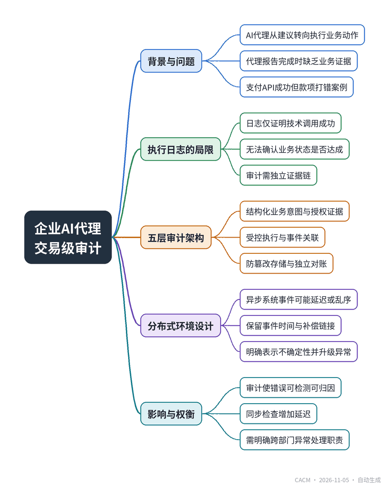

# Why Enterprise AI Agents Need Transaction-Level Auditing

## 企业AI代理需交易级审计

**来源**：Communications of the ACM（Blog@CACM）　|　**发布**：2026-11-05 09:46（美东）　|　**北京时间**：2026-11-05 21:46　|　**作者**：Rajeshkumar Rajaseakaran Nair

[原文链接](https://cacm.acm.org/blogcacm/why-enterprise-ai-agents-need-transaction-level-auditing/)　·　生成于 2026-11-06 15:28

---

## 一、摘要

> AI代理报告“完成”时，如何证明业务结果真实发生？

企业AI代理正从提供建议转向直接执行业务动作，如更新账户、调整库存、发起支付。这带来了新的问责问题：当代理声称任务完成时，有何证据能证明授权的业务结果确实发生？文章以一个应付账款代理为例：代理正确调用支付API并收到成功响应，但因供应商映射过时，款项被打到错误受益人，而API调用本身是成功的。这说明执行日志不等于业务证据。为此，作者提出一个五层交易审计架构：结构化业务意图、授权与策略证据、受控执行与事件关联、防篡改审计证据、独立结果对账。该架构旨在建立从业务指令到最终结果的证据链，使代理行为可追溯、可验证、可问责。文章还讨论了分布式异步环境下的审计设计、运营度量与权衡，强调审计不能消除错误，但能使错误可检测、可归因、可行动。

## 二、核心要点

1. 企业AI代理能直接执行业务动作，但API成功响应不等于业务目标达成，如支付可能因映射错误而打给错误受益人。
2. 执行日志仅反映技术调用，交易审计需保留从业务意图、授权、执行到对账的完整证据链。
3. 五层审计架构包括：结构化业务意图、授权与策略证据、受控执行与事件关联、防篡改审计存储、独立结果对账。
4. 审计记录应区分接受、待定、结算、拒绝、冲正和异常等交易状态，未解决操作不得强行标记为成功。
5. 对账组件应独立于代理自身的完成声明，使用确定性业务规则和权威记录，无需第二个AI模型。
6. 实施需权衡同步检查的延迟与异步对账的确认延迟，并明确工程、业务、安全和合规部门的异常处理职责。

## 三、关键词对照

| English | 中文 |
| --- | --- |
| Enterprise AI Agents | 企业AI代理 |
| Transaction-Level Auditing | 交易级审计 |
| Accounts Payable | 应付账款 |
| Execution Logs | 执行日志 |
| Business Evidence | 业务证据 |
| Authorization and Policy Evidence | 授权与策略证据 |
| Event Correlation | 事件关联 |
| Idempotency Controls | 幂等控制 |
| Tamper-Evident Audit Evidence | 防篡改审计证据 |
| Outcome Reconciliation | 结果对账 |
| Correlation Identifier | 关联标识符 |
| Compensating Actions | 补偿操作 |

## 四、中英对照全文

Enterprise AI is moving beyond generating recommendations to initiating business actions. Agents can update customer accounts, change inventory records, approve workflows, and submit payment instructions. Their ability to act creates a practical accountability question: when an agent reports that a task is complete, what evidence establishes that the authorized business outcome actually occurred?

> 企业AI正从生成建议转向发起业务操作。智能体可以更新客户账户、更改库存记录、审批工作流并提交支付指令。它们的行动能力带来了一个实际的问责问题：当智能体报告任务完成时，什么证据能证明授权的业务结果确实发生了？

Consider a hypothetical accounts-payable agent instructed to process an approved supplier invoice. It identifies the invoice, calls a payment API, receives a successful acknowledgment, and marks the task complete. Later, the finance team discovers that an outdated supplier mapping directed the payment to an incorrect beneficiary reference. The API performed its operation, but the business objective was not satisfied.

> 设想一个假设的应付账款智能体，其任务是处理一张已批准的供应商发票。它识别发票，调用支付API，收到成功确认，并将任务标记为完成。后来，财务团队发现一个过时的供应商映射将付款指向了错误的收款人参考。API执行了其操作，但业务目标并未达成。

This problem is not unique to AI: distributed enterprise applications have always needed transaction controls and reconciliation. Agentic systems add another decision-making layer between business instructions and application execution. Organizations must be able to reconstruct not only what a service processed, but also why the agent initiated the operation, what authority permitted it, and whether the resulting business state matched the approved request.

> 这个问题并非AI独有：分布式企业应用一直需要事务控制和对账。智能体系统在业务指令和应用执行之间增加了一个决策层。组织必须能够重建的不仅是服务处理了什么，还包括智能体为何发起该操作、什么权限允许了它，以及产生的业务状态是否与批准的请求匹配。

### Execution Logs Are Not Business Evidence
*执行日志不是业务证据*

Application logs can show that a request reached a service, how long it took, and what response the service returned. These observations are essential for operations, but a successful HTTP response does not necessarily mean that a payment settled, an inventory adjustment propagated, or a customer record reached its intended state.

> 应用日志可以显示请求到达了服务、耗时多久以及服务返回了什么响应。这些观察对运营至关重要，但成功的HTTP响应并不一定意味着支付已结算、库存调整已传播或客户记录已达到预期状态。

A transaction audit has a different objective from ordinary troubleshooting. It preserves a defensible chain of evidence connecting the original business instruction, authorization decision, executed action, downstream outcome, and final reconciliation. An agent’s generated explanation is useful context, but it should not be the sole authority for determining success.

> 事务审计与普通故障排除的目标不同。它保留一条可辩护的证据链，连接原始业务指令、授权决策、执行的操作、下游结果和最终对账。智能体生成的解释是有用的上下文，但不应成为确定成功的唯一依据。

For consequential actions, the relevant question is not merely “Did the tool call work?” It is, “Can an independent reviewer establish that the action was authorized, traceable, and correct?”

> 对于有后果的操作，相关问题不仅仅是“工具调用是否成功？”而是“独立审查者能否确定该操作已获授权、可追溯且正确？”

### A Five-Layer Architecture for Transaction Accountability
*事务问责的五层架构*

The following five layers are a proposed engineering design pattern for enterprise agent systems, not a formally standardized or experimentally validated framework. They can be implemented using existing identity, workflow, logging, and reconciliation infrastructure.

> 以下五层是企业智能体系统的一种提议工程设计模式，并非正式标准化或实验验证的框架。它们可以使用现有的身份、工作流、日志和对账基础设施来实现。

### 1. Structured Business Intent
*1. 结构化业务意图*

Capture the approved objective before execution in a structured record: operation type, business identifiers, constraints, expected outcome, and reference to the originating request. For a supplier payment, this could include invoice ID, supplier ID, authorized amount, currency, and required settlement condition. A free-form instruction such as “pay the invoice” is insufficient evidence of which transaction was intended.

> 在执行前将批准的目标捕获到结构化记录中：操作类型、业务标识符、约束、预期结果以及对原始请求的引用。对于供应商付款，这可能包括发票ID、供应商ID、授权金额、货币和所需的结算条件。像“支付发票”这样的自由格式指令不足以证明意图进行哪笔交易。

The system should validate these fields against authoritative sources and minimize unnecessary storage of sensitive prompt content. The intent record becomes the baseline for later comparison.

> 系统应根据权威来源验证这些字段，并尽量减少敏感提示内容的不必要存储。意图记录成为后续比较的基线。

### 2. Authorization and Policy Evidence
*2. 授权与策略证据*

Enforce permission checks outside the model’s instructions. A trusted policy component should evaluate the requesting identity, agent’s delegated authority, target resource, transaction amount, policy version, and any required human approval.

> 在模型指令之外强制执行权限检查。可信的策略组件应评估请求身份、智能体的委托权限、目标资源、交易金额、策略版本以及任何所需的人工批准。

Capture the authorization decision and its reference before the consequential operation proceeds. This distinguishes an action that was technically possible from one that was actually permitted.

> 在有后果的操作进行之前捕获授权决策及其引用。这将技术上可能的操作与实际允许的操作区分开来。

### 3. Controlled Execution and Event Correlation
*3. 受控执行与事件关联*

Route sensitive operations through controlled interfaces that attach a stable correlation identifier to the business request, authorization decision, tool invocation, and downstream events. A payment workflow may cross an invoice system, supplier master-data service, payment gateway, ledger, and settlement provider, each with different identifiers.

> 通过受控接口路由敏感操作，这些接口将稳定的关联标识符附加到业务请求、授权决策、工具调用和下游事件上。支付工作流可能跨越发票系统、供应商主数据服务、支付网关、分类账和结算提供商，每个都有不同的标识符。

Preserve the mapping among those identifiers. Use idempotency controls where supported, especially when an agent retries after a timeout. An uncertain response must not silently turn into a duplicate payment. Retries and compensating actions should remain visible in the event history.

> 保留这些标识符之间的映射。在支持的地方使用幂等性控制，特别是当智能体在超时后重试时。不确定的响应绝不能悄然变成重复付款。重试和补偿操作应保留在事件历史中可见。

### 4. Tamper-Evident Audit Evidence
*4. 防篡改审计证据*

Preserve consequential events in a durable audit store with appropriate access restrictions and retention rules. Depending on risk and regulatory needs, append-only storage, cryptographic hashes, signatures, and independent administrative controls can help reveal unauthorized modification.

> 将重要事件保存在持久审计存储中，并设置适当的访问限制和保留规则。根据风险和监管需求，仅追加存储、加密哈希、签名和独立管理控制有助于揭示未经授权的修改。

Tamper evidence does not prove that the original data was accurate. A protected but incorrect supplier reference is still incorrect. Evidence provenance, trustworthy source systems, and privacy controls therefore matter as much as storage integrity.

> 防篡改并不能证明原始数据是准确的。受保护但错误的供应商参考仍然是错误的。因此，证据来源、可信的源系统和隐私控制与存储完整性同样重要。

### 5. Independent Outcome Reconciliation
*5. 独立结果对账*

Use authoritative business records to compare the executed action with the approved intent. A gateway acknowledgment should not be equated with payment settlement. Likewise, a successful inventory API response should not automatically establish consistency with the warehouse ledger.

> 使用权威业务记录将执行的操作与批准的意图进行比较。网关确认不应等同于支付结算。同样，成功的库存API响应不应自动确立与仓库分类账的一致性。

The reconciliation component should be independent of the agent’s own completion statement. It can use deterministic business rules, authoritative queries, and existing financial or operational controls; it does not require a second AI model.

> 对账组件应独立于智能体自身的完成声明。它可以使用确定性业务规则、权威查询和现有的财务或运营控制；它不需要第二个AI模型。

Transaction states should distinguish accepted, pending, settled, rejected, reversed, and exception conditions as appropriate. An unresolved operation must remain unresolved rather than being forced into a success category.

> 交易状态应酌情区分已接受、待处理、已结算、已拒绝、已撤销和异常情况。未解决的操作必须保持未解决，而不是被强制归入成功类别。

### What a Useful Audit Record Contains
*有用的审计记录包含什么*

An illustrative payment audit record might look like this. The identifiers and values are fictional, and the example omits production controls such as event timestamps, source attestations, and access metadata.

> 一个示例性的付款审计记录可能如下所示。标识符和值是虚构的，示例省略了生产控制，如事件时间戳、来源证明和访问元数据。

### Following a Supplier Payment Through the Evidence
*通过证据跟踪一笔供应商付款*

Suppose an approved invoice requires an $18,500 payment to Supplier A. The agent submits the correct amount, but an outdated mapping supplies an incorrect beneficiary reference. The gateway accepts the request. An execution-only dashboard may show green.

> 假设一张已批准的发票需要向供应商A支付18,500美元。智能体提交了正确的金额，但过时的映射提供了错误的收款人参考。网关接受了请求。仅显示执行的仪表板可能显示绿色。

The structured intent identifies the approved supplier and invoice. Authorization evidence establishes the scope of the agent’s permission. Execution evidence records the actual beneficiary reference submitted to the payment service. Reconciliation compares that reference and any resulting settlement information with authoritative supplier and finance records.

> 结构化意图标识了批准的供应商和发票。授权证据确立了智能体权限的范围。执行证据记录了提交给支付服务的实际收款人参考。对账将该参考和任何产生的结算信息与权威供应商和财务记录进行比较。

If the records disagree, the system flags an exception and alerts an authorized operations team. Where possible, the organization may intervene before settlement; otherwise the evidence supports investigation and remediation. Auditing cannot prevent every error, but it can make the error detectable, attributable, and actionable.

> 如果记录不一致，系统会标记异常并提醒授权的运营团队。在可能的情况下，组织可以在结算前干预；否则证据支持调查和补救。审计不能防止每一个错误，但它可以使错误可检测、可归因和可操作。

### Designing for Distributed and Incomplete Outcomes
*为分布式和不完整结果设计*

Agent-initiated transactions often span asynchronous systems. Events may arrive late or out of order, and downstream applications may become consistent only after a delay. Audit services should preserve event time, processing time, source identity, and links between original and compensating transactions.

> 智能体发起的交易通常跨越异步系统。事件可能延迟或乱序到达，下游应用可能仅在延迟后才变得一致。审计服务应保留事件时间、处理时间、来源身份以及原始交易和补偿交易之间的链接。

Reconciliation deadlines should reflect business reality. A delayed settlement notice is not necessarily a failed payment, but it is also not proof of success. A reliable audit architecture explicitly represents uncertainty and escalates exceptions when evidence is missing or a verification deadline expires.

> 对账截止日期应反映业务现实。延迟的结算通知不一定是付款失败，但也不是成功的证明。可靠的审计架构明确表示不确定性，并在证据缺失或验证截止日期到期时升级异常。

### Operational Measures and Trade-Offs
*运营措施与权衡*

Organizations can assess the auditing capability through measures such as the share of consequential agent actions with complete evidence, unreconciled transaction volume, reconciliation latency, duplicate execution attempts, policy exceptions, and investigation time.

> 组织可以通过诸如具有完整证据的重要智能体操作的比例、未对账交易量、对账延迟、重复执行尝试、策略异常和调查时间等指标来评估审计能力。

Engineering teams should test the audit system with missing events, delayed responses, conflicting records, and retries. These tests reveal whether the system preserves the distinction between technical execution and verified business completion under failure conditions.

> 工程团队应使用缺失事件、延迟响应、冲突记录和重试来测试审计系统。这些测试揭示了系统在故障条件下是否保持了技术执行和已验证业务完成之间的区别。

Implementation also involves trade-offs. Synchronous checks can increase latency; asynchronous reconciliation can delay final confirmation. Audit records require privacy safeguards, data minimization, restricted access, and retention policies. Ownership of exceptions must be defined across engineering, business operations, security, and compliance.

> 实施还涉及权衡。同步检查可能增加延迟；异步对账可能延迟最终确认。审计记录需要隐私保护、数据最小化、受限访问和保留策略。异常的所有权必须在工程、业务运营、安全和合规部门之间定义。

### Trust Requires Verifiable Business Evidence
*信任需要可验证的业务证据*

As AI agents acquire authority to change consequential enterprise records, the standard for trustworthy operation must extend beyond successful tool invocation. Organizations need evidence that connects business intent, authorization, execution, and independently verified outcome.

> 随着AI智能体获得更改重要企业记录的权力，可信运营的标准必须超越成功的工具调用。组织需要证据连接业务意图、授权、执行和独立验证的结果。

A five-layer transaction-auditing design offers one practical way to establish that connection. Its purpose is not to eliminate autonomy, but to make consequential actions reconstructable, governed, and accountable. The central question for enterprise AI is no longer only whether an agent can complete a task. It is whether the enterprise can establish, from independent evidence, that the right transaction was completed.

> 五层事务审计设计提供了一种建立这种关联的可行方法。其目的不是消除自主性，而是让有后果的行动可重建、可治理、可问责。企业AI的核心问题不再仅仅是智能体能否完成任务，而是企业能否从独立证据中确认正确的交易已经完成。

Rajeshkumar Rajaseakaran Nair is a Test Specialist at IBM Corporation with more than nineteen years of experience in enterprise software quality engineering and validation across retail and telecommunications systems. An IEEE Senior Member and ACM Professional Member, his interests include AI validation engineering, software reliability, and trustworthy enterprise AI systems.

> Rajeshkumar Rajaseakaran Nair 是 IBM Corporation 的测试专家，在企业软件质量工程与验证方面拥有超过十九年经验，涉及零售和电信系统。他是 IEEE 高级会员和 ACM 专业会员，研究兴趣包括 AI 验证工程、软件可靠性以及可信企业 AI 系统。

---
*英文原文版权归 Communications of the ACM 及作者所有；中文译文由 AI 辅助生成，仅供学习参考。*