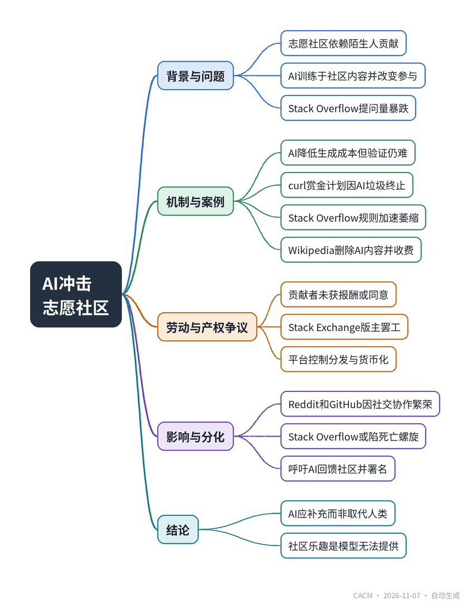

# AI Shakes Volunteer Sites

## AI冲击志愿社区

**来源**：Communications of the ACM（News）　|　**发布**：2026-11-06 16:30（美东）　|　**北京时间**：2026-11-07 04:30　|　**作者**：Samuel Greengard

[原文链接](https://cacm.acm.org/news/ai-shakes-volunteer-sites/)　·　生成于 2026-11-07 14:40

---

## 一、摘要

> AI引发对志愿社区信息质量及人类审核角色的根本性质疑。

以Stack Overflow、GitHub、Wikipedia等为代表的志愿社区长期依靠陌生人贡献知识。生成式AI的兴起改变了贡献与消费方式：Stack Overflow月提问量从2014年约20万骤降至2026年7月约1400；curl因约五分之一提交为AI垃圾、仅不足5%为真实漏洞而终止七年漏洞赏金计划。AI公司使用社区数据训练模型却未付费或征得同意，Stack Overflow与OpenAI的2024年协议未惠及贡献者，2023年Stack Exchange版主罢工暴露矛盾。研究显示ChatGPT发布后Stack Overflow活动下降超95%。Wikipedia通过删除AI生成内容并推出付费数据feed取得平衡；Reddit和GitHub因社交或协作属性仍繁荣。结论是需让AI补充而非取代人类知识生产，并回馈社区。

## 二、核心要点

1. Stack Overflow月提问量从2014年峰值约20万降至2026年7月约1400，ChatGPT发布后活动下降超95%。
2. curl七年漏洞赏金计划于2026年1月终止，约五分之一提交为AI垃圾，仅不足5%为真实漏洞。
3. Stack Overflow与OpenAI 2024年许可协议未给贡献者报酬，2023年Stack Exchange版主罢工近两月抗议AI政策。
4. Wikipedia主动删除AI生成内容，并推出付费实时编辑feed，要求署名且禁止构建竞争产品。
5. Reddit和GitHub因社交讨论或协作工作属性而持续繁荣，AI写代码但人类决定构建与合并。
6. 研究者呼吁AI产品应提供署名、回流量、反馈或资金支持，补充而非取代人类知识生产。

## 三、关键词对照

| English | 中文 |
| --- | --- |
| peer production |  peer生产/同侪生产 |
| AI slop | AI垃圾内容 |
| disintermediation | 去中介化 |
| bug bounty | 漏洞赏金 |
| knowledge panel | 知识面板 |
| data dump | 数据转储 |
| attribution | 署名/归属 |

## 四、中英对照全文

The generosity of strangers has long powered online communities. Spaces like Stack Overflow, GitHub, curl, OpenSSL, Wikipedia, and OpenStreetMap have a rich history of volunteers sharing knowledge and maintaining code, encyclopedias, and maps.

> 陌生人的慷慨长期以来一直驱动着在线社区的发展。Stack Overflow、GitHub、curl、OpenSSL、Wikipedia 和 OpenStreetMap 等平台有着悠久的历史，志愿者们在这里分享知识，维护代码、百科全书和地图。

Now, AI is having a say. Trained on content from these sites, it is changing how volunteers contribute and how users consume content. Stack Overflow, for example, has seen monthly questions fall from a peak of roughly 200,000 in 2014 to about 1,400 in July 2026. Meanwhile, a deluge of contributions—often fake and misleading—has overrun these projects.

> 如今，AI 开始在其中发挥作用。它基于这些网站的内容训练而成，正在改变志愿者的贡献方式和用户消费内容的方式。以 Stack Overflow 为例，其月度提问量已从 2014 年约 20 万的峰值下降到 2026 年 7 月的约 1,400 个。与此同时，大量贡献——往往是虚假和误导性的——已经淹没了这些项目。

This has created unease about the future of online knowledge sharing. “We are starting to replace social communities and their underlying processes with a piece of software,” said Gordon Burtch, Allen and Kelli Questrom Professor in Information Systems at Boston University. “As fewer people go to the community with questions, the incentive for experts to be there falls in turn.”

> 这引发了人们对在线知识共享未来的不安。“我们正在开始用一款软件取代社交社区及其底层流程，”波士顿大学信息系统 Allen and Kelli Questrom 讲席教授 Gordon Burtch 说。“随着越来越少的人到社区提问，专家留在那里的动力也随之下降。”

He isn’t the only one sounding alarms. “There is a huge fear, with growing evidence, that AI companies are kicking the legs out from underneath the table they are eating at,” said Benjamin Mako Hill, an associate professor of communication at the University of Washington and a longtime contributor to peer-production projects.

> 发出警报的不止他一人。“有越来越多的证据表明，AI 公司正在拆掉它们赖以吃饭的那张桌子的桌腿，人们对此深感恐惧，”华盛顿大学传播学副教授、同行生产项目的长期贡献者 Benjamin Mako Hill 说。

The stakes extend beyond site traffic and human connections. Fundamental questions arise about the quality of AI-provided information, who owns and profits from it, and what role humans play in vetting it. The cycle can also be recursive: models trained on public knowledge inhibit the production of new content. The question now is: will these communities evolve or disappear?

> 利害关系不仅限于网站流量和人际连接。关于 AI 所提供信息的质量、谁拥有这些信息并从中获利，以及人类在审核这些信息中扮演什么角色，根本性的问题随之浮现。这个循环还可能是递归的：基于公共知识训练的模型抑制了新内容的产生。现在的问题是：这些社区会进化还是消失？

Substance or Slop?

> 实质内容还是垃圾内容？

Every era has seen online communities wither or die. Usenet groups, mailing lists, and the discussion boards on CompuServe and AOL, evolved into more elaborate Web forums. Those resources eventually turned into Stack Overflow, GitHub, and Reddit. At each transition, participants lamented but the world moved on.

> 每个时代都有在线社区枯萎或消亡。Usenet 群组、邮件列表，以及 CompuServe 和 AOL 上的讨论版，演变成了更精细的 Web 论坛。这些资源最终又变成了 Stack Overflow、GitHub 和 Reddit。每一次转变中，参与者都曾扼腕叹息，但世界继续前行。

Whether AI will supplant human contributors or introduce new forms of knowledge sharing is not clear. What is apparent is that peer production projects are undergoing a radical shift—and the repercussions could be far reaching. “AI creates an asymmetry of sorts. Generation becomes costless, but verification, evaluation, and curation do not,” Burtch said.

> AI 究竟会取代人类贡献者，还是会引入新的知识共享形式，目前尚不清楚。显而易见的是，同行生产项目正在经历一场根本性的转变——其影响可能极为深远。“AI 造成了某种不对称。生成变得零成本，但验证、评估和策展并非如此，”Burtch 说。

At curl, tldraw, and English-language Wikipedia, AI has lowered production costs and increased participation—but with few checks on verification, judgment, and context. Curl’s seven-year bug bounty ended in January 2026 after roughly a fifth of submissions were deemed AI slop, and fewer than 5% turned out to be actual vulnerabilities. Over its lifetime, the program paid researchers more than $100,000 for identifying 87 confirmed vulnerabilities.

> 在 curl、tldraw 和英文 Wikipedia 上，AI 降低了生产成本并提高了参与度——但在验证、判断和上下文方面几乎没有把关。curl 为期七年的漏洞赏金计划于 2026 年 1 月结束，此前约五分之一的提交被认定为 AI 垃圾内容，而真正属于实际漏洞的不到 5%。在该计划存续期间，它为研究人员识别出 87 个已确认漏洞，支付了超过 10 万美元。

AI also can reduce participation. Disintermediation on the Internet has existed for well over a decade. Google knowledge panels have pulled content from Wikipedia and other services. The problem, Hill argues, is that corrections and nuance don’t travel back to the original source. When a user challenges a chatbot’s answer, that suggestion remains in the chat window. And unlike a search result, the chatbot doesn’t always reveal where the information originated.

> AI 也可能降低参与度。互联网上的去中介化已经存在了十多年。Google 知识面板一直在从 Wikipedia 和其他服务中抓取内容。Hill 认为，问题在于更正和细微差别不会回流到原始来源。当用户质疑聊天机器人的回答时，该建议仍留在聊天窗口中。而且与搜索结果不同，聊天机器人并不总是揭示信息的来源。

At Stack Overflow, site rules compound the problem. A question that has already been answered is typically marked “closed” and linked to the earlier thread. No new discussion takes place. This may not seem significant since past content remains, but “if new people don’t join and participate, there is nobody there to grow into a community leader or moderator,” Burtch said. “The community is likely to atrophy and become more concentrated. It may take longer, or become impossible, to cover new technologies.”

> 在 Stack Overflow，网站规则加剧了这一问题。已经回答过的问题通常会被标记为“已关闭”并链接到早先的帖子。不会进行新的讨论。这似乎并不重要，因为过往内容仍然存在，但“如果新人不再加入和参与，就没有人能成长为社区领袖或版主，”Burtch 说。“社区很可能会萎缩并变得更加集中。覆盖新技术可能需要更长时间，甚至变得不可能。”

There is evidence this is taking place. Stack Overflow was already in slow decline prior to AI, said Johannes Wachs, an associate professor at Hungary’s Corvinus University of Budapest and a senior fellow at Microsoft’s AI Economy Institute. Once ChatGPT appeared, one study found activity dropped by 25% within six months relative to comparable forums where the chatbot was less available or less capable. By Wachs’s account, overall use of Stack Overflow has fallen more than 95% since ChatGPT’s release. “Online communities thrive on new blood,” he said.

> 有证据表明这种情况正在发生。匈牙利布达佩斯考文纽斯大学副教授、微软 AI 经济研究所高级研究员 Johannes Wachs 表示，在 AI 出现之前，Stack Overflow 就已经在缓慢衰落。一项研究发现，ChatGPT 出现后，与聊天机器人可用性较低或能力较弱的同类论坛相比，其活动量在六个月内下降了 25%。据 Wachs 称，自 ChatGPT 发布以来，Stack Overflow 的整体使用量已下降超过 95%。“在线社区靠新鲜血液繁荣，”他说。

Labor Pains

> 劳工之痛

The irony is inescapable: AI models are built on the backs of the same communities they are displacing. Stack Overflow answers, Wikipedia articles, and millions of GitHub commits became training data, yet the volunteers who generated them were neither asked nor paid. When Stack Overflow entered a licensing agreement with OpenAI in 2024, the contributors didn’t receive a penny from the deal, and they had no say in how their content is used.

> 讽刺无法回避：AI 模型建立在它们正在取代的那些社区的背上。Stack Overflow 的回答、Wikipedia 的文章和数百万条 GitHub 提交成为了训练数据，但生成这些内容的志愿者既未被征询意见，也未获得报酬。当 Stack Overflow 于 2024 年与 OpenAI 达成许可协议时，贡献者没有从这笔交易中获得一分钱，也无权决定其内容如何被使用。

“It’s essentially a question of who owns the platform to distribute content, and who owns the right to the content,” said Hanlin Li, an assistant professor at the University of Texas at Austin. Currently, she said, platforms can distribute or resell what volunteers produce however they like, and “the actual creators don’t often see any benefits from that distribution.”

> “这本质上是一个谁拥有分发内容的平台、谁拥有内容权利的问题，”德克萨斯大学奥斯汀分校助理教授 Hanlin Li 说。她表示，目前平台可以随意分发或转售志愿者生产的内容，而“实际创作者往往从这种分发中看不到任何好处。”

That rift was exposed in 2023, when Stack Exchange moderators went on strike for nearly two months after the company issued confusing instructions about its AI policy. Days into the walkout, it also stopped publishing its data dumps to the Internet Archive while making plans to monetize its API for data access. For communities that had long embraced the principle of open knowledge, the shift in policy was devastating. It laid bare the gulf between producing knowledge and controlling how it is used and monetized.

> 这一裂痕在 2023 年暴露出来，当时 Stack Exchange 的版主们罢工近两个月，原因是公司就其 AI 政策发布了令人困惑的指示。罢工开始几天后，该公司还停止向 Internet Archive 发布其数据转储，同时计划将其 API 的数据访问货币化。对于长期秉持开放知识原则的社区来说，这一政策转变是毁灭性的。它赤裸裸地揭示了生产知识与控制其使用和货币化方式之间的鸿沟。

Li believes volunteers have leverage because, as new events unfold and new information emerges, AI models require a steady supply of fresh data from humans. She points to Wikipedia as a success story. The English-language site actively deletes AI-generated content. In addition, rather than blocking reuse, the Wikimedia Foundation has established a paid tier that sells high-volume customers a real-time feed of edits and article updates along with guaranteed uptime. It requires attribution and prohibits using the feed to build a competing product.

> Li 认为志愿者拥有筹码，因为随着新事件的发生和新信息的出现，AI 模型需要人类持续提供新鲜数据。她以 Wikipedia 作为成功案例。该英文网站积极删除 AI 生成的内容。此外，Wikimedia Foundation 没有阻止复用，而是建立了一个付费层级，向高用量客户出售编辑和文章更新的实时数据流，并保证正常运行时间。它要求署名，并禁止使用该数据流构建竞争产品。

Beyond the Stars

> 超越星辰

Although the future of many online communities is cloudy, some—Reddit and GitHub among them—continue to thrive. The difference likely isn’t AI; it’s that some sites dispense answers and others offer a place to debate a topic or discuss a bug report. “The social fabric of Reddit is a real thing,” Wachs said. GitHub, likewise, isn’t a reference library but a place to work. Although much of the code arriving there is now written by AI, humans still decide what gets built and what gets merged.

> 尽管许多在线社区的未来阴云密布，但有些社区——包括 Reddit 和 GitHub——仍在蓬勃发展。差异可能不在于 AI；而在于有些网站提供答案，另一些则提供辩论话题或讨论缺陷报告的地方。“Reddit 的社交结构是真实存在的，”Wachs 说。GitHub 同样不是参考图书馆，而是一个工作场所。尽管如今到达那里的代码大部分由 AI 编写，但人类仍然决定构建什么、合并什么。

Other sites, such as Stack Overflow, may already be in a death spiral. Yet the ending isn’t written. “We need to find a way for AI to complement the human knowledge-production process rather than disintermediate it,” Burtch said. “AI products should provide attribution and, where appropriate, return traffic, feedback, or financial support to the communities whose knowledge they use,” he added.

> 其他网站，如 Stack Overflow，可能已经陷入死亡螺旋。但结局尚未写定。“我们需要找到一种方式，让 AI 补充人类知识生产过程，而不是将其去中介化，”Burtch 说。“AI 产品应提供署名，并在适当情况下向其使用知识的社区返还流量、反馈或财务支持，”他补充道。

Wachs strikes a broader view: “There is a joy to participating in online communities. There is a reason people answer other people’s questions for no pay, and that’s the one thing that no model can provide.”

> Wachs 持更宏观的看法：“参与在线社区有一种乐趣。人们无偿回答他人的问题是有原因的，而这是任何模型都无法提供的东西。”

Samuel Greengard is an author and journalist based in West Linn, OR, USA.

> Samuel Greengard 是位于美国俄勒冈州 West Linn 的作家和记者。

---
*英文原文版权归 Communications of the ACM 及作者所有；中文译文由 AI 辅助生成，仅供学习参考。*