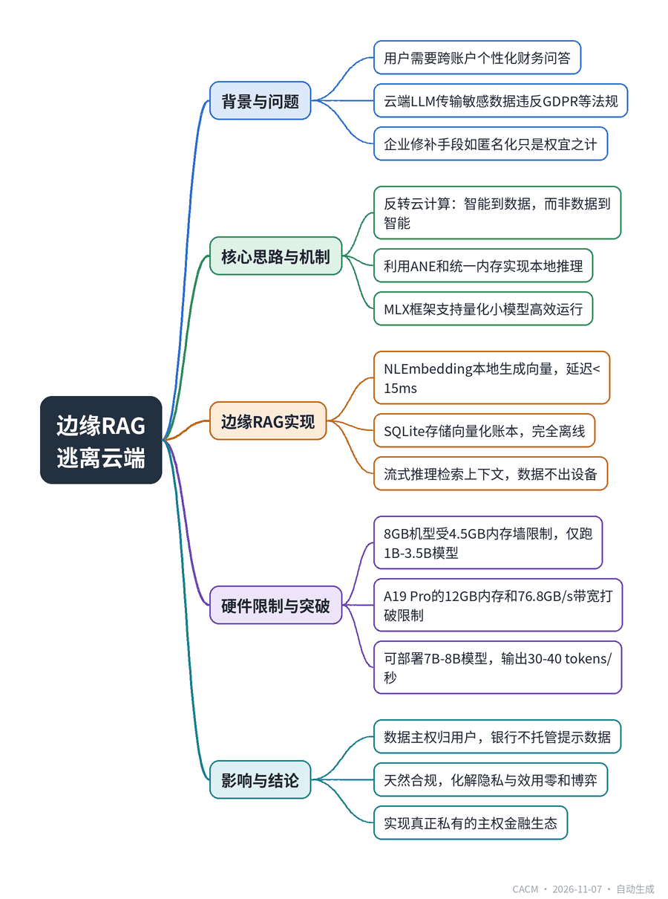

# Escaping the Cloud with Edge RAG

## 边缘RAG：逃离云端的金融AI

**来源**：Communications of the ACM（Blog@CACM）　|　**发布**：2026-11-06 13:00（美东）　|　**北京时间**：2026-11-07 01:00　|　**作者**：Muralikrishna Veeramosu

[原文链接](https://cacm.acm.org/blogcacm/escaping-the-cloud-with-edge-rag/)　·　生成于 2026-11-07 14:41

---

## 一、摘要

> 将智能带到数据，而非数据送到智能。

在高度监管的金融领域，生成式AI面临隐私与效用的悖论：用户需要跨账户、高度个性化的财务问答，但将敏感数据传至云端LLM会带来GDPR、GLBA等法规下的合规与安全风险。过去企业依赖数据匿名化、API协议等修补手段，但作者认为根本出路是放弃云端，转向“主权金融代理”——把模型部署在用户设备上。借助苹果神经引擎、统一内存架构和MLX框架，开发者可在iPhone本地运行量化小模型，并构建完全离线的边缘RAG流水线：用原生NLEmbedding生成向量、SQLite存储本地账本、流式推理检索上下文。文章详细分析了硬件限制：A18 Pro等8GB内存机型受制于约4.5GB前台内存墙，只能跑1B-3.5B参数模型；而A19 Pro的12GB内存和76.8GB/s带宽打破了这一限制，可本地部署7B-8B模型，实现30-40 tokens/秒的流式输出和更大检索窗口。最终，数据不出设备，银行无需托管提示数据，天然满足最严格的数据保护法规，从而化解隐私与效用的零和博弈。

## 二、核心要点

1. 金融AI的隐私-效用悖论：用户要跨账户个性化问答，但云端LLM传输敏感数据违反GDPR、GLBA和DORA等法规。
2. 核心思路反转：将智能带到数据，而非数据送到智能，利用苹果神经引擎和统一内存架构在手机端本地推理。
3. 边缘RAG架构：用NLEmbedding本地生成向量（延迟<15ms），SQLite存储向量化账本，完全离线检索，数据不出设备。
4. 内存墙限制：8GB内存的A18 Pro机型前台应用限约4.5GB，只能运行1B-3.5B参数模型并需4位量化。
5. A19 Pro突破：12GB内存和76.8GB/s带宽打破4.5GB限制，可本地部署7B-8B模型，流式输出达30-40 tokens/秒。
6. 主权金融代理：模型权重下载至设备，推理全本地，银行不托管提示数据，天然合规，数据主权归用户。

## 三、关键词对照

| English | 中文 |
| --- | --- |
| Edge RAG | 边缘检索增强生成 |
| Sovereign Financial Agent | 主权金融代理 |
| Apple Neural Engine (ANE) | 苹果神经引擎 |
| Unified Memory Architecture | 统一内存架构 |
| MLX Framework | MLX框架 |
| Quantization | 量化 |
| Vector Database | 向量数据库 |
| Cosine Similarity | 余弦相似度 |
| Memory Wall | 内存墙 |
| Data Sovereignty | 数据主权 |

## 四、中英对照全文

In my experience architecting AI systems for heavily regulated environments, I have encountered a profound privacy-utility paradox that currently is paralyzing the integration of generative AI in consumer finance.

> 在我为高度监管环境设计 AI 系统的经验中，我遇到了一个深刻的隐私-效用悖论，它目前正使生成式 AI 在消费金融领域的整合陷入瘫痪。

On the one hand, users demand the hyper-personalized, autonomous wealth management capabilities promised by modern AI. They want to open their mobile banking app and ask deeply contextual, cross-account questions, like: ● “Why did my discretionary spending spike last month?” ● “Can you cross-reference my checking account and my Amex statement to see if I was double-charged for the hotel stay in Paris?” ● “If I divert $500 a month from my tech-stock ETF to a high-yield savings account, how will that impact my goal of buying a house in two years?”

> 一方面，用户要求现代 AI 所承诺的超个性化、自主财富管理能力。他们希望打开手机银行应用，提出深度情境化、跨账户的问题，例如：● “为什么我上个月的可自由支配支出激增？” ● “你能交叉核对我的支票账户和我的 Amex 账单，看看我在巴黎的酒店住宿是否被重复收费了吗？” ● “如果我每月从科技股 ETF 中转移 500 美元到高收益储蓄账户，这将如何影响我两年内买房的 goal？”

On the other hand, transmitting years of highly sensitive, personally identifiable financial data to a centralized, third-party cloud large language model (LLM) to answer these questions creates unacceptable regulatory and cybersecurity liabilities. Under frameworks like GDPR, the Gramm-Leach-Bliley Act, and the emerging Digital Operational Resilience Act, moving user ledgers across network boundaries to a black-box cloud API is a massive structural risk.

> 另一方面，将多年高度敏感、个人可识别的财务数据传输到集中式的第三方云大型语言模型（LLM）以回答这些问题，会带来不可接受的监管和网络安全责任。根据 GDPR、Gramm-Leach-Bliley 法案以及新兴的数字运营韧性法案等框架，将用户账本跨网络边界移动到黑盒云 API 是一种巨大的结构性风险。

For the past few years, the enterprise has tried to build secure vaults using inherently porous cloud architectures. We have relied on complex data anonymization techniques, strict enterprise API agreements, and transient cloud instances. But these are bandages. As I have argued previously regarding the enterprise Token Trap, relying on infinite cloud context windows is an unsustainable economic and architectural model.

> 过去几年，企业试图使用本质上多孔的云架构来构建安全保险库。我们依赖复杂的数据匿名化技术、严格的企业 API 协议和瞬态云实例。但这些只是创可贴。正如我之前在企业 Token 陷阱中所论述的，依赖无限的云上下文窗口是一种不可持续的经济和架构模型。

The ultimate solution is not to build a more secure cloud pipeline; the solution is to abandon the cloud altogether for sensitive financial reasoning.

> 终极解决方案不是构建更安全的云管道；解决方案是在敏感的财务推理中完全放弃云。

### The Era of the Sovereign Financial Agent
*主权金融代理时代*

We are entering the era of the sovereign financial agent. The core philosophy of this architecture is an inversion of standard cloud computing: we must bring the intelligence to the data, rather than sending the data to the intelligence.

> 我们正在进入主权金融代理时代。这种架构的核心理念是对标准云计算的反转：我们必须将智能带到数据处，而不是将数据发送到智能处。

Historically, this was impossible due to the sheer computational weight of language models. However, with the advent of the Apple Neural Engine (ANE) and the unified memory architecture in modern iPhones, mobile edge computing has reached a critical inflection point. Unlike traditional systems that partition memory between the CPU and GPU—requiring data to be inefficiently copied back and forth—Apple’s unified memory allows both processors to access the exact same data pool instantly.

> 历史上，由于语言模型的计算量巨大，这是不可能的。然而，随着 Apple Neural Engine (ANE) 和现代 iPhone 中统一内存架构的出现，移动边缘计算已达到关键转折点。与在 CPU 和 GPU 之间划分内存（需要低效地来回复制数据）的传统系统不同，Apple 的统一内存允许两个处理器即时访问完全相同的数据池。

Combined with Apple’s release of the MLX framework—an open-source machine learning framework designed specifically to exploit this Apple silicon architecture—developers now can run quantized small language models locally with unprecedented speed and efficiency. By leveraging MLX Swift, a highly capable reasoning engine can be pushed directly into the user’s pocket.

> 结合 Apple 发布的 MLX 框架——一个专门为利用这种 Apple 芯片架构而设计的开源机器学习框架——开发者现在可以在本地以空前的速度和效率运行量化的小型语言模型。通过利用 MLX Swift，一个能力强大的推理引擎可以直接推入用户的口袋。

However, deploying a raw model locally is only half the battle. To act as a financial advisor, the model must be context-aware.

> 然而，在本地部署原始模型只是战斗的一半。要充当财务顾问，模型必须具有上下文感知能力。

### The On-Device RAG Architecture
*设备端 RAG 架构*

To give the on-device model context without pinging a cloud database, the mobile application must execute a localized Retrieval-Augmented Generation (Edge RAG) pipeline entirely offline.

> 为了在不 ping 云数据库的情况下为设备端模型提供上下文，移动应用程序必须完全离线执行本地化的检索增强生成（Edge RAG）管道。

In a traditional cloud-based RAG setup, a software architect relies on heavy, deep-learning transformer models (like BERT) to generate text embeddings, which are then stored in a massive, centralized vector database. If you attempt to replicate this naive architecture on a smartphone—trying to load a 3GB embedding model simultaneously alongside a 3GB language model—the application will instantly crash.

> 在传统的基于云的 RAG 设置中，软件架构师依赖重型深度学习 transformer 模型（如 BERT）来生成文本嵌入，然后将其存储在大型集中式向量数据库中。如果你试图在智能手机上复制这种朴素架构——尝试同时加载一个 3GB 嵌入模型和一个 3GB 语言模型——应用程序将立即崩溃。

To build Edge RAG on iOS, the architecture must be carefully decoupled to minimize RAM load:

> 要在 iOS 上构建 Edge RAG，必须仔细解耦架构以最小化 RAM 负载：

- Native Embeddings Over Heavy Transformers: Instead of loading a secondary transformer model for vectorization, developers can utilize Apple’s built-in NLEmbedding class via the native Natural Language framework. This tool generates text vectors and calculates similarity rankings locally with sub-15-millisecond latency by taking advantage of CPU SIMD vector primitives directly on the Neural Engine.

  > 原生嵌入优于重型 Transformer：开发者无需加载第二个 transformer 模型进行向量化，而是可以通过原生 Natural Language 框架利用 Apple 内置的 NLEmbedding 类。该工具通过直接在 Neural Engine 上利用 CPU SIMD 向量原语，在本地生成文本向量并以低于 15 毫秒的延迟计算相似度排名。

- Local Vector Storage: Chunks of the user’s financial ledger, recent transaction history, and parsed PDF statements are vectorized and stored in a lightweight local framework running entirely within the iOS application sandbox (such as SQLite or SwiftData).

  > 本地向量存储：用户财务账本、近期交易历史和解析的 PDF 对账单的块被向量化并存储在一个轻量级本地框架中，完全在 iOS 应用程序沙盒内运行（如 SQLite 或 SwiftData）。

- Streamed Inference: When a user asks a complex financial question, the system performs a local cosine similarity search against the SQLite database, retrieves the top relevant financial context,

  > 流式推理：当用户提出复杂的财务问题时，系统对 SQLite 数据库执行本地余弦相似度搜索，检索出最相关的财务上下文，

The result is an AI that “reads” your financial history and answers your questions without a single byte of personal data ever leaving the smartphone.

> 结果是一个 AI，它“阅读”你的财务历史并回答你的问题，而个人数据的任何一个字节都不会离开智能手机。

### Navigating the Memory Wall: A18 vs. A19 Pro Architectures
*穿越内存墙：A18 与 A19 Pro 架构*

While the hardware capabilities of modern smartphones are remarkable, building autonomous agents on mobile edge devices requires rigorous engineering discipline. As I recently observed when evaluating clinical AI deployments, relying on pristine cloud models is an illusion when edge reality demands highly constrained, small-data architectures. The boundaries of this architecture are dictated directly by the hardware generation the user holds.

> 虽然现代智能手机的硬件能力非凡，但在移动边缘设备上构建自主代理需要严格的工程纪律。正如我最近在评估临床 AI 部署时所观察到的，当边缘现实要求高度受限的小数据架构时，依赖纯净的云模型是一种幻觉。这种架构的边界直接由用户持有的硬件代际决定。

On baseline and older architectures (such as the Apple A18 Pro and the base A19 chip), devices are equipped with 8GB of LPDDR5X RAM. However, the iOS kernel enforces a strict, unforgiving rule: it will force-close any individual foreground application that crosses roughly 4.5GB of active memory usage. Your LLM weights, the vector index, the operating system overhead, and the active text context must all fit comfortably under this 4.5-GB threshold.

> 在基线及更旧架构（如 Apple A18 Pro 和基础 A19 芯片）上，设备配备 8GB LPDDR5X RAM。然而，iOS 内核执行一条严格、无情的规则：它将强制关闭任何超过约 4.5GB 活动内存使用量的单个前台应用程序。你的 LLM 权重、向量索引、操作系统开销和活动文本上下文都必须轻松地适应这个 4.5-GB 阈值以下。

This historic “Memory Wall” mandated the use of tiny models (1B-to-3.5B parameters) and short context windows. It also required developers to lean heavily into aggressive flash-memory loading techniques and 4-bit integer quantization to compress model weights without sacrificing output quality.

> 这一历史性的“内存墙”强制要求使用微型模型（1B 到 3.5B 参数）和短上下文窗口。它还要求开发者大量依赖激进的闪存加载技术和 4 位整数量化来压缩模型权重，而不牺牲输出质量。

The 12-GB Inflection Point: With the release of the Apple A19 Pro architecture, the hardware constraints have fundamentally shifted. The A19 Pro introduces 12GB of LPDDR5X-9600 RAM and an unprecedented peak memory bandwidth of 76.8GB/s.

> 12-GB 拐点：随着 Apple A19 Pro 架构的发布，硬件约束已发生根本性转变。A19 Pro 引入了 12GB LPDDR5X-9600 RAM 和前所未有的 76.8GB/s 峰值内存带宽。

This is an architectural game-changer for Edge AI. By raising the total system memory to 12GB, the active RAM limit for a foreground application expands significantly. For software architects, this means the 4.5-GB Memory Wall has been shattered.

> 这对 Edge AI 来说是架构游戏规则的改变者。通过将总系统内存提高到 12GB，前台应用程序的活动 RAM 限制显著扩展。对于软件架构师来说，这意味着 4.5-GB 内存墙已被打破。

Financial applications on A19 Pro devices are no longer restricted to 3B-parameter models. Developers can now deploy heavily optimized, highly capable 7B-to-8B-parameter models natively. Furthermore, the 76.8-GB/s bandwidth allows these larger models to stream text at blistering speeds (up to 30-40 tokens per second), and the expanded RAM overhead allows for vastly larger retrieval context windows, enabling the AI to cross-reference multiple years of complex financial data simultaneously.

> A19 Pro 设备上的金融应用程序不再局限于 3B 参数模型。开发者现在可以原生部署经过高度优化、能力强大的 7B 到 8B 参数模型。此外，76.8-GB/s 的带宽允许这些更大的模型以极快的速度（高达每秒 30-40 个 token）流式传输文本，而扩展的 RAM 开销允许更大的检索上下文窗口，使 AI 能够同时交叉引用多年的复杂财务数据。

### The Private AI Paradigm
*私有 AI 范式*

Regardless of the underlying chip, when these engineering constraints are successfully navigated, the resulting system fundamentally transforms the economics and security of financial software.

> 无论底层芯片如何，当这些工程约束被成功驾驭时，由此产生的系统将从根本上改变金融软件的经济性和安全性。

Because the model weights are downloaded to the device and the MLX inference loop happens entirely locally, the user’s personal financial data never traverses a network. It never hits a load balancer, it is never stored in a server cache, and it is never exposed to a cloud API.

> 由于模型权重被下载到设备，且 MLX 推理循环完全在本地进行，用户的个人财务数据永远不会穿越网络。它永远不会触及负载均衡器，永远不会存储在服务器缓存中，也永远不会暴露给云 API。

This establishes a true private, sovereign financial ecosystem. The banking institution does not have to worry about data breaches in their AI pipeline because they never take custody of the prompt data. The architecture complies natively with the strictest data protection laws globally because data sovereignty remains unequivocally with the user.

> 这建立了一个真正的私有、主权金融生态系统。银行机构不必担心其 AI 管道中的数据泄露，因为他们从未托管提示数据。该架构原生符合全球最严格的数据保护法律，因为数据主权明确无误地属于用户。

For years, the computing community has treated AI capabilities and user privacy as a zero-sum game. By mastering local RAG and the MLX framework on the mobile edge, we can finally resolve the privacy-utility paradox—delivering uncompromising, intelligent financial advisory with absolute data sovereignty.

> 多年来，计算社区一直将 AI 能力和用户隐私视为零和游戏。通过在移动边缘掌握本地 RAG 和 MLX 框架，我们终于可以解决隐私-效用悖论——提供不妥协的、智能的财务咨询，并拥有绝对的数据主权。

Author’s Note: The views expressed in this post are solely those of the author and do not necessarily reflect the views or policies of any organization.

> 作者注：本文所表达的观点仅代表作者本人，不一定反映任何组织的观点或政策。

Disclosure: I used AI writing tools for light editing and phrasing assistance during revision. All substantive content, architectural assessments, and the overarching argument originated with me. I have reviewed every sentence, take full responsibility for its accuracy, and fully agree with the conclusions presented in this post.

> 披露：我在修订期间使用 AI 写作工具进行轻度编辑和措辞协助。所有实质性内容、架构评估和总体论点均源于我本人。我已审阅每一句话，对其准确性承担全部责任，并完全同意本文提出的结论。

## 附录：参考与脚注（原文）

References

1. Veeramosu, M. The Token Trap: Reimagining the Economics of Enterprise AI at the Edge. Communications, https://bit.ly/3VXcP3T

2. Apple Machine Learning Research. MLX: An array framework for Apple silicon. GitHub. https://github.com/ml-explore/mlx

5. Alizadeh, K., et al. 2023. LLM in a flash: Efficient Large Language Model Inference with Limited Memory. Apple Machine Learning Research. arXiv:2312.11514

Muralikrishna Veeramosu is an elite mobile architecture expert and technology leader,recognized for designing and scaling enterprise-grade applications. A pioneer in the native iOS ecosystem and on-device and Edge AI integration, he has held critical leadership roles, driving high-impact technical initiatives. Demonstrating original contributions of major significance, he has authored technical articles for prestigious industry publications, including on Edge AI for Communications of the ACM (CACM).

---
*英文原文版权归 Communications of the ACM 及作者所有；中文译文由 AI 辅助生成，仅供学习参考。*