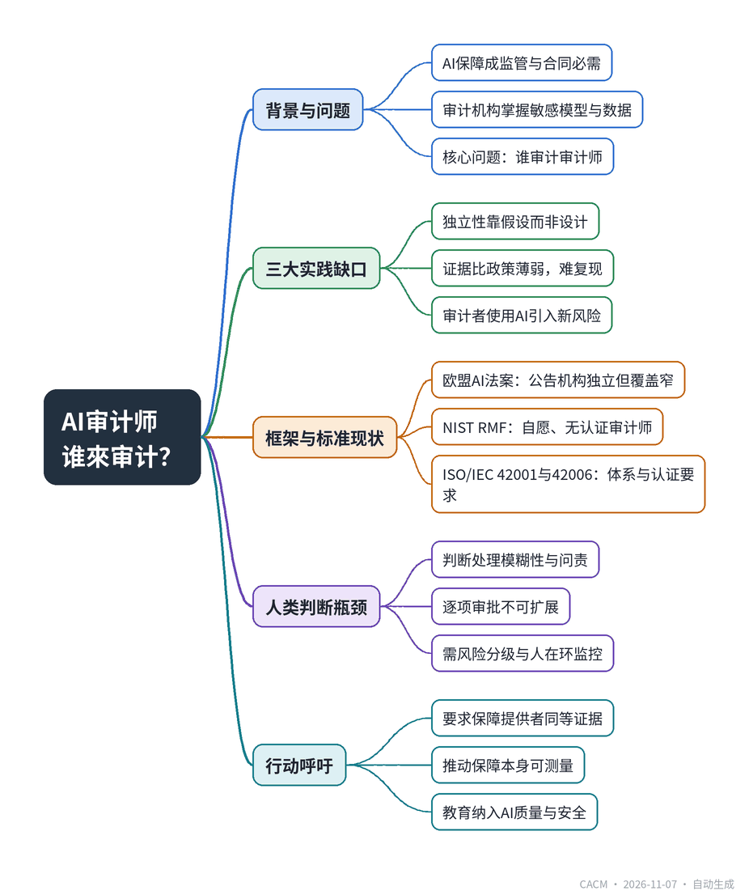

# Who Audits the AI Auditors?

## 谁来审计AI审计师？

**来源**：Communications of the ACM（Blog@CACM）　|　**发布**：2026-11-06 15:15（美东）　|　**北京时间**：2026-11-07 03:15　|　**作者**：Srinivas Padmanabhuni

[原文链接](https://cacm.acm.org/blogcacm/who-audits-the-ai-auditors/)　·　生成于 2026-11-07 14:40

---

## 一、摘要

> AI保障正成为运营必需，审计者自身也需被审计。

随着AI系统在监管、金融等高风险领域部署，独立第三方审计成为运营必需，但审计机构自身掌握敏感模型与数据，并越来越多地使用AI工具，引发“谁来审计审计师”的问题。文章基于作者在AiEnsured的实践，指出三大缺口：独立性未被设计、证据比政策薄弱、审计者自身使用AI带来新风险。文章分析欧盟AI法案仅对公告机构强制独立、多数高风险系统仍靠自我评估，NIST框架自愿且无认证审计师，ISO/IEC 42001和42006则分别规定AI管理体系与认证机构要求，但均不充分。人类判断仍是应对模糊性的关键，却难以规模化，需风险分级监督。作者呼吁对保障提供者要求与AI供应商同等的证据，并推动保障本身可测量、教育纳入AI质量。结论是信任来自可传递的证据，包括关于审计者的证据。

## 二、核心要点

1. AI保障从可选卫生措施变为监管与合同必需，但审计机构自身掌握敏感模型、专有数据及AI工具，形成“谁审计审计师”的新风险。
2. 实践存在三大缺口：独立性靠假设而非设计、证据比政策薄弱、审计者使用AI引入上下文泄露与模型漂移等失败模式。
3. 欧盟AI法案第31条对公告机构规定严格独立性，但第43条使多数附件III高风险系统走内部自我评估，第三方评估覆盖有限。
4. NIST AI RMF自愿且流程导向，建议独立评估但不设认证审计师；ISO/IEC 42001要求AI管理体系证据，42006规定认证机构能力与公正性要求。
5. 人类判断仍是处理模糊性与问责的关键，但逐项审批不可扩展，需风险分级监督、人在环监控与选择性干预。
6. 作者呼吁对保障提供者要求同等证据（范围、方法、局限、数据控制、自身AI治理），并推动共享基准、报告格式与课程教育。

## 三、关键词对照

| English | 中文 |
| --- | --- |
| AI assurance | AI保障 |
| notified bodies | 公告机构 |
| conformity assessment |  conformity assessment |
| AI Risk Management Framework | AI风险管理框架 |
| AI management system | AI管理体系 |
| automation bias | 自动化偏见 |
| human-on-the-loop | 人在环上 |
| regression suite | 回归测试套件 |

## 四、中英对照全文

I work as an AI assurance specialist at AiEnsured in Bengaluru. My job, in plain terms, is testing other people’s AI. That kind of work used to be optional hygiene. It is steadily becoming an operational requirement: regulators, banks, and large enterprises increasingly want independent verification before a probabilistic system goes anywhere near production.

> 我在班加罗尔的AiEnsured公司担任AI保障专家。简单来说，我的工作是测试别人的人工智能。这类工作过去是可选的卫生措施，现在正稳步成为一项运营要求：监管机构、银行和大型企业越来越希望在概率性系统投入生产之前进行独立验证。

That is progress. It is also a new risk, and one the industry talks about far less than it should.

> 这是一种进步，但也是一种新的风险，而业界对此的讨论远远不够。

The organizations that vouch for other people’s AI now sit on sensitive models, proprietary data and, increasingly, their own AI tooling. Which raises an obvious question that almost nobody in the room wants to answer out loud: who audits the AI auditors?

> 为他人AI提供担保的组织现在掌握着敏感模型、专有数据，并且越来越多地拥有自己的AI工具。这就引出了一个几乎没有人愿意公开回答的显而易见的问题：谁来审计AI审计师？

### A Familiar Pattern, Three Familiar Gaps
*熟悉的模式，三个熟悉的缺口*

Computing professionals know this pattern from software quality. Nobody accepts a vendor’s own unit tests as sufficient assurance for a flight-control system. We ask who tested it, against which oracle, with what independence, and what residual risk remains. AI assurance is catching up to that discipline, but unevenly. Three gaps appear again and again in practice.

> 计算专业人士从软件质量中熟知这种模式。没有人会接受供应商自己的单元测试作为飞行控制系统的充分保证。我们会问是谁测试的、依据什么标准、独立性如何、剩余风险是什么。AI保障正在追赶这一纪律，但进展不均。实践中反复出现三个缺口。

Independence is assumed, not designed. An internal model-risk team, a consulting slide deck, and an external technical assessor are not interchangeable. Each can be useful. Only some of them can speak freely when the finding is inconvenient. Procurement language still rarely defines what “independent” means for AI testing: contractual freedom to deliver unvarnished findings, separation from the teams that built the model, and clear rules for handling residual risk.

> 独立性是假设的，而非设计的。内部模型风险团队、咨询幻灯片和外部技术评估者不可互换。每种都有用，但只有部分能在发现不便时自由发言。采购语言仍然很少定义AI测试中“独立”的含义：交付未经粉饰的发现结果的合同自由、与构建模型的团队分离、处理剩余风险的明确规则。

Evidence is thinner than policy. Most enterprises now have AI principles, ethics boards, and acceptable-use documents. Far fewer can show repeatable tests with thresholds, named owners, and continuous monitoring. A fairness metric with no owner and no review cadence is theatre. So is a jailbreak demo that never becomes a regression suite. Assurance that cannot be replayed is very hard to audit.

> 证据比政策更薄弱。大多数企业现在都有AI原则、伦理委员会和可接受使用文档。但能展示具有阈值、指定负责人和持续监控的可重复测试的则少得多。没有负责人和审查节奏的公平性指标是作秀。从未成为回归套件的越狱演示也是如此。无法重放的保证很难审计。

The auditors use AI, too. Test-case generators, summarizers, and triage assistants bring their own failure modes: client context leaking into external models, overconfident summaries of vulnerability logs, silent drift in the helper model. If an assurance firm cannot inventory and govern its own AI use, buyers should treat that as a material risk, not a footnote.

> 审计师也使用AI。测试用例生成器、摘要器和分类助手带来各自的故障模式：客户上下文泄露到外部模型、漏洞日志的过度自信摘要、辅助模型的静默漂移。如果保障公司无法清点并治理自己的AI使用，买家应将其视为重大风险，而非脚注。

### What the Frameworks Do, and Do Not Do
*框架能做什么，不能做什么*

The regulatory picture is real but partial. The EU AI Act imposes strict independence rules on notified bodies, the third parties that run conformity assessments for certain high-risk systems. Article 31 requires those bodies to be independent of the provider of the system under assessment, of any operator with an economic interest in it, and of the provider’s competitors. Neither the body, its top management, nor the personnel performing the assessment may be involved in the design, development, marketing, or use of the systems they assess, and consultancy work that could compromise independence of judgment is expressly barred. Impartiality procedures and liability insurance are mandatory. That is a serious answer, on paper.

> 监管图景是真实的，但不完整。欧盟《人工智能法案》对公告机构（为某些高风险系统运行合格评定的第三方）施加了严格的独立性规则。第31条要求这些机构独立于受评估系统的提供商、任何在该系统中有经济利益的运营商以及提供商的竞争对手。机构本身、其最高管理层以及执行评估的人员均不得参与其所评估系统的设计、开发、营销或使用，可能损害判断独立性的咨询工作被明确禁止。公正程序和责任保险是强制性的。这在纸面上是一个严肃的答案。

The catch is coverage. For most high-risk uses listed in Annex III, Article 43 routes providers through the internal-control procedure of Annex VI, which means self-assessment with no notified body involved. Third-party assessment is concentrated in narrower cases, mainly certain biometric systems when harmonized standards are not fully applied. The Act hard-codes independence where external assessment is mandatory, and leaves a large share of high-risk systems to the provider’s own processes.

> 问题在于覆盖范围。对于附件三中列出的大多数高风险用途，第43条将提供商引导至附件六的内部控制程序，这意味着自我评估，不涉及公告机构。第三方评估集中在较窄的情况下，主要是某些生物识别系统在协调标准未完全适用时。该法案在强制外部评估的地方硬性规定独立性，而将很大一部分高风险系统留给提供商自己的流程。

NIST’s AI Risk Management Framework takes the opposite approach: voluntary, process-oriented. Its Measure function recommends involving independent assessors, or internal experts who were not front-line developers, specifically to reduce bias and conflicts of interest. It prescribes no certified auditor class. It treats independent review as a way to strengthen measurement inside an organization’s own risk process, which is useful, and easy to skip.

> NIST的AI风险管理框架采取相反的方法：自愿、面向过程。其“测量”功能建议引入独立评估者或非一线开发人员的内部专家，特别是为了减少偏见和利益冲突。它没有规定认证审计师类别。它将独立审查视为加强组织自身风险流程内测量的一种方式，这很有用，也很容易被跳过。

The standards community is filling part of the gap. ISO/IEC 42001:2023, described by ISO as the world’s first AI management system standard, forces evidence of accountability rather than one-off technical claims: who owns AI risk, how risks are assessed and treated, how changes are controlled, how incidents are learned from. India has adopted it nationally through the Bureau of Indian Standards. Just as relevant to my title question, ISO/IEC 42006:2025 sets requirements for the bodies that audit and certify organizations against ISO/IEC 42001, supplementing the general auditing rules of ISO/IEC 17021-1 with AI-specific expectations on competence, impartiality, and consistency. It defines what the certifier must demonstrate before its stamp means anything. ISO/IEC 23894 adds guidance on AI risk management across the lifecycle. None of this is sufficient on its own, but the shape of an answer is emerging.

> 标准社区正在填补部分空白。ISO/IEC 42001:2023被ISO描述为世界上第一个AI管理体系标准，它要求提供问责证据，而非一次性的技术声明：谁拥有AI风险、如何评估和处理风险、如何控制变更、如何从事件中学习。印度已通过印度标准局在全国采用该标准。与我的标题问题同样相关的是，ISO/IEC 42006:2025规定了根据ISO/IEC 42001对组织进行审计和认证的机构的要求，在ISO/IEC 17021-1的一般审计规则基础上补充了关于能力、公正性和一致性的AI特定期望。它定义了认证机构在其印章有意义之前必须证明什么。ISO/IEC 23894增加了整个生命周期中AI风险管理的指南。这些单独都不足够，但答案的轮廓正在显现。

Professional and standards bodies have moved in the same direction. IEEE’s 7000-series standards address ethical concerns, transparency, and algorithmic bias in system design. ACM’s Code of Ethics asks computing professionals for comprehensive and thorough evaluation of systems and their impacts, and ACM policy statements call for auditability and independent scrutiny of algorithmic systems. Yet none of these frameworks, on its own or together, establishes one universal regime for overseeing the auditors of everyday AI systems.

> 专业和标准机构也朝着同一方向前进。IEEE的7000系列标准涉及系统设计中的伦理问题、透明度和算法偏见。ACM的道德准则要求计算专业人士对系统及其影响进行全面彻底的评估，ACM政策声明呼吁对算法系统进行可审计性和独立审查。然而，这些框架无论单独还是共同，都没有建立一个统一的制度来监督日常AI系统的审计师。

### The Human Bottleneck
*人的瓶颈*

Human judgment is still the strongest tool we have to address ambiguity, accountability, and genuine edge cases. People weigh context that is not in the training data, spot the statistically plausible output that is still unacceptable, and can stand behind a decision when a regulator asks who signed off. An AI system cannot be held responsible in the ordinary sense. Someone has to be.

> 人类判断仍然是我们应对模糊性、问责制和真正边缘情况的最强工具。人们权衡训练数据中没有的上下文，发现统计上合理但仍不可接受的输出，并能在监管机构询问谁签字时支持一项决定。AI系统无法在通常意义上被追究责任。必须有人来承担。

But judgment does not scale. Ask a person to approve every output or every action, and fatigue and automation bias arrive quickly. People over-trust confident recommendations, click through repetitive prompts, and miss the rare serious error precisely when the system is mostly right. In agentic settings the problem is sharper: an agent can initiate hundreds of actions, and per-action human approval becomes rubber-stamping or simple operational impossibility. Scaling judgment is a design problem, not a staffing slogan. It needs risk-tiered oversight, human-on-the-loop monitoring with selective intervention, clear escalation thresholds, and measurement of the review process itself.

> 但判断力无法扩展。要求一个人批准每个输出或每个动作，疲劳和自动化偏见很快就会到来。人们过度信任自信的建议，点击重复的提示，恰恰在系统大部分正确时错过罕见的严重错误。在代理环境中，问题更加尖锐：一个代理可以发起数百个动作，逐动作的人工批准变成橡皮图章或简单的操作不可能。扩展判断力是一个设计问题，不是人员配置的口号。它需要风险分层监督、有选择性干预的人在环监控、明确的升级阈值以及对审查过程本身的测量。

### What the Community Should Demand
*社区应该要求什么*

So what should we, as computing professionals, actually ask for?

> 那么，作为计算专业人士，我们实际上应该要求什么？

Ask assurance providers for the same class of proof we demand of AI vendors. Not a product pitch: evidence. The scope of the assessment, the methods and benchmarks used, the known limitations, the data-handling controls, and how the firm governs AI inside its own delivery. Prefer providers who can show a managed system for AI risk, not only a toolkit. Treat standards such as ISO/IEC 42001, and the competence and impartiality rules of ISO/IEC 42006 for the certifiers themselves, as necessary but not sufficient. They organize accountability. They do not replace technical tests for bias, robustness, security, or drift.

> 要求保障提供商提供我们要求AI供应商的同类证明。不是产品推销：证据。评估范围、使用的方法和基准、已知限制、数据处理控制以及公司如何在其自身交付中治理AI。优先选择能够展示AI风险管理系统的提供商，而不仅仅是工具包。将ISO/IEC 42001等标准以及ISO/IEC 42006对认证机构本身的能力和公正性规则视为必要但不充分。它们组织问责制。它们不能替代针对偏见、鲁棒性、安全性或漂移的技术测试。

For researchers and tool builders, the opportunity is to make assurance itself measurable: shared benchmarks for LLM application testing, clearer reporting formats for fairness and robustness findings, and evaluation methods that survive model updates. For educators, AI quality belongs next to software engineering and security in the curriculum. The next generation of engineers will ship probabilistic systems. They also will be asked to vouch for them.

> 对于研究人员和工具构建者来说，机会在于使保障本身可衡量：LLM应用测试的共享基准、公平性和鲁棒性发现的更清晰报告格式，以及能在模型更新后存活的评估方法。对于教育者来说，AI质量应与软件工程和安全一起纳入课程。下一代工程师将交付概率性系统。他们也将被要求为其担保。

I am not arguing that every tester must hold the same certificate, or that management-system audits replace hands-on evaluation. I am arguing for symmetry. As AI assurance moves from optional hygiene to regulatory and contractual necessity, the people who test AI should expect to be tested on how they run their own house.

> 我并不是主张每个测试人员都必须持有相同的证书，或者管理体系审计可以取代动手评估。我主张的是对称性。随着AI保障从可选的卫生措施变为监管和合同必需品，测试AI的人应该预期自己会因如何管理自己的事务而受到测试。

Trust in AI will not come from louder assurances. It will come from evidence that travels, including evidence about the auditors.

> 对AI的信任不会来自更响亮的保证。它将来自可传播的证据，包括关于审计师的证据。

Srinivas Padmanabhuni is CTO and co-founder of testAIng.com/AiEnsured, where he works as an AI assurance specialist. He is a member of an expert group contributing to draft AI regulation in India, a member of a TMMi AI testing expert committee, and co-author of one of the first AI testing certification syllabi, which fed into ISTQB’s Certified Tester AI Testing. He works on AI quality, software engineering, and responsible AI.

> Srinivas Padmanabhuni是testAIng.com/AiEnsured的首席技术官和联合创始人，在那里担任AI保障专家。他是为印度AI法规草案提供意见的专家组成员、TMMi AI测试专家委员会成员，以及首批AI测试认证大纲之一的合著者，该大纲已纳入ISTQB的认证测试员AI测试。他从事AI质量、软件工程和负责任AI的工作。

---
*英文原文版权归 Communications of the ACM 及作者所有；中文译文由 AI 辅助生成，仅供学习参考。*