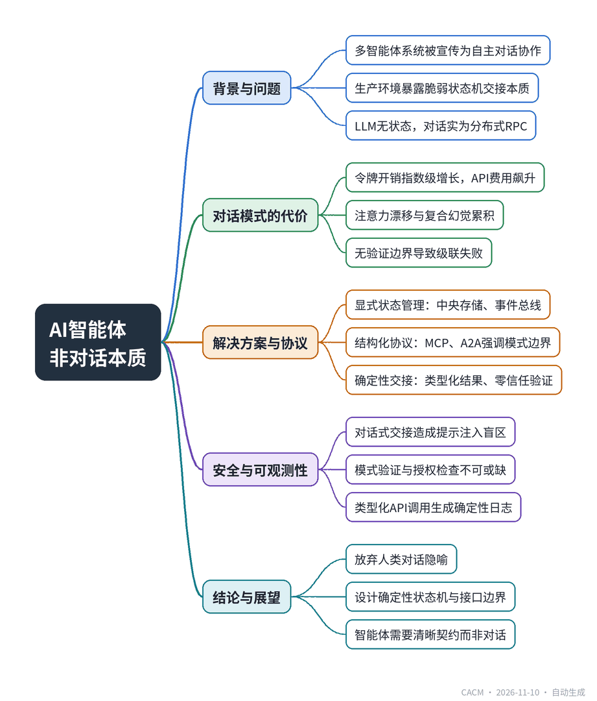

# AI Agents Can’t Talk

## AI智能体之间并非对话

**来源**：Communications of the ACM（Blog@CACM）　|　**发布**：2026-11-09 17:15（美东）　|　**北京时间**：2026-11-10 05:15　|　**作者**：Abhilash Pakalapati

[原文链接](https://cacm.acm.org/blogcacm/ai-agents-cant-talk/)　·　生成于 2026-11-10 15:50

---

## 一、摘要

> 多智能体系统的“对话”实为脆弱的、状态机式的交接。

多智能体系统常被宣传为智能体之间能进行实时、自主的对话协作，但工程团队在将其扩展到生产环境时发现，这不过是脆弱的、状态机式的交接伪装成对话。大语言模型本质上是无状态的文本补全函数，智能体之间的消息传递实为分布式远程过程调用（RPC）。这种概念误导导致令牌开销指数级增长、注意力漂移和幻觉累积，甚至引发模型崩溃。文章提出，应使用显式状态管理（如中央状态存储、事件总线）替代对话抽象，采用结构化协议（如MCP、A2A）实现确定性交接，并强调安全治理与可观测性。结论是，多智能体架构的未来在于设计确定性的状态机、内存存储和接口边界，而非让模型进行更好的对话。

## 二、核心要点

1. 大语言模型是无状态的文本补全函数，智能体间的“对话”实为通过中间件传递JSON负载的请求-响应事务，本质是分布式RPC。
2. 对话式多智能体循环导致令牌开销指数级增长，五轮讨论不会带来更深推理，只会增加API费用和延迟。
3. 未经验证的合成输出在智能体间传递会引发注意力漂移和复合幻觉，类似Shumailov等人研究的模型崩溃。
4. 生产架构应使用中央状态存储、事件总线或键值缓存，智能体写入验证后的类型化结果，实现解耦和线性令牌成本。
5. 标准化协议如Anthropic的MCP和Agent2Agent（A2A）强调刚性模式边界、显式工具能力和安全负载路由，而非自由对话。
6. 对话式交接造成安全盲区（提示注入、数据投毒）和可观测性难题，需通过模式验证、授权检查和零信任边界来治理。

## 三、关键词对照

| English | 中文 |
| --- | --- |
| large language model (LLM) | 大语言模型 |
| multi-agent system | 多智能体系统 |
| remote procedure call (RPC) | 远程过程调用 |
| state machine | 状态机 |
| token overhead | 令牌开销 |
| context window | 上下文窗口 |
| hallucination | 幻觉 |
| model collapse | 模型崩溃 |
| Model Context Protocol (MCP) | 模型上下文协议 |
| Agent2Agent (A2A) protocol | 智能体间协议 |
| prompt injection | 提示注入 |
| observability | 可观测性 |

## 四、中英对照全文

When software leaders hear that multi-agent systems are “talking to each other,” they typically picture an autonomous, real-time collaboration layer of agents negotiating, delegating, and reasoning in fluid conversation. The marketing narrative paints a compelling picture of decentralized digital workforces conducting rich dialogues to solve complex operational goals. But as engineering teams attempt to scale these architectures beyond controlled pilot environments into production environments, they hit a blunt reality: AI agents don’t talk. What looks like an organic exchange of intelligence is actually just a sequence of brittle, state-machine handoffs masquerading as dialogue.

> 当软件领导者听说多智能体系统“互相交谈”时，他们通常会想象一个自主的、实时的协作层，智能体在其中进行流畅的对话，协商、委托和推理。营销叙事描绘了一幅引人注目的图景：去中心化的数字劳动力进行丰富的对话，以解决复杂的运营目标。但当工程团队试图将这些架构从受控的试点环境扩展到生产环境时，他们遇到了一个残酷的现实：AI智能体并不交谈。看似有机的智能交流实际上只是一系列脆弱的、伪装成对话的状态机交接。

At a fundamental architectural level, large language models (LLMs) are stateless text-completion functions. They possess no active transport mechanism, socket listener, or runtime memory to “hear” or “speak” continuously. When Agent A passes an output to Agent B, it is executing a standard request-response transaction across standard compute infrastructure. Agent A serializes its intermediate generation into a structured schema (often a raw JSON payload), transmits it across a middleware proxy or message broker, and Agent B unrolls that payload into a fresh context window. Calling this inter-agent communication misleads systems architects into applying conversational paradigms to what is fundamentally distributed remote procedure call (RPC) execution.

> 在基本的架构层面上，大型语言模型（LLM）是无状态的文本补全函数。它们没有主动的传输机制、套接字监听器或运行时内存来持续“听”或“说”。当智能体A将输出传递给智能体B时，它是在标准计算基础设施上执行标准的请求-响应事务。智能体A将其中间生成序列化为结构化模式（通常是原始JSON负载），通过中间件代理或消息代理传输，智能体B将该负载展开到新的上下文窗口中。将此称为智能体间通信会误导系统架构师将对话范式应用于本质上是分布式远程过程调用（RPC）执行的过程。

This conceptual misstep carries massive cost and performance consequences. In a human team, dialogue refines ideas through back-and-forth feedback. In an LLM-based system, dialogue expands token overhead exponentially. As detailed in my earlier post, “The Hidden Token Trap of Agent Orchestration,” when developers design multi-agent loops that rely on natural language negotiations to reach consensus, they force every participating agent to re-read and re-process the entire prior exchange with every single turn. A five-turn discussion between three worker agents does not yield deeper reasoning; it simply bloats the prompt payload, multiplies API inference fees, and introduces processing latency that renders real-time automation unusable.

> 这种概念上的失误带来了巨大的成本和性能后果。在人类团队中，对话通过来回反馈来完善想法。在基于LLM的系统中，对话会以指数级增加令牌开销。正如我在之前的文章《智能体编排的隐藏令牌陷阱》中详细描述的那样，当开发者设计依赖自然语言协商达成共识的多智能体循环时，他们迫使每个参与的智能体在每一轮都重新阅读并重新处理整个先前的交流。三个工作智能体之间的五轮讨论并不会产生更深入的推理；它只会膨胀提示负载，成倍增加API推理费用，并引入使实时自动化无法使用的处理延迟。

The illusion of dialogue breaks down fastest inside the context window. In conversational multi-agent setups, every “turn” in the conversation appends the raw history of both agents into the next prompt generation. As task complexity grows, token consumption scales non-linearly. More critically, dumping uncurated message logs into downstream context windows triggers severe attention drift and compounding hallucinations. When agents consume unverified synthetic outputs from one another, they mirror the feedback-loop degradation identified in foundational research by Shumailov et al. on AI model collapse. Without deterministic verification boundaries between handoffs, message-passing turns multi-agent systems into quiet echo chambers of cascading failure.

> 对话的幻觉在上下文窗口内最快破灭。在对话式多智能体设置中，对话中的每个“轮次”都会将两个智能体的原始历史附加到下一个提示生成中。随着任务复杂性增长，令牌消耗呈非线性扩展。更关键的是，将未整理的消息日志倾倒到下游上下文窗口会引发严重的注意力漂移和复合幻觉。当智能体消费彼此未经证实的合成输出时，它们会镜像Shumailov等人关于AI模型崩溃的基础研究中发现的反馈循环退化。如果没有交接之间的确定性验证边界，消息传递会将多智能体系统变成级联故障的安静回声室。

To escape this trap, enterprise software architects must replace conversational abstractions with explicit state management. Rather than letting agents pass conversational threads back and forth, production architectures rely on central state stores, event buses, or key-value caches. Agent A finishes its sub-task, writes a validated, typed result to a database or state engine, and terminates its execution lifecycle. Agent B is then instantiated independently, pulling only the specific key fields required to execute its assigned role. This decoupled pattern enforces clean execution boundaries, prevents context contamination, and keeps token costs linear rather than exponential.

> 为了逃离这个陷阱，企业软件架构师必须用显式状态管理取代对话抽象。生产架构不是让智能体来回传递对话线程，而是依赖中央状态存储、事件总线或键值缓存。智能体A完成其子任务，将经过验证的类型化结果写入数据库或状态引擎，并终止其执行生命周期。然后智能体B独立实例化，仅拉取执行其分配角色所需的特定关键字段。这种解耦模式强制执行清晰的执行边界，防止上下文污染，并保持令牌成本线性而非指数级。

To build resilient multi-agent systems in production, enterprise architectures are pivoting away from unconstrained “agent chat” and toward structured operational protocols. Standardized specifications like Anthropic’s Model Context Protocol (MCP) demonstrate that real agent coordination relies on rigid schema boundaries, explicit tool capabilities, and controlled state persistence rather than free-form natural language handoffs. Similarly, emerging frameworks for cross-framework agent interoperability such as the open Agent2Agent (A2A) protocol focus on standardized discovery, capability negotiation, and secure payload routing rather than conversational mechanics.

> 为了在生产中构建弹性的多智能体系统，企业架构正在从无约束的“智能体聊天”转向结构化操作协议。像Anthropic的模型上下文协议（MCP）这样的标准化规范表明，真正的智能体协调依赖于严格的模式边界、显式的工具能力和受控的状态持久性，而不是自由形式的自然语言交接。同样，跨框架智能体互操作性的新兴框架，如开放的Agent2Agent（A2A）协议，专注于标准化发现、能力协商和安全负载路由，而不是对话机制。

Security and governance further demand that we abandon the conversational myth. Direct, unmonitored agent-to-agent exchanges create blind spots for prompt injection, indirect data poisoning, and unauthorized privilege escalation. If a malicious payload or unformatted data stream bypasses the input validation of an upstream agent, an unconstrained downstream agent will execute those malicious instructions without question. Enterprise-grade systems require every handoff to pass through deterministic guardrails: schema validation, authorization checks, and execution boundaries that treat every incoming agent payload with zero-trust skepticism.

> 安全和治理进一步要求我们放弃对话神话。直接、未经监控的智能体间交换为提示注入、间接数据中毒和未经授权的权限提升创造了盲点。如果恶意负载或未格式化的数据流绕过了上游智能体的输入验证，无约束的下游智能体将毫无疑问地执行这些恶意指令。企业级系统要求每次交接都通过确定性护栏：模式验证、授权检查以及以零信任怀疑态度处理每个传入智能体负载的执行边界。

Beyond security, observability becomes nearly impossible when agents communicate in unformatted chat streams. Engineering teams attempting to debug a failed workflow must sift through thousands of lines of conversational natural language to discover where an agent drifted off course. In contrast, when agent handoffs are structured as typed API calls or state transactions, every interaction generates deterministic logs, performance metrics, and explicit failure points that can be monitored, alerted on, and automatically retried using standard SRE tooling.

> 除了安全性之外，当智能体以未格式化的聊天流通信时，可观测性几乎变得不可能。试图调试失败工作流的工程团队必须筛选数千行对话自然语言，以发现智能体在哪里偏离了方向。相比之下，当智能体交接结构化为类型化API调用或状态事务时，每次交互都会生成确定性日志、性能指标和明确的故障点，可以使用标准SRE工具进行监控、警报和自动重试。

The path forward for multi-agent architecture is not teaching models how to hold better conversations with one another; it is designing superior deterministic state machines, memory stores, and interface boundaries. Until we stop framing multi-agent design around the metaphor of human conversation, teams will continue to drown in token costs and unpredictable runtime behavior. AI agents don’t need to talk; they need clean contracts, typed schemas, and reliable state routing.

> 多智能体架构的前进道路不是教模型如何更好地相互对话；而是设计卓越的确定性状态机、内存存储和接口边界。直到我们停止围绕人类对话的隐喻来构建多智能体设计，团队将继续淹没在令牌成本和不可预测的运行时行为中。AI智能体不需要交谈；它们需要清晰的契约、类型化模式和可靠的状态路由。

Disclosure: All core technical concepts and conclusions are entirely my own. A GenAI tool was used strictly for prose refinement.

> 披露：所有核心技术概念和结论完全是我个人的。使用GenAI工具严格用于散文润色。

Abhilash Pakalapati is a Senior AI Engineer and Data Engineer with more than a decade of experience building large-scale data platforms and intelligent applications. His work focuses on the design of modern data architectures that support machine learning, generative AI systems, and real-time analytics in enterprise environments.

> Abhilash Pakalapati是一位资深AI工程师和数据工程师，拥有十多年构建大规模数据平台和智能应用的经验。他的工作专注于设计支持企业环境中机器学习、生成式AI系统和实时分析的现代数据架构。

---
*英文原文版权归 Communications of the ACM 及作者所有；中文译文由 AI 辅助生成，仅供学习参考。*