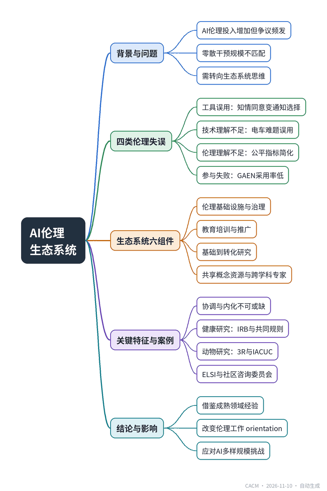

# An Ethics Ecosystem for AI

## 构建AI伦理生态系统

**来源**：Communications of the ACM（）　|　**发布**：2026-11-09 13:47（美东）　|　**北京时间**：2026-11-10 01:47　|　**作者**：

[原文链接](https://cacm.acm.org/research/an-ethics-ecosystem-for-ai/)　·　生成于 2026-11-10 15:51

---

## 一、摘要

> AI伦理需超越零散干预，构建协同生态系统。

AI在社会各领域的广泛应用带来了复杂的伦理挑战，尽管业界、学界和政府投入资源开发伦理工具、开展跨学科培训并推行参与式设计，AI项目仍频繁引发争议和伦理失误。文章识别了四类反复出现的伦理失误：将其他领域的伦理工具（如知情同意）生搬硬套到AI场景；伦理学者因技术理解不足而误用类比（如自动驾驶中的电车难题）；技术专家因伦理理解不足而过度简化公平性（如算法公平指标）；以及因利益相关者沟通失败导致有前景的技术无人采用（如GAEN暴露通知系统）。作者认为，现有干预措施在规模上与AI的普及程度严重不匹配，主张借鉴健康研究、军事和航空等领域的成熟伦理生态系统，构建一个由伦理基础设施、治理、教育培训与推广、基础到转化研究、共享概念资源、跨学科伦理专家六个组件构成，并强调协调与内化两个关键特征的AI伦理生态系统。这一目标将改变各行业开展伦理工作的方式，有望应对AI带来的多样且大规模的伦理挑战。

## 二、核心要点

1. 文章指出AI伦理失误的四种典型模式：工具误用、技术理解不足、伦理理解不足和利益相关者参与失败。
2. 知情同意在AI中退化为“通知与选择”，因缺乏IRB式监督和用户真实理解而失效。
3. 自动驾驶伦理早期文献误用电车难题，忽视了机器学习训练机制本身的伦理意义。
4. 算法公平文献初期过度追求数学化公平指标，忽略了公平的情境依赖和程序正义。
5. GAEN系统因公众混淆接触追踪与暴露通知、缺乏信任，导致采用率低而失效。
6. 作者主张借鉴健康研究等领域的伦理生态系统，包含六大组件并强调协调与内化。

## 三、关键词对照

| English | 中文 |
| --- | --- |
| ethics ecosystem | 伦理生态系统 |
| informed consent | 知情同意 |
| Institutional Review Board (IRB) | 机构审查委员会 |
| fairness metrics | 公平性指标 |
| participatory design | 参与式设计 |
| Google/Apple Exposure Notification (GAEN) | 谷歌/苹果暴露通知系统 |
| human subjects research (HSR) | 人类受试者研究 |
| animal subjects research (ASR) | 动物受试者研究 |
| Institutional Animal Care and Use Committee (IACUC) | 机构动物护理与使用委员会 |
| Common Rule | 共同规则 |
| responsible conduct of research (RCR) | 负责任研究行为 |
| Collaborative Institutional Training Initiative (CITI) | 协作机构培训计划 |
| Ethics, Legal, and Social Implications (ELSI) | 伦理、法律与社会影响 |
| community advisory board (CAB) | 社区咨询委员会 |

## 四、中英对照全文

Attention to the social and ethical dimensions of AI has spurred efforts in industry, academia, and government to anticipate and mitigate ethical risks. Whether motivated by genuine moral concern or not, key stakeholders are increasingly dedicating significant resources to addressing ethical challenges in AI. But despite these efforts, AI projects and products regularly cause controversy, and ethical missteps abound.

> 对AI的社会和伦理维度的关注，促使工业界、学术界和政府努力预测和减轻伦理风险。无论是否出于真正的道德关切，关键利益相关者正越来越多地投入大量资源来应对AI中的伦理挑战。然而，尽管做出了这些努力，AI项目和产品仍经常引发争议，伦理失误比比皆是。

Frequently recommended responses to these ethical shortcomings include creating ethics tools and resources for specific sociotechnical contexts, upskilling in ethics for technologists and in technology for ethicists, and practicing participatory technology design that involves key stakeholders. These aims are laudable; however, they are inadequate for the scale and nature of the social and ethical challenges we face. We articulate an alternative response: We should work toward the development of an AI ethics ecosystem, an overlapping and mutually reinforcing network of governance, education, training, research, and communication mechanisms.

> 针对这些伦理缺陷，经常被推荐的应对措施包括：为特定的社会技术背景创建伦理工具和资源，提升技术专家的伦理素养和伦理学家的技术素养，以及实践涉及关键利益相关者的参与式技术设计。这些目标值得称赞；然而，它们不足以应对我们所面临的社会和伦理挑战的规模和性质。我们提出一种替代性应对方案：我们应致力于发展一个AI伦理生态系统，一个由治理、教育、培训、研究和沟通机制组成的、相互重叠且相互强化的网络。

In what follows, we argue for the development of an AI ethics ecosystem (or collection of ecosystems) by first identifying a range of recurring ethical missteps and evaluating current attempts to address them. We then illustrate details of the ecosystemic approach, highlighting how ethics ecosystems in other domains or sectors—such as health and medicine, military and defense, and aviation—allow us to manage their particular social and moral challenges. Drawing especially on the ecosystem governing health research and practice, we identify the essential components of ethics ecosystems. We then argue that existing tools and practices in the AI domain fall well short of what would be required to realize an AI ethics ecosystem, and recommend concentrating our efforts on addressing that shortfall. In so doing, we reflect on lessons we can learn from difficulties faced in other domains, as well as on hurdles that may appear particular to the AI domain. The upshot of our reflection is not a detailed explanation of the specifics of a monolithic AI ethics ecosystem. Rather, it is a recognition that adopting the development of an AI ethics ecosystem as a goal changes our orientation to doing ethics work across sectors, domains, and populations, in a way that yields hope for addressing the diversity and scale of ethical challenges raised by AI and its integration across a broad range of sociotechnical systems.

> 在下文中，我们主张发展一个AI伦理生态系统（或生态系统集合），首先识别一系列反复出现的伦理失误，并评估当前应对这些失误的尝试。然后，我们阐述生态系统方法的具体细节，强调其他领域或行业——如健康和医学、军事和国防以及航空——的伦理生态系统如何使我们能够管理其特定的社会和道德挑战。我们特别借鉴了管理健康研究和实践的生态系统，识别出伦理生态系统的关键组成部分。接着，我们论证AI领域现有的工具和实践远未达到实现AI伦理生态系统所需的要求，并建议将我们的努力集中在解决这一不足上。在此过程中，我们反思可以从其他领域面临的困难中吸取的教训，以及可能为AI领域所特有的障碍。我们反思的结果并非对单一AI伦理生态系统具体细节的详细解释。相反，它是对以下事实的认识：将发展AI伦理生态系统作为目标，会改变我们在跨部门、跨领域和跨人群中开展伦理工作的方向，从而为解决AI及其在广泛社会技术系统中的整合所带来的伦理挑战的多样性和规模带来希望。

### Recurring Ethical Missteps
*反复出现的伦理失误*

Among the kinds of ethical failures in AI is the misapplication of existing ethical tools. This occurs when we observe that some ethical challenge in the AI context closely resembles one from another context, and then too hastily import the tools of the latter in hopes of solving problems in the former. To illustrate, consider informed consent, a crucial ethical tool in the context of human subjects research (HSR) in the U.S. In that context, securing informed consent requires researchers to ensure participants are provided with clear information about how the research will be conducted and used, understand the associated risks, and are participating voluntarily. This operationalizes respect for autonomy and protects participants’ well-being. When this model is applied to the domain of AI or digital data collection, however, it is typically operationalized as “notice and choice,” which fails to serve those same values. In complex digital systems, true comprehension is rarely possible for end users: Information about data uses is often overly technical or incomplete, and the mechanisms for ensuring authentic understanding or voluntary participation, such as oversight by institutional review boards (IRBs), are not in place. As a result, the attempt to directly import the ethical tool from HSR to AI fails because it is not suited to safeguard foundational values in the new context.

> AI中的伦理失败类型之一是现有伦理工具的误用。当我们观察到AI背景下的某些伦理挑战与另一背景下的挑战非常相似，然后过于仓促地引入后者的工具，希望解决前者的问题时，就会发生这种情况。举例来说，考虑知情同意，这是美国人体受试者研究（HSR）背景下的一个关键伦理工具。在该背景下，获取知情同意要求研究人员确保参与者获得关于研究将如何进行和使用的明确信息，理解相关风险，并自愿参与。这落实了对自主性的尊重，并保护了参与者的福祉。然而，当这一模式应用于AI或数字数据收集领域时，它通常被操作为“通知与选择”，这未能服务于同样的价值观。在复杂的数字系统中，最终用户很少可能真正理解：关于数据使用的信息往往过于技术化或不完整，而确保真正理解或自愿参与的机制，如机构审查委员会（IRB）的监督，并不存在。结果，试图将伦理工具直接从HSR移植到AI的尝试失败了，因为它不适合在新背景下维护基本价值观。

Ethical trouble also arises when we try to solve problems related to AI with insufficient technical understanding. This often occurs when ethicists, despite their normative expertise, build their analyses on incorrect assumptions about how the underlying technologies function, how they are engineered, or how they are deployed in the real world. To illustrate, consider the progression of the scholarly literature on autonomous vehicles (AVs) in philosophical ethics. As AV technology matured, philosophers recognized that self-driving cars presented new challenges with respect to the ethics of driving and related policy design. Early commentary in the field often treated some ethical challenges as real-world instantiations of the trolley problem, reasoning that the ethics of harm distribution from the thought experiment could be directly applied to driving scenarios that AVs might face on the road. But this way of thinking seems to rest on a misunderstanding about how complex robotic systems operate. The specific outcomes in any particular AV driving scenario are partly a function of how various machine learning systems in the vehicle are trained, and therefore a function of choices about how to construct their training regimes, including a multitude of choices about data collection, curation, validation, and so on. Questions about how best to construct and evaluate such regimes are themselves ethical questions with downstream implications across the range of scenarios in which AVs operate. Attempting to draw lessons directly from trolley cases about what we should design cars to do in discrete, superficially similar accident scenarios fundamentally misunderstands the nature of the technical design challenge at issue and how ethical tools can help us navigate that challenge.

> 当我们试图在技术理解不足的情况下解决与AI相关的问题时，伦理麻烦也会出现。这种情况经常发生在伦理学家身上，尽管他们拥有规范专业知识，但他们的分析建立在关于底层技术如何运作、如何设计或如何在现实世界中部署的错误假设之上。举例来说，考虑哲学伦理学中关于自动驾驶汽车（AV）的学术文献的进展。随着AV技术的成熟，哲学家们认识到自动驾驶汽车在驾驶伦理和相关政策设计方面提出了新的挑战。该领域的早期评论往往将某些伦理挑战视为电车问题的现实世界实例，认为思想实验中的伤害分配伦理可以直接应用于AV在道路上可能面临的驾驶场景。但这种思维方式似乎基于对复杂机器人系统如何运作的误解。任何特定AV驾驶场景的具体结果部分取决于车辆中各种机器学习系统如何被训练，因此取决于关于如何构建其训练方案的选择，包括关于数据收集、整理、验证等的大量选择。关于如何最好地构建和评估此类方案的问题本身就是伦理问题，对AV运行的各种场景具有下游影响。试图直接从电车案例中汲取关于我们应该设计汽车在离散的、表面上相似的 accident 场景中做什么的教训，从根本上误解了所涉及的技术设计挑战的性质，以及伦理工具如何帮助我们应对这一挑战。

Unsurprisingly, a further kind of failure that regularly occurs mirrors the last: when sufficient technical understanding is met with insufficient ethical understanding. This is exemplified in much of the scholarship regarding fairness metrics in algorithmic decision making, especially in the earliest days of that literature. In response to troubling cases in which prediction or recommendation systems apparently treated subjects quite differently, and unfairly, depending on their membership in various protected classes, a lot of energy was devoted toward mathematically defining fairness conditions that could be used to constrain the modeling in systems of that kind, such that their outputs would be guaranteed to avoid the problems of the troubling cases. While understandable and even laudable, the difficulty with such efforts is there is no good reason to think that the whole of the ethical import of fairness can be captured by easily codifiable conditions such as formal fairness metrics, especially given that fairness is often a matter of attending to procedural details in decision making, or of ensuring that decisions go some way to addressing past or structural injustice, either in addition to or rather than outcomes. As the enormous body of scholarship on the normative significance of fairness evinces, there is little reason to expect that fairness is the kind of normative value that we care about in just the same way, for just the same reasons, across the wide range of contexts in which people are subject to algorithmic sorting or prediction. For example, consider how we might differentially evaluate whether a recidivism prediction tool is fair depending on whether it is used in pretrial detention decisions or to provide resources to communities or individuals to reduce the risk of reoffense. Whether failing to satisfy a given fairness metric is unfair depends on a variety of facts about the context-specific use of a given tool. It was a mistake at the outset, then, to understand the problematic cases that jump-started the literature as requiring a solution in the form of univocal, mathematically operationalized fairness standards.

> 不出所料，另一种经常发生的失败与上一种相呼应：当足够的技术理解遇到不足的伦理理解时。这在许多关于算法决策中公平性指标的学术研究中得到了体现，尤其是在该文献的早期。针对预测或推荐系统显然根据主体属于各种受保护类别而对其待遇相当不同且不公平的令人不安的案例，大量精力被投入到数学上定义公平条件，这些条件可用于约束此类系统中的建模，从而保证其输出避免令人不安案例中的问题。虽然可以理解甚至值得称赞，但这种努力的困难在于，没有充分理由认为公平的全部伦理意义可以被诸如形式公平指标之类易于编纂的条件所捕捉，尤其是考虑到公平往往涉及关注决策中的程序细节，或确保决策在某种程度上解决过去或结构性不公正，无论是作为结果的补充还是替代。正如大量关于公平的规范意义的学术研究所表明的那样，几乎没有理由期望公平是那种我们在人们受到算法排序或预测的广泛背景下以同样方式、出于同样原因而关心的规范价值。例如，考虑我们如何根据累犯预测工具是用于审前拘留决定还是用于向社区或个人提供资源以降低再犯风险，来不同地评估其是否公平。未能满足给定公平指标是否不公平取决于关于给定工具在特定背景下使用的各种事实。因此，从一开始就将引发该文献的问题案例理解为需要以单义的、数学上可操作的公平标准的形式来解决，是一个错误。

A final form of failure can occur when it seems like everything has gone right: We have identified some problem that can be addressed with AI, carefully considered the technical and ethical issues at play, and created a tool that looks promising. The problem? No one wants it. When potential users turn away from a promising computing solution, we believe that this is often due to failed stakeholder engagement. During the height of the COVID-19 pandemic in the U.S. in 2020, digital tools were developed with the promise of efficiently notifying users of potential exposures. Among them was the Google/Apple Exposure Notification (GAEN) system, which had been designed with special attention to privacy protection. Digital tools were largely inefficacious in the U.S. due to low uptake, seemingly explained in large part by lack of trust. Despite the sophistication of its privacy-protecting methods, many Americans were reluctant to use GAEN for fear of privacy violations. Why? At least part of the answer is that they seemed to conflate the technology that enabled exposure notification with other forms of technology designed to enable contact tracing, and so took GAEN to be just as much of a privacy threat as, say, location tracking. That conflation reveals a failure of communication between those building and hoping to deploy the technology and those who might have benefited from it.

> 最后一种失败形式可能发生在一切似乎都进展顺利时：我们已经确定了某个可以用AI解决的问题，仔细考虑了其中的技术和伦理问题，并创建了一个看起来很有前景的工具。问题是什么？没人想要它。当潜在用户对 promising 的计算解决方案避而远之时，我们认为这通常是由于利益相关者参与失败。在2020年美国COVID-19大流行高峰期，数字工具被开发出来，承诺高效地通知用户潜在暴露。其中包括谷歌/苹果暴露通知（GAEN）系统，该系统在设计时特别注重隐私保护。数字工具在美国基本上无效，因为采用率低，似乎很大程度上是由于缺乏信任。尽管其隐私保护方法很复杂，但许多美国人因担心隐私侵犯而不愿使用GAEN。为什么？至少部分答案是，他们似乎将实现暴露通知的技术与其他旨在实现接触者追踪的技术混为一谈，因此认为GAEN与位置追踪一样是隐私威胁。这种混淆揭示了构建和希望部署该技术的人与可能从中受益的人之间的沟通失败。

### Lessons
*教训*

The ethical failures above point to several natural interventions that might help address them.

> 上述伦理失败指向了几种可能有助于解决它们的自然干预措施。

One natural solution is to provide cross-disciplinary training. Indeed, educational interventions are regularly recommended by major institutional actors, and several such programs are already well developed and have been operating for several years. An alternative solution addresses the problem of misunderstanding across disciplinary lines differently, by fostering the development of teams of researchers comprising experts from different areas of study.

> 一个自然的解决方案是提供跨学科培训。事实上，主要机构行为者经常推荐教育干预措施，并且几个此类项目已经发展成熟并运行了数年。另一种解决方案以不同方式解决跨学科误解的问题，即促进由来自不同研究领域的专家组成的研究团队的发展。

The natural solution to failed stakeholder engagement in technology design is obvious: Increase the degree to which stakeholders are involved. A recent National Academies report endorses just that idea: “Projects that include among their aims the achievement of societally relevant outcomes should engage stakeholders from the start of design through deployment, testing, and redesign processes, and employ design teams that include domain experts and social and behavioral scientists to help ensure the project is solving the right problems.” The most well-known method by which to accomplish this kind of aim is participatory design, which the report approvingly cites just a few sentences later.

> 技术设计中利益相关者参与失败的自然解决方案显而易见：增加利益相关者的参与程度。最近的一份国家科学院报告赞同这一想法：“其目标包括实现社会相关成果的项目应从设计开始到部署、测试和重新设计过程都让利益相关者参与，并采用包括领域专家和社会与行为科学家在内的设计团队，以帮助确保项目解决正确的问题。”实现此类目标的最著名方法是参与式设计，报告在几行之后赞许地引用了它。

Each of these ideas gets something right, and we are enthusiastic about some particularly well-developed attempts to implement them. We are pessimistic, however, about their prospects for systematically resolving the pain points canvassed in the previous section. Despite the natural fit between the shape of the problems and solutions on offer, there is a vast mismatch between the size or scale of the problems and solutions. Consider, for example, what it would take to try to resolve the problems through “upskilling” technical and/or normative experts. Because of how pervasively AI is being implemented across the major sectors of society, it would be a monumental undertaking to ensure that all of the actors directly engaged in such projects had expert-level understanding of both the technological components of their work and the relevant ethical issues implicated by it. Concentrating instead on the composition of teams of researchers is unlikely to help. Given the many teams across industry, academic, and governmental settings conducting cutting-edge AI research, we doubt the existing supply of normative expertise would be close to matching the demand that would exist should each of them require a minimally tech-competent ethicist to join their ranks. The scaling difficulties for participatory design are perhaps even worse. Indeed, the challenges of scaling are such that attempts to overcome them may cut against the very theoretical underpinnings that motivate participatory design in the first place. And, again, the pervasiveness of AI research and implementation only exacerbates this problem.

> 这些想法各有其正确之处，我们对一些特别成熟的实施尝试充满热情。然而，我们对它们系统性地解决上一节所列举的痛点的前景感到悲观。尽管问题的形态与所提供的解决方案之间存在自然契合，但问题的规模或尺度与解决方案之间存在巨大不匹配。例如，考虑通过“提升技能”来解决问题的技术专家和/或规范专家需要付出什么。由于AI正在社会主要部门中如此普遍地实施，确保所有直接参与此类项目的行为者对其工作的技术组成部分及其所涉及的相关伦理问题具有专家级理解将是一项艰巨的任务。相反，专注于研究团队的构成也不太可能有所帮助。鉴于工业界、学术界和政府环境中许多团队正在进行前沿AI研究，我们怀疑现有的规范专业知识供应将远不能满足如果每个团队都需要一位至少具备技术能力的伦理学家加入其行列时所产生的需求。参与式设计的扩展困难可能更糟。事实上，扩展的挑战如此之大，以至于克服这些挑战的尝试可能会违背最初激发参与式设计的理论基础。而且，AI研究和实施的普遍性只会加剧这个问题。

As we will see, the mismatch between the problems we face and an attempted resolution in the form of education and stakeholder engagement becomes clearer when we consider how we respond to pervasive ethical challenges in other domains.

> 正如我们将看到的，当我们考虑如何应对其他领域中普遍存在的伦理挑战时，我们所面临的问题与以教育和利益相关者参与形式进行的解决尝试之间的不匹配变得更加明显。

### An Ecosystemic Approach
*生态系统方法*

Addressing the ethical challenges raised by AI is best accomplished through the cultivation of an ethics ecosystem, a collection of coordinated, mutually supporting components oriented toward preserving, protecting, and promoting the foundational values of some domain of activity. It is useful to think of the collection of components as an ecosystem insofar as it enables us to understand and assess how the components and their relationships to one another serve the overall function of realizing the values that they are designed to jointly promote and protect. While details vary, more or less robust ecosystems serve this function across a variety of domains, including healthcare, engineering, the military, and law. The foundational values that ecosystems promote, preserve, and protect are typically developed into intermediary norms, which clarify how the foundational values are typically realized in the domain. For example, in HSR, the foundational value of respect for persons is protected through prioritizing the autonomy of research participants. In the case of animal subjects research (ASR), the foundational value of animal welfare is cashed out in terms of a set of intermediary norms referred to as the “3Rs”: replacement (of animal subjects where possible), reduction (of the number of animal subjects where possible), and refinement (of interventions to reduce the harm caused to animal subjects). In some sub-domains of engineering, the value of well-being is realized through intermediary norms focused on safety, around which a system of regulations, audits, and trainings is organized.

> 应对AI提出的伦理挑战最好通过培养一个伦理生态系统来实现，这是一个由协调的、相互支持的组成部分组成的集合，旨在维护、保护和促进某一活动领域的基本价值观。将组成部分的集合视为一个生态系统是有用的，因为它使我们能够理解和评估这些组成部分及其相互关系如何服务于实现它们旨在共同促进和保护的价值观的整体功能。虽然细节各异，但或多或少稳健的生态系统在多种领域中服务于这一功能，包括医疗保健、工程、军事和法律。生态系统所促进、维护和保护的基本价值观通常被发展为中间规范，这些规范阐明了基本价值观在该领域中通常如何实现。例如，在HSR中，尊重人的基本价值观通过优先考虑研究参与者的自主性来保护。在动物受试者研究（ASR）的情况下，动物福利的基本价值观通过一组称为“3R”的中间规范来体现：替代（尽可能替代动物受试者）、减少（尽可能减少动物受试者的数量）和优化（改进干预措施以减少对动物受试者造成的伤害）。在工程的某些子领域中，福祉的价值通过关注安全的中间规范来实现，围绕这些规范组织了法规、审计和培训体系。

The components of an ethics ecosystem specify and reinforce intermediary norms as a mechanism to preserve, promote, and protect foundational values. In this section, we articulate six key components of a well-functioning ethics ecosystem: ethics infrastructure; governance; education, training, and outreach; foundational to translational research; shared conceptual resources; and interdisciplinary ethics experts. We define each component, providing examples from existing ecosystems, before explaining two features that are essential to a well-functioning ecosystem that are distinct from the individual components: coordination and enculturation. To illuminate the components and features of well-functioning ethics ecosystems, we will point to examples from outside the AI domain, focusing mostly on the sub-domains and accompanying ecosystems related to health research and practice, including HSR, ASR, clinical care, and embryonic stem-cell research. In focusing our attention in this way, we do not mean to suggest that the health sector is the only domain that realizes a well-functioning ethics ecosystem (consider, for example, legal, military, and engineering domains). Nor do we mean to suggest that the implementation details of these ecosystems are likely to be easily ported to AI—indeed, we were at pains above to illustrate some reasons for thinking they will not be. Rather, our hope is to draw attention to the mature, interconnected functional form of these systems to highlight the general shape and scale of what we believe is necessary in the case of AI.

> 伦理生态系统的组成部分指定并强化中间规范，作为维护、促进和保护基本价值观的机制。在本节中，我们阐述了运作良好的伦理生态系统的六个关键组成部分：伦理基础设施；治理；教育、培训和推广；从基础到转化的研究；共享概念资源；以及跨学科伦理专家。我们定义每个组成部分，提供现有生态系统的例子，然后解释两个对运作良好的生态系统至关重要且不同于单个组成部分的特征：协调和文化内化。为了阐明运作良好的伦理生态系统的组成部分和特征，我们将指出AI领域之外的例子，主要关注与健康研究和实践相关的子领域及 accompanying 生态系统，包括HSR、ASR、临床护理和胚胎干细胞研究。我们以这种方式集中注意力，并不意味着健康部门是实现运作良好的伦理生态系统的唯一领域（例如，考虑法律、军事和工程领域）。我们也不意味着这些生态系统的实施细节可能容易移植到AI——事实上，我们在上面竭力说明了一些认为它们不会容易移植的理由。相反，我们希望提请注意这些系统的成熟、相互关联的功能形式，以突出我们认为在AI情况下所必需的一般形态和规模。

Ethics infrastructure. Ethics infrastructure refers to the tools, rules, and operationalizations that govern the practices of those working within an ethics ecosystem. It also includes local oversight of those tools, rules, and operationalizations. This infrastructure can come in many forms; much of it might be automated or involve simple procedures and principles that researchers or practitioners can be trained to follow as part of their daily practice. For example, it may include standard auditing procedures, mechanisms for stakeholders to easily escalate issues that require more careful attention or expertise that they lack, and other forms of direct guidance for actors enmeshed throughout the ecosystem.

> 伦理基础设施。伦理基础设施是指管理伦理生态系统内工作者实践的工具、规则和操作化方法。它还包括对这些工具、规则和操作化方法的本地监督。这种基础设施可以有多种形式；其中许多可能是自动化的，或涉及研究人员或从业者可以接受培训作为日常实践一部分遵循的简单程序和原则。例如，它可能包括标准审计程序、利益相关者轻松升级需要更仔细关注或他们缺乏的专业知识的问题的机制，以及对整个生态系统中行为者的其他形式的直接指导。

That brief description might seem to imply a recommendation for a kind of compliance regime for managing ethical issues, one that reduces addressing complex ethical scenarios to a box-checking exercise. While we agree that mere legal compliance is often a bare-minimum requirement that is generally inadequate for addressing the ethical dimensions of technological practice, compliance need not mean mere legal compliance and box-checking need not be an exercise devoid of substantive ethical value. It is possible to develop operationalized ethics tools that go beyond legal requirements that researchers, practitioners, and other key stakeholders can be trained to use without requiring significant ethical competency themselves. These operationalizations can include escalation procedures that pull in those with such competency when necessary. When situated within a robust ethics ecosystem, the use of these operationalizations is part of a useful division of labor for the intricate work carried out by the whole.

> 那段简短描述可能似乎暗示了一种管理伦理问题的合规制度建议，一种将应对复杂伦理场景简化为勾选框练习的制度。虽然我们同意仅仅法律合规往往是最低要求，通常不足以应对技术实践的伦理维度，但合规不一定意味着仅仅法律合规，勾选框也不一定是不具有实质伦理价值的练习。可以开发超越法律要求的操作化伦理工具，研究人员、从业者和其他关键利益相关者可以接受培训使用这些工具，而无需自身具备显著的伦理能力。这些操作化方法可以包括在必要时引入具备此类能力者的升级程序。当置于稳健的伦理生态系统中时，这些操作化方法的使用是整个系统所进行的复杂工作的有用分工的一部分。

As concrete examples of ethics infrastructure, consider the various tools and methods employed in the health sector. In research involving human participants in the U.S., researchers must make a determination of whether the research constitutes “human subjects research,” whether such research satisfies criteria for exemption, and, if so, whether that exemption means they need either no or an expedited research review from their IRB. The National Institutes of Health (NIH) offers a decision tool for making these determinations, requiring researchers to make use of it in the course of securing approval to conduct human subjects research. Researchers provide a relatively standardized set of documents that include a research protocol describing their proposed study and how participants will be recruited, the information that they will disclose to research participants and how that information will be disclosed, information about the study population and whether participants are members of vulnerable populations, and documentation confirming that researchers have completed various mandatory trainings. These documents are ultimately submitted to an IRB, the local oversight mechanism, which reviews them with an eye toward ensuring, for example, that duties to disclose, inform, and avoid coercion are satisfied and that there is sufficient justification for using participants from vulnerable populations. There are also standard sets of principles that researchers can utilize when seeking ethical guidance concerning their research, such as the NIH Guiding Principles for Ethical Research. In the U.S., similar procedures guide ASR, with appropriate documentation being submitted for review by an Institutional Animal Care and Use Committee (IACUC).

> 作为伦理基础设施的具体例子，考虑健康部门采用的各种工具和方法。在美国涉及人类参与者的研究中，研究人员必须确定研究是否构成“人体受试者研究”，此类研究是否符合豁免标准，如果符合，该豁免是否意味着他们不需要或需要其IRB的快速研究审查。美国国立卫生研究院（NIH）提供了一个用于做出这些决定的决策工具，要求研究人员在获得进行人体受试者研究批准的过程中使用它。研究人员提供一套相对标准化的文件，包括描述其拟议研究以及如何招募参与者的研究方案、他们将向研究参与者披露的信息以及如何披露该信息、关于研究人群以及参与者是否属于弱势群体的信息，以及确认研究人员已完成各种强制性培训的文件。这些文件最终提交给IRB，即本地监督机制，IRB审查这些文件，以确保例如披露、告知和避免胁迫的义务得到满足，并且有充分理由使用弱势群体的参与者。研究人员在寻求有关其研究的伦理指导时还可以使用一套标准原则，例如NIH伦理研究指导原则。在美国，类似的程序指导ASR，适当的文件提交给机构动物护理和使用委员会（IACUC）审查。

Local oversight mechanisms are a key part of the ethics infrastructure of an ethics ecosystem and also involve operationalizations and mechanisms that help realize the ethical aims of the ecosystem. IRBs and IACUCs have standard monitoring procedures for the studies they approve. For example, IACUCs organize periodic site visits to animal labs to monitor the treatment of animals. The oversight boards also have composition requirements that help ensure the relevant expertise is present on the board to carry out effective oversight and avoid conflicts of interest: IACUCs must have a veterinarian as a member, and both IRBs and IACUCs require scientific and non-scientific members as well as non-affiliated or external members.

> 本地监督机制是伦理生态系统伦理基础设施的关键部分，也涉及有助于实现生态系统伦理目标的操​​作化方法和机制。IRB和IACUC对其批准的研究有标准的监测程序。例如，IACUC组织定期现场访问动物实验室以监测动物的待遇。监督委员会还有组成要求，有助于确保委员会具备相关专业知识以进行有效监督并避免利益冲突：IACUC必须有一名兽医作为成员，IRB和IACUC都要求有科学和非科学成员以及非附属或外部成员。

Governance. Robust ethics ecosystems are governed by a broad system of rules, norms, rewards, and formal and informal accountability mechanisms, including sanctions that incentivize and support other components of the ecosystem. For example, this system might incentivize, perhaps very strongly, the adoption of particular pieces of ethics infrastructure or various education and training requirements. The governance component of an ethics ecosystem sits outside any single institution or organization, creating mechanisms that make those individual organizations and institutions responsive to broader social concerns. Laws, regulation, and legislation are obvious pieces of this component of the ecosystem, but they are not the only form. Broadly shared social norms, for example, can provide the kinds of incentives to deploy ethics infrastructure, engage in training, fund domain-relevant ethics research, and so on. Accreditation requirements for educational institutions are another mechanism by which some form of ecosystemic governance can be enacted.

> 治理。稳健的伦理生态系统由广泛的规则、规范、奖励以及正式和非正式问责机制系统管理，包括激励和支持生态系统其他组成部分的制裁。例如，该系统可能激励（也许非常强烈地）采用特定的伦理基础设施或各种教育和培训要求。伦理生态系统的治理组成部分位于任何单一机构或组织之外，创建机制使这些个别组织和机构对更广泛的社会关切做出回应。法律、法规和立法是生态系统这一组成部分的明显部分，但它们不是唯一形式。例如，广泛共享的社会规范可以提供部署伦理基础设施、参与培训、资助领域相关伦理研究等的激励。教育机构的认证要求是另一种可以实施某种形式生态系统治理的机制。

In the cases of human and animal subjects research, the policy, regulation, and accountability frameworks are largely enshrined in the law. An example is the “Common Rule” governing HSR, which includes requirements on institutions to ensure compliance with a set of rules and regulations, on researchers with respect to how they manage issues of informed consent, and on the workings (constitution, function, etc.) of IRBs. Similarly, the Animal Welfare Act enacts analogous requirements governing ASR and its local oversight. While typical (and useful), governance and oversight need not be mandated by law.

> 在人类和动物受试者研究的情况下，政策、法规和问责框架在很大程度上被载入法律。一个例子是管理HSR的“通用规则”，其中包括要求机构确保遵守一套规则和法规，要求研究人员管理知情同意问题，以及要求IRB的运作（组成、职能等）。同样，《动物福利法》颁布了管理ASR及其本地监督的类似要求。虽然典型（且有用），但治理和监督不一定需要法律授权。

Education, training, and outreach. Healthy ethics ecosystems include mechanisms to educate and train participants, as well as to engage key stakeholders through targeted outreach. These efforts aim to promote a shared understanding of the structures and processes that uphold and protect the foundational values of the ecosystem. This component facilitates the onboarding of practitioners, equipping them to navigate the ethics ecosystem effectively and to apply its ethical principles and tools in their own work.

> 教育、培训和推广。健康的伦理生态系统包括教育和培训参与者的机制，以及通过有针对性的推广吸引关键利益相关者。这些努力旨在促进对维护和保护生态系统基本价值观的结构和过程的共同理解。这一组成部分促进从业者的入职，使他们能够有效驾驭伦理生态系统，并在自己的工作中应用其伦理原则和工具。

In health and scientific research contexts, education and training requirements are established by agencies such as the National Science Foundation (NSF). These requirements include responsible conduct of research (RCR) training, as well as specific instruction in HSR and ASR. RCR, HSR, and ASR training are integrated into undergraduate curricula, and additional ethics training is often mandated in graduate programs. Members of IRBs and IACUCs are subject to further specialized training. Much of this educational infrastructure is maintained by the Collaborative Institutional Training Initiative (CITI), which delivers and certifies foundational ethics training in both human and animal subjects research.

> 在健康和科学研究背景下，教育和培训要求由国家科学基金会（NSF）等机构制定。这些要求包括负责任研究行为（RCR）培训，以及HSR和ASR的具体指导。RCR、HSR和ASR培训已纳入本科课程，研究生项目通常还要求额外的伦理培训。IRB和IACUC成员须接受进一步的专业培训。大部分教育基础设施由协作机构培训计划（CITI）维护，该计划提供并认证人类和动物受试者研究的基础伦理培训。

Outreach is perhaps the least developed component of existing ethics ecosystems. Nevertheless, some important cornerstones are well-established and newer efforts are underway to enhance engagement with key stakeholders. For example, in 1990, the NIH established the Ethics, Legal, and Social Implications (ELSI) Research Program to examine these dimensions of genetics and genomics research. Much of ELSI research focuses on engaging stakeholders—including patients and the broader public—to understand their values and perspectives on genetic research. There is also a growing emphasis on partnering with communities through community advisory boards (CABs), which serve as mechanisms for integrating stakeholder values and fostering community collaboration in research. The importance of transparent and effective science communication with the public is widely recognized, and the NIH maintains a standardized checklist to guide communication about health and clinical research.

> 推广可能是现有伦理生态系统中发展最不充分的组成部分。然而，一些重要基石已经确立，新的努力正在进行中，以加强与关键利益相关者的接触。例如，1990年，NIH建立了伦理、法律和社会影响（ELSI）研究计划，以检查遗传学和基因组学研究的这些维度。大部分ELSI研究侧重于吸引利益相关者——包括患者和更广泛的公众——以了解他们对遗传研究的价值观和观点。还越来越强调通过社区咨询委员会（CAB）与社区合作，CAB作为整合利益相关者价值观和促进研究社区合作的机制。与公众进行透明有效的科学传播的重要性已被广泛认可，NIH维护着一份标准化清单，以指导有关健康和临床研究的传播。

Foundational to translational research. No matter how robust the other key components of an ethics ecosystem at any given moment, we should expect that some ethical issues will remain unresolved and that novel concerns will emerge. Sociotechnical domains are in this way dynamic: They evolve and we come to recognize new ethical dimensions of that evolution, or a newly recognized ethical failing of the past helps us to recognize a previously unidentified vulnerability in the ecosystem. A well-functioning ethics ecosystem requires an ethics research component to help identify, understand, and resolve ongoing and emerging ethical challenges. The ethics research component will itself have a number of sub-components that help resolve foundational ethics challenges and then translate that throughout the ecosystem, leading to updates in ethics infrastructure, education, governance, and so on.

> 从基础到转化的研究。无论伦理生态系统其他关键组成部分在任何特定时刻多么稳健，我们都应预期一些伦理问题仍未解决，新的关切会出现。社会技术领域以这种方式动态发展：它们演变，我们逐渐认识到这种演变的新伦理维度，或者过去新近认识的伦理失败帮助我们认识到生态系统中以前未识别的脆弱性。运作良好的伦理生态系统需要一个伦理研究组成部分，以帮助识别、理解和解决持续存在和新出现的伦理挑战。伦理研究组成部分本身将有许多子组成部分，帮助解决基础伦理挑战，然后在整个生态系统中转化，导致伦理基础设施、教育、治理等方面的更新。

In the context of health, the field of bioethics includes the key components of foundational to translational research. Bioethics is a robust field with scholars and practitioners conducting research on the full-range of ethical issues related to health, healthcare, and medical practice. Research spans foundational issues—for example, on the ultimate normative foundations of research ethics and how that should push us to revise our ethics infrastructure—and applied issues—for example, empirical work on the effectiveness of various consent procedures. There are high-impact journals, such as Bioethics, and conferences for dissemination and information exchange. There are also case libraries and gatherings of IRBs and IACUCs to share information and approaches to managing particular complications. There is significant bioethics research funding to sustain this work, often tied to more general research funding in the health sector.

> 在健康背景下，生物伦理学领域包括从基础到转化研究的关键组成部分。生物伦理学是一个强大的领域，学者和从业者对与健康、医疗保健和医疗实践相关的全方位伦理问题进行研​​究。研究涵盖基础问题——例如，研究伦理的最终规范基础以及这应如何推动我们修订伦理基础设施——和应用问题——例如，关于各种同意程序有效性的实证工作。有高影响力的期刊，如《生物伦理学》，以及用于传播和信息交流的会议。还有案例库以及IRB和IACUC的聚会，以分享信息和管理特定复杂情况的方法。有大量的生物伦理学研究资金来维持这项工作，通常与健康部门更一般的研究资金相关联。

Shared conceptual resources. Two core components of an ethics ecosystem support and enable the ecosystem more broadly. The first is a shared conceptual and linguistic landscape: a relatively broad, shared understanding of key concepts and terminology that facilitates communication and action across the ethics ecosystem.

> 共享概念资源。伦理生态系统的两个核心组成部分更广泛地支持和赋能生态系统。第一个是共享的概念和语言景观：对关键概念和术语的相对广泛、共同的理解，促进整个伦理生态系统的沟通和行动。

We have already referenced various bits of the shared conceptual and linguistic landscape in the U.S.-based context. For example, within HSR, informed consent is a term of art, picking out a variety of specific requirements or duties (disclosure, informedness, and non-coercion) and carrying significant weight. Those regularly engaged with the HSR ethics ecosystem know that “exempt” research has a specific meaning (and that, confusingly to outsiders, it does not mean that the research is exempt from IRB review). Within the ASR ecosystem, one can casually mention the 3Rs and expect that those listening will understand.

> 我们已经提到了美国背景下共享概念和语言景观的各个部分。例如，在HSR中，知情同意是一个专业术语，指代各种具体要求或义务（披露、知情和非胁迫），并具有重大分量。经常参与HSR伦理生态系统的人知道“豁免”研究有特定含义（并且，对外行人来说令人困惑的是，它并不意味着研究免于IRB审查）。在ASR生态系统中，人们可以随意提及3R，并期望听众能理解。

Interdisciplinary ethics experts. The second core enabling component of a healthy ethics ecosystem is the presence of interdisciplinary ethics scholars and practitioners who execute and facilitate various ecosystemic functions. Interdisciplinary experts help carry out oversight, conduct ethics research and translate it into practice, and inform regulation, and are trained to command a much broader understanding of the ecosystem as a whole than others working more locally within it.

> 跨学科伦理专家。健康伦理生态系统的第二个核心赋能组成部分是跨学科伦理学者和从业者的存在，他们执行和促进各种生态系统功能。跨学科专家帮助进行监督，开展伦理研究并将其转化为实践，并为监管提供信息，他们接受的培训使他们能够比在生态系统中更局部工作的其他人对整个生态系统有更广泛的理解。

In the health space, this component is, again, very robust. The education component of the ecosystem includes pathways for training bioethicists. Bioethicists carry out significant research agendas and play a significant role in oversight, governance, education, and training; they deploy (and advance) the conceptual and linguistic landscape to facilitate interactions between the components.

> 在健康领域，这一组成部分再次非常强大。生态系统的教育组成部分包括培训生物伦理学家的途径。生物伦理学家开展重要的研究议程，并在监督、治理、教育和培训中发挥重要作用；他们部署（并推进）概念和语言景观，以促进各组成部分之间的互动。

Features of an ethics ecosystem: Coordination and enculturation. Before turning to our assessment of the current state of the ethics ecosystem for AI and big data, it is worth highlighting two additional features of a robust, well-functioning ethics ecosystem that are not themselves independent components but nonetheless make for a healthy ethics ecosystem: coordination and enculturation.

> 伦理生态系统的特征：协调和文化内化。在转向评估AI和大数据伦理生态系统的现状之前，值得强调一个稳健、运作良好的伦理生态系统的另外两个特征，它们本身不是独立组成部分，但却造就了健康的伦理生态系统：协调和文化内化。

An ethics ecosystem is coordinated to the extent that there are reinforcing interactions between particular components. For example, in a well-functioning ecosystem, the education component prepares future practitioners to deploy the ethics infrastructure they will need to make use of. The governance component incentivizes those education requirements and sanctions violations of the ethics infrastructure. Research journals in the field will promote scholarship that is responsive to the relevant empirical facts about the ethics ecosystem as it is currently instantiated, and so on.

> 伦理生态系统在特定组成部分之间存在强化互动时就是协调的。例如，在运作良好的生态系统中，教育组成部分培养未来从业者部署他们将需要使用的伦理基础设施。治理组成部分激励这些教育要求并制裁违反伦理基础设施的行为。该领域的研究期刊将促进对伦理生态系统当前实例化的相关经验事实做出回应的学术研究，等等。

It should be apparent from our earlier discussions of the various ethics ecosystems in health that they are relatively well-coordinated. The descriptions of various components make reference to others. The Common Rule has specific implications for local oversight and other pieces of ethics infrastructure, as does the Animal Welfare Act. Ethics education in the health curriculum familiarizes students with key terminology and concepts, and there are distinct educational pathways to train bioethicists that then support other ecosystemic functions.

> 从我们之前对健康领域各种伦理生态系统的讨论中可以明显看出，它们相对协调良好。对各种组成部分的描述会提及其他组成部分。《通用规则》对本地监督和其他伦理基础设施有具体影响，《动物福利法》也是如此。健康课程中的伦理教育使学生熟悉关键术语和概念，并且有独特的教育途径来培训生物伦理学家，然后支持其他生态系统功能。

Robust ethics ecosystems possess another feature that augments their efficacy: enculturation. By this we mean that people within the ecosystem come to view their work through the lens of its values and processes. Someone who has been enculturated into an ethics ecosystem will start to parse ethical problems using the concepts and language of that ecosystem. This enculturation can be an effective mechanism for carrying out ecosystemic functions. For example, enculturation might facilitate effective use of the ethics infrastructure by reinforcing the attitude that the use of that infrastructure is part of what it is to be a good member of the community.

> 稳健的伦理生态系统具有另一个增强其效力的特征：文化内化。我们指的是生态系统内的人们开始通过其价值观和过程的视角来看待他们的工作。被内化到伦理生态系统中的人将开始使用该生态系统的概念和语言来解析伦理问题。这种文化内化可以成为执行生态系统功能的有效机制。例如，文化内化可能通过强化以下态度来促进伦理基础设施的有效使用：使用该基础设施是成为社区良好成员的一部分。

Extant ethics ecosystems that are relatively well-functioning exhibit this feature. In our many combined years of experience discussing ethics with people across a variety of domains, those conversations with people working in the health sector have a very different character from those with people in the military or defense domain, and differ again from discussions with those in cybersecurity, or civil engineering, or the law. While ethical reasoning within any of these domains is not a monolith and individuals differ in their attitudes regarding the ethical defaults and framings in the domain, our experience suggests widely shared intra-domain approaches to how people think about ethics. We surmise that this enculturation explains why, for example, much of the discussion of AI ethics issues in the domain of warfare has focused on responsibility and the importance of having a human in the loop, while discussions of AI in health and healthcare are frequently oriented around issues of data privacy and consent.

> 相对运作良好的现有伦理生态系统表现出这一特征。在我们多年来与各个领域的人讨论伦理的丰富经验中，与健康部门工作人员的对话与与军事或国防领域人员的对话具有非常不同的特点，与网络安全、土木工程或法律领域人员的讨论也不同。虽然任何这些领域内的伦理推理都不是铁板一块，个人对领域内的伦理默认值和框架的态度也不同，但我们的经验表明，领域内对人们如何思考伦理存在广泛共享的方法。我们推测，这种文化内化解释了为什么例如战争领域中对AI伦理问题的许多讨论集中在责任和保持人在回路中的重要性上，而健康和医疗保健中对AI的讨论则经常围绕数据隐私和同意问题。

### Conclusion: Ethics Ecosystems and AI
*结论：伦理生态系统与AI*

We expect that many readers will recognize the ways in which the current state of the ethics ecosystem for AI, to the extent that one exists at all, is deficient across the components and features we have discussed. To be sure, there is much work that falls under the heading of one or the other of the components outlined above: There is work on creating ethics infrastructure, developing governance, providing ethics education, and so on. However, most of these components are not mature and do not adequately serve their ecosystemic function. For example, while the National Institute of Standards and Technology (NIST) AI Risk Management Framework (RMF) correctly identifies some foundational values in the domain and is sensitive to the need to operationalize them across differing applications, it takes significant work to move from the AI RMF to the kind of ethics infrastructure that could be widely deployed to researchers and practitioners across the domain. Even setting aside these difficulties, there are very few formal or informal accountability mechanisms or incentive architectures to orient stakeholders to adopt or closely follow whatever ethics infrastructure is available, and there are currently few developed mechanisms such as licensure that can be leveraged to develop those accountability mechanisms. Furthermore, the components as developed hardly stand in the sort of coordinated, mutually supporting relationships that would constitute an ethics ecosystem. For example, efforts to embed ethics modules within computer science curricula include no explicit attempts to align their work with the NIST AI RMF, and there exists no party whose role it is to enact such alignment.

> 我们预计许多读者会认识到，AI伦理生态系统的现状（如果存在的话）在我们讨论的各个组成部分和特征方面存在不足。诚然，有许多工作属于上述组成部分之一：有创建伦理基础设施、发展治理、提供伦理教育等方面的工作。然而，这些组成部分大多不成熟，不能充分服务于其生态系统功能。例如，虽然美国国家标准与技术研究院（NIST）AI风险管理框架（RMF）正确识别了该领域的一些基本价值观，并敏感于在不同应用中操作化这些价值观的需求，但从AI RMF转向可广泛部署给该领域研究人员和从业者的那种伦理基础设施需要大量工作。即使撇开这些困难不谈，也很少有正式或非正式的问责机制或激励架构来引导利益相关者采用或严格遵循任何可用的伦理基础设施，而且目前很少有诸如许可之类的成熟机制可以用来发展这些问责机制。此外，所开发的组成部分 hardly 处于构成伦理生态系统的那种协调、相互支持的关系中。例如，将伦理模块嵌入计算机科学课程的努力没有明确尝试将其工作与NIST AI RMF对齐，也不存在负责实施这种对齐的一方。

We recognize that the call for a robust, coordinated ethics ecosystem to govern AI and big data is ambitious and may be met with skepticism for a number of reasons, including that the extant ethics ecosystems we identify as exemplars are themselves imperfect. While we cannot canvass and respond to all the grounds for skepticism here, we think it is important to highlight some lessons we can draw from current ecosystems. First, these ecosystems are relatively effective and efficient at managing a wide range of domain-specific ethical challenges, even when they might be inadequate with respect to others. Even recognizing that an ethics ecosystem for AI might not be perfect, an ecosystemic approach offers us perhaps the best opportunity to address the scale of the ethical challenge we face. Second, some of our most robust ethics ecosystems and the mechanisms that enable them are relatively young: The Belmont Report, the foundation of contemporary HSR protections in the U.S., was published in 1979, less than 50 years ago. This should give us hope that the development of the relevant components of ethics ecosystems need not be a dream for a distant future. Third, the strongest critiques of ethics ecosystems are themselves a product of these ecosystems: It is bioethicists trained within their ecosystem raising the most pressing criticisms of it. The lesson is that a robust ethics ecosystem for AI provides the resources to build ethical capacity that is oriented toward improving the ecosystem itself. Fourth, despite the above considerations, extant ethics ecosystems can become entrenched and difficult to change. While bioethicists have raised excellent critiques of the bioethics ecosystem, large-scale change has been slow and the ecosystem is still reasonably seen as deficient in a number of ways. Rather than seeing this as a reason to avoid implementing ethics ecosystems in other domains, we take this observation as informing the best way to cultivate and maintain an AI ethics ecosystem, by instituting practices designed to foster critical reflection and allow for nimble adjustment as needed. It also motivates the call for AI-specific ethics ecosystems, as opposed to simply modifying existing ethics ecosystems to accommodate AI. These ecosystems are largely entrenched, and were built prior to the development of AI. They are thereby oriented toward different individuals and professions, different sociotechnical features, and so on. The creation of an AI ethics ecosystem provides fertile ground for managing the intersection of AI and other domains.

> 我们认识到，呼吁建立一个稳健、协调的伦理生态系统来治理AI和大数据是雄心勃勃的，可能会因多种原因遭到怀疑，包括我们所认定的现有伦理生态系统典范本身并不完美。虽然我们无法在此详尽无遗地回应所有怀疑理由，但我们认为重要的是强调我们可以从当前生态系统中吸取的一些教训。首先，这些生态系统在管理广泛的领域特定伦理挑战方面相对有效和高效，即使它们在其他方面可能不足。即使认识到AI伦理生态系统可能并不完美，生态系统方法或许为我们提供了应对我们所面临伦理挑战规模的最佳机会。其次，我们一些最稳健的伦理生态系统及其赋能机制相对年轻：贝尔蒙特报告，美国当代HSR保护的基础，发表于1979年，不到50年前。这应给我们希望，伦理生态系统相关组成部分的发展不必是遥远未来的梦想。第三，对伦理生态系统最强烈的批评本身就是这些生态系统的产物：是在其生态系统内接受培训的生物伦理学家提出了对其最紧迫的批评。教训是，一个稳健的AI伦理生态系统提供了构建伦理能力的资源，这种能力旨在改善生态系统本身。第四，尽管有上述考虑，现有伦理生态系统可能变得根深蒂固且难以改变。虽然生物伦理学家对生物伦理生态系统提出了出色的批评，但大规模变革一直缓慢，该生态系统在许多方面仍被合理地视为不足。我们不应将此视为避免在其他领域实施伦理生态系统的理由，而是将此观察视为指导培养和维护AI伦理生态系统的最佳方式，即通过建立旨在促进批判性反思并允许根据需要灵活调整的实践。这也激发了对AI特定伦理生态系统的呼吁，而不是简单地修改现有伦理生态系统以适应AI。这些生态系统在很大程度上根深蒂固，并且是在AI发展之前建立的。因此，它们面向不同的个人和职业、不同的社会技术特征等。AI伦理生态系统的创建为管理AI与其他领域的交叉提供了肥沃的土壤。

Despite the ambitiousness of the call to adopt an ecosystemic approach, we feel that such an approach, sensitive to the successes and pitfalls of existing ecosystems, provides the best opportunity for addressing the scale and diversity of challenges raised by AI. The precise form of the individual components of such an ecosystem or collection of ecosystems is left open by what we have said, as is the issue of the number of sub-ecosystems that would best serve the domain. And, harkening back to an earlier lesson, we will not be able to simply adopt an existing ethics ecosystem. However, conceptualizing the ethical challenge for AI as one of developing an ethics ecosystem should itself influence how we assess our options for moving forward and shape calls to action for the discipline of computer science. Taking an ecosystemic approach should significantly reorient our thinking about a range of ethics interventions, from developing approaches to managing individual projects; to how we think about large-scale interventions in education, policy, and with the public; to how we think about the relationship among all of these. A careful, coordinated, holistic project of building and maintaining a healthy AI ethics ecosystem is our best hope for protecting ourselves from the ethical pitfalls of AI and developing AI technology that promotes human flourishing.

> 尽管采用生态系统式方法的呼吁雄心勃勃，但我们认为，这种对现有生态系统的成功与陷阱保持敏感的方法，为解决 AI 所提出的挑战的规模与多样性提供了最佳机会。我们此前的论述并未限定这种生态系统或生态系统集合中各个组成部分的具体形式，也未限定最能服务于该领域的子生态系统的数量问题。而且，回顾早先的教训，我们无法简单地采用一个现有的伦理生态系统。然而，将 AI 的伦理挑战概念化为构建伦理生态系统的问题，这本身就应该影响我们如何评估前进的选项，并塑造对计算机科学学科的行动呼吁。采用生态系统式方法应会显著重新定位我们对一系列伦理干预措施的思考，从开发管理单个项目的方法，到我们如何思考教育、政策以及与公众相关的大规模干预，再到我们如何思考所有这些之间的关系。一个审慎、协调、整体的项目来构建和维护健康的 AI 伦理生态系统，是我们保护自身免受 AI 伦理陷阱之害、并开发促进人类繁荣的 AI 技术的最佳希望。

### Acknowledgments
*致谢*

We are grateful for the individual feedback and support of Katie Creel, Sina Fazelpour, Chad Lee-Stronach, Meica Magnani, Vance Ricks, and Ron Sandler. We also thank our research assistants Abi Rajadurai and Max Rizzuto for their support. We have had the fortune to present work on ethics ecosystems to a number of audiences across disciplines and we are grateful for the feedback, questions, and conversation of those audiences. We also thank two referees for helpful suggestions that substantively improved this work.

> 我们感谢 Katie Creel、Sina Fazelpour、Chad Lee-Stronach、Meica Magnani、Vance Ricks 和 Ron Sandler 的个人反馈与支持。我们也感谢研究助理 Abi Rajadurai 和 Max Rizzuto 的支持。我们有幸向跨学科的众多听众展示过关于伦理生态系统的工作，我们感谢这些听众的反馈、提问和交流。我们还感谢两位审稿人提出的有益建议，这些建议实质性地改进了本项工作。

---
*英文原文版权归 Communications of the ACM 及作者所有；中文译文由 AI 辅助生成，仅供学习参考。*