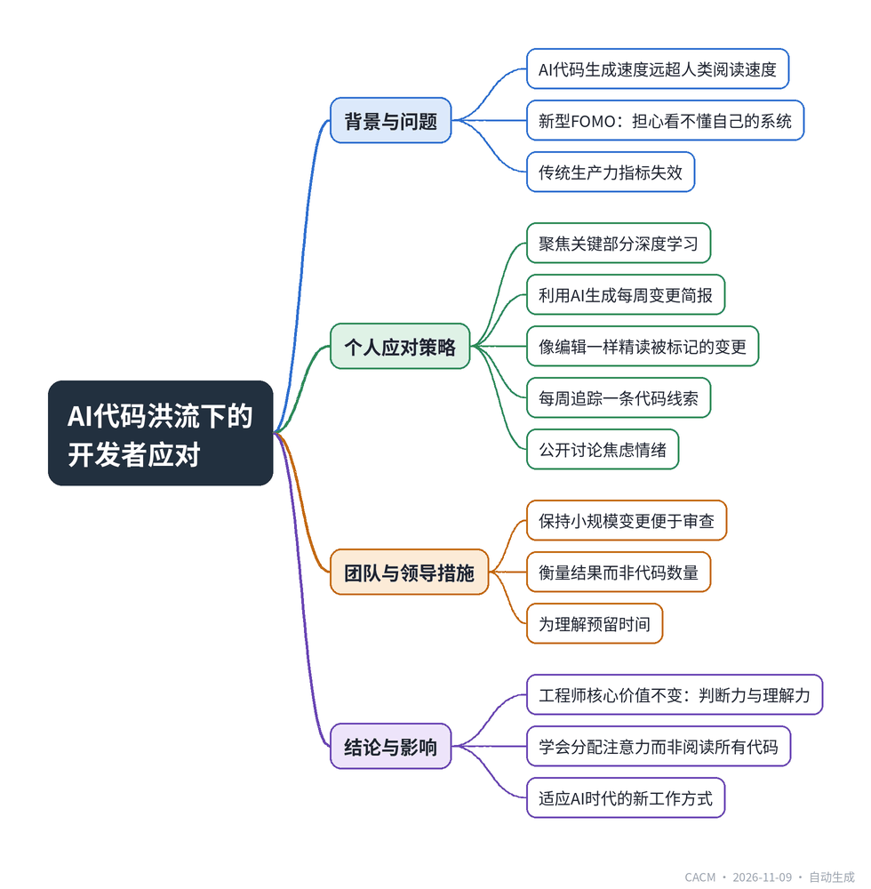

# GenAI Is Shipping Code Faster Than You Can Read It

## 当AI写代码快过你的阅读速度

**来源**：Communications of the ACM（Blog@CACM）　|　**发布**：2026-11-09 09:36（美东）　|　**北京时间**：2026-11-09 21:36　|　**作者**：Rahul Vaish

[原文链接](https://cacm.acm.org/blogcacm/genai-is-shipping-code-faster-than-you-can-read-it/)　·　生成于 2026-11-10 15:51

---

## 一、摘要

> 开发者掌控感流失，即使产出更高。

随着AI编程助手普及，代码生成速度远超人类阅读速度，开发者面临新型FOMO——不是怕错过技术，而是怕看不懂自己的系统。文章指出，传统以合并请求数、关闭工单数等指标衡量生产力已失效，因为这些指标只反映产出量，不反映代码质量、可理解性和长期可维护性。作者以新闻编辑室类比：记者写稿快十倍，编辑阅读速度不变，注意力成为瓶颈。为此提出个人应对策略：聚焦关键部分深度学习、利用AI生成每周简报、像编辑一样只精读被标记的变更、每周追踪一条线索、公开讨论焦虑。团队层面则需保持小规模变更、衡量结果而非数量、为理解预留时间。结论是，AI加速开发不改变工程师的核心价值——判断力、系统理解和专注力，开发者应学会分配注意力而非试图阅读所有代码。

## 二、核心要点

1. AI辅助开发导致代码合并速度远超人类阅读速度，引发开发者对系统理解力的焦虑。
2. 传统生产力指标（合并请求数、代码行数）无法衡量架构正确性和团队可理解性。
3. 个人应对策略包括：聚焦关键模块深度学习、利用AI生成每周变更简报、精读被标记的变更、每周追踪一条代码线索。
4. 团队应保持小规模变更、衡量可靠性等结果指标、为设计评审和知识分享预留时间。
5. 工程师的核心价值在于判断力、系统理解和专注力，这些品质在AI时代更加重要。

## 三、关键词对照

| English | 中文 |
| --- | --- |
| GenAI | 生成式人工智能 |
| FOMO | 错失恐惧症 |
| pull request | 拉取请求 |
| code review | 代码审查 |
| sequence diagram | 序列图 |
| retro | 回顾会议 |
| throughput | 吞吐量 |

## 四、中英对照全文

Open your team’s board on a Monday morning and the picture has already changed. Tickets that were open on Friday are closed. Pull requests that didn’t exist an hour ago are merged. A teammate shipped a feature over the weekend that, a year ago, would have taken a sprint. Much of the code was drafted by an AI assistant, reviewed quickly, and is already running in production.

> 周一早上打开团队看板，情况已经变了。周五还开着的工单已经关闭。一小时前还不存在的拉取请求已经合并。一位队友在周末发布了一个功能，而在一年前，这可能需要一个冲刺周期。大部分代码由AI助手起草，经过快速审查，已经在生产环境中运行。

If you feel a small knot of anxiety reading that, you’re in good company. Developers have always had to keep up with new frameworks and tools. What’s different now is how fast the code changes inside the codebase you’re responsible for. Code is arriving faster than anyone can read it, and the silent question many of us carry is: if I can’t follow all of this, am I falling behind? This post offers practical ways to work with the pace instead of being worn down by it.

> 如果你读到这些感到一丝焦虑，那你并不孤单。开发者一直需要跟上新的框架和工具。不同之处在于，你负责的代码库中的代码变化速度有多快。代码到达的速度比任何人能阅读的速度都快，我们许多人心中都有一个无声的问题：如果我无法跟上所有这些，我是不是落后了？这篇文章提供了一些实用的方法，让你与这种节奏共处，而不是被它拖垮。

### The New Shape of FOMO
*错失恐惧症的新形态*

The classic fear of missing out (FOMO) in tech was about technologies: the language you hadn’t learned, the framework everyone else seemed to be using. The AI-era version is different. It’s about comprehension. You’re not worried about missing a tool; you’re worried about no longer understanding your own system.

> 科技行业经典的错失恐惧症（FOMO）是关于技术的：你没学过的语言，其他人似乎都在用的框架。AI时代的版本则不同。它关乎理解。你担心的不是错过一个工具；你担心的是不再理解自己的系统。

That’s a more uncomfortable feeling, because it touches professional identity. Developers have traditionally earned trust by knowing how things work. When a large share of the change in a repository is machine-drafted and merged within hours, that sense of mastery can feel as if it’s slipping, even when your own output is higher than ever.

> 这是一种更不舒服的感觉，因为它触及职业身份。开发者传统上通过了解事物如何运作来赢得信任。当仓库中很大一部分变更由机器起草并在几小时内合并时，那种掌控感可能会感觉正在溜走，即使你自己的产出比以往任何时候都高。

### Why the Comparison is Broken
*为什么比较是无效的*

Much of the anxiety comes from measuring yourself against a dashboard. Merged pull requests, closed tickets, and lines changed are easy to count, so they are what we notice. But they only tell you how much was produced. They don’t tell you whether the change was architecturally correct, whether anyone else understands it well enough to build on top of it, or whether it will still make sense to the team in six months.

> 许多焦虑来自于用仪表盘来衡量自己。合并的拉取请求、关闭的工单和更改的行数很容易计数，所以它们是我们所注意到的。但它们只告诉你产出了多少。它们不告诉你变更在架构上是否正确，是否有其他人足够理解它以便在其上构建，或者团队在六个月后是否仍能理解它。

Think of a newsroom where the reporters suddenly start writing ten times faster. The editors still read at the same speed, so stories pile up waiting to be checked, and the editor’s attention becomes the limit. Software is the same. AI can write code quickly, but people still have to read it, understand it, and answer for it at human speed.

> 想象一个新闻编辑室，记者们突然开始以十倍的速度写作。编辑们仍然以同样的速度阅读，所以故事堆积起来等待检查，编辑的注意力成为限制。软件也是如此。AI可以快速编写代码，但人们仍然必须以人类的速度阅读、理解并对其负责。

So the developer who tries to read every change isn’t the most diligent person on the team. They’re spending their scarcest resource, attention, on every change equally, including the ones that don’t need it. What matters now is knowing which changes deserve your attention, and that’s a skill you can build.

> 因此，试图阅读每一个变更的开发者并不是团队中最勤奋的人。他们把最稀缺的资源——注意力——平均花在每一个变更上，包括那些不需要的变更。现在重要的是知道哪些变更值得你关注，这是一种你可以培养的技能。

### Practical Ways to Cope
*应对的实用方法*

None of these strategies ask you to read more. They’re about deciding where your attention goes.

> 这些策略都不要求你读更多。它们关乎决定你的注意力去向。

● Start with one part and go deep: You’re accountable for the whole system, but you can’t know all of it at once, so don’t try. Start with the one part that matters most, maybe the one that paged someone last quarter or the one every feature seems to touch, and learn it properly. When it feels familiar, add the next. Keep only a rough outline of the rest. Depth grows one part at a time, and the anxiety shrinks with it.

> ● 从一部分开始深入：你对整个系统负责，但你无法一下子了解全部，所以不要试图这样做。从最重要的部分开始，也许是上个季度触发过告警的部分，或者每个功能似乎都会触及的部分，并认真学习它。当它变得熟悉时，再添加下一个。对其余部分只保留粗略的轮廓。深度一次增长一部分，焦虑也随之减少。

● Let a weekly briefing do the streaming: Think of the morning digest an editor reads before deciding which stories need a closer look. Ask your team’s approved AI tool to read last week’s merged changes and write you one: a few plain-language bullet points on what changed, plus a sequence diagram of one or two key flows, like placing an order or logging in, showing what calls what and where it can fail. Try it by hand once to see if it’s useful, then put it on a weekly schedule so it doesn’t depend on anyone remembering. Read it over a coffee and you’ll spot things like a new fraud check before payment or a retry that was quietly introduced, even in parts of the system you don’t know well.

> ● 让每周简报完成流式处理：想想编辑在决定哪些故事需要仔细查看之前阅读的晨间摘要。让你团队批准的AI工具阅读上周合并的变更，并为你写一份：几个用平实语言写的要点，说明发生了什么变化，外加一两个关键流程（如下单或登录）的序列图，显示什么调用了什么以及哪里可能失败。手动尝试一次，看看是否有用，然后将其设为每周计划，这样就不依赖于任何人记得。在喝咖啡时阅读它，你会发现在支付前新增的欺诈检查或悄然引入的重试，即使在你不太熟悉的系统部分也能发现。

● Read what gets flagged like an editor: When the briefing flags a change, or a change lands in the part you know deeply, slow down. Ask whether the design fits the system, what the generated code quietly assumes, and what happens when it fails. Everything else gets a skim, and that’s fine. As generating code gets cheaper, the person who can quickly judge whether a change is sound becomes the most valuable one in the room. Review isn’t a tax on productivity anymore; it’s the craft.

> ● 像编辑一样阅读被标记的内容：当简报标记了一个变更，或者一个变更落在你深入了解的部分时，放慢速度。问问设计是否适合系统，生成的代码悄悄假设了什么，以及失败时会发生什么。其他所有内容都快速浏览，这没问题。随着生成代码变得越来越便宜，能够快速判断变更是否合理的人成为房间里最有价值的人。审查不再是对生产力的征税；它是一种技艺。

● Follow one thread a week: Pick one item from the briefing, or one flow you’ve never traced, and follow it all the way down. Read the module you didn’t write, or work through the design behind it. An hour is usually enough. Depth builds on itself in a way scanning never does, and it’s the best cure for the feeling of skating on the surface.

> ● 每周跟随一条线索：从简报中选一个项目，或者一个你从未追踪过的流程，一直跟踪到底。阅读你没写过的模块，或者梳理其背后的设计。通常一个小时就足够了。深度会以扫描永远无法做到的方式自我积累，这是治疗浮于表面感觉的最佳良药。

● Say it out loud: This feeling is far more common than people admit. Mention it in a retro or a one-on-one and you’ll likely find others feel it too, and the weekly briefing is an easy thing to bring along. That’s usually where the conversation about smaller pull requests and better review habits starts.

> ● 大声说出来：这种感觉比人们承认的要普遍得多。在回顾会议或一对一交流中提出来，你可能会发现其他人也有同感，而每周简报是一个很容易带来的东西。这通常是关于更小的拉取请求和更好的审查习惯的对话开始的地方。

### What Teams and Leaders Can Do
*团队和领导者能做什么*

A team that produces more than it can understand has a systems problem, so it needs systems answers, not just individual coping.

> 一个产出超过其理解能力的团队存在系统性问题，因此需要系统性的答案，而不仅仅是个人的应对。

● Keep changes small enough to review. Smaller pull requests with a clear note on intent make review realistic, whether a person or a model wrote the code.

> ● 保持变更足够小以便审查。带有明确意图说明的较小拉取请求使审查变得现实，无论代码是人还是模型编写的。

● Measure outcomes, not volume. Reliability, customer impact and time to recover say far more than merge counts, and they take away the pressure to compete on throughput.

> ● 衡量结果，而非数量。可靠性、客户影响和恢复时间比合并计数更能说明问题，它们消除了在吞吐量上竞争的压力。

● Budget time for understanding. Leave room for design reviews, documentation, and knowledge sharing. They’re what keeps a fast-moving codebase something people can still reason about.

> ● 为理解分配时间。为设计评审、文档和知识分享留出空间。它们是一个快速移动的代码库仍然让人们能够推理的关键。

### A Steadier Way Forward
*更稳定的前进之路*

The speed of AI-assisted development is real and, for most teams, valuable. But it doesn’t change what makes an engineer worth trusting: sound judgment, a clear understanding of the systems they’re responsible for, and the discipline to focus on what matters. Those qualities aren’t made obsolete by a faster stream of code. They’re what make the stream safe to build on.

> AI辅助开发的速度是真实的，对大多数团队来说是有价值的。但它并没有改变让工程师值得信赖的因素：良好的判断力、对他们负责的系统的清晰理解，以及专注于重要事情的纪律。这些品质不会因为更快的代码流而过时。它们正是使代码流安全可构建的基础。

You don’t need to keep up with everything. You need to know what you’re accountable for, decide where your attention goes, and keep building the skills that machines make more important rather than less. The developers who thrive in this period won’t be the ones who read the most pull requests. They’ll be the ones who stay calm enough to ask the right questions: what changed, what could break, and what needs a closer look.

> 你不需要跟上一切。你需要知道你对什么负责，决定你的注意力去向，并继续培养那些机器使其更重要而非更不重要的技能。在这个时期蓬勃发展的开发者不会是阅读最多拉取请求的人。他们会是那些保持冷静、能够提出正确问题的人：什么改变了，什么可能出错，什么需要仔细查看。

Rahul Vaish is a Software Engineer and Independent Researcher with over a decade of experience designing and building enterprise systems. His work focuses on software architecture, distributed systems, and applied AI.

> Rahul Vaish 是一名软件工程师和独立研究员，拥有十多年设计和构建企业系统的经验。他的工作专注于软件架构、分布式系统和应用AI。

---
*英文原文版权归 Communications of the ACM 及作者所有；中文译文由 AI 辅助生成，仅供学习参考。*