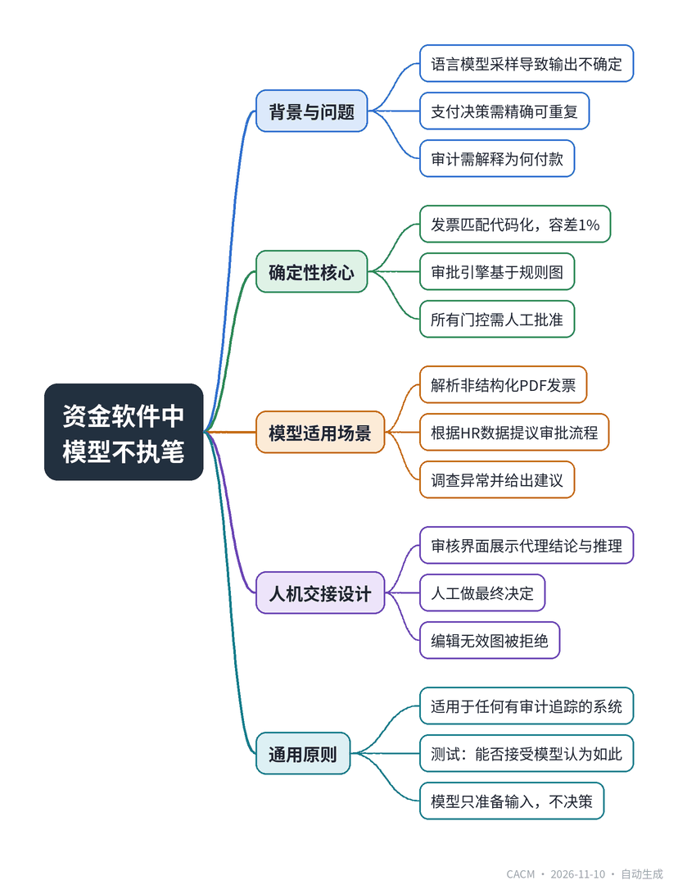

# In Software that Moves Money, the Model Never Holds the Pen

## 资金流转软件：模型不执笔

**来源**：Communications of the ACM（Blog@CACM）　|　**发布**：2026-11-10 11:49（美东）　|　**北京时间**：2026-11-10 23:49　|　**作者**：Dylan Merigaud

[原文链接](https://cacm.acm.org/blogcacm/in-software-that-moves-money-the-model-never-holds-the-pen/)　·　生成于 2026-11-11 15:18

---

## 一、摘要

> 在资金流转软件中，模型只能提议，决策必须由确定性代码或人做出。

在采购到付款流程中，发票匹配、审批和支付决策必须精确且可重复，而语言模型的随机性使其无法胜任这些任务。作者基于在采购金融科技公司Pivot的工作经验，开发了开源工作流Ledgerloop，将发票匹配、审批引擎和核对等核心环节全部实现为确定性代码，仅将模型用于处理非结构化输入，如解析供应商PDF发票、根据HR数据提议审批流程、调查异常发票。模型在这些环节中只生成提议，由代码验证或由人审核决定。文章强调，在资金流转软件中，模型不应持有最终决策权，这一原则也适用于访问控制、保险理赔等任何需要审计追踪的系统。

## 二、核心要点

1. Ledgerloop的发票匹配使用确定性代码，价格容差1%，返回clean、exception或duplicate三种结果，相同输入千次运行结果一致。
2. 审批引擎基于规则图，每个门控条件涉及金额、差异、部门或匹配结果，只有所有活跃门控获得人工批准后账单才会过账。
3. 模型仅用于非结构化输入处理：视觉模型解析PDF发票、代理根据HR系统提议审批流程、调查代理分析异常并给出建议。
4. 人工审核环节需设计为在决策点展示代理的结论和推理过程，避免审核流于形式。
5. 作者建议用简单测试判断组件是否可用模型：若不愿以“模型认为如此”回答审计问题，则该组件应为代码。

## 三、关键词对照

| English | 中文 |
| --- | --- |
| procure-to-pay | 采购到付款 |
| deterministic code | 确定性代码 |
| purchase order | 采购订单 |
| goods receipt | 收货单 |
| approval chain | 审批链 |
| reconciliation | 对账 |
| audit trail | 审计追踪 |
| forward-deployed engineer | 前沿部署工程师 |

## 四、中英对照全文

Ledgerloop is an open source procure-to-pay workflow I built after almost two years as a forward-deployed engineer at a procurement fintech, where I turned enterprise clients’ approval rules into product configuration. When a vendor invoice arrives as a PDF, it gets matched against a purchase order, goes through an approval chain, and is reconciled into the accounting system. Writing it from scratch forced me to decide, component by component, whether a model was allowed to touch it.

> Ledgerloop 是我在采购金融科技公司担任前置部署工程师近两年后构建的一个开源采购到付款工作流，期间我将企业客户的审批规则转化为产品配置。当供应商发票以 PDF 形式到达时，它会与采购订单匹配，经过审批链，并核对到会计系统中。从头编写它迫使我在每个组件上决定是否允许模型介入。

I started from exact code and let a model in only where the input is fuzzy. That ordering matters for any software whose output someone will later have to defend, and money is the clearest case.

> 我从精确的代码开始，只在输入模糊的地方引入模型。这种顺序对于任何输出后来需要有人辩护的软件都很重要，而金钱是最明显的例子。

### Two Answers to One Question
*一个问题的两个答案*

A language model samples. Ask it the same question twice and you may get two different answers; above a temperature of zero, that variation is by design. When the job is drafting text, nobody minds. When the job is deciding whether an invoice matches its purchase order, it disqualifies the model.

> 语言模型是采样。问它同一个问题两次，你可能会得到两个不同的答案；在温度高于零时，这种变化是设计使然。当任务是起草文本时，没人在意。当任务是决定发票是否匹配其采购订单时，模型就不合格了。

The question a controller or an auditor asks months later is simple: why was this bill paid? In ledgerloop, the answer is a function. The matching process lives in lib/matching.ts (commit 6af9fb1 on github.com/DylanMerigaud/ledgerloop). It compares quantities and unit prices line by line against a purchase order and a goods receipt, with a price tolerance of 1% to absorb rounding and currency conversion, and it returns one of three verdicts: clean, exception, or duplicate. Run it 1,000 times on the same inputs and you get the same verdict every time. When it is wrong, the bug has a line number.

> 几个月后，财务总监或审计师会问一个简单的问题：为什么这笔账单被支付了？在 ledgerloop 中，答案是一个函数。匹配过程位于 lib/matching.ts（提交 6af9fb1，在 github.com/DylanMerigaud/ledgerloop 上）。它逐行比较数量和单价与采购订单和收货单，价格容差为 1% 以吸收舍入和货币转换，并返回三种裁决之一：干净、异常或重复。对相同的输入运行 1000 次，每次都会得到相同的裁决。当它出错时，bug 有行号。

The approval engine works the same way. The workflow is a graph of gates, each with a condition on the amount, the variance, the department, or the verdict, and the engine walks it. A bill posts only when every active gate has a human approval, and one rejection blocks everything after it. No model sits anywhere on that path. The project README states the rule in one sentence:

> 审批引擎的工作方式相同。工作流是一个由门组成的图，每个门都有关于金额、差异、部门或裁决的条件，引擎遍历它。只有当每个活跃的门都获得人工批准时，账单才会过账，一次拒绝会阻止之后的所有操作。这条路径上没有任何模型。项目 README 用一句话陈述了规则：

Everything else, matching, the workflow engine, reconciliation, is deterministic code, because a payment decision must be exact and repeatable, never a model’s guess.

> 其他一切，匹配、工作流引擎、对账，都是确定性代码，因为支付决策必须精确且可重复，绝不能是模型的猜测。

None of this is new. Payment systems were built this way long before language models. What matters is that they stay built this way after a model is added.

> 这些都不是新东西。支付系统早在语言模型出现之前就是这样构建的。重要的是，在添加模型之后，它们仍保持这种构建方式。

### Where the Model Belongs
*模型该在的地方*

Hold that line and the places where a model belongs become easy to see: they are the places where a deterministic rule would be brittle or impossible to write.

> 守住这条线，模型该在的地方就变得显而易见：它们是确定性规则会变得脆弱或无法编写的地方。

Reading a vendor’s PDF is the plainest example. Every supplier has its own invoice layout, and parsers built on regular expressions lose that race. A vision model reads the document into a structured invoice, the result is validated against a schema, and from there on code takes over.

> 读取供应商的 PDF 是最简单的例子。每个供应商都有自己的发票布局，基于正则表达式的解析器在这场竞赛中会失败。视觉模型将文档读入结构化发票，结果根据模式进行验证，从那里开始由代码接管。

Onboarding is another. In my previous job, setting up a new client meant an engineer reading their org chart and turning it into approval rules by hand: who signs what, above which amount. Mapping job titles to signing authority takes judgment, and real org data is messy, with a manager who left last month or two people who both look like the CEO. So an agent reads the HR system and proposes the workflow, with those problems flagged. Code assembles the proposal into a validated graph, and a person reviews and edits it in plain language before anything goes live. An edit that would produce an invalid graph is refused.

> 入职是另一个。在我之前的工作中，设置新客户意味着工程师阅读他们的组织结构图并手动将其转化为审批规则：谁签署什么，超过哪个金额。将职位头衔映射到签署权限需要判断，而真实的组织数据很混乱，有上个月离职的经理，或者两个看起来都像 CEO 的人。因此，一个代理读取 HR 系统并提出工作流，同时标记这些问题。代码将提案组装成经过验证的图，然后由人员以自然语言审查和编辑，之后才能上线。会产生无效图的编辑会被拒绝。

Investigating an exception is the last. In the demo data, invoice INV-2042 bills steel bar about 9% above its purchase order, and that number alone does not say whether the supplier raised its prices for a good reason or overcharged. That answer lives in notes, past invoices, and vendor history, and which of those matter depends on what you find along the way. This is the one open-ended agent on the operational path (src/mastra/agents/investigator.ts, commit 38f4f16). It chooses which records to read and writes a recommendation. A person makes the call.

> 调查异常是最后一个。在演示数据中，发票 INV-2042 的钢材价格比其采购订单高出约 9%，仅这个数字并不能说明供应商是出于正当理由提价还是多收费。答案存在于备注、过去的发票和供应商历史中，而其中哪些重要取决于你在过程中发现什么。这是操作路径上唯一一个开放式代理（src/mastra/agents/investigator.ts，提交 38f4f16）。它选择读取哪些记录并撰写建议。由人做出决定。

These uses share a shape. The model works on unstructured input and hands a proposal to either code or a person. It never holds the pen on the outcome.

> 这些用途有一个共同点。模型处理非结构化输入，并将提案交给代码或人。它从不掌握结果的笔。

### The Handoff Is Where the Engineering Goes
*交接是工程所在*

When the model can only propose, the human step becomes a part you have to design. The reviewer has to see what the agent concluded and why, in the place where they decide, or the review turns into a rubber stamp or a queue. In ledgerloop the paused bill shows the investigator’s recommendation next to the Approve and Reject buttons, and the run’s trace lists every record the agent opened on the way. The approver reads the case in one place and decides, and the decision stays with the person who is accountable for it.

> 当模型只能提出建议时，人工步骤就变成了你必须设计的部分。审查者必须在他们做决定的地方看到代理得出的结论及其原因，否则审查就会变成橡皮图章或队列。在 ledgerloop 中，暂停的账单在“批准”和“拒绝”按钮旁边显示调查员的建议，运行的跟踪记录列出了代理沿途打开的每条记录。审批者在一个地方阅读案例并做出决定，决定权留给对其负责的人。

### A Default for Other Domains
*对其他领域的默认做法*

Money makes the failure visible, but the reasoning carries to any system with an audit trail: access control, insurance claims, medical billing, anywhere someone may later ask why the system did what it did. I suggest a simple test for each component. If you would be uncomfortable answering that question with “the model thought so,” the component is code, and the model’s job is to prepare its input.

> 金钱使失败变得可见，但推理适用于任何有审计追踪的系统：访问控制、保险索赔、医疗账单，任何以后可能有人问系统为什么这样做的地方。我建议对每个组件进行一个简单的测试。如果你不愿意用“模型这么认为”来回答这个问题，那么该组件就是代码，模型的工作是准备其输入。

Most of my design time on ledgerloop went into deciding which parts of the system a model may enter. In software that moves money, getting that right leaves most of the system as boring, auditable code. I argued a shorter version of this on my site in July, and the ledgerloop source is public for anyone who wants to check where the line falls.

> 我在 ledgerloop 上的大部分设计时间都花在决定系统的哪些部分允许模型进入。在转移资金的软件中，正确处理这一点会使系统的大部分成为无聊、可审计的代码。我七月份在我的网站上论证了这一点的一个简短版本，ledgerloop 的源代码是公开的，任何人都可以检查界限在哪里。

Dylan Merigaud is a software engineer based in Paris. He was a forward deployed engineer at the procurement fintech Pivot and built ledgerloop, an open source procure-to-pay workflow.

> Dylan Merigaud 是巴黎的一名软件工程师。他曾是采购金融科技公司 Pivot 的前置部署工程师，并构建了开源采购到付款工作流 ledgerloop。

---
*英文原文版权归 Communications of the ACM 及作者所有；中文译文由 AI 辅助生成，仅供学习参考。*