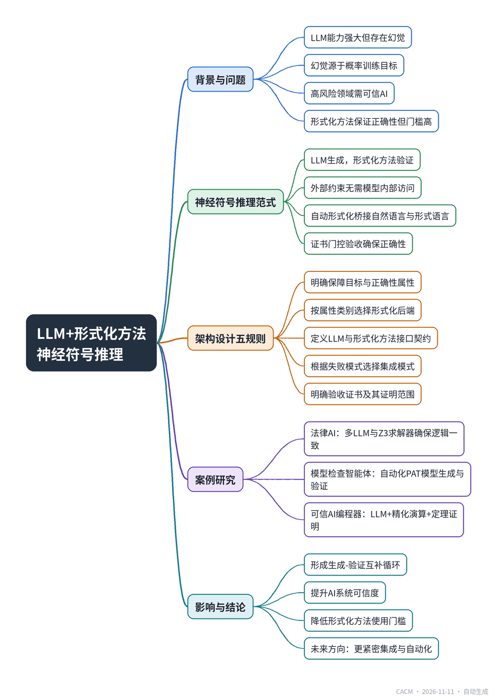

# Synergizing LLMs and Formal Methods for Neural-Symbolic Reasoning

## LLM与形式化方法协同的神经符号推理

**来源**：Communications of the ACM（）　|　**发布**：2026-11-10 12:12（美东）　|　**北京时间**：2026-11-11 00:12　|　**作者**：

[原文链接](https://cacm.acm.org/research/synergizing-llms-and-formal-methods-for-neural-symbolic-reasoning/)　·　生成于 2026-11-11 15:18

---

## 一、摘要

> 新范式结合大语言模型与形式化方法，构建可信AI系统。

大语言模型在多个领域展现出强大能力，但其推理存在根本性缺陷：容易产生看似合理但事实错误或逻辑不一致的输出，即幻觉。这种问题源于LLM训练的概率目标，无法仅靠训练更好的模型根除。形式化方法能提供严格的正确性保证，但学习曲线陡峭、专业要求高。文章提出一种神经符号推理范式，将LLM的生成能力与形式化方法的验证能力结合，通过外部形式化工具约束、检查和引导LLM输出，无需访问模型内部。文章给出了五条架构设计规则，强调从保障目标出发选择形式化后端，定义LLM与形式化方法之间的接口契约，并根据主要失败模式选择集成模式。通过三个案例研究展示了该范式的应用：法律AI中利用SMT求解器确保判决逻辑一致性；LLM模型检查智能体自动化模型检查流程；可信AI编程器结合程序精化与定理证明生成可证明正确的代码。这些案例表明，LLM与形式化方法将形成互补的生成-验证循环，提升AI系统的可信度。

## 二、核心要点

1. LLM的幻觉问题源于其概率训练目标，理论上无法仅通过改进模型消除，在高风险领域构成严重风险。
2. 形式化方法（如SMT求解、定理证明、模型检查）能提供数学严格的正确性保证，但应用门槛高。
3. 文章提出神经符号推理范式，用LLM处理生成与交互，用形式化方法强制正确性与可解释性，并通过证书门控验收。
4. 法律AI案例中，多角色LLM与Z3求解器结合，检测逻辑不一致并修正，判决结果接近真实，准确率领先。
5. LLM模型检查智能体（PAT-Agent）自动化PAT模型生成与验证，需求翻译准确率99.6%，通常3-4次修复迭代即可满足所有性质。
6. 可信AI编程器将LLM集成到程序精化循环中，由LLM预测精化法则并生成代码片段，定理证明器验证证明义务，确保代码正确性。

## 三、关键词对照

| English | 中文 |
| --- | --- |
| Large Language Model (LLM) | 大语言模型 |
| Formal Methods (FM) | 形式化方法 |
| Neural-Symbolic Reasoning | 神经符号推理 |
| Hallucination | 幻觉 |
| Satisfiability Modulo Theories (SMT) | 可满足性模理论 |
| Theorem Proving | 定理证明 |
| Model Checking | 模型检查 |
| Autoformalization | 自动形式化 |
| Retrieval-Augmented Generation (RAG) | 检索增强生成 |
| Refinement Calculus | 精化演算 |
| Proof Obligation (PO) | 证明义务 |
| Counterexample | 反例 |
| Unsat Core | 不可满足核心 |
| Linear Temporal Logic (LTL) | 线性时序逻辑 |
| CSP# | CSP#（通信顺序进程#） |

## 四、中英对照全文

In recent years, the rapid proliferation of large language models (LLMs) has marked a transformative shift in the landscape of artificial intelligence and many of its applications: software engineering, finance, healthcare, and legal, among others. Top LLMs, such as ChatGPT, Claude, Gemini, and DeepSeek, have demonstrated impressive capabilities in multimodal understanding, generation, coding, task execution, and reasoning. Leveraging these capabilities, agentic LLMs can plan, take actions, and use feedback loops with memory to achieve goals autonomously.

> 近年来，大型语言模型（LLM）的迅速普及标志着人工智能及其众多应用领域（如软件工程、金融、医疗、法律等）发生了变革性转变。顶尖的LLM，如ChatGPT、Claude、Gemini和DeepSeek，在多模态理解、生成、编码、任务执行和推理方面展现了令人印象深刻的能力。利用这些能力，智能体LLM可以自主规划、采取行动，并利用带有记忆的反馈循环来实现目标。

Despite these advances, LLM reasoning suffers from a fundamental limitation: the tendency to produce factually incorrect or logically inconsistent yet plausible outputs, commonly termed hallucinations. This poses serious risks in high-stakes domains, where trustworthiness is critical. Importantly, this issue is not anomalous but rather mathematically inherent to the probabilistic objectives underlying LLM training. As an example, we asked the LLMs to solve a simple puzzle: In 318, only one digit is correct, and it is in the correct position. In 379, only one digit is correct, but it is in the wrong position. In 863, two digits are correct, but they are in the wrong positions. In 421, no digits are correct. What’s the correct combination of the three digits and their positions? Older models such as GPT 4.1, Gemini 2.5, Claude 4 Sonnet, DeepSeek V3, and Grok 3 gave wrong answers with believable thinking processes. Reasoning models, such as the “Thinking” or “Pro” modes, fared better but took minutes to respond. Small open source LLMs performed poorly and often fell into an infinite loop of reasoning. These models are constantly evolving—the latest versions of GPT, Gemini, and Claude all answered correctly (698). However, hallucinations persist, and theoretically cannot be eradicated by training better LLMs alone.

> 尽管取得了这些进展，LLM推理仍存在一个根本性局限：倾向于产生事实错误或逻辑不一致但看似合理的输出，通常称为幻觉。这在高风险领域构成严重风险，因为这些领域对可信度至关重要。重要的是，这个问题并非异常，而是LLM训练所基于的概率目标在数学上固有的。例如，我们让LLM解决一个简单的谜题：在318中，只有一个数字正确且位置正确。在379中，只有一个数字正确但位置错误。在863中，有两个数字正确但位置错误。在421中，没有数字正确。三个数字及其位置的正确组合是什么？较旧的模型如GPT 4.1、Gemini 2.5、Claude 4 Sonnet、DeepSeek V3和Grok 3给出了错误答案，但思考过程看似可信。推理模型，如“Thinking”或“Pro”模式，表现更好，但响应需要数分钟。小型开源LLM表现不佳，常常陷入无限推理循环。这些模型在不断进化——最新版本的GPT、Gemini和Claude都正确回答了（698）。然而，幻觉依然存在，理论上无法仅通过训练更好的LLM来根除。

Interestingly, we also asked Claude 4 to translate the puzzle into Z3’s SMT-LIB format, which Z3 solved correctly in 0.01 seconds on a laptop (MacBook Pro with M1 Pro). Z3 is a satisfiability modulo theories (SMT) solver, offering rigorous reasoning complementary to the probabilistic nature of LLMs. More broadly, formal methods (FM) provide mathematically precise tools for trustworthy computing: SMT extends classical satisfiability to theories such as arithmetic, bit-vectors, arrays, datatypes, and uninterpreted functions; theorem proving derives valid formulas from axioms via proof calculi; and model checking systematically explores system states to detect property violations.

> 有趣的是，我们还让Claude 4将谜题翻译成Z3的SMT-LIB格式，Z3在笔记本电脑（搭载M1 Pro的MacBook Pro）上0.01秒内正确求解。Z3是一个可满足性模理论（SMT）求解器，提供严谨的推理，补充了LLM的概率性质。更广泛地说，形式化方法（FM）为可信计算提供了数学上精确的工具：SMT将经典可满足性扩展到算术、位向量、数组、数据类型和未解释函数等理论；定理证明通过证明演算从公理推导有效公式；模型检查系统地探索系统状态以检测属性违反。

Compared to the uncertain and generative nature of LLMs, formal methods deliver rigorous correctness guarantees, but their adoption is limited by steep learning curves and high expertise requirements. A promising direction is to unify these paradigms by leveraging LLMs for generation and interaction while using formal methods to enforce correctness and interpretability.

> 与LLM的不确定性和生成性相比，形式化方法提供严格的正确性保证，但其采用受限于陡峭的学习曲线和高专业知识要求。一个有前景的方向是统一这些范式：利用LLM进行生成和交互，同时使用形式化方法强制正确性和可解释性。

### A Neural-Symbolic Reasoning Paradigm
*神经符号推理范式*

Notable neural-symbolic AI methods. A common early pattern in LLM-based formal reasoning is loosely coupled integration, where an LLM translates a problem into a formal language for a symbolic solver, and solver failures due to syntactic or semantic issues are fed back to the LLM for iterative refinement. In contrast, tightly integrated approaches embed neural reasoning directly into the formal reasoning loop. For example, LeanDojo employs retrieval-augmented premise selection based on the current proof state and an encoder-decoder transformer to propose the next proof tactic, enabling fine-grained neural-symbolic collaboration.

> 值得注意的神经符号AI方法。基于LLM的形式化推理中常见的早期模式是松散耦合集成，即LLM将问题翻译成符号求解器的形式语言，并将因语法或语义问题导致的求解器失败反馈给LLM进行迭代改进。相比之下，紧密集成的方法将神经推理直接嵌入形式化推理循环。例如，LeanDojo采用基于当前证明状态的检索增强前提选择和编码器-解码器变换器来提出下一个证明策略，实现细粒度的神经符号协作。

Other tightly integrated paradigms include logical neural networks (LNNs), where neurons correspond to components of weighted logical formulas in a real-valued logic, yielding end-to-end differentiability, omnidirectional inference, and training-time enforcement of logical consistency. Scallop further advances this line through a neurosymbolic programming language and compiler that supports data- and computation-efficient training while delivering strong performance, interpretability, and generalization across diverse tasks. Beyond such architectures, directly integrating formal methods into the internal components of LLMs remains possible but prohibitively resource intensive. Our work instead adopts a practical and complementary strategy: constraining, checking, and guiding LLM outputs via external formal methods without requiring access to model internals. By formalizing the representations, constraints, and reasoning interfaces between LLMs and downstream systems, we ensure verifiability while enabling accessible deployment of reliability mechanisms in high-stakes applications.

> 其他紧密集成的范式包括逻辑神经网络（LNN），其中神经元对应于实值逻辑中加权逻辑公式的组件，产生端到端可微性、全向推理和训练时逻辑一致性强制。Scallop通过一种神经符号编程语言和编译器进一步推进了这一方向，支持数据和计算高效的训练，同时在多样化任务中提供强大性能、可解释性和泛化能力。除了此类架构，直接将形式化方法集成到LLM的内部组件中仍然是可能的，但资源密集程度令人望而却步。我们的工作转而采用一种实用且互补的策略：通过外部形式化方法约束、检查和引导LLM输出，而无需访问模型内部。通过形式化LLM与下游系统之间的表示、约束和推理接口，我们确保可验证性，同时在高风险应用中实现可靠性机制的可及部署。

Our paradigm. Across integration styles, common neural-symbolic interaction themes emerge (Figure 1). To lower the entry barrier, natural language is used as input, with multiple LLM agents coordinated by an agentic task automation LLM that selects agents, interacts with users, and automates the workflow. Complex problems typically follow a “plan-execute” decomposition. The resulting gap between informal input and formal specifications is bridged by an autoformalization LLM, while a designing LLM converts underspecified prompts into high-level designs. Given the close link between formal methods and software engineering, many execution steps involve programming and are handled by a coding LLM. Retrieval-augmented generation (RAG) supplies domain knowledge, including language syntax and semantics, and enables downstream applications. LLM agents interact with formal reasoning engines, including SMT solvers, theorem provers, and model checkers, whose reliable outputs provide high-quality feedback for repairing and refining autoformalized code.

> 我们的范式。在各种集成风格中，出现了常见的神经符号交互主题（图1）。为降低入门门槛，使用自然语言作为输入，多个LLM智能体由智能体任务自动化LLM协调，该LLM选择智能体、与用户交互并自动化工作流。复杂问题通常遵循“计划-执行”分解。非正式输入与形式化规范之间的差距由自动形式化LLM弥合，而设计LLM将欠指定的提示转换为高层设计。鉴于形式化方法与软件工程之间的紧密联系，许多执行步骤涉及编程，由编码LLM处理。检索增强生成（RAG）提供领域知识，包括语言语法和语义，并支持下游应用。LLM智能体与形式化推理引擎（包括SMT求解器、定理证明器和模型检查器）交互，其可靠输出为修复和改进自动形式化代码提供高质量反馈。

Guidelines on architecture design. An LLM+FM architecture should be selected from the assurance target outward, rather than from an LLM workflow inward. The aim is not merely better average outputs, but rather an architecture where success and failure are observable through formal feedback and where completion is gated by a certificate, that is, machine-checkable evidence produced by the FM back end (e.g., a localized conflict explanation, a violating execution trace, or an undischarged proof). This also future-proofs the design: LLM capabilities may change quickly, but the acceptance boundary is defined by certificates that can be validated independently of the LLM.

> 架构设计指南。LLM+FM架构应从保证目标向外选择，而不是从LLM工作流向内选择。目标不仅仅是更好的平均输出，而是这样一种架构：成功和失败可通过形式化反馈观察，完成由证书门控，即由FM后端产生的机器可检查证据（例如，局部冲突解释、违反执行轨迹或未完成的证明）。这也使设计具有前瞻性：LLM能力可能快速变化，但接受边界由可独立于LLM验证的证书定义。

Design Rule 1 (Assurance target). State the artifact that must be correct and the related properties that define correctness. Write the acceptance claim in the form “This output is acceptable because <property> holds for <artifact>.” If this claim cannot be stated precisely, later choices drift toward optimizing fluency or convenience rather than the intended notion of correctness.

> 设计规则1（保证目标）。陈述必须正确的工件以及定义正确性的相关属性。以“此输出可接受，因为<属性>对<工件>成立”的形式编写接受声明。如果无法精确陈述此声明，后续选择将偏向优化流畅性或便利性，而非预期的正确性概念。

Design Rule 2 (Back-end FM choice). An FM back end should be chosen to match the property class and, more fundamentally, the domain of quantification. For constraint satisfiability and consistency questions that expect definitive outcomes (e.g., SAT/UNSAT), SMT-based back ends are most appropriate, as they determine logical formula satisfiability and can return unsat cores to localize conflicting constraints, providing constraint-level correctness. For behavioral and temporal properties, model checking is better suited, as it reasons exhaustively over transition systems, verifies whether all executions satisfy a temporal specification, and otherwise produces counterexample traces, with first-class support for safety, liveness, and fairness, yielding behavioral/temporal correctness. For refinement and high-assurance correctness, theorem proving and refinement checking adopt a proof-centric approach, generating and discharging proof obligations to certify that a system meets its specification by construction, providing semantic, unbounded correctness; when full certification is too costly, lighter-weight techniques such as type systems, abstract interpretation, or contract checking can offer faster but partial guarantees.

> 设计规则2（后端FM选择）。应选择FM后端以匹配属性类别，更根本地，匹配量化域。对于期望确定性结果（例如SAT/UNSAT）的约束可满足性和一致性问题，基于SMT的后端最为合适，因为它们确定逻辑公式可满足性并可返回unsat核心以定位冲突约束，提供约束级正确性。对于行为和时间属性，模型检查更合适，因为它对转移系统进行穷尽推理，验证所有执行是否满足时间规范，否则产生反例轨迹，并原生支持安全性、活性和公平性，产生行为/时间正确性。对于精化和高保证正确性，定理证明和精化检查采用以证明为中心的方法，生成和 discharged 证明义务以证明系统按构造满足其规范，提供语义的、无界的正确性；当完全认证成本过高时，类型系统、抽象解释或契约检查等轻量级技术可提供更快但部分的保证。

Design Rule 3 (LLM-FM interface). After fixing the FM back end, define the contract between generation and validation by deciding what the LLM may propose (candidates, decompositions, repairs) and what the FM tool must return on failure. Treat formal failures as typed signals rather than generic “try again” events, so prompts and repair logic are organized around channels such as inconsistency, counterexample, or unsatisfied obligation. Finer-grained diagnostics typically shorten repair cycles and reduce silent failure, at the cost of tighter tool integration and more orchestrated iterations. A further trade-off is where human effort is spent: It can be front-loaded via structured inputs that reduce ambiguity, or back-loaded via flexible inputs plus more validation cycles and occasional interactive confirmation.

> 设计规则3（LLM-FM接口）。在确定FM后端后，通过决定LLM可以提出什么（候选、分解、修复）以及FM工具在失败时必须返回什么来定义生成与验证之间的契约。将形式化失败视为类型化信号而非通用的“重试”事件，因此提示和修复逻辑围绕不一致、反例或未满足义务等通道组织。更细粒度的诊断通常缩短修复周期并减少静默失败，代价是更紧密的工具集成和更多编排迭代。另一个权衡是人类努力花费在哪里：可以通过结构化输入前置以减少歧义，或通过灵活输入加更多验证周期和偶尔交互确认后置。

Design Rule 4 (Integration pattern). Select a coupling pattern that matches the dominant failure mode and the task abstraction level. For decision/compliance settings (e.g., access-control policies, configuration constraints), consistency-guarded deliberation works well: Deliberate freely, but gate acceptance with a consistency checker that surfaces localized conflicts. For system-level behaviors (e.g., protocol workflows, safety controllers), counterexample-guided refinement is effective: Failed checks yield executions that drive targeted revisions, at the cost of repeated checking and occasional abstraction. For component synthesis (e.g., critical parsers and code), proof-obligation guided synthesis is effective: Obligations pinpoint repair targets, but require precise specifications and manageable proof burden. Patterns are often combined across layers; when both system- and code-level assurance are needed, certify the higher-level model or contracts first, then constrain and certify lower-level synthesis.

> 设计规则4（集成模式）。选择与主要失败模式和任务抽象级别匹配的耦合模式。对于决策/合规设置（例如访问控制策略、配置约束），一致性保护的审议效果良好：自由审议，但通过一致性检查器门控接受，该检查器暴露局部冲突。对于系统级行为（例如协议工作流、安全控制器），反例引导的精化有效：失败的检查产生执行，驱动有针对性的修订，代价是重复检查和偶尔抽象。对于组件合成（例如关键解析器和代码），证明义务引导的合成有效：义务精确定位修复目标，但需要精确规范和可管理的证明负担。模式通常跨层组合；当需要系统和代码级保证时，先认证高层模型或契约，然后约束和认证低层合成。

Design Rule 5 (Acceptance guard). State explicitly the certificate that gates acceptance for the end-to-end system and what exactly it certifies. This operationalizes “good vs. bad” choices and makes trade-offs legible: Stronger certificates raise iteration cost and may narrow applicability, while lighter-weight certificates broaden scope but leave more residual uncertainty. In practice, designs are most robust when they align the architecture with the task abstraction level, treat FM as the correctness filter rather than an optional add-on, and keep a clean separation between candidate generation and certificate-based validation.

> 设计规则5（接受守卫）。明确陈述门控端到端系统接受的证书以及它确切认证什么。这将“好与坏”的选择操作化并使权衡清晰：更强的证书提高迭代成本并可能缩小适用性，而更轻量的证书扩大范围但留下更多残余不确定性。在实践中，当设计将架构与任务抽象级别对齐、将FM视为正确性过滤器而非可选附加项，并保持候选生成与基于证书的验证之间的清晰分离时，设计最为稳健。

In summary, LLMs and FM will form a complementary and beneficial generate-validate loop in future applications: LLMs explore the design space by proposing candidate artifacts, while FM back ends enforce a certificate-based acceptance boundary grounded in explicit assurance targets. Formal failures verified by FM would become structured feedback that guides iterative refinement, aligning probabilistic generation with semantic guarantees. In the following sections, we will provide some examples of our neural-symbolic reasoning paradigm to demonstrate the different roles of LLMs and formal reasoning in a variety of application domains.

> 总之，LLM和FM将在未来应用中形成互补且有益的生成-验证循环：LLM通过提出候选工件探索设计空间，而FM后端基于明确的保证目标强制执行基于证书的接受边界。由FM验证的形式化失败将成为结构化反馈，指导迭代精化，使概率生成与语义保证对齐。在以下部分中，我们将提供一些神经符号推理范式的示例，以展示LLM和形式化推理在各种应用领域中的不同作用。

### FM4LLM: Legal AI with LLM-SMT Integration
*FM4LLM：LLM-SMT集成的法律AI*

As our first case study, we show how formal reasoning enhances the reliability and consistency of LLM outputs in legal reasoning. While substantive rationality concerns fairness and morality, formal rationality demands logical adherence to the law. Existing legal LLMs, such as LawLLM, primarily rely on natural language processing and retrieval-augmented generation to reduce hallucinations, but still lack logically grounded and reliable reasoning.

> 作为第一个案例研究，我们展示形式化推理如何增强法律推理中LLM输出的可靠性和一致性。实质合理性关注公平和道德，而形式合理性要求逻辑上遵守法律。现有的法律LLM，如LawLLM，主要依赖自然语言处理和检索增强生成来减少幻觉，但仍缺乏逻辑基础和可靠的推理。

Our approach, shown in Figure 2, addresses the above issue using SMT solving. Each statutory clause c is parsed into a typed rule Rule(c):=〈Actor,Action,Cond,Penalty〉, and compiled into a first-order implicationϕc:=∀x.Actor(x)∧Action(x)∧Cond(x)→Penalty(x). All articles form the static legal knowledge base K:={ϕc|c∈Statutes}. Given a case D, the Prosecutor and Attorney LLMs generate (FP,SP):=ProsecutorLLM(D),(FD,SD):=AttorneyLLM(D), where F are fact predicates and S are cited clauses. The autoformalization LLM acts neutrally and takes the evidence provided by the above two LLMs and generates SMT-LIB format formal code that Z3 can check. If Z3 reports unsatisfiable, we will extract the minimal unsatisfiable core, representing the simplest reason that causes logical inconsistency. The autoformalization LLM maps this core back to the original text and instructs the Prosecutor or Attorney LLM to drop the contradictory clauses, then asks Z3 to check for consistency again.

> 我们的方法如图2所示，使用SMT求解解决上述问题。每个法律条款c被解析为类型化规则Rule(c):=〈Actor,Action,Cond,Penalty〉，并编译为一阶蕴涵ϕc:=∀x.Actor(x)∧Action(x)∧Cond(x)→Penalty(x)。所有条款形成静态法律知识库K:={ϕc|c∈Statutes}。给定案件D，检察官和律师LLM生成(FP,SP):=ProsecutorLLM(D),(FD,SD):=AttorneyLLM(D)，其中F是事实谓词，S是引用的条款。自动形式化LLM中立地行动，接收上述两个LLM提供的证据，并生成Z3可以检查的SMT-LIB格式形式化代码。如果Z3报告不可满足，我们将提取最小不可满足核心，代表导致逻辑不一致的最简单原因。自动形式化LLM将此核心映射回原始文本，并指示检察官或律师LLM删除矛盾条款，然后要求Z3再次检查一致性。

Example. Consider the following real case: (Gong Qiang concerns a repeat narcotics offender) Defendant Gong Qiang received a WeChat message from Luo, requesting the purchase of 1,000 yuan worth of drugs. After receiving the 1,000 yuan transfer from Luo via WeChat, Gong Qiang delivered 2 grams of methamphetamine and six magu tablets to Luo at approximately 5:00 PM …

> 示例。考虑以下真实案例：（龚强涉及毒品再犯）被告人龚强收到罗某的微信消息，要求购买价值1000元的毒品。在收到罗某通过微信转账的1000元后，龚强于下午5点左右将2克甲基苯丙胺和6片麻古交给罗某……

Taking the case information as input, the Prosecutor LLM (accusatory stance) extracts:

> 以案件信息为输入，检察官LLM（控诉立场）提取：

Actors: Defendant Gong Qiang (prior drug convictions), buyer Luo; public prosecution by Donghu District People’s Procuratorate

> 行为人：被告人龚强（有毒品犯罪前科），买家罗某；东湖区人民检察院提起公诉

Acts: Sold 2g methamphetamine + 6 “magu” tablets for 1,000 RMB

> 行为：以1000元人民币出售2克甲基苯丙胺+6片“麻古”

Evidence: WeChat payment record, seized drugs, positive urine tests, confession

> 证据：微信支付记录、查获的毒品、尿检阳性、供述

Aggravators: Repeat drug offender in five-year window; multiple prior administrative penalties

> 加重情节：五年内毒品再犯；多次行政处罚前科

Statutory Law: [64, 65]; [347, 356]

> 成文法：[64, 65]；[347, 356]

On the other hand, the Attorney LLM (exculpatory stance) extracts:

> 另一方面，律师LLM（辩护立场）提取：

Actors: Defendant Gong Qiang, buyer Luo; defense counsel appointed

> 行为人：被告人龚强，买家罗某；指定辩护律师

Acts: Acknowledge sale but stress “very small quantity” and no wider circulation

> 行为：承认出售但强调“数量很小”且无更广泛流通

Evidence: WeChat record, drug test, confession

> 证据：微信记录、毒品检测、供述

Mitigators: Full confession, signed plea agreement, voluntary compensation and buyer’s understanding; prior sentence already served, limited social harm

> 减轻情节：完全供述、签署认罪协议、自愿赔偿及买家谅解；前刑已服完，社会危害有限

Statutory Law: [64, 67]; [347, 356]

> 成文法：[64, 67]；[347, 356]

The autoformalization LLM analyzes the above results and further extracts the following facts and converts them into SMT-LIB format, then sends them to the Z3 solver together with the extracted rules and clauses:

> 自动形式化LLM分析上述结果，进一步提取以下事实并将其转换为SMT-LIB格式，然后与提取的规则和条款一起发送给Z3求解器：

Article 65: matched field { prior_sentence: True, reoffense_in_5_years: True }

> 第65条：匹配字段{ prior_sentence: True, reoffense_in_5_years: True }

Article 67: matched field { truthful_confession: True }

> 第67条：匹配字段{ truthful_confession: True }

Article 347: matched fields {subject: person, action: traffic_narcotics, object: narcotics, intent: intentional}

> 第347条：匹配字段{subject: person, action: traffic_narcotics, object: narcotics, intent: intentional}

Z3 evaluates the logical constraints and produces consistent results, which a judge LLM converts into a human-readable verdict of two years’ imprisonment and a 10,000 yuan fine, close to the ground truth of one year and two months with an 11,000 yuan penalty. This legally informed integration employs multiple role-specific LLM agents coordinated with an SMT solver to ensure logical consistency, leading to more realistic sentencing and the highest accuracy among state-of-the-art methods.

> Z3评估逻辑约束并产生一致结果，法官LLM将其转换为人类可读的判决：两年监禁和10000元罚款，接近一年两个月和11000元罚款的真实结果。这种法律信息集成采用多个角色特定的LLM智能体与SMT求解器协调，以确保逻辑一致性，从而产生更现实的量刑，并在最先进方法中达到最高准确率。

### LLM4FM: LLM Model-Checking Agent
*LLM4FM：LLM模型检查智能体*

LLMs can reduce the costly manual effort in formal methods. This case study presents a multi-LLM-agent framework that automates the full model-checking workflow. While model checking itself is automated once a formal model and properties are provided, its industrial adoption is hindered by the manual creation of models and specifications, which requires expertise in checker-specific modeling languages and temporal logics unfamiliar to most engineers.

> LLM可以减少形式化方法中昂贵的手工工作。本案例研究提出了一个多LLM智能体框架，自动化整个模型检查工作流。虽然一旦提供形式化模型和属性，模型检查本身是自动化的，但其工业采用受到手动创建模型和规范的阻碍，这需要检查器特定建模语言和时间逻辑的专业知识，而大多数工程师不熟悉。

Autoformalization is central to LLM-driven formal methods. Prior work has used LLMs to translate natural language into linear temporal logic (LTL) formulas and to synthesize or repair formal proofs, but these do not target system-level modeling. Our case study focuses on the Process Analysis Toolkit (PAT), which employs CSP# as the modeling language. The PAT-Agent framework (Figure 3) takes a natural language system description comprising system behavior and expected properties, translating the former into a formal model and the latter into requirements—properties with specified expected outcomes (i.e., expected to hold or not hold).

> 自动形式化是LLM驱动形式化方法的核心。先前工作使用LLM将自然语言翻译成线性时间逻辑（LTL）公式，并合成或修复形式化证明，但这些不针对系统级建模。我们的案例研究聚焦于过程分析工具包（PAT），它采用CSP#作为建模语言。PAT-Agent框架（图3）接收包含系统行为和预期属性的自然语言系统描述，将前者翻译为形式化模型，后者翻译为需求——具有指定预期结果（即预期成立或不成立）的属性。

We introduce the following notation: Let LNL be the space of natural language descriptions, Π the planning representations, P the generation plans, M the PAT models, Q the user requirements, V PAT’s verification procedure, C the counterexample traces, and R the repair directives. With these notations, our pipeline is summarized by the four transformations:

> 我们引入以下符号：令LNL为自然语言描述空间，Π为规划表示，P为生成计划，M为PAT模型，Q为用户需求，V为PAT的验证过程，C为反例轨迹，R为修复指令。使用这些符号，我们的流水线总结为四个转换：

T plan : L NL → Π → P ; T gen : P → M ; V : M × Q → { MATCH , MISMATCH } m × C ; T repair : M × C × R → M .

> T plan : L NL → Π → P ; T gen : P → M ; V : M × Q → { MATCH , MISMATCH } m × C ; T repair : M × C × R → M .

Our objective is to obtain a model M*∈M such that ∀(ϕ,o)∈Q:V(M*,ϕ)=o. In the first stage, a Planning LLM parses the system description to extract semantic elements such as constants, variables, actions, and guards, and produces a model-generation plan that defines the intended structure and includes placeholder annotations with explanatory comments to guide subsequent code synthesis. It also processes the user-specified requirements for the system (e.g., reachability and liveness requirements).

> 我们的目标是获得一个模型 M*∈M，使得 ∀(ϕ,o)∈Q:V(M*,ϕ)=o。在第一阶段，规划 LLM 解析系统描述以提取常量、变量、动作和守卫等语义元素，并生成模型生成计划，该计划定义了预期结构，并包含带有解释性注释的占位符标注，以指导后续的代码合成。它还处理用户对系统的需求（例如，可达性和活性需求）。

User studies show that PAT-Agent translates requirements with 99.6% accuracy across multiple projects. In rare cases, manual checks are still required, supported by optional checkpoints in PAT-Agent. In the second stage, a Coding LLM translates the model-generation plan into CSP# code, guided by formal syntax and semantics and a corpus of existing PAT models. In our experiments, Claude 3.7 Sonnet generates CSP# code with near-perfect syntax on the first attempt, with any minor issues resolved automatically through brief LLM interaction. Full semantic correctness cannot be guaranteed in an automated method, as it depends on user intent, but this issue can be mitigated by checking the generated model against the automatically formalized properties and expected outcomes using PAT. Assuming that the properties are formalized correctly and they sufficiently capture the user’s intent, model checking itself will largely resolve modeling inaccuracies. When mismatches occur, a model repair loop is triggered: PAT’s output, including counterexamples, guides a Repair Agent to identify and fix only the faulty code region rather than regenerating the entire model. In practice, three to four repair iterations typically suffice to satisfy all properties.

> 用户研究表明，PAT-Agent 在多个项目中将需求翻译的准确率达到了 99.6%。在极少数情况下，仍需要人工检查，PAT-Agent 中的可选检查点提供了支持。在第二阶段，编码 LLM 在形式化语法和语义以及现有 PAT 模型语料库的指导下，将模型生成计划翻译成 CSP# 代码。在我们的实验中，Claude 3.7 Sonnet 首次尝试就生成了语法近乎完美的 CSP# 代码，任何小问题都通过简短的 LLM 交互自动解决。自动化方法无法保证完全的语义正确性，因为这取决于用户意图，但可以通过使用 PAT 对照自动形式化的属性和预期结果检查生成的模型来缓解这个问题。假设属性被正确形式化并且充分捕捉了用户意图，模型检查本身将在很大程度上解决建模不准确的问题。当出现不匹配时，会触发模型修复循环：PAT 的输出（包括反例）指导修复代理仅识别和修复有故障的代码区域，而不是重新生成整个模型。在实践中，通常三到四次修复迭代就足以满足所有属性。

Example. An electrical engineer describes the motor engine as follows:

> 示例。一位电气工程师这样描述电机引擎：

This process models a car’s motor. The engine can be turned on and off, the car can start and stop driving, the fuel is gradually consumed after driving, and it can be refueled.

> 这个过程模拟了汽车的电机。引擎可以开启和关闭，汽车可以启动和停止行驶，行驶后燃料逐渐消耗，并且可以加油。

The Planning LLM extracts and defines key constants, variables, and actions (e.g., carMotion, fuel, engineStatus, startDriving), assigning context-appropriate names and inferring implicit system logic using common sense. For example, it deduces that startDriving requires the engine to be on, the car to be stationary, sufficient fuel, and driver presence. The Coding LLM then instantiates this plan by filling in concrete model details, translating such inferred actions into:

> 规划 LLM 提取并定义关键常量、变量和动作（例如，carMotion、fuel、engineStatus、startDriving），分配上下文适当的名称，并使用常识推断隐含的系统逻辑。例如，它推断 startDriving 需要引擎开启、汽车静止、燃料充足且驾驶员在场。然后，编码 LLM 通过填充具体的模型细节来实例化这个计划，将此类推断的动作翻译为：

The code follows CSP# syntax [conditions] event_name data_operations -> next_process(), where guards specify enabling conditions and data operations define event effects, and it passes PAT’s syntax check on the first attempt. The Coding LLM also formalizes system requirements, for example, translating “the car should not be in driving mode without the key” into a reachability assertion, where the state driveWithoutKey is expected to be unreachable:

> 代码遵循 CSP# 语法 [conditions] event_name data_operations -> next_process()，其中守卫指定启用条件，数据操作定义事件效果，并且首次尝试就通过了 PAT 的语法检查。编码 LLM 还将系统需求形式化，例如，将“汽车在没有钥匙的情况下不应处于行驶模式”翻译为可达性断言，其中状态 driveWithoutKey 预期是不可达的：

However, verification results may show that the above state is reachable given the initial model generated by the Coding LLM. This issue, together with a counterexample trace composed of system states that lead to the error, is sent to the Repair Agent for a repair iteration, after which the above process is revised as follows to avoid the error:

> 然而，验证结果可能显示，给定编码 LLM 生成的初始模型，上述状态是可达的。这个问题连同由导致错误的系统状态组成的反例轨迹一起被发送给修复代理进行修复迭代，之后上述过程被修改如下以避免错误：

Interestingly, this issue reflects a real-life situation in which a coauthor of this article kept the engine on and dropped off a passenger, who took the key, at a shopping mall. The author continued to drive the car to the office, only to realize he could not lock the car! With PAT-Agent, automakers can now verify their designs without the excuse of, “But we do not have formal methods engineers.”

> 有趣的是，这个问题反映了现实生活中的一个情况：本文的一位合著者让引擎保持开启，在购物中心放下了一位乘客，而乘客拿走了钥匙。作者继续开车到办公室，才意识到他无法锁车！有了 PAT-Agent，汽车制造商现在可以验证他们的设计，而无需借口“但我们没有形式化方法工程师”。

### They Are One: Trustworthy AI Coder
*它们是一体的：可信赖的 AI 编码器*

Some powerful integrations of neural-symbolic reasoning require the two parts to work hand in hand in each small step. This case study demonstrates an AI coder that combines LLMs, program refinement, and theorem proving into a hybrid system. LLMs have shown potent coding capabilities, and the latest ones have raised the bar to the project level—the user only needs to give a one-line prompt, and GPT 5 can build a fully functional website. However, the fundamental reliability problem remains: Is the code functionally correct with respect to user specifications?

> 一些强大的神经符号推理集成要求两个部分在每个小步骤中携手工作。本案例研究展示了一个 AI 编码器，它将 LLM、程序精化和定理证明结合成一个混合系统。LLM 已显示出强大的编码能力，最新的 LLM 已将标准提升到项目级别——用户只需给出一行提示，GPT 5 就能构建一个功能齐全的网站。然而，根本的可靠性问题仍然存在：代码在功能上是否根据用户规范正确？

Example. We asked GPT 5 to write the following function: Generate a program that finds the square root of N within the error bound e.

> 示例。我们要求 GPT 5 编写以下函数：生成一个程序，在误差界 e 内找到 N 的平方根。

GPT 5 produced the Python code below. However, the reader can check that the two lines after the for loop are incorrect, as there exist N and e such that abs(x_next - x) <= e, but abs(x_next⌃2 - N) > e, which violates the specification. Such issues prompted us to build a reliable AI coder, illustrated in Figure 4. To ensure correctness, we adopt the refinement calculus to derive code from first-order logic specifications via correctness-preserving transformations. A program is viewed as a predicate transformer, and refinement as logical implications between transformers. Starting from a pure specification Spec, the calculus incrementally replaces conjuncts and quantifiers with executable constructs, such as assignments, guards, loops, and nondeterministic choices using laws like assignment introduction, guard strengthening, and loop introduction, until only code remains. Traditionally, each refinement step requires human intervention: selecting a refinement law whose side conditions hold, instantiating schema variables to produce a program fragment, and discharging the proof obligations (POs) ensuring Spec⊑Code. This manual workflow scales poorly for real-world systems, where large specifications may require hundreds of refinement steps. To address scalability, we integrate LLMs into the refinement loop. Given the current specification state Si, the LLM predicts a suitable refinement law, instantiates it to generate a candidate code fragment Ci, and emits the associated proof obligation (PO) induced by the refinement law. For example, the VC for an assignment, {P}x:=E{Q}, requires proving the logical implication P⇒Q[x↦E]. An automated theorem prover (ATP) attempts to discharge all POs. If all succeed, the refinement commits to Si+1. If any PO fails, the ATP produces the failing proof state (e.g., an unsatisfied VC or counterexample model), which is fed back to the LLM. The LLM may revise the code, select a different refinement rule, or backtrack to the last verified state. This yields a search-and-repair refinement process jointly guided by symbolic reasoning and neural generation.

> GPT 5 生成了下面的 Python 代码。然而，读者可以检查出 for 循环后的两行是不正确的，因为存在 N 和 e 使得 abs(x_next - x) <= e，但 abs(x_next⌃2 - N) > e，这违反了规范。这些问题促使我们构建一个可靠的 AI 编码器，如图 4 所示。为了确保正确性，我们采用精化演算，通过保持正确性的变换从一阶逻辑规范推导代码。程序被视为谓词转换器，精化被视为转换器之间的逻辑蕴含。从纯规范 Spec 开始，演算使用赋值引入、守卫加强和循环引入等法则，逐步用可执行结构（如赋值、守卫、循环和非确定性选择）替换合取词和量词，直到只剩下代码。传统上，每个精化步骤都需要人工干预：选择满足边条件的精化法则，实例化模式变量以生成程序片段，并完成确保 Spec⊑Code 的证明义务（PO）。这种手动工作流程对于现实世界的系统来说扩展性很差，因为大型规范可能需要数百个精化步骤。为了解决可扩展性问题，我们将 LLM 集成到精化循环中。给定当前规范状态 Si，LLM 预测一个合适的精化法则，实例化它以生成候选代码片段 Ci，并发出由精化法则引起的相关证明义务（PO）。例如，赋值的 VC，{P}x:=E{Q}，需要证明逻辑蕴含 P⇒Q[x↦E]。自动定理证明器（ATP）尝试完成所有 PO。如果全部成功，精化提交到 Si+1。如果任何 PO 失败，ATP 产生失败的证明状态（例如，未满足的 VC 或反例模型），并将其反馈给 LLM。LLM 可以修改代码、选择不同的精化规则，或回溯到上次验证的状态。这产生了一个由符号推理和神经生成共同指导的搜索与修复精化过程。

Back to the square root example, our method generated the code below. Our code is guaranteed correct with respect to the proof obligations required by the refinement calculus in each step. Only one human input remains: This method requires the specification in first-order logic at the starting point, but not every programmer is knowledgeable in logic.

> 回到平方根示例，我们的方法生成了下面的代码。我们的代码保证在每个步骤中满足精化演算所需的证明义务。只剩下一个人工输入：该方法要求起始点的一阶逻辑规范，但并非每个程序员都精通逻辑。

LLM-based autoformalization can mitigate this, as done in the previous case study, but the core issue remains: What if the translation is wrong? We argue that no perfect and fully automatic solution exists, as verification ultimately depends on correctness criteria defined by the user. In the experiment, our method improves the pass rate on popular datasets, such as HumanEval and EvalPlus, over the base LLM. That is, if the LLM becomes more intelligent, our method’s result will be improved on top of that. More importantly, unlike LLMs, whose pass rate decreases with more test cases, indicating that potential bugs still exist, our method’s pass rate is consistent regardless of test cases because programs are proven correct. Those that fail do so mainly because the theorem prover timed out, which, in turn, could be enhanced by LLMs.

> 基于 LLM 的自动形式化可以缓解这个问题，如之前的案例研究所示，但核心问题仍然存在：如果翻译错了怎么办？我们认为不存在完美且全自动的解决方案，因为验证最终取决于用户定义的正确性标准。在实验中，我们的方法在 HumanEval 和 EvalPlus 等流行数据集上提高了通过率，超过了基础 LLM。也就是说，如果 LLM 变得更智能，我们的方法的结果将在此基础上得到改善。更重要的是，与 LLM 不同（其通过率随着测试用例的增加而下降，表明潜在的错误仍然存在），我们的方法的通过率与测试用例无关，因为程序被证明是正确的。那些失败的案例主要是因为定理证明器超时，这反过来可以通过 LLM 来增强。

### Mitigating Autoformalization Risk
*缓解自动形式化风险*

A common issue across LLM+FM paradigms is the translation from informal user intention to formal specification. We generally assume that the user sufficiently specifies their requirements in natural language and manually confirms the formal specification generated by the autoformalization module. Beyond syntax, the main risk is semantic under-specification: Natural language omits assumptions, scopes, and constraints, so an autoformalizer can produce a logically consistent but intent-misaligned specification that still passes solver checks and yields certificates for the wrong target. Robustness can be improved with typed intermediate representations and constrained decoding, where the LLM emits a type-checked schema compiled deterministically into the target formalism, and with semantic validation via round-trip paraphrases and automatically generated “should/should-not” scenarios checked against both the original intent and the formal solver.

> LLM+FM 范式中的一个常见问题是从非正式用户意图到形式化规范的翻译。我们通常假设用户用自然语言充分指定了他们的需求，并手动确认自动形式化模块生成的形式化规范。除了语法之外，主要风险是语义欠规范：自然语言省略了假设、范围和约束，因此自动形式化器可能产生逻辑一致但与意图不一致的规范，该规范仍然通过求解器检查并为错误的目标生成证书。可以通过类型化中间表示和约束解码来提高鲁棒性，其中 LLM 发出类型检查的模式，确定性地编译到目标形式化中，并通过往返释义和自动生成的“应该/不应该”场景进行语义验证，这些场景对照原始意图和形式化求解器进行检查。

A practical mitigation is N-version autoformalization: Generate multiple independent formalizations using different LLMs or prompt/decoding variants of the same LLM, and filter them with lightweight formal checks (well-formedness/type constraints, satisfiability and non-triviality, and consistency against fixed background constraints). Material disagreement in structure or consequences is treated as a high-risk signal and surfaced explicitly rather than being silently resolved. When appropriate, a router+specialists strategy (a system-level mixture of experts) can further reduce mismatch by dispatching inputs to domain- and logic-specific formalizers or templates, while keeping the same certificate-producing back end as the acceptance gate.

> 一种实用的缓解措施是 N 版本自动形式化：使用不同的 LLM 或同一 LLM 的不同提示/解码变体生成多个独立的形式化，并用轻量级形式化检查（良构性/类型约束、可满足性和非平凡性，以及针对固定背景约束的一致性）过滤它们。结构或后果上的实质性分歧被视为高风险信号，并明确显示出来，而不是被静默解决。在适当的情况下，路由器+专家策略（系统级专家混合）可以通过将输入分派给领域和逻辑特定的形式化器或模板来进一步减少不匹配，同时保持相同的生成证书的后端作为验收关口。

Finally, while certificate-producing back ends provide strong guarantees of logical validity, they do not eliminate epistemic uncertainty regarding specification fidelity. Formal methods act as verifiers of consistency, not arbiters of semantic truth. Bridging the informal-formal gap therefore remains an open research challenge, requiring improved interactive specification protocols, structure-aware validation, and human-in-the-loop confirmation mechanisms.

> 最后，虽然生成证书的后端提供了逻辑有效性的强保证，但它们并不能消除关于规范保真度的认知不确定性。形式化方法作为一致性的验证者，而不是语义真理的仲裁者。因此，弥合非正式-形式化差距仍然是一个开放的研究挑战，需要改进的交互式规范协议、结构感知验证和人在环确认机制。

### Conclusion and Future Work
*结论与未来工作*

This article presents a neural-symbolic paradigm in which LLMs propose candidate artifacts and formal methods gate acceptance with machine-checkable certificates. The three case studies illustrate this paradigm, but the key contribution is a reusable design view: Select from the assurance target outward, choose an FM back end for the property class, and use formal feedback to drive revision so errors become observable rather than implicit.

> 本文提出了一种神经符号范式，其中 LLM 提出候选工件，形式化方法通过机器可检查的证书来把关验收。三个案例研究说明了这一范式，但关键贡献是一个可重用的设计视图：从保证目标向外选择，为属性类选择 FM 后端，并使用形式化反馈来驱动修订，使错误变得可观察而不是隐含。

Beyond the case studies, the same paradigm applies to other integrations of LLMs and FM and applications in compliance analysis, protocol verification, cyber-physical safety, and synthesis of critical components. Recent progress around Lean further illustrates this opportunity. Mathlib shows how an extensive machine-checked library can support large-scale formalization and provide a strong foundation for later AI-assisted proof tools, while CSLib seeks to extend this effort to computer science concepts and verified code for AI-aided FM. Together, these projects suggest that shared formal libraries and reusable proof artifacts can help LLMs and formal methods achieve results beyond what either could readily do alone.

> 除了案例研究之外，同样的范式适用于 LLM 和 FM 的其他集成，以及在合规分析、协议验证、信息物理安全和关键组件合成中的应用。围绕 Lean 的最新进展进一步说明了这一机会。Mathlib 展示了广泛的机器检查库如何支持大规模形式化，并为后来的 AI 辅助证明工具提供强大的基础，而 CSLib 寻求将这一努力扩展到计算机科学概念和用于 AI 辅助 FM 的验证代码。这些项目共同表明，共享的形式化库和可重用的证明工件可以帮助 LLM 和形式化方法取得超越任何一方单独所能轻易实现的结果。

Future work will broaden these directions and further close the autoformalization gap via N-version translation (across models or prompt variants), router+specialists, typed intermediate representations, and scenario-based semantic validation.

> 未来的工作将拓宽这些方向，并通过 N 版本翻译（跨模型或提示变体）、路由器+专家、类型化中间表示和基于场景的语义验证进一步缩小自动形式化差距。

---
*英文原文版权归 Communications of the ACM 及作者所有；中文译文由 AI 辅助生成，仅供学习参考。*