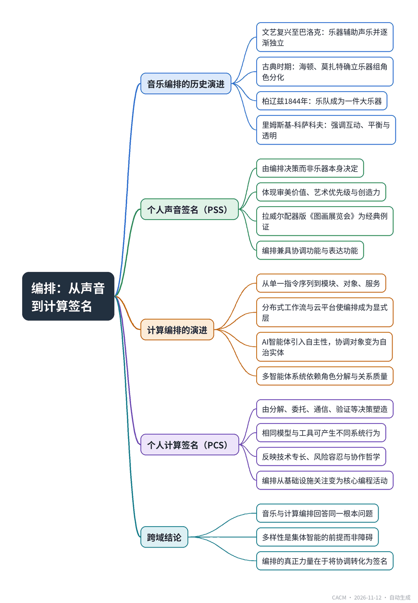

# Orchestration: From Personal Sound Signature to Personal Computation Signature

## 从个人声音签名到个人计算签名

**来源**：Communications of the ACM（Blog@CACM）　|　**发布**：2026-11-11 12:51（美东）　|　**北京时间**：2026-11-12 00:51　|　**作者**：Orit Wolf, Orit Hazzan, and Avi Salmon

[原文链接](https://cacm.acm.org/blogcacm/orchestration-from-personal-sound-signature-to-personal-computation-signature/)　·　生成于 2026-11-12 15:49

---

## 一、摘要

> 编排是将专业自主实体组织成连贯系统，产生超越个体能力的结果。

文章从音乐中的“配器法”（orchestration）出发，追溯其历史演变：从文艺复兴时期乐器辅助声乐，到古典时期海顿、莫扎特确立乐器组角色分化，再到柏辽兹1844年《配器法》将管弦乐队视为一件“大乐器”，以及里姆斯基-科萨科夫强调乐器间互动与平衡。作者据此提出“个人声音签名”（PSS）概念：作曲家通过音色、音区、密度、平衡等编排决策形成可识别的独特音响身份，拉威尔配器版《图画展览会》即为明证。随后文章将这一框架迁移至计算领域，梳理软件编排从模块化、面向对象、服务架构到分布式工作流和云平台的演进，并指出AI智能体引入自主性后，编排从协调预定义步骤转变为协调能推理、选择工具、适应环境的实体。多智能体系统中规划者、研究者、编码者、测试者、批评者等角色的分解与协调，其成功同样取决于关系质量而非个体能力。作者由此提出“个人计算签名”（PCS）：开发者通过分解、角色分配、委托、通信、记忆、工具选择、排序、验证等编排决策，塑造出独特的智能体行为模式。结论是，编排兼具协调与表达双重功能，其真正力量在于将协调本身转化为可识别的智能签名。

## 二、核心要点

1. 柏辽兹1844年《配器法》将管弦乐队视为一件大乐器，标志着配器从技术升格为艺术学科。
2. 里姆斯基-科萨科夫强调乐器间的互动、平衡与透明性，认为成功配器源于关系质量而非孤立声部的优秀。
3. 作者提出“个人声音签名”（PSS）：相同旋律、和声与乐器配置下，编排决策的差异造就截然不同的音响身份。
4. 计算领域的编排从模块化、面向对象、服务架构演进到分布式工作流与云平台，系统本身成为设计对象。
5. AI智能体的自主性使编排从协调预定义步骤转向协调能推理、选工具、适应环境的实体，关系质量决定成败。
6. 作者提出“个人计算签名”（PCS）：开发者通过分解、委托、通信、验证等编排决策，形成可识别的智能体行为模式。

## 三、关键词对照

| English | 中文 |
| --- | --- |
| Orchestration | 编排 |
| Personal Sound Signature (PSS) | 个人声音签名 |
| Personal Computation Signature (PCS) | 个人计算签名 |
| Agentic Software Development | 智能体软件开发 |
| Multi-Agent Systems | 多智能体系统 |
| Distributed Computing | 分布式计算 |
| Workflow Engines | 工作流引擎 |
| Service-Oriented Architecture | 面向服务的架构 |

## 四、中英对照全文

Have you ever wondered about the origin of the term orchestration, which has recently gained widespread attention with the rapid growth of agentic software development?

> 你是否曾好奇过“编排”（orchestration）一词的起源？随着智能体软件开发的迅猛发展，这个词近来已广受关注。

Orchestration is traditionally defined as the art and science of assigning musical ideas to instruments. Yet this definition captures only part of its significance. Drawing on contemporary scholarship, we understand orchestration here as the intentional coordination of distinct musical voices into a coherent expressive whole. Rather than asking simply which instrument should play a given passage, orchestration addresses the broader question of how specialized voices can interact to create musical meaning that transcends their individual contributions. In this sense, orchestration is the process of organizing individual capabilities, timbres, and musical functions so the whole becomes greater than the sum of its parts.

> 编排传统上被定义为将音乐构思分配给乐器的艺术与科学。然而，这一界定只抓住了其意义的一部分。借鉴当代学术研究，我们在此将编排理解为：将不同的音乐声部有意识地协调为一个连贯而富有表现力的整体。编排并非仅仅追问某一段落应由哪种乐器演奏，而是探讨一个更宏观的问题：专业化的声部如何相互作用，从而创造出超越各自贡献的音乐意义。从这个意义上说，编排就是组织个体能力、音色和音乐功能的过程，使整体大于部分之和。

Historically, the need for orchestration evolved alongside the development of the modern orchestra. During the Renaissance and Baroque periods, instruments served both to reinforce vocal writing and to participate in increasingly independent instrumental genres, with instrumental color acquiring different roles across musical contexts. As orchestras expanded during the Classical period, composers such as Haydn and Mozart gradually established increasingly differentiated roles for instrumental families. By the nineteenth century, larger concert halls, advances in instrument construction, and the growing expressive ambitions of Romantic composers transformed orchestration into an artistic discipline in its own right.

> 从历史上看，对编排的需求与现代管弦乐队的发展相伴而生。在文艺复兴和巴洛克时期，乐器既用于强化声乐写作，也参与日益独立的器乐体裁，乐器色彩在不同音乐语境中获得了不同的角色。随着古典时期管弦乐队规模扩大，海顿、莫扎特等作曲家逐步为各乐器族确立了日益分化的角色。到19世纪，更大的音乐厅、乐器制造技术的进步以及浪漫主义作曲家日益增长的表现野心，使编排转变为一门独立的艺术学科。

Hector Berlioz’s Grand traité d’instrumentation et d’orchestration modernes (1844) is widely recognized as one of the most influential treatises on instrumentation and orchestration. Berlioz described the orchestra not as a collection of separate instruments, but as a single large instrument capable of producing an almost limitless spectrum of expressive possibilities. This represented a profound conceptual shift. The orchestra itself became the instrument, while individual musicians functioned as specialized yet interdependent contributors within a unified expressive system. Berlioz’s vision laid the foundations for modern orchestral thinking and profoundly influenced later composers and orchestrators.

> 埃克托·柏辽兹的《现代乐器法与配器法专论》（1844年）被广泛认为是关于乐器法和配器法最具影响力的论著之一。柏辽兹将管弦乐队描述为一件能够产生几乎无限表现力频谱的大型乐器，而非一件件独立乐器的集合。这代表了一次深刻的概念转变。管弦乐队本身成了乐器，而每位乐手则在一个统一的表达体系中充当专业化却又相互依存的贡献者。柏辽兹的愿景为现代管弦乐思维奠定了基础，并深刻影响了后来的作曲家和配器家。

Several decades later, Nikolai Rimsky-Korsakov’s Principles of Orchestration (completed after his death by Maximilian Steinberg; first published in Russian in 1913 and in English in 1922) further advanced this perspective by emphasizing not only the characteristics of individual instruments but, more importantly, their interaction, balance, transparency, and collective function. Successful orchestration emerged not from the excellence of isolated parts, but from the quality of their relationships. Later orchestration scholars have argued that orchestration is best understood as the design of meaningful interactions between musical voices, rather than simply the accumulation of instrumental colors.

> 数十年后，尼古拉·里姆斯基-科萨科夫的《配器法原理》（他去世后由马克西米利安·施泰因贝格完成；1913年首次以俄文出版，1922年以英文出版）进一步推进了这一视角，不仅强调单个乐器的特性，更强调它们的相互作用、平衡、透明度与集体功能。成功的配器并非源于孤立部分的卓越，而是源于它们之间关系的质量。后来的配器学者主张，最好将配器理解为音乐声部之间有意义的交互设计，而非乐器色彩的简单堆叠。

Yet orchestration does more than coordination. It is also one of the primary ways in which composers establish an individual artistic identity. Two composers, or even two orchestrators, may begin with the same melody, harmony, instrumentation, and formal design, yet produce profoundly different sonic experiences. Their choices in timbre, register, density, spacing, articulation, balance, and interaction create a musical voice listeners often recognize almost immediately. Maurice Ravel’s orchestration of Mussorgsky’s Pictures at an Exhibition is perhaps the best-known demonstration that orchestration can fundamentally reshape the perception and expressive meaning of musical material.

> 然而，编排所做的远不止协调。它也是作曲家确立个人艺术身份的主要方式之一。两位作曲家，甚至两位配器家，可能从相同的旋律、和声、乐器编制和曲式设计出发，却创造出截然不同的音响体验。他们在音色、音区、密度、间距、发音法、平衡和交互上的选择，创造出听众往往几乎立刻就能辨认出的音乐声音。莫里斯·拉威尔为穆索尔斯基《图画展览会》所作的配器，或许是最著名的例证，表明配器能够从根本上重塑音乐素材的感知与表现意义。

Musical Orchestration: Personal Sound Signature

> 音乐编排：个人声音签名

Building upon this observation, we introduce the concept of a Personal Sound Signature (PSS): the distinctive sonic identity that emerges through recurring orchestration decisions. A PSS is not determined by the instruments themselves, but by the way instruments are organized, combined, layered, balanced, and allowed to interact. In this sense, orchestration is simultaneously a process of coordination and an act of authorship. It reveals the orchestrator’s aesthetic values, artistic priorities, interpretive judgement, and creative imagination. The same musical resources can therefore generate entirely different artistic worlds because orchestration reflects the orchestrator’s identity as much as the orchestra’s capabilities.

> 基于这一观察，我们引入“个人声音签名”（Personal Sound Signature, PSS）的概念：即通过反复出现的编排决策而浮现出的独特声音身份。PSS并非由乐器本身决定，而是由乐器被组织、组合、分层、平衡并允许其相互作用的方式决定。从这个意义上说，编排既是协调的过程，也是作者身份的体现。它揭示了配器家的审美价值、艺术优先级、诠释判断和创造性想象力。因此，同样的音乐资源可以生成完全不同的艺术世界，因为编排既反映了管弦乐队的能力，也反映了配器家的身份。

From this perspective, orchestration fulfills two inseparable functions. First, it coordinates specialized musical agents into a coherent expressive system. Second, it constructs a distinctive sonic identity through the particular manner in which those agents are coordinated. Orchestration is therefore both functional and expressive: it organizes complexity while simultaneously creating uniqueness.

> 从这个视角看，编排履行着两项不可分割的功能。第一，它将专业化的音乐行动者协调为一个连贯的表达体系。第二，它通过协调这些行动者的特定方式，构建出独特的声音身份。因此，编排既是功能性的，也是表达性的：它在组织复杂性的同时创造独特性。

Building upon this historical tradition, we propose that orchestration may be understood more broadly as a general principle of coordinated intelligence. Rather than viewing orchestration solely as a compositional technique, it can be conceptualized as the organization of specialized agents into a coherent system capable of producing outcomes that exceed the capacities of its individual components. Under this framework, diversity is not an obstacle, but a prerequisite for collective intelligence. Each participant contributes distinct capabilities while operating within a shared structure of communication, timing, responsibility, and purpose. The coherence of the system emerges from the intelligent coordination of difference.

> 基于这一历史传统，我们提出，编排可以被更宽泛地理解为协调智能的一般原则。与其仅将编排视为一种作曲技术，不如将其概念化为：将专业化的行动者组织为一个连贯系统，使其能够产生超越各组成部分能力的结果。在这一框架下，多样性不是障碍，而是集体智能的前提条件。每个参与者贡献独特的能力，同时在沟通、时序、责任和目的的共享结构中运作。系统的连贯性源自对差异的智能协调。

Remarkably, this broader conception extends well beyond the concert hall. Nearly two centuries after Berlioz articulated the orchestra as an integrated system of specialized yet interdependent voices, computer scientists adopted the concept of orchestration to address a strikingly similar challenge in distributed and multi-agent systems. Although separated by domain and technology, both musical and computational orchestration seek to answer the same fundamental question: How can specialized, autonomous entities be coordinated so that their collective intelligence exceeds the capabilities of any individual component?

> 值得注意的是，这一更宽泛的概念远远超出了音乐厅。在柏辽兹将管弦乐队阐述为专业化却又相互依存的声部所构成的集成系统近两个世纪之后，计算机科学家采用了“编排”这一概念，以应对分布式和多智能体系统中惊人相似的挑战。尽管领域和技术不同，音乐编排与计算编排都在试图回答同一个根本问题：如何协调专业化的自主实体，使其集体智能超越任何单个组成部分的能力？

In this post, we argue that music contributes an additional and largely unexplored dimension to this discussion. Beyond coordination, orchestration also shapes identity. Just as composers develop a Personal Sound Signature through the way they organize musical resources, designers of multi-agent systems may likewise create distinctive orchestration strategies that reflect particular priorities, values, and modes of interaction. The true power of orchestration, whether musical or computational, lies in transforming coordination itself into a unique and recognizable signature of intelligence, rather than only in coordinating specialized entities.

> 在本文中，我们主张音乐为这一讨论贡献了一个额外的、在很大程度上尚未被探索的维度。除了协调之外，编排还塑造身份。正如作曲家通过组织音乐资源的方式发展出个人声音签名，多智能体系统的设计者同样可以创造出反映特定优先级、价值观和交互模式的独特编排策略。编排的真正力量——无论是音乐还是计算——在于将协调本身转化为一种独特且可识别的智能签名，而不仅仅在于协调专业化的实体。

Orchestration: From Coordinated Programs to Agentic Intelligence

> 编排：从协调程序到智能体智能

Orchestration is traditionally understood in computing as the coordination and management of multiple computational processes, services, or components so they operate together toward a common objective. Yet this definition captures only part of its significance. In agentic programming, orchestration increasingly involves intentionally coordinating distinct agents, tools, processes, and sources of knowledge into a coherent intelligent system. Rather than simply asking which agent should perform a given task, orchestration addresses the broader question of how specialized agents can interact, communicate, reason, and act to produce outcomes that transcend their individual capabilities. In this sense, orchestration is the process of organizing individual capabilities, roles, knowledge sources, and actions so the whole becomes greater than the sum of its parts.

> 在计算领域，编排传统上被理解为对多个计算过程、服务或组件的协调与管理，使它们朝着共同目标协同运作。然而，这一界定只抓住了其意义的一部分。在智能体编程中，编排日益涉及将不同的智能体、工具、过程和知识来源有意识地协调为一个连贯的智能系统。编排并非仅仅追问应由哪个智能体执行给定任务，而是探讨一个更宏观的问题：专业化的智能体如何交互、沟通、推理和行动，从而产生超越各自能力的结果。从这个意义上说，编排就是组织个体能力、角色、知识来源和行动的过程，使整体大于部分之和。

Historically, the need for orchestration in computing emerged as software systems grew more complex. Early programs were largely conceived as sequences of explicitly specified instructions executed by a single computational process. As software systems grew in scale, developers increasingly decomposed them into modules, procedures, objects, services, and distributed components, each responsible for a specialized function. Software engineering paradigms such as structured programming, object-oriented programming, component-based development, and service-oriented architectures progressively shifted attention from individual instructions toward the organization and interaction of computational entities. The challenge was no longer just implementing an individual function, but coordinating multiple specialized components so they could collectively accomplish a larger computational purpose.

> 从历史上看，计算领域对编排的需求随着软件系统日益复杂而出现。早期程序在很大程度上被构想为由单个计算过程执行的一系列明确指定的指令。随着软件系统规模增长，开发者日益将其分解为模块、过程、对象、服务和分布式组件，每个部分负责一项专门功能。结构化编程、面向对象编程、基于组件的开发和面向服务架构等软件工程范式，逐步将注意力从单条指令转向计算实体的组织与交互。挑战不再仅仅是实现单个功能，而是协调多个专业化组件，使它们能够共同完成更大的计算目标。

The emergence of distributed computing and workflow systems further established orchestration as a central computational concern. Complex applications came to involve multiple services, data sources, execution environments, and computational processes that had to be coordinated in a particular sequence or according to particular dependencies. Workflow engines and cloud-computing platforms subsequently made orchestration an explicit layer of system design: developers specified how specialized computational components should be invoked, combined, monitored, and integrated, rather than implementing every operation as a monolithic process. The system itself increasingly became the object of design, while its individual components served as specialized yet interdependent contributors within a larger computational architecture.

> 分布式计算和工作流系统的出现，进一步确立了编排作为核心计算关注点的地位。复杂应用开始涉及多个服务、数据源、执行环境和计算过程，它们必须按特定顺序或根据特定依赖关系进行协调。工作流引擎和云计算平台随后使编排成为系统设计中一个明确的层次：开发者指定专业化的计算组件应如何被调用、组合、监控和集成，而不是将每项操作都实现为单体过程。系统本身日益成为设计的对象，而其各个组件则在更大的计算架构中充当专业化却又相互依存的贡献者。

The emergence of AI agents introduces a profound extension of this trajectory. Traditional software orchestration generally coordinates components whose behavior is largely specified in advance. Agentic systems, by contrast, incorporate entities that can interpret goals, reason about possible actions, select tools, adapt their behavior, and respond to changing environments. An agent may therefore determine not only what operation to perform, but also how to pursue an objective within a given set of constraints and resources. This introduces a fundamental shift in the nature of orchestration. The orchestrator no longer coordinates only predefined computational steps; it coordinates entities that themselves possess a degree of autonomy.

> AI智能体的出现，为这一轨迹带来了深刻的延伸。传统软件编排通常协调的是行为在很大程度上预先指定的组件。相比之下，智能体系统纳入的实体能够解释目标、推理可能的行动、选择工具、调整行为并响应变化的环境。因此，智能体不仅可以决定执行什么操作，还可以决定如何在给定约束和资源集合内追求目标。这给编排的性质带来了根本性转变。编排者不再只协调预定义的计算步骤，而是协调本身具有一定自主性的实体。

This distinction is particularly important in multi-agent and agentic programming systems. A complex task may be decomposed among a planner agent, a research agent, a coding agent, a testing agent, and a critic agent, with each agent contributing a different capability. The orchestrator determines which agents to select, when to invoke them, what information they receive, how they communicate outputs to other agents, and how to evaluate and integrate intermediate results. And, as in the case of musical orchestration, successful orchestration therefore emerges from the quality of the relationships among agents, rather than from the excellence of isolated agents. A highly capable collection of agents can nevertheless produce poor results if their roles overlap, their communication is inadequate, their outputs are not critically evaluated, or their activities are poorly sequenced.

> 这一区别在多智能体和智能体编程系统中尤为重要。复杂任务可以分解给规划智能体、研究智能体、编码智能体、测试智能体和批评智能体，每个智能体贡献不同的能力。编排者决定选择哪些智能体、何时调用它们、它们接收什么信息、它们如何将输出传达给其他智能体，以及如何评估和整合中间结果。因此，正如音乐编排的情形，成功的编排源于智能体之间关系的质量，而非孤立智能体的卓越。一组能力极强的智能体，如果角色重叠、沟通不足、输出未经过批判性评估或活动排序不当，仍可能产生糟糕的结果。

Building upon the historical development of software orchestration, we propose that orchestration may be understood more broadly as a general principle of agentic intelligence. Rather than viewing orchestration solely as a technical mechanism for managing multiple agents, it can be conceptualized as the organization of specialized autonomous entities into a coherent system capable of producing outcomes that exceed the capabilities of its individual components. Each agent contributes distinct capabilities while operating within a shared structure of communication, timing, responsibility, constraints, and purpose.

> 基于软件编排的历史发展，我们提出，编排可以被更宽泛地理解为智能体智能的一般原则。与其仅将编排视为管理多个智能体的技术机制，不如将其概念化为：将专业化的自主实体组织为一个连贯系统，使其能够产生超越各组成部分能力的结果。每个智能体贡献独特的能力，同时在沟通、时序、责任、约束和目的的共享结构中运作。

Yet orchestration does more than coordination. It is also one of the primary ways in which developers establish the identity and character of an agentic system. Two developers, or two development teams, may employ the same underlying language model, the same tools, the same collection of agents, and even the same overall task, yet produce profoundly different system behaviors. Their choices regarding decomposition, role assignment, delegation, communication, memory, tool selection, sequencing, verification, feedback, and intervention generate different forms of agentic intelligence. One system may emphasize autonomy and exploration; another may privilege verification and control. One may rely on iterative critique; another may employ parallel specialized agents. The resulting behavior is therefore shaped not only by the capabilities of the underlying agents, but by the way those capabilities are orchestrated.

> 然而，编排所做的远不止协调。它也是开发者确立智能体系统身份与特性的主要方式之一。两位开发者，或两个开发团队，可能使用相同的基础语言模型、相同的工具、相同的智能体集合，甚至相同的总体任务，却产生截然不同的系统行为。他们在分解、角色分配、委托、沟通、记忆、工具选择、排序、验证、反馈和干预方面的选择，生成了不同形式的智能体智能。一个系统可能强调自主性与探索；另一个可能优先考虑验证与控制。一个可能依赖迭代批评；另一个可能采用并行的专业化智能体。因此，最终行为不仅由底层智能体的能力塑造，也由这些能力被编排的方式塑造。

Agentic Orchestration: Personal Computation Signature

> 智能体编排：个人计算签名

Building on this analogy with musical orchestration, Personal Computation Signature (PCS) can be interpreted as the distinctive pattern of agentic behavior that emerges through recurring orchestration decisions made by a developer or development team. A PCS is determined by how agents and tools are organized, combined, delegated, sequenced, monitored, and allowed to interact. Two developers can therefore use identical computational resources while creating systems that behave differently because they orchestrate those resources differently. In this sense, orchestration is simultaneously a process of coordination and an act of authorship. It reveals not only technical expertise but also design priorities, epistemic assumptions, risk tolerance, desired levels of autonomy, and a philosophy of human-AI collaboration.

> 基于与音乐编排的这一类比，“个人计算签名”（Personal Computation Signature, PCS）可以被解释为：通过开发者或开发团队反复做出的编排决策而浮现出的独特智能体行为模式。PCS由智能体和工具被组织、组合、委托、排序、监控并允许其相互作用的方式决定。因此，两位开发者可以使用相同的计算资源，却创造出行为不同的系统，因为他们以不同方式编排这些资源。从这个意义上说，编排既是协调的过程，也是作者身份的体现。它不仅揭示技术专长，还揭示设计优先级、认知假设、风险承受能力、期望的自主程度以及人机协作哲学。

From this perspective, orchestration fulfills two inseparable functions. First, it coordinates specialized computational agents into a coherent intelligent system. Second, it constructs a distinctive agentic identity through the particular manner in which those agents are coordinated. Therefore, as in the case of musical orchestration, orchestration is both functional and expressive: it organizes computational complexity while simultaneously creating a distinctive mode of intelligence.

> 从这个视角看，编排履行着两项不可分割的功能。第一，它将专业化的计算智能体协调为一个连贯的智能系统。第二，它通过协调这些智能体的特定方式，构建出独特的智能体身份。因此，正如音乐编排的情形，编排既是功能性的，也是表达性的：它在组织计算复杂性的同时，创造出一种独特的智能模式。

This perspective also distinguishes agentic orchestration from traditional program composition. In conventional programming, the developer specifies the computational procedure: the sequence of operations through which the system transforms inputs into outputs. In agentic programming, the developer increasingly specifies goals, constraints, capabilities, roles, and relationships, while allowing agents to determine some of the intermediate steps required to achieve the desired outcome. The programmer therefore moves from specifying every computational action toward designing the cognitive architecture and orchestration structure within which autonomous entities can reason and act. Orchestration consequently becomes a central programming activity rather than merely an infrastructure concern.

> 这一视角也将智能体编排与传统程序编写区分开来。在传统编程中，开发者指定计算过程：系统将输入转化为输出所经历的操作序列。在智能体编程中，开发者日益指定目标、约束、能力、角色和关系，同时允许智能体决定实现期望结果所需的某些中间步骤。因此，程序员从指定每一个计算动作，转向设计自主实体可以在其中推理和行动的认知架构与编排结构。编排 consequently 成为一项核心编程活动，而不仅仅是基础设施层面的关注点。

Musical Orchestration and Agentic Orchestration

> 音乐编排与智能体编排

Remarkably, this development brings computing conceptually closer to music. Just as the orchestra transforms individual instruments into a coordinated expressive system, an agentic system transforms individual agents, tools, and knowledge resources into a coordinated intelligent system. In both cases, the central design challenge is not simply to maximize the capability of individual components, but to determine how specialized entities should be organized so that their interactions generate capabilities that no individual component possesses on its own. The orchestrator, like the conductor or composer, therefore operates at a level above the individual contributors, shaping their roles, relationships, timing, and collective behavior.

> 值得注意的是，这一发展使计算在概念上更接近音乐。正如管弦乐队将单个乐器转化为协调的表达系统，智能体系统将单个智能体、工具和知识资源转化为协调的智能系统。在这两种情形中，核心设计挑战都不是简单地最大化单个组件的能力，而是确定应如何组织专业化的实体，使其交互产生任何单个组件自身都不具备的能力。因此，编排者如同指挥家或作曲家，在高于个体贡献者的层面上运作，塑造他们的角色、关系、时序和集体行为。

Just as composers develop a Personal Sound Signature through the way they organize musical resources, developers of agentic systems may develop a Personal Computation Signature through the way they organize computational resources, agents, tools, and interactions. That is, the true power of orchestration, whether musical or computational, lies in transforming coordination itself into a distinctive and recognizable signature of intelligence.

> 正如作曲家通过组织音乐资源的方式发展出个人声音签名，智能体系统的开发者也可以通过组织计算资源、智能体、工具和交互的方式发展出个人计算签名。也就是说，编排的真正力量——无论是音乐还是计算——在于将协调本身转化为一种独特且可识别的智能签名。

## 附录：参考与脚注（原文）

References

1. Adler, S. The Study of Orchestration (3rd ed.). W. W. Norton (2002).

2. Berlioz, H. Berlioz’s orchestration treatise: A translation and commentary (H. Macdonald, Trans. & Ed.). Cambridge University Press (2002).

3. Blanning, T.C.W. The Triumph of Music: The Rise of Composers, Musicians and Their Art. Harvard University Press (2008).

4. Delisle, J., Hasegawa, R., Noble, J., and Touizrar, M. Bringing orchestration into the foreground (Editors’ introduction). In J. Delisle, R. Hasegawa, J. Noble, & M. Touizrar (Eds.). The Oxford Handbook of Orchestration Studies (pp. 1–15). Oxford University Press (2026).

5. Macdonald, H., Berlioz, (Louis-)Hector. Grove Music Online. Oxford University Press (2001).

6. Mathews, P. Instrumentation and Orchestration. Oxford Bibliographies in Music (2020).

7. Nichols, R. Ravel. Yale University Press (2011).

8. Rimsky-Korsakov, N. Principles of Orchestration. M. Steinberg (Ed.); E. Agate (Trans.). Édition Russe de Musique (1922).

9. Rushton, J. The Art of Orchestration. In C. Lawson (Ed.), The Cambridge Companion to the Orchestra (pp. 92–111). Cambridge University Press (2003).

10. Taruskin, R. The Oxford History of Western Music. Oxford University Press (2005).

Orit Wolf is an international concert pianist, composer, and Associate Professor of Creative Arts at the Technion’s Department of Humanities and Arts. Her work explores connections between music, creativity, and science, focusing on live performance and audience communication. See https://www.oritwolf.com.

Orit Hazzan is a professor at the Technion’s Department of Education in Science and Technology. Her research focuses on computer science, software engineering, and data science education. See https://orithazzan.net.technion.ac.il/

Avi Salmon is Innovation Lead at Intel Israel and a senior engineer dedicated to preparing the engineering workforce for the AI era. His work focuses on ramping up and upskilling teams, ensuring they have the cutting-edge methodologies and know-how needed to excel in this rapidly evolving field.

---
*英文原文版权归 Communications of the ACM 及作者所有；中文译文由 AI 辅助生成，仅供学习参考。*