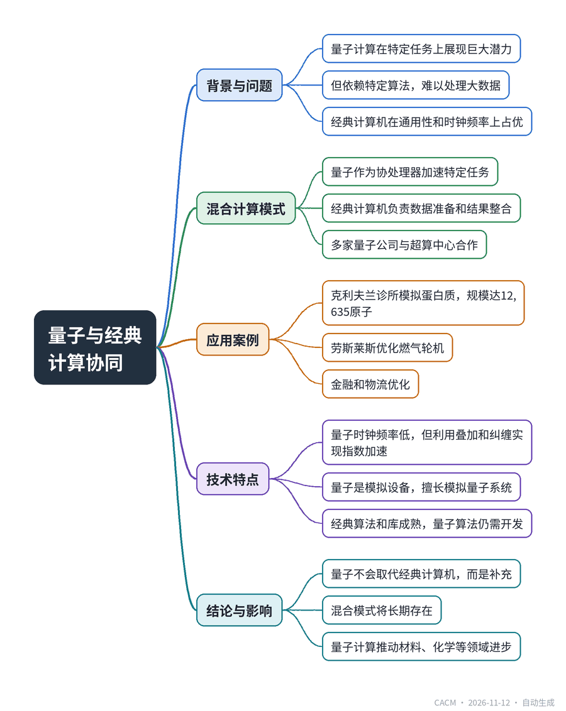

# Quantum is Gaining, but Don’t Throw Away that Supercomputer

## 量子计算助力超算，而非取代

**来源**：Communications of the ACM（News）　|　**发布**：2026-11-11 13:48（美东）　|　**北京时间**：2026-11-12 01:48　|　**作者**：Mark Halper

[原文链接](https://cacm.acm.org/news/quantum-is-gaining-but-dont-throw-away-that-supercomputer/)　·　生成于 2026-11-12 15:48

---

## 一、摘要

> 量子计算机正与经典超算协同工作，形成混合计算模式。

量子计算虽在特定任务上展现惊人算力，如谷歌量子计算机几分钟完成超算需数万亿年的基准测试，但其依赖特定算法且难以处理大数据，因此无法取代经典计算机。IBM、Quantinuum等公司正与超算中心合作，将量子作为协处理器。例如，克利夫兰诊所利用IBM量子计算机和日本RIKEN超算，模拟了规模达12,635个原子的人类蛋白质，是此前纪录的40倍。量子擅长模拟量子系统，如材料、化学和流体动力学，而经典计算机负责数据处理和通用任务。这种混合模式在金融、物流优化中也有应用。结论是量子与经典计算将长期共存，量子作为加速特定问题的专用工具。

## 二、核心要点

1. IBM量子计算机与日本RIKEN超算合作，将蛋白质模拟规模提升至12,635个原子，是此前纪录的40倍。
2. 量子计算机依赖特定算法，是专用协处理器，而非通用机器，经典计算机在时钟频率和大数据处理上仍占优。
3. 量子计算在模拟量子系统（如材料、化学）方面具有天然优势，但需将结果交给经典计算机进行后续处理。
4. 多家量子公司与超算中心合作，如Quantinuum与劳斯莱斯、Rigetti与HPE，推动量子与经典计算的集成。
5. 量子计算机的时钟频率远低于经典计算机，但其通过叠加和纠缠实现指数级加速，适合特定任务。

## 三、关键词对照

| English | 中文 |
| --- | --- |
| quantum computing | 量子计算 |
| supercomputer | 超级计算机 |
| qubit | 量子比特 |
| superposition | 叠加 |
| entanglement | 纠缠 |
| coprocessor | 协处理器 |
| high-performance computing (HPC) | 高性能计算 |
| quantum-centric supercomputing | 以量子为中心的超算 |

## 四、中英对照全文

When IBM announced in May that two of its quantum computers helped Cleveland Clinic achieve a record-size simulation of human proteins, a couple of other pieces of hardware also stood out in the accomplishment: two supercomputers.

> 当IBM在5月宣布其两台量子计算机帮助克利夫兰诊所实现了创纪录规模的人类蛋白质模拟时，这项成就中还有另外两件硬件也脱颖而出：两台超级计算机。

This pairing of quantum computing and classical computing illustrates that while quantum computers can deliver staggering compute power in certain circumstances, they also have limitations compared to conventional systems, which have faster clock rates, established algorithms, are more capable with large datasets, and are more broadly useful than niche-oriented quantum.

> 量子计算与经典计算的这种配对表明，尽管量子计算机在某些情况下可以提供惊人的计算能力，但与传统系统相比，它们也有局限性，传统系统具有更快的时钟频率、成熟的算法、更擅长处理大型数据集，并且比面向特定领域的量子计算具有更广泛的用途。

“There’s going to be a classical computer in anything that has to do with quantum,” said IBM vice president of quantum adoption Scott Crowder.

> “任何与量子有关的事物中都会有一台经典计算机，”IBM量子应用副总裁Scott Crowder说。

There’s plenty of similar thinking around the quantum computing industry, which is routinely partnering with classical high-performance computing (HPC) companies to serve what Marcus Henning, chief business officer of German quantum computing company planqc GmbH, referred to as a “coprocessor” boost to supercomputers. In March, planqc entered an arrangement with end user partners Infineon and BMW to help them combine quantum and supercomputing processes.

> 量子计算行业周围有很多类似的想法，该行业经常与经典高性能计算（HPC）公司合作，为超级计算机提供德国量子计算公司planqc GmbH首席商务官Marcus Henning所说的“协处理器”增强。今年3月，planqc与最终用户合作伙伴英飞凌和宝马达成协议，帮助他们将量子计算和超级计算流程结合起来。

The growing list of such partnerships includes a July announcement by quantum company Quantinuum, Rolls-Royce, and the U.K. National Supercomputing Centre at the University of Edinburgh to examine how the combination of quantum and classical computing can improve gas turbine engines. The same month, quantum vendor Rigetti Computing said it will work with supercomputing provider Hewlett Packard Enterprises at the Pittsburgh Supercomputing Center to integrate the two technologies. Quantinuum also formed an alliance with HPE in June. IBM has several quantum/classical partnerships in addition to the one with Cleveland Clinic.

> 此类合作名单不断增长，包括量子公司Quantinuum、罗尔斯·罗伊斯以及爱丁堡大学英国国家超级计算中心7月宣布的一项合作，旨在研究量子计算与经典计算的结合如何改进燃气涡轮发动机。同月，量子供应商Rigetti Computing表示将与超级计算提供商惠普企业在匹兹堡超级计算中心合作，整合这两种技术。Quantinuum还在6月与HPE结成联盟。除了与克利夫兰诊所的合作外，IBM还有多项量子/经典合作。

A Super Assistant

> 超级助手

Quantum computing has been exciting the computing world with eye-popping achievements. One example came in 2024, when a Google quantum computer ran a benchmark algorithm in less than five minutes that the company said would have taken a supercomputer a septillion years. In July of this year, IBM, working with the University of Chicago, announced that its quantum computer had solved in 15 minutes a problem that would “demand infeasible amounts of classical computing time.”

> 量子计算一直以令人瞠目的成就让计算界兴奋不已。一个例子发生在2024年，谷歌的一台量子计算机在不到五分钟内运行了一个基准算法，该公司表示，超级计算机需要10的24次方年才能完成。今年7月，IBM与芝加哥大学合作宣布，其量子计算机在15分钟内解决了一个“需要不可行的经典计算时间”的问题。

Despite all this brawn, quantum computing is working essentially as a powerful assistant to classical supercomputing, rather than as a replacement.

> 尽管有所有这些力量，量子计算本质上是在作为经典超级计算的强大助手，而不是替代品。

Why? While quantum is still a work in progress—quantum computing developers are focused on increasing the qubit count in their machines—the answer lies largely in quantum’s reliance on specific algorithms written to solve very specific tasks by taking advantage of quantum properties. Qubits, or quantum bits, can represent zero and one at the same time, a quantum characteristic known as superposition. And they work in conjunction with other qubits, via a quantum process called entanglement.

> 为什么？虽然量子计算仍在进行中——量子计算开发者专注于增加其机器中的量子比特数——但答案主要在于量子计算依赖于为利用量子特性解决非常具体任务而编写的特定算法。量子比特（qubit）可以同时表示0和1，这种量子特性称为叠加。它们通过称为纠缠的量子过程与其他量子比特协同工作。

The combination of superposition and entanglement is what gives quantum computing its enormous computational capabilities.

> 叠加和纠缠的结合赋予了量子计算巨大的计算能力。

It’s All About the Algorithms

> 关键在于算法

Yet that is only true if the quantum computer has the proper algorithms. “Quantum is not a general-purpose machine,” said Henning of planqc. “It’s a coprocessor. It solves certain kinds of problems where classical computers are really, really bad. You load it with problems that a classical cannot solve.”

> 然而，只有当量子计算机拥有合适的算法时，这才成立。“量子不是通用机器，”planqc的Henning说。“它是一个协处理器。它解决经典计算机非常非常不擅长解决的某些类型的问题。你给它加载经典计算机无法解决的问题。”

No one is throwing away their classical iron.

> 没有人会扔掉他们的经典硬件。

“We will still have supercomputers, classical computers, and they’ll have additional tools for different kinds of problems,” Henning said. “One tool will be a quantum computer. With quantum computers, you’re still at the stage where you still have to develop algorithms. With classical computers, we have many, many years of experience. We have very well established algorithms and libraries and codes and all these things.”

> “我们仍然会有超级计算机、经典计算机，它们将拥有针对不同问题的额外工具，”Henning说。“其中一个工具将是量子计算机。对于量子计算机，你仍然处于需要开发算法的阶段。对于经典计算机，我们有很多很多年的经验。我们有非常成熟的算法、库、代码以及所有这些东西。”

So classical computers will continue to carry the general computing workload, probably for a long time to come. Quantum computers won’t supplant them any time soon for AI, for example, because for now, quantum cannot readily absorb large amounts of data. Quantum computers, however, can feed their findings into a classically-driven AI process.

> 因此，经典计算机将继续承担通用计算工作负载，可能在未来很长一段时间内都是如此。例如，量子计算机不会很快在AI领域取代它们，因为目前量子计算无法轻易吸收大量数据。然而，量子计算机可以将其发现输入到经典驱动的AI流程中。

Quantum for Quantum

> 量子用于量子

One of several promising areas for quantum is the simulation of matter, fluid dynamics, physical processes and chemistry. That’s because the quantum properties of quantum computers can echo the quantum makeup of matter which, many physicists believe, exhibit quantum superposition and entangled behavior on the atomic and subatomic level. Thus, quantum computing portends major improvements in materials for batteries, in pharmaceuticals, in aerospace fuel use (as with Quantinuum and Rolls-Royce’s arrangement), and other things.

> 量子计算有几个有前景的领域之一是对物质、流体动力学、物理过程和化学的模拟。这是因为量子计算机的量子特性可以呼应物质的量子构成，许多物理学家认为，物质在原子和亚原子层面上表现出量子叠加和纠缠行为。因此，量子计算预示着电池材料、制药、航空航天燃料使用（如Quantinuum和罗尔斯·罗伊斯的合作）等方面的重大改进。

“You can try to do it classically, but the compute resources you have will never be sufficient for that,” said Henning.

> “你可以尝试用经典方法来做，但你拥有的计算资源永远不够，”Henning说。

In hybrid projects, quantum hands over its results to a supercomputer for broader application.

> 在混合项目中，量子计算将其结果交给超级计算机进行更广泛的应用。

That’s what happened when Cleveland Clinic used two IBM quantum computers and two Japanese supercomputers provided through a partnership with Japan’s government-owned research institute RIKEN when it was trying to simulate a couple of human proteins. The combination was able to model two different molecules (one that’s part of the human digestion system, and another that’s part of the human immune system) at a size of 12,635 atoms and11,608 atoms, both roughly 40 times the size of the previous high of 303 atoms.

> 当克利夫兰诊所使用两台IBM量子计算机和通过与日本政府拥有的研究机构RIKEN合作提供的两台日本超级计算机来模拟几种人类蛋白质时，情况就是如此。该组合能够以12,635个原子和11,608个原子的规模模拟两种不同的分子（一种是人类消化系统的一部分，另一种是人类免疫系统的一部分），两者都是之前303个原子最高纪录的约40倍。

IBM described the approach as quantum-centric supercomputing. Basically, “Classical broke up the problem into fragments, quantum simulated the pieces” and “classical stitched it back together to get the full answer,” explained IBM’s Crowder.

> IBM将这种方法描述为以量子为中心的超级计算。基本上，“经典计算将问题分解成碎片，量子模拟这些碎片”，然后“经典计算将其重新拼接起来以获得完整答案”，IBM的Crowder解释说。

Quantum/classical combinations also help companies optimize financial portfolios and logistics. For example, planqc’s project with Infineon and BMW aims to optimize supply chain processes. IBM in May announced that it is working with insurance company Allstate to improve its combination of risks and values. To evaluate home insurance policy offerings, IBM’s Heron quantum computer “generates a batch of candidate answers nudged toward combinations that are both valuable and within budget,” an IBM representative said. “Then, a classical step cleans up the list.”

> 量子/经典组合还有助于公司优化金融投资组合和物流。例如，planqc与英飞凌和宝马的项目旨在优化供应链流程。IBM在5月宣布，它正在与保险公司Allstate合作，改进其风险与价值的组合。为了评估家庭保险保单产品，IBM的Heron量子计算机“生成一批候选答案，这些答案被推向既有价值又在预算内的组合，”IBM的一位代表说。“然后，经典步骤清理列表。”

“Quantum computers are a very niche tool for very important problems which currently you can’t even approach on a classical computer,” said Mykola Maksymenko, co-founder and chief technology officer of New York City-based Haiqu, which simulates quantum processes on classical computers.

> “量子计算机是一种非常小众的工具，用于解决非常重要的问题，目前你甚至无法在经典计算机上处理这些问题，”总部位于纽约市的Haiqu的联合创始人兼首席技术官Mykola Maksymenko说，该公司在经典计算机上模拟量子过程。

Analog, or Nature’s Way

> 模拟，或自然的方式

One irony is that quantum computers work their “septillion year” wonders even though they are, by the conventional measurement of clock speed, slower than classical systems. While today’s high-performance classical computers run in the terahertz range, a quantum computer might run in the hertz range of one operation per second. That’s one reason they are not good at large data processing.

> 一个讽刺之处在于，量子计算机创造了“10的24次方年”的奇迹，尽管按照传统的时钟速度衡量，它们比经典系统慢。当今的高性能经典计算机运行在太赫兹范围内，而量子计算机可能运行在赫兹范围内，即每秒一次操作。这是它们不擅长大型数据处理的原因之一。

It’s a striking difference. But clock speed is misleading from the quantum perspective, because quantum doesn’t rely on it. Rather, what is lost in clock speed is made up with the exponential power of combining superposition and entanglement for specific tasks.

> 这是一个显著的区别。但从量子角度来看，时钟速度具有误导性，因为量子并不依赖它。相反，时钟速度上失去的东西通过叠加和纠缠在特定任务上的指数级力量得到了弥补。

Izhar Madelsy, co-founder and CEO of Quantum Elements, Los Angeles, described quantum as a return to the analog world—a notable departure from the digital side of computing to which the world is accustomed.

> 洛杉矶Quantum Elements的联合创始人兼首席执行官Izhar Madelsy将量子描述为回归模拟世界——这是对世界所习惯的计算数字侧的一次显著背离。

Quantum computers are analog precisely because the quantum mechanics on which they are based are themselves analog, Madelsy said. “While when you look at quantum devices, which are analog devices, they’re very good at representing complex systems that are rooted in quantum physics,” he said. “They represent nature using an analog system.”

> Madelsy说，量子计算机是模拟的，正是因为它们所基于的量子力学本身就是模拟的。“当你观察量子设备时，它们是模拟设备，它们非常擅长表示植根于量子物理的复杂系统，”他说。“它们使用模拟系统来表示自然。”

In short, he said, quantum computing “is an analog beast.”

> 简而言之，他说，量子计算“是一头模拟巨兽”。

Mark Halper is a freelance journalist based near Bristol, U.K. He covers everything from media moguls to subatomic particles.

> Mark Halper是一位自由记者，居住在英国布里斯托尔附近。他报道从媒体大亨到亚原子粒子的各种话题。

---
*英文原文版权归 Communications of the ACM 及作者所有；中文译文由 AI 辅助生成，仅供学习参考。*