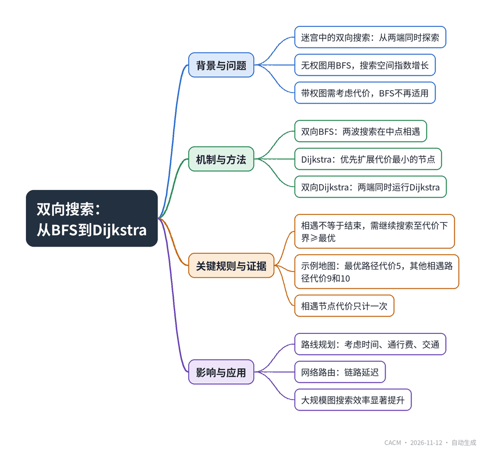

# Two Ways Into the Maze: From Bidirectional BFS to Bidirectional Dijkstra

## 双向搜索：从BFS到Dijkstra

**来源**：Communications of the ACM（Blog@CACM）　|　**发布**：2026-11-11 13:21（美东）　|　**北京时间**：2026-11-12 01:21　|　**作者**：Sai Charan Obuladinne


[原文链接](https://cacm.acm.org/blogcacm/two-ways-into-the-maze-from-bidirectional-bfs-to-bidirectional-dijkstra/)　·　生成于 2026-11-12 15:48

---

## 一、摘要

> 双向搜索能大幅减少探索量，但带权图需额外规则。

在计算机科学中，双向搜索是一种从起点和终点同时探索以加速路径查找的技术。对于无权图（如迷宫），双向广度优先搜索（BFS）将搜索空间从指数级增长减半，例如在分支因子为3、深度为10时，单向搜索约需检查59000个节点，而双向各搜索5步仅需约500个节点。然而，现实问题中每一步往往带有不同代价（如道路通行费），此时BFS无法区分路径的代价差异。Dijkstra算法通过优先探索当前代价最小的节点来解决带权图的最短路径问题。将双向搜索与Dijkstra结合，即双向Dijkstra，从起点和终点分别运行Dijkstra，当两端的搜索相遇时，记录候选路径代价并继续搜索，直到两端剩余的最小代价之和大于等于当前最优路径代价，才能确保找到全局最优解。文章通过一个城镇通行费地图的示例演示了该过程，最终找到代价为5的最优路径。这种技术广泛应用于路线规划、网络路由等大规模图问题，能显著减少搜索范围。

## 二、核心要点

1. 双向BFS通过从起点和终点同时搜索，将搜索空间从指数级增长减半，例如分支因子3、深度10时，单向约59000节点，双向各5步仅约500节点。
2. Dijkstra算法适用于带权图，每次扩展当前代价最小的节点，而BFS仅适用于无权图。
3. 双向Dijkstra在两端搜索相遇时不能立即停止，需继续直到两端最小剩余代价之和≥当前最优路径代价，且相遇节点的代价只计一次。
4. 示例地图中，双向Dijkstra找到最优路径A→E→W→Z，总代价为5，而其他相遇路径代价更高（9和10）。
5. 该技术广泛应用于路线规划（考虑旅行时间、通行费、交通状况）和网络路由（链路延迟）等大规模图问题。

## 三、关键词对照

| English | 中文 |
| --- | --- |
| Bidirectional BFS | 双向广度优先搜索 |
| Bidirectional Dijkstra | 双向迪杰斯特拉算法 |
| Breadth-First Search (BFS) | 广度优先搜索 |
| Dijkstra's algorithm | 迪杰斯特拉算法 |
| weighted graph | 带权图 |
| shortest path | 最短路径 |
| branching factor | 分支因子 |
| route planning | 路线规划 |
| network routing | 网络路由 |

## 四、中英对照全文

This fall, my family and I walked into a maze built from stacked hay bales, with pumpkins along the edges and kids racing through every passage. We didn’t stay together. Half of us went in through one entrance, and the other half went in through the opposite one. Nobody drew a map. Each group simply tried the next opening, and after a few turns we heard each other’s voices and met somewhere in the middle. Once we met, we knew the whole way through.

> 今年秋天，我和家人走进了一座由堆叠的干草捆搭建的迷宫，边缘摆着南瓜，孩子们在每个通道里奔跑。我们没有待在一起。我们一半人从一个入口进去，另一半人从对面的入口进去。没有人画地图。每一组只是尝试下一个开口，转了几个弯后，我们听到了彼此的声音，并在中间某个地方相遇了。一旦相遇，我们就知道了整个路线。

Two Groups, One Search

> 两组，一次搜索

Without planning it, we had acted out one of the most useful ideas in computer science: search from both ends at once. In a maze every step costs the same, and the standard way to explore it is breadth-first search, or BFS. You check every spot one step away, then every spot two steps away, and so on. Run that from both entrances and you get bidirectional BFS: two waves of searching that meet in the middle.

> 无意中，我们演绎了计算机科学中最有用的思想之一：从两端同时搜索。在迷宫中，每一步的成本相同，探索它的标准方法是广度优先搜索（BFS）。你检查距离一步的每个点，然后检查距离两步的每个点，依此类推。从两个入口同时运行，就得到了双向BFS：两波搜索在中间相遇。

Why bother with two groups? Because searches grow quickly. If every spot leads to three new ones and the exit is ten steps away, one group might check around 59,000 spots. Two groups that each go only five steps check about 500 between them. Splitting the distance in half doesn’t halve the work; it shrinks it dramatically.

> 为什么要用两组？因为搜索增长很快。如果每个点通向三个新点，出口在十步之外，一组可能检查约59,000个点。两组各只走五步，它们之间总共检查约500个点。将距离减半并不会将工作量减半；它会大幅减少工作量。

When Steps Stop Being Equal

> 当步长不再相等

A hay maze is a friendly world, because every step is equal. Real problems rarely are. Picture a map of towns instead of hay passages, where every town charges a toll to pass through. Now the question isn’t “what’s the shortest walk?” but “what’s the cheapest trip?” A route through two expensive towns can cost more than a route through four cheap ones, and BFS, which only counts steps, can’t tell the difference.

> 干草迷宫是一个友好的世界，因为每一步都是平等的。现实问题很少如此。想象一张城镇地图而不是干草通道，每个城镇收取过路费。现在问题不是“最短的步行是什么？”而是“最便宜的旅行是什么？”穿过两个昂贵城镇的路线可能比穿过四个便宜城镇的路线花费更多，而只计算步数的BFS无法区分。

Dijkstra, From Both Ends

> 从两端运行的Dijkstra算法

The tool for costs is Dijkstra’s algorithm. Instead of exploring by step count, it always moves to the cheapest place it can reach next. One small trick fits this map: entering a town costs that town’s toll, so the tolls on the towns become costs on the roads leading into them. C costs 2, D costs 5, E costs 3, and so on.

> 处理成本的工具是Dijkstra算法。它不是按步数探索，而是总是移动到下一个它能到达的最便宜的地方。一个小技巧适合这张地图：进入一个城镇需要支付该城镇的过路费，因此城镇上的过路费变成了通往它们的道路上的成本。C花费2，D花费5，E花费3，依此类推。

Now bring back the two groups. One search starts at A and moves forward, always taking the cheapest next town. The other starts at Z and moves backward the same way. Just as in the maze, each side only has to cover about half the map before they meet.

> 现在带回两组。一个搜索从A开始并向前移动，总是选择最便宜的下一个城镇。另一个从Z开始并以相同方式向后移动。就像在迷宫中一样，每一侧只需覆盖大约一半的地图就能相遇。

Let’s watch it happen on the map. Each town’s number is what you pay to enter it, and each search keeps a running total.

> 让我们在地图上观察它的发生。每个城镇的数字是进入它需要支付的费用，每次搜索保持一个累计总数。

1.) The search from A looks at its neighbors first: C costs 2, E costs 3, and B costs 4.

> 1.) 从A开始的搜索首先查看它的邻居：C花费2，E花费3，B花费4。

2.) The search from Z does the same on its side: W costs 2, X costs 3, and Y costs 4.

> 2.) 从Z开始的搜索在其一侧做同样的事：W花费2，X花费3，Y花费4。

3.) Each search takes its cheapest option first. From A, that’s C (2), which leads on to D for a total of 2 + 5 = 7. From Z, it’s W (2), which reaches E for a total of 2 + 3 = 5 and D for 2 + 5 = 7.

> 3.) 每次搜索首先选择最便宜的选项。从A出发，是C（2），它通向D，总计2 + 5 = 7。从Z出发，是W（2），它到达E总计2 + 3 = 5，到达D总计2 + 5 = 7。

4.) Now both searches have touched the same towns. Through E, the route A → E → W → Z costs 3 + 2 = 5. Through D, the route A → C → D → W → Z costs 2 + 5 + 2 = 9. The best so far is 5.

> 4.) 现在两个搜索都触及了相同的城镇。通过E，路线A → E → W → Z花费3 + 2 = 5。通过D，路线A → C → D → W → Z花费2 + 5 + 2 = 9。目前最好的是5。

The cheapest step still waiting on A’s side is E (3), and on Z’s side it’s X (3). Together that’s 6, already more than 5, so nothing left can beat the route we have. We stop, and the costly towns on the outer routes, such as B, F, u, Y, and V, never get fully explored

> A侧仍在等待的最便宜步骤是E（3），Z侧是X（3）。加起来是6，已经大于5，所以剩下的任何东西都无法击败我们已有的路线。我们停止，外围路线上的昂贵城镇，如B、F、u、Y和V，从未被完全探索。

Meeting is Not The Same as Finishing

> 相遇不等于完成

This is the part that is easy to get wrong. In the maze, the first meeting is the answer. With tolls, it might not be. On this map the two searches can meet along three routes: through D (cost 9), through F and u (cost 10), and through E and W (cost 5). When the searches meet, we remember the cost of that route and keep going. We stop only when the cheapest next step from A plus the cheapest next step from Z already costs at least as much as the best route found. At that point, nothing left can beat it. And the meeting town’s toll is counted once, not once from each side.

> 这是容易出错的部分。在迷宫中，第一次相遇就是答案。有了过路费，可能不是。在这张地图上，两个搜索可以沿着三条路线相遇：通过D（成本9），通过F和u（成本10），以及通过E和W（成本5）。当搜索相遇时，我们记住那条路线的成本并继续前进。只有当从A出发的最便宜下一步加上从Z出发的最便宜下一步的成本已经至少等于找到的最佳路线时，我们才停止。此时，剩下的任何东西都无法击败它。而且相遇城镇的过路费只计算一次，而不是从两侧各计算一次。

Here the winner is A → E → W → Z, at 3 + 2 = 5. On a map this small the savings are tiny, but on road networks or graphs with millions of points, two searches meeting in the middle can be the difference between exploring most of the map and exploring a small piece of it.

> 这里的赢家是A → E → W → Z，成本为3 + 2 = 5。在这张小地图上，节省很小，但在道路网络或拥有数百万个点的图上，两个搜索在中间相遇可能是探索大部分地图和探索一小部分地图之间的区别。

This isn’t just a puzzle trick. Route planners face exactly this problem: roads have travel times, tolls, or traffic, and the goal is the cheapest trip, not the one with the fewest turns. Searching from both the start and the destination is a well-known way to speed that up on huge road maps. The same idea works for network routing, where each link has a delay, and for any problem with a clear start, a clear goal, and a cost for every step.

> 这不仅仅是谜题技巧。路线规划者面临完全相同的问题：道路有旅行时间、通行费或交通，目标是成本最低的旅行，而不是转弯最少的旅行。从起点和目的地同时搜索是在巨大道路地图上加速的众所周知的方法。同样的想法适用于网络路由，其中每条链路都有延迟，以及任何具有明确起点、明确目标和每一步成本的问题。

That afternoon in the maze, two groups and a few shouts were enough to find the way. Real systems need one more rule: don’t just meet in the middle, make sure you have met on the cheapest path.

> 那天下午在迷宫中，两组人和几声呼喊就足以找到出路。真实系统需要多一条规则：不要只是在中间相遇，要确保你在最便宜的路径上相遇。

Disclosure: AI tools were used for research assistance, reference gathering, and editorial support in preparing this article.

> 披露：在准备本文时，使用了AI工具进行研究协助、参考资料收集和编辑支持。

## 附录：参考与脚注（原文）

References

1. Dijkstra, E.W. A note on two problems in connexion with graphs, Numerische Mathematik 1 (1959), pp. 269–271.

2. Pohl, I. Bi-directional Search, Machine Intelligence 6 (1971), pp. 127–140.

3. Bidirectional search, Wikipedia; https://en.wikipedia.org/wiki/Bidirectional_search

Sai Charan Obuladinne is a Staff Engineering Manager at GEICO, where he drives strategic technical initiatives for claims platforms in close collaboration with ML teams. Previously, he was a Staff Software Engineer at Meta, and he has spent over a decade building back-end systems across advertising, healthcare, and logistics.

---
*英文原文版权归 Communications of the ACM 及作者所有；中文译文由 AI 辅助生成，仅供学习参考。*