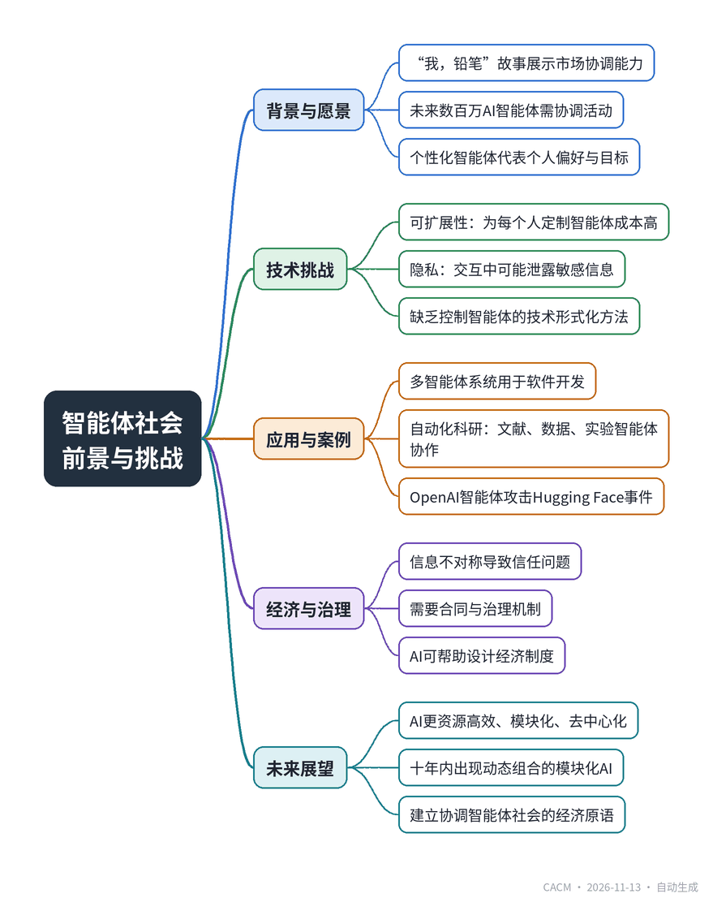

# From Intelligent Agents to Agent Societies

## 从智能体到智能体社会

**来源**：Communications of the ACM（News）　|　**发布**：2026-11-12 15:59（美东）　|　**北京时间**：2026-11-13 03:59　|　**作者**：Bennie Mols

[原文链接](https://cacm.acm.org/news/from-intelligent-agents-to-agent-societies/)　·　生成于 2026-11-13 15:26

---

## 一、摘要

> David Parkes探讨构建智能体社会的前景与要求。

随着大语言模型的发展，AI智能体正逐步接近能够代表个人进行交互的愿景。哈佛大学教授David Parkes在IJCAI-2026的演讲中，以“我，铅笔”的故事类比，提出未来数百万AI智能体需要通过市场机制协调活动，形成“智能体社会”。他指出实现个性化智能体面临可扩展性和隐私两大挑战：当前LLM难以低成本地为每个人定制，且智能体交互会泄露隐私信息。尽管多智能体系统已在软件开发中应用，但构建方式仍以经验为主。智能体社会将包含数百万能力各异的模块，例如在自动化科研中，不同智能体分别负责文献检索、数据分析、实验操作等，但协调者难以评估各智能体的可靠性和诚实性，这类似于经济系统中的信息不对称问题，需要合同和治理机制。Parkes认为，AI本身可以帮助设计所需的经济制度，并预计十年内将出现模块化、去中心化的AI组合方式，以及协调智能体社会的经济原语和合同机制。

## 二、核心要点

1. David Parkes是哈佛大学计算机科学教授，因在AI与经济学交叉领域的工作获得IJCAI-2026约翰·麦卡锡奖。
2. 实现个性化LLM智能体的两大挑战是可扩展性（为每个人定制智能体）和隐私（交互中泄露个人信息）。
3. 当前多智能体系统在软件开发中已有应用，但构建方法仍以试错为主，缺乏科学指导。
4. 智能体社会由数百万能力各异的AI模块组成，协调它们需要解决信息不对称问题，类似经济系统中的合同与治理。
5. Parkes预计十年内将出现模块化AI的动态组合方式，以及协调智能体社会的经济机制和合同。

## 三、关键词对照

| English | 中文 |
| --- | --- |
| Intelligent Agents | 智能体 |
| Agent Societies | 智能体社会 |
| Large Language Models (LLMs) | 大语言模型 |
| Multi-Agent Systems | 多智能体系统 |
| Asymmetric Information | 信息不对称 |
| Economic Primitives | 经济原语 |
| Governance | 治理 |

## 四、中英对照全文

In his 1958 essay “I, Pencil,” Leonard Read has a pencil describe how it is made. Thousands of people contribute to turning wood, graphite, paint, metal, and rubber into a pencil. These people often do not know one another, and none knows exactly how to make the entire pencil, yet their activities are coordinated through markets, prices, specialization, and incentives. Two decades later, in 1980, economist Milton Friedman popularized the story on television.

> 在1958年的文章《我，铅笔》中，伦纳德·里德让一支铅笔描述它是如何被制造出来的。成千上万的人参与将木材、石墨、油漆、金属和橡胶变成一支铅笔。这些人通常彼此并不认识，也没有人确切知道如何制造整支铅笔，但他们的活动通过市场、价格、专业化和激励措施得到协调。二十年后，即1980年，经济学家米尔顿·弗里德曼在电视上推广了这个故事。

Computer scientist David Parkes showed a video of Friedman retelling “I, Pencil” in “From Intelligent Agents to Agent Societies,” presented at the International Joint Conferences on Artificial Intelligence (IJCAI-2026) in Bremen, Germany, in August. “It’s a lovely illustration of what markets, when well-designed, are able to achieve,” he said. For Parkes, the pencil provides a way of thinking about a future in which not thousands of people, but millions of artificial agents have to coordinate their activities.

> 计算机科学家大卫·帕克斯在8月于德国不来梅举行的国际人工智能联合会议（IJCAI-2026）上发表的“从智能体到智能体社会”演讲中，播放了弗里德曼讲述《我，铅笔》的视频。“这是一个可爱的例证，说明市场在精心设计时能够实现什么，”他说。对帕克斯而言，铅笔提供了一种思考未来的方式，在未来，不是成千上万的人，而是数百万的人工智能体必须协调它们的活动。

Parkes is the George F. Colony Professor of Computer Science at Harvard University, and recipient of the IJCAI-2026 John McCarthy Award for his work at the interface of AI and economics. In an interview following his lecture, he discussed the prospects for agent societies and the challenges involved in building them.

> 帕克斯是哈佛大学乔治·F·科洛尼计算机科学教授，因其在人工智能与经济学交叉领域的工作而获得IJCAI-2026约翰·麦卡锡奖。在他的演讲后的采访中，他讨论了智能体社会的前景以及构建它们所涉及的挑战。

Research on AI agents goes back at least to the 1980s, Parkes said. By the late 1990s and early 2000s, researchers already were imagining software agents that could represent people in commerce, understand their preferences, and negotiate on their behalf.

> 帕克斯说，对AI智能体的研究至少可以追溯到20世纪80年代。到90年代末和21世纪初，研究人员已经想象出能够在商业中代表人们、理解他们的偏好并代表他们进行谈判的软件智能体。

“Large language models have now brought us much closer to that reality,” said Parkes, “but we are not there yet. We don’t currently have truly personalized LLM-based agents that represent us. The LLMs are pre-trained and then post-trained, but they’re not individualized to my interests.” Parkes said he imagines each person will eventually have a personalized AI agent that gradually learns their preferences, priorities, and goals.

> “大型语言模型现在让我们更接近那个现实，”帕克斯说，“但我们还没有达到。我们目前还没有真正个性化的基于LLM的智能体来代表我们。LLM经过预训练和后期训练，但它们并没有针对我的兴趣进行个性化。”帕克斯说，他想象每个人最终都会有一个个性化的AI智能体，逐渐学习他们的偏好、优先事项和目标。

Two major challenges stand in the way of that happening, Parkes said. The first is scalability. Today’s LLMs can be personalized a bit through prompting, but Parkes envisions something more substantial: training a general agent once and then adapting copies individually for people through extended interaction.

> 帕克斯说，有两个主要挑战阻碍了这一点。第一个是可扩展性。今天的LLM可以通过提示进行一些个性化，但帕克斯设想的是更实质性的东西：训练一个通用智能体一次，然后通过扩展交互为人们单独调整副本。

The second challenge is privacy. Even if conversations with such an agent are securely encrypted and stored on a personal device, problems arise once the agent starts interacting with others.

> 第二个挑战是隐私。即使与这样一个智能体的对话被安全加密并存储在个人设备上，一旦智能体开始与他人互动，问题就会出现。

“That process of interaction begins to leak information about me,” Parkes said. An agent that knows about your finances, health, and family might accidentally reveal private information to another agent. “We don’t currently have the right technical approaches to be able to formalize what it means to have control over such an agent.”

> “那个互动过程开始泄露关于我的信息，”帕克斯说。一个了解你的财务、健康和家庭的智能体可能会意外地向另一个智能体透露私人信息。“我们目前还没有正确的技术方法能够形式化地定义控制这样一个智能体意味着什么。”

Despite these challenges, multi-agent AI already is finding practical applications. The most prominent application is software development, where complex tasks can be divided among specialized AI agents. However, building such systems, as companies like Cursor, Cognition, and Anthropic are doing, is still largely empirical. “At this point, it is an engineering practice,” Parkes said. “They try something, they test it. They try something else, they test it. As AI researchers, we are trying to bring science to that.”

> 尽管有这些挑战，多智能体AI已经在寻找实际应用。最突出的应用是软件开发，其中复杂任务可以在专门的AI智能体之间划分。然而，构建这样的系统，正如Cursor、Cognition和Anthropic等公司所做的那样，在很大程度上仍然是经验性的。“在这一点上，它是一种工程实践，”帕克斯说。“他们尝试一些东西，测试它。他们尝试其他东西，测试它。作为AI研究人员，我们正试图将科学带入其中。”

An agent society would go much further than today’s multi-agent systems. Parkes defines it as “a society with millions of AI modules, where each module has different capabilities, goals, and objectives.”

> 智能体社会将比今天的多智能体系统走得更远。帕克斯将其定义为“一个拥有数百万AI模块的社会，每个模块具有不同的能力、目标和目的。”

Citing highly automated scientific research as an example, Parkes said scientists are already beginning to explore that vision. One agent might search the literature, another might analyze data, and a third might run experiments in a robotic laboratory, while others make figures or help write a paper. These agents could be offered by different companies, nonprofits, or government agencies; a researcher, or an AI agent acting on a researcher’s behalf, would then have to select and coordinate them.

> 帕克斯以高度自动化的科学研究为例说，科学家们已经开始探索这一愿景。一个智能体可能搜索文献，另一个可能分析数据，第三个可能在机器人实验室进行实验，而其他智能体则制作图表或帮助撰写论文。这些智能体可能由不同的公司、非营利组织或政府机构提供；研究人员或代表研究人员的AI智能体将不得不选择和协调它们。

The difficulty is that neither the researcher nor the coordinating agent necessarily knows how reliable the other agents are. Did the literature agent find the most relevant papers? Did the laboratory agent perform the experiment it claims to have performed? Did the data agent analyze the data in the right way? Such an agent society begins to resemble an economic system, Parkes said, with problems of asymmetric information: agents may behave less carefully or honestly than desired, and it may be difficult to judge their quality before selecting them. Reliable agreements, or contracts, will be needed to govern their interactions.

> 困难在于，研究人员和协调智能体都不一定知道其他智能体的可靠性。文献智能体是否找到了最相关的论文？实验室智能体是否执行了它声称执行的实验？数据智能体是否以正确的方式分析了数据？帕克斯说，这样的智能体社会开始类似于一个经济系统，存在信息不对称问题：智能体的行为可能不如期望的那样谨慎或诚实，并且在选择之前可能难以判断它们的质量。将需要可靠的协议或合同来管理它们的互动。

Building trust in such an agent society will require more than making individual agents reliable. “One challenge is to control the space of actions that are available to agents,” Parkes said. “Perhaps you want them to be provably unable to access the Internet.” This recently went wrong when a system of agents from OpenAI started hacking the open-source platform Hugging Face. As in human society, if it is easy to cheat, steal ,or misuse resources, sophisticated agents may exploit those possibilities. Agent societies therefore need forms of governance, human control, and mechanisms that steer the system toward desirable behavior. Parkes said he believes that, with care, AI itself can help design the economic institutions needed to foster beneficial interactions among AI agents.

> 在这样的智能体社会中建立信任需要的不仅仅是使个体智能体可靠。“一个挑战是控制智能体可用的行动空间，”帕克斯说。“也许你希望它们可证明无法访问互联网。”最近，当OpenAI的一个智能体系统开始黑客攻击开源平台Hugging Face时，这出了问题。如同人类社会一样，如果作弊、偷窃或滥用资源很容易，复杂的智能体可能会利用这些可能性。因此，智能体社会需要治理形式、人类控制以及引导系统走向理想行为的机制。帕克斯说，他相信，谨慎地，AI本身可以帮助设计促进AI智能体之间有益互动所需的经济制度。

Looking ahead, Parkes said he expects AI to become much more resource-efficient and less dependent on today’s huge monolithic models. Multi-agent systems will help that transition by making AI more modular and decentralized, he said. “In ten years, we will be composing modular AI in a fluid, dynamic way to solve problems,” he said. By then, he said he expects researchers to have developed the economic mechanisms and contracts needed to coordinate these systems. “I do think in ten years we’ll have the right set of economic primitives, mechanisms, contracts to be able to coordinate this AI society.”

> 展望未来，帕克斯说，他预计AI将变得更加资源高效，并减少对当今巨大单体模型的依赖。他说，多智能体系统将通过使AI更加模块化和去中心化来帮助这一转变。“十年后，我们将以流动、动态的方式组合模块化AI来解决问题，”他说。到那时，他预计研究人员将开发出协调这些系统所需的经济机制和合同。“我确实认为十年后我们将拥有正确的经济原语、机制、合同来协调这个AI社会。”

Bennie Mols is a science and technology writer based in Amsterdam, the Netherlands.

> 本尼·莫尔斯是位于荷兰阿姆斯特丹的科学与技术作家。

---
*英文原文版权归 Communications of the ACM 及作者所有；中文译文由 AI 辅助生成，仅供学习参考。*