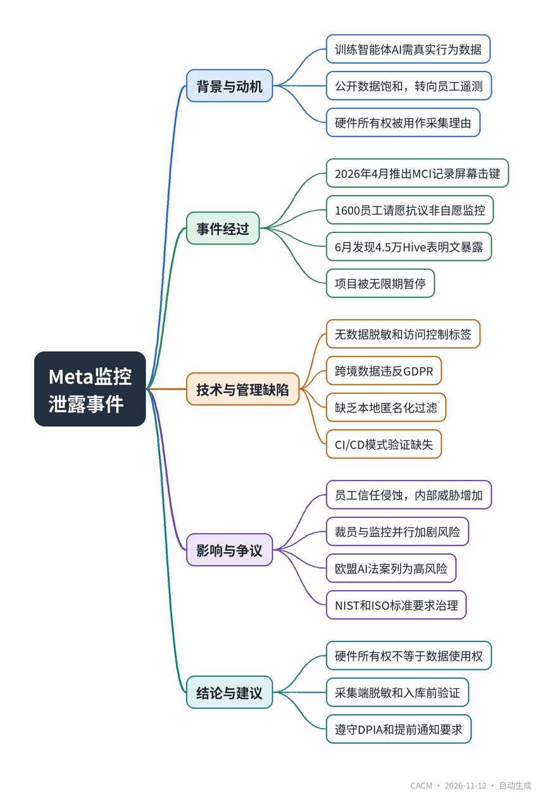

# Meta’s Laptop Surveillance Leak Damages Internal Trust

## Meta笔记本监控泄露损害内部信任

**来源**：Communications of the ACM（News）　|　**发布**：2026-11-12 09:57（美东）　|　**北京时间**：2026-11-12 21:57　|　**作者**：David Geer

[原文链接](https://cacm.acm.org/news/metas-laptop-surveillance-leak-damages-internal-trust/)　·　生成于 2026-11-13 15:26

---

## 一、摘要

> 员工抗议Meta收集电脑使用数据，安全事件迫使公司终止该做法。

为训练智能体AI，Meta于2026年4月推出模型能力计划（MCI），在员工笔记本电脑上记录屏幕内容、鼠标移动和击键，引发1600多名员工联名抗议。6月，内部监控发现未加密的MCI遥测数据流被直接写入全公司4.5万个Apache Hive数据库表，且无基于角色的访问控制，导致绩效评估、AI提示和聊天记录等以明文暴露。事件迫使高管无限期暂停项目，并引发GDPR合规担忧。文章指出，硬件所有权不等于绕过数据分类政策的权力，企业需在数据采集和入库环节实施脱敏、访问控制标签和自动化验证，同时监控员工会侵蚀组织信任，尤其在裁员时期。欧盟AI法案将职场监控AI列为高风险，GDPR和NIST、ISO标准要求严格治理。

## 二、核心要点

1. Meta的MCI软件在2026年4月记录美国员工笔记本的屏幕、鼠标和击键，5月超1600名员工签署请愿书抗议非自愿监控。
2. 6月内部监控发现未加密的MCI遥测流被写入4.5万个Apache Hive表，无角色访问控制，明文暴露绩效评估、AI提示和聊天记录。
3. Meta声称数据仅用于模型训练，但软件无技术边界，记录个人消息、密码字段和非工作应用，且跨境数据涉及欧盟员工引发GDPR担忧。
4. 专家指出，硬件所有权不自动授予绕过零信任数据分类政策的权力，需在采集端实施本地脱敏和入库前自动化模式验证。
5. 监控与裁员并行会侵蚀员工信任，增加内部威胁风险；欧盟AI法案将职场监控AI列为高风险，要求提前通知和影响评估。

## 三、关键词对照

| English | 中文 |
| --- | --- |
| agentic AI | 智能体AI |
| Model Capability Initiative (MCI) | 模型能力计划 |
| telemetry | 遥测数据 |
| Apache Hive | Apache Hive数据仓库 |
| role-based access control | 基于角色的访问控制 |
| GDPR | 通用数据保护条例 |
| Data Protection Impact Assessment (DPIA) | 数据保护影响评估 |
| NIST AI Risk Management Framework | NIST AI风险管理框架 |
| ISO/IEC 42001 | ISO/IEC 42001人工智能管理体系标准 |
| zero-trust | 零信任 |

## 四、中英对照全文

One approach to training agentic AI is eroding workplace privacy and trust: developers are deploying desktop tracking tools that record live screen content, mouse movements, and keystrokes. While designed to learn user workflows, the logging captures passwords, login tokens, and private messages. Installing these tools without clear policies or employee consent adds to workplace friction and creates data security risks.

> 训练智能体AI的一种方法正在侵蚀工作场所的隐私与信任：开发者正在部署桌面跟踪工具，记录实时屏幕内容、鼠标移动和击键。虽然设计初衷是学习用户工作流程，但日志记录会捕获密码、登录令牌和私人消息。在缺乏明确政策或员工同意的情况下安装这些工具，会加剧工作场所摩擦并带来数据安全风险。

Meta employees discovered the company was logging their corporate laptops to train internal AI models, according to media reports. Launched in April 2026 under Meta’s Model Capability Initiative (MCI), the software recorded desktop activity of laptops across the U.S. A month later, growing internal backlash led more than 1,600 employees to sign a petition protesting the non-consensual surveillance. In a minor concession in June, Meta executives offered employees the ability to pause tracking for up to thirty minutes at a time. However, later that month, internal monitors uncovered a security incident in which unencrypted MCI telemetry streams were written directly into 45,000 internal Apache Hive database tables company-wide, without role-based access controls. The exposed records were accessible in plain text by employees with database query access. The records included performance reviews, raw AI prompts, and employee chat logs. The exposure forced executives to halt the project indefinitely.

> 据媒体报道，Meta员工发现公司正在记录其企业笔记本电脑的活动，以训练内部AI模型。该软件于2026年4月根据Meta的模型能力计划（MCI）启动，记录了全美范围内笔记本电脑的桌面活动。一个月后，日益增长的内部反对声浪导致超过1600名员工签署请愿书，抗议这种未经同意的监控。在6月的一次小幅让步中，Meta高管允许员工每次最多暂停跟踪30分钟。然而，同月晚些时候，内部监控发现了一起安全事件：未加密的MCI遥测数据流被直接写入全公司45000个内部Apache Hive数据库表，且没有基于角色的访问控制。拥有数据库查询权限的员工可以以明文形式访问这些暴露的记录。记录内容包括绩效评估、原始AI提示词和员工聊天日志。此次暴露迫使高管无限期暂停该项目。

Meta confirmed that the 45,000 Hive tables served as the central storage warehouse for raw plain-text behavior logs. Meta’s proprietary MCI agent captured OS-level framebuffer snapshots and keystrokes on macOS and Windows devices, streaming the data through internal telemetry aggregators directly into Apache Hive storage formats like ORC and Parquet. While Meta intended for these dataset feeds to train autonomous workflow agents, engineers failed to implement data sanitization, token redaction, or access-control tagging before ingestion. Cross-border communications on monitored U.S. laptops pulled international staff and European Union residents into unencrypted domestic datasets, triggering significant GDPR compliance concerns.

> Meta确认，这45000个Hive表是原始明文行为日志的中央存储仓库。Meta专有的MCI代理在macOS和Windows设备上捕获操作系统级帧缓冲快照和击键，并通过内部遥测聚合器将数据直接流式传输到Apache Hive存储格式（如ORC和Parquet）。虽然Meta意图将这些数据集馈送用于训练自主工作流代理，但工程师在数据摄取前未能实施数据清洗、令牌脱敏或访问控制标记。受监控的美国笔记本电脑上的跨境通信将国际员工和欧盟居民的数据拉入了未加密的国内数据集，引发了重大的GDPR合规担忧。

Following the leak disclosure, Meta issued a statement: “We have carefully designed this program with privacy safeguards and while we have no indication at this time that any data was improperly accessed by Meta employees, we’re pausing it while we investigate.”

> 在泄露事件披露后，Meta发表声明称：“我们精心设计了该计划并设有隐私保护措施，虽然目前没有迹象表明任何数据被Meta员工不当访问，但我们正在调查期间暂停该计划。”

While Meta maintained it had contained exposure internally and that deactivating the background agent across all corporate laptops would take several days, the statement failed to address why they omitted basic data classification standards from the ingestion pipeline in the first place.

> 尽管Meta坚称已在内部控制住暴露，且在所有企业笔记本电脑上停用后台代理需要数天时间，但该声明未能解释为何他们从一开始就在数据摄取管道中省略了基本的数据分类标准。

No Employee Consent, No Clear Data Usage Limits

> 无员工同意，无明确数据使用限制

In leaked internal memos and in information shared with the news media, Meta leadership claimed MCI telemetry would strictly serve model training and never feed performance evaluations. Yet the software operated without technical boundaries, logging personal messaging, password fields, non-work applications, and sensitive financial activity.

> 在泄露的内部备忘录和与新闻媒体分享的信息中，Meta领导层声称MCI遥测数据将严格用于模型训练，绝不会用于绩效评估。然而，该软件在没有技术边界的情况下运行，记录了个人消息、密码字段、非工作应用程序和敏感财务活动。

David Redekop, chief executive officer at ADAMnetworks, a cybersecurity company, said there’s a premium on real-world training data because organizations have already trained and retrained AI iteratively on historical, conventionally available datasets.

> 网络安全公司ADAMnetworks的首席执行官David Redekop表示，真实世界训练数据非常珍贵，因为各组织已经在历史性的、常规可用的数据集上迭代训练和再训练了AI。

As frontier AI labs reach saturation on public Web scrapes and synthetic data, high-density human behavioral telemetry, capturing how experts navigate complex desktop environments, has become a new frontier for agentic AI training data.

> 随着前沿AI实验室在公开网络抓取和合成数据上达到饱和，高密度的人类行为遥测数据——捕捉专家如何导航复杂桌面环境——已成为智能体AI训练数据的新前沿。

Redekop called AI model development a kind of arms race and said that any company with internal, fresh data would be tempted to use it. In addition, corporate devices are company-owned, which would technically suffice as a reason to access without employee consent.

> Redekop称AI模型开发是一种军备竞赛，并表示任何拥有内部新鲜数据的公司都会忍不住使用它。此外，企业设备为公司所有，这在技术上足以成为未经员工同意即可访问的理由。

For systems architects, this highlights a critical gap in corporate governance: hardware ownership does not automatically grant the authority to bypass zero-trust data classification policies or to collect application-layer secrets without audit logging.

> 对于系统架构师而言，这凸显了企业治理中的一个关键缺口：硬件所有权并不自动授予绕过零信任数据分类政策或未经审计日志收集应用层机密的权力。

Raw Keystrokes, Private Messages Sit On Accessible Hive Tables

> 原始击键和私人消息存于可访问的Hive表

Available information suggests the collection of raw keystrokes and private messages was not a technical error. Rather, it appears to have been an intentional capability of the Model Capability Initiative (MCI), which had the purpose of capturing desktop activities, including application usage, prompts, messages, and potentially keystrokes, for AI model development, said Gail-Joon Ahn, a Fellow of both IEEE and ACM and a professor in the School of Computing and Augmented Intelligence at Arizona State University.

> IEEE和ACM会士、亚利桑那州立大学计算与增强智能学院教授Gail-Joon Ahn表示，现有信息表明，收集原始击键和私人消息并非技术错误。相反，这似乎是模型能力计划（MCI）的一项有意功能，其目的是捕获桌面活动，包括应用程序使用、提示词、消息以及可能的击键，用于AI模型开发。

In system design, when organizations engineer endpoint agents with full OS-level hook capabilities such as framebuffer snapshots and keylogging, the security posture depends entirely on downstream pipeline controls rather than endpoint collection limits. Said Ahn, “The technical issue appears to be the subsequent exposure of that collected data due to a system misconfiguration. Without access to Meta’s internal incident report, audit logs, or compliance documentation, it is impossible to identify the exact root cause.”

> 在系统设计中，当组织设计具有完整操作系统级钩子能力（如帧缓冲快照和键盘记录）的端点代理时，安全态势完全取决于下游管道控制，而非端点收集限制。Ahn说：“技术问题似乎是系统配置错误导致收集的数据随后暴露。在没有Meta内部事件报告、审计日志或合规文档的情况下，无法确定确切根本原因。”

For software engineers, this underscores the necessity of automated CI/CD schema validation and mandatory role-based access control tagging before central data lakes like Apache Hive ingest raw endpoint streams.

> 对于软件工程师而言，这强调了在Apache Hive等中央数据湖摄取原始端点流之前，必须进行自动化CI/CD模式验证和强制性的基于角色的访问控制标记。

Privacy Reviews Approve Content Capture From Non-U.S. Employees

> 隐私审查批准从非美国员工处捕获内容

According to Redekop, organizations frequently attempt to exploit jurisdictional boundaries by restricting the installation of tracking software to U.S.-based hardware. But it creates a compliance blind spot in which foreign employees communicate from monitored U.S. laptops, and cross-border data streams take GDPR-protected communications into domestic data lakes that lack strict privacy controls.

> 据Redekop称，组织经常试图利用司法管辖区边界，将跟踪软件的安装限制在美国硬件上。但这造成了一个合规盲点：外国员工通过受监控的美国笔记本电脑通信，跨境数据流将受GDPR保护的通信带入缺乏严格隐私控制的国内数据湖。

From a regulatory standpoint, relying on hardware deployment geography fails under international privacy law. European data protection authorities such as the European Data Protection Board and privacy advocacy groups like None Of Your Business emphasize that processing non-U.S. personal data in plain-text domestic data lakes, such as the interactions of U.S. workers with EU staff, violates the GDPR.

> 从监管角度看，依赖硬件部署地理位置在国际隐私法下是行不通的。欧洲数据保护机构（如欧洲数据保护委员会）和隐私倡导团体（如None Of Your Business）强调，在国内明文数据湖中处理非美国个人数据（例如美国员工与欧盟员工的互动）违反了GDPR。

Local Data Anonymization Not Applied To Laptops

> 本地数据匿名化未应用于笔记本电脑

“Mitigating AI training data risk requires strict validation across the data pipeline,” said Brian Walsh, incident response manager at Varonis and FBI cybercrime expert emeritus. Walsh noted that organizations must evaluate whether endpoint tools support client-side masking, anonymization, or filtering scripts before transmitting screen captures to central servers. “If local sanitization isn’t technically supported at collection, organizations are forced to execute rigorous post-collection review and masking. Without strict validation at either stage, collecting sensitive and irrelevant data becomes an inevitability.”

> Varonis事件响应经理、FBI网络安全犯罪荣誉专家Brian Walsh表示：“降低AI训练数据风险需要在数据管道中进行严格验证。”Walsh指出，组织必须评估端点工具在将屏幕截图传输到中央服务器之前是否支持客户端掩码、匿名化或过滤脚本。“如果在收集时技术上不支持本地清洗，组织就不得不执行严格的收集后审查和掩码。如果在任一阶段缺乏严格验证，收集敏感和不相关数据就不可避免。”

From an engineering standpoint, applying local regex filters or client-side redaction hooks before network egress is computationally lightweight and remains the primary defense against turning central data lakes into liability surfaces.

> 从工程角度看，在网络出口之前应用本地正则表达式过滤器或客户端脱敏钩子计算量轻，并且仍然是防止中央数据湖成为责任面的主要防御手段。

Monitoring Employees Affects Workplace Trust

> 监控员工影响工作场所信任

“Deploying covert surveillance tools during a wave of corporate layoffs burns through organizational trust at the exact moment it is most fragile,” said Eric R. Burgess, CEO of Credtent, a licensing platform that connects AI companies and content creators. Burgess said profitable tech firms that conduct workforce reductions while installing endpoint tracking software can create insider threats. Companies that treat employees as disposable optimization targets can incentivize frustrated workers to expose internal missteps and leak corporate data, he said.

> 连接AI公司和内容创作者的许可平台Credtent的首席执行官Eric R. Burgess表示：“在企业裁员浪潮中部署隐蔽监控工具，会在组织信任最脆弱的时刻将其消耗殆尽。”Burgess说，盈利的科技公司在进行裁员的同时安装端点跟踪软件，可能会制造内部威胁。他表示，将员工视为可抛弃的优化目标的公司，可能会激励沮丧的员工揭露内部失误并泄露企业数据。

Meta reportedly conducted sweeping workforce reductions in 2026 while simultaneously rolling out and operating its MCI laptop-tracking software.

> 据报道，Meta在2026年进行了大规模裁员，同时推出并运行其MCI笔记本电脑跟踪软件。

The situation highlights the human dimension of insider risk when organizations pair workplace surveillance with workforce reductions: technical security controls can be undermined by eroded employee trust.

> 这种情况凸显了当组织将工作场所监控与裁员相结合时，内部风险的人性维度：技术安全控制可能因员工信任受损而被削弱。

Standards To Protect Employee Data Rights

> 保护员工数据权利的标准

Building and training in-house AI models on employee behavioral telemetry intersects directly with binding legal regulations and international governance standards. In Europe, the EU Artificial Intelligence Act (Regulation 2024/1689) explicitly classifies AI systems deployed for workplace monitoring and employment decision-making as “high-risk,” imposing strict advance-notice requirements on employers. This operates alongside GDPR Article 35, which mandates a formal Data Protection Impact Assessment (DPIA) and strict purpose limitation before an enterprise can repurpose raw employee computer activity into machine learning training pipelines.

> 基于员工行为遥测构建和训练内部AI模型，直接涉及具有约束力的法律法规和国际治理标准。在欧洲，欧盟《人工智能法案》（法规2024/1689）明确将用于工作场所监控和就业决策的AI系统归类为“高风险”，对雇主施加严格的事先通知要求。这与GDPR第35条并行运作，该条要求在企业将原始员工计算机活动重新用于机器学习训练管道之前，必须进行正式的数据保护影响评估（DPIA）并严格遵守目的限制。

In the U.S. and globally, voluntary technical frameworks set the benchmark for enterprise compliance. The NIST AI Risk Management Framework (AI RMF 1.0) provides systems architects with actionable guidelines for mapping, measuring, and managing human rights risks during data ingestion. Globally, the ISO/IEC 42001 Standard establishes the baseline for Artificial Intelligence Management Systems, requiring formalized governance for data provenance, transparency, and data-subject rights whenever harvesting internal corporate datasets.

> 在美国和全球范围内，自愿性技术框架为企业合规设定了基准。NIST AI风险管理框架（AI RMF 1.0）为系统架构师提供了可操作的指南，用于在数据摄取期间映射、测量和管理人权风险。在全球范围内，ISO/IEC 42001标准为人工智能管理系统建立了基线，要求在收集企业内部数据集时对数据来源、透明度和数据主体权利进行正式治理。

David Geer is a journalist who focuses on issues related to cybersecurity. He writes from Cleveland, OH, USA.

> David Geer是一名专注于网络安全相关问题的记者。他来自美国俄亥俄州克利夫兰。

---
*英文原文版权归 Communications of the ACM 及作者所有；中文译文由 AI 辅助生成，仅供学习参考。*