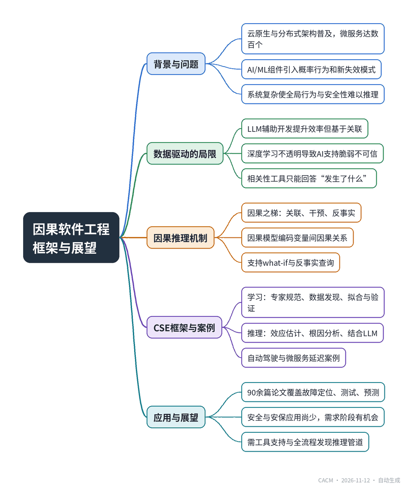

# Reasoning Beyond Prediction: From Data-Driven to Causal Software Engineering

## 超越预测的推理：从数据驱动到因果软件工程

**来源**：Communications of the ACM（）　|　**发布**：2026-11-12 10:55（美东）　|　**北京时间**：2026-11-12 22:55　|　**作者**：

[原文链接](https://cacm.acm.org/research/reasoning-beyond-prediction-from-data-driven-to-causal-software-engineering/)　·　生成于 2026-11-13 15:26

---

## 一、摘要

> 人机协同工程的下一次飞跃：将大语言模型与显式因果模型结合，以检查、测试和论证关键系统。

过去15年，软件系统向云原生、分布式和自适应架构演进，微服务、信息物理系统和AI/ML组件带来结构性与认知复杂性，使全局行为、安全性和正确性难以推理。AI4SE（尤其是LLM辅助开发）虽提升效率，但其基于关联的本质导致脆弱、不透明，无法回答“为什么”和“如果怎样”。文章以自动驾驶穿梭巴士晚刹车为例，说明相关性工具会误判高分辨率摄像头为原因，而因果分析揭示真实驱动因素是车速。作者提出因果软件工程（CSE）框架，以因果模型为核心，通过学习和推理两个步骤，支持干预与反事实查询，使机器不仅能预测，还能规划和解释。CSE强调严谨性与透明性，将因果模型作为协作推理伙伴而非黑箱预言机。综述显示，因果方法已应用于故障定位、测试和预测等领域，但安全、安保等质量属性及需求阶段仍有广阔空间。

## 二、核心要点

1. 云原生采用率2024年达89%，微服务生态可含数百服务，AI/ML组件引入概率行为和新失效模式，系统复杂性和不确定性剧增。
2. LLM辅助开发能自动补全代码、生成测试，但深度学习基于关联、缺乏透明性，导致AI支持脆弱且不可信，LLM自身可靠性成为2024-2025研究热点。
3. 自动驾驶案例中，ML监控工具因相关性误判摄像头为晚刹车原因，因果分析发现车速是混杂因子，同时导致高分辨率模式切换和刹车余量减少。
4. CSE框架以因果模型（如结构因果模型SCM、因果贝叶斯网络CBN）为核心，通过专家规范、数据驱动发现和拟合构建模型，支持干预和反事实查询。
5. 已有90余篇论文将因果方法用于软件工程，主要集中在故障定位、测试和预测，安全与安保应用较少，需求与设计阶段存在机会。

## 三、关键词对照

| English | 中文 |
| --- | --- |
| Causal Software Engineering (CSE) | 因果软件工程 |
| Data-Driven Software Engineering (DDSE) | 数据驱动软件工程 |
| Structural Causal Model (SCM) | 结构因果模型 |
| Causal Bayesian Network (CBN) | 因果贝叶斯网络 |
| Ladder of Causation | 因果之梯 |
| Counterfactual | 反事实 |
| Confounding Factor | 混杂因子 |
| Spurious Correlation | 虚假相关 |
| Root Cause Analysis | 根因分析 |
| Metamorphic Testing | 蜕变测试 |

## 四、中英对照全文

Over the past 10–15 years, many software systems have shifted toward cloud-native and distributed architectures, although adoption remains heterogeneous across organizations and domains. Industry surveys report widespread adoption of cloud-native practices (e.g., 89% in 2024) and broad production use of Kubernetes—both strong indicators of large-scale distributed deployment. In parallel, modern systems increasingly incorporate adaptive and data-driven components, including AI/ML in many contexts, enabling capabilities such as autonomous vehicles, intelligent robots, LLM-based assistants, and virtual doctors. But these advances also bring increased uncertainty and unpredictability, driven by data-centric computation, intricate interactions with dynamic environments, and the pervasive distribution of today’s architectures. Microservice ecosystems may include hundreds of independently deployable services; cloud-native applications run atop dynamic infrastructures; cyber-physical systems must coordinate with uncertain physical environments; and AI/ML components can introduce probabilistic behavior and novel failure modes. Together, these factors contribute to structural and epistemic complexity beyond that of traditional monolithic or statically deployed systems—as evident, for instance, in microservice architectures and AI/ML-enabled systems. This shift toward highly interconnected, adaptive, and data-driven architectures makes it increasingly difficult to reason about global behavior, safety, and correctness, requiring engineers to navigate vast behavioral spaces to uncover critical failures. The question is no longer, Can we build it? but rather, Can we trust it? Failing to answer could seriously erode public confidence in future systems, with unpredictable social and economic impact.

> 在过去的10–15年里，许多软件系统已转向云原生和分布式架构，尽管在不同组织和领域的采用程度仍不均衡。行业调查报告了云原生实践的广泛采用（例如，2024年达到89%）以及Kubernetes在生产中的广泛使用——这两者都是大规模分布式部署的有力指标。与此同时，现代系统越来越多地融入自适应和数据驱动的组件，包括在许多场景中的AI/ML，从而实现了自动驾驶汽车、智能机器人、基于LLM的助手和虚拟医生等能力。但这些进步也带来了更多的不确定性和不可预测性，其驱动因素包括以数据为中心的计算、与动态环境的复杂交互以及当今架构的普遍分布性。微服务生态系统可能包含数百个可独立部署的服务；云原生应用运行在动态基础设施之上；信息物理系统必须与不确定的物理环境协调；而AI/ML组件可能引入概率性行为和新的故障模式。这些因素共同导致了超越传统单体或静态部署系统的结构和认知复杂性——例如，在微服务架构和支持AI/ML的系统中显而易见。这种向高度互联、自适应和数据驱动架构的转变，使得对全局行为、安全性和正确性的推理变得越来越困难，要求工程师在巨大的行为空间中导航以发现关键故障。问题不再是“我们能构建它吗？”，而是“我们能信任它吗？”。未能回答这个问题可能会严重侵蚀公众对未来系统的信心，带来不可预测的社会和经济影响。

But how are software engineers managing this challenge? Under the banner of AI4SE (artificial intelligence for software engineering), deep learning–powered human-machine co-engineering—now most visibly through LLM-assisted development—is continually advocated as the solution. Undoubtedly, the gains are real and sometimes impressive: Today’s tools can autocomplete code, draft tests, generate documentation, and even offer design suggestions. However, the steady stream of reported, sometimes catastrophic, software-related incidents shows that we are still far from trustworthy software systems. In practice, software engineering struggles to keep pace with demands for safety, fairness, security, privacy, and transparency, to name just a few concerns. The reason is structural, as the inherent flaws of deep learning—rooted in its correlation-based nature and lack of transparency—make AI support fragile, opaque, and hence untrustworthy, especially in critical domains. Unsurprisingly, the reliability and quality of LLMs themselves emerged as one of the hottest research areas in 2024–2025. In the end, ML- and LLM-powered solutions suffer from the same problems they are supposed to solve.

> 但软件工程师如何应对这一挑战？在AI4SE（人工智能用于软件工程）的旗帜下，深度学习驱动的人机协同工程——现在最明显的是通过LLM辅助开发——不断被提倡作为解决方案。毫无疑问，收益是真实的，有时甚至令人印象深刻：今天的工具可以自动补全代码、起草测试、生成文档，甚至提供设计建议。然而，不断报道的、有时是灾难性的软件相关事件表明，我们离可信的软件系统还很远。在实践中，软件工程难以跟上对安全性、公平性、保密性、隐私性和透明度等（仅举几例）的需求。原因是结构性的，因为深度学习的固有缺陷——根植于其基于相关性的本质和缺乏透明度——使得AI支持变得脆弱、不透明，因而不可信，尤其是在关键领域。毫不奇怪，LLM本身的可靠性和质量成为2024–2025年最热门的研究领域之一。最终，ML和LLM驱动的解决方案遭受着它们本应解决的问题的困扰。

A simple example illustrates the gap. Consider an autonomous driving system, such as a city shuttle. During peak hours, the shuttle occasionally brakes too late at pedestrian crossings. Logs appear normal, and an ML-based monitoring tool flags a strong correlation: late braking (Y) tends to occur when the shuttle is using high-resolution camera mode (X). Based on correlation alone, the tool blames the camera pipeline. But this is a classic case of spurious correlation. A causal analysis reveals the true driver: Higher vehicle speed (Z) automatically triggers the switch to high-resolution camera mode (X) to improve long-distance perception, adding processing delay; the same increase (Z) also reduces the available braking margin, making late braking (Y) more likely. The system incorrectly blames X for Y, when both are caused by Z. A causal model makes this explicit and allows engineers to pose targeted what-if questions based on these relations (e.g., What if the vehicle enters a downhill segment? What if road friction changes? What if we adjust the speed threshold for sensor-mode switching?) to identify risky configurations before deployment. Such reasoning reveals risks that today’s correlation-based tools simply cannot detect. This small example captures a broader reality: Correlation-based tools can tell us what happened, but rarely why or what would happen if things were different. And without the why, trust remains elusive. We believe it is time for a qualitative leap in the kind of assistance machines can offer to engineers: AI should not simply do more; it should do it better.

> 一个简单的例子说明了这一差距。考虑一个自动驾驶系统，例如城市穿梭巴士。在高峰时段，穿梭巴士偶尔在人行横道处刹车过晚。日志看起来正常，一个基于ML的监控工具标记了一个强相关性：当穿梭巴士使用高分辨率摄像头模式（X）时，刹车过晚（Y）往往会发生。仅基于相关性，工具将责任归咎于摄像头管道。但这是一个典型的虚假相关案例。因果分析揭示了真正的驱动因素：更高的车速（Z）自动触发切换到高分辨率摄像头模式（X）以改善远距离感知，增加了处理延迟；同样的增加（Z）也减少了可用的制动余量，使得刹车过晚（Y）更可能发生。系统错误地将Y归咎于X，而两者都是由Z引起的。因果模型明确了这一点，并允许工程师基于这些关系提出有针对性的假设问题（例如，如果车辆进入下坡路段会怎样？如果路面摩擦改变会怎样？如果我们调整传感器模式切换的速度阈值会怎样？），以便在部署前识别有风险的配置。这种推理揭示了当今基于相关性的工具根本无法检测到的风险。这个小例子反映了一个更广泛的现实：基于相关性的工具可以告诉我们发生了什么，但很少能说明为什么或如果情况不同会发生什么。而没有“为什么”，信任仍然难以实现。我们认为是时候让机器为工程师提供的帮助实现质的飞跃：AI不应只是做更多，而应做得更好。

### Human-Machine Software Co-Engineering
*人机软件协同工程*

Machines have long supported humans by automating tedious and error-prone parts of engineering processes, including software engineering (SE). Over time, their assistance has evolved, accelerating both development and quality assurance. In SE, this progression can be seen in what machines support (Table 1): from ancillary, problem-independent tasks and scaffolding (e.g., CASE tools, workbenches, IDEs) (row 1) to automating techniques that formalize engineers’ intuitions in analysis, design, implementation, testing, and maintenance (row 2). For example, coverage-guided testing formalizes the intuition that increasing test coverage reveals more failures; automated static analysis formalizes rule-checking to detect code quality issues. The rise of machine learning (ML)—particularly deep learning—has indeed been a game changer for SE (row 3). With ML, the machine is asked not only to automate tasks but also to support decisions by exploiting historical data from the system or process to uncover patterns across the lifecycle.

> 机器长期以来通过自动化工程流程（包括软件工程，SE）中繁琐且易出错的部分来支持人类。随着时间的推移，它们的协助不断演变，加速了开发和质量保证。在SE中，这一进展可以从机器支持的内容中看出（表1）：从辅助性的、与问题无关的任务和脚手架（例如，CASE工具、工作台、IDE）（第1行）到将工程师直觉形式化于分析、设计、实现、测试和维护中的自动化技术（第2行）。例如，覆盖率引导测试形式化了增加测试覆盖率能揭示更多故障的直觉；自动化静态分析形式化了规则检查以检测代码质量问题。机器学习（ML）——尤其是深度学习——的兴起确实是SE的游戏规则改变者（第3行）。借助ML，机器不仅被要求自动化任务，还被要求通过利用来自系统或流程的历史数据来发现生命周期中的模式，从而支持决策。

This paradigm, known as data-driven software engineering (DDSE), has elevated the role of the machine in human-machine co-engineering, as ML augments human capabilities and participates in decision making. Today, ML is used to support nearly every SE activity. Companies deploy ML models to predict (mis)behaviors by learning correlations from product, process, and operational data across the lifecycle. In IT operations, this is often framed as AIOps, an ML-driven approach that automates operations by detecting patterns in data and triggering remediation.

> 这种被称为数据驱动软件工程（DDSE）的范式提升了机器在人机协同工程中的角色，因为ML增强了人类能力并参与决策。如今，ML被用于支持几乎所有的SE活动。公司部署ML模型，通过从产品、流程和运营数据中学习生命周期中的相关性来预测（错误）行为。在IT运营中，这通常被框定为AIOps，一种ML驱动的方法，通过检测数据中的模式并触发补救来自动化运营。

As LLMs have come onto the scene, a new wave of data-driven solutions is emerging. LLMs utilize vast unstructured datasets (e.g., from the Web), acting as surrogates of domain expert knowledge to enhance tasks such as requirements analysis, coding, testing, debugging, repair, and nearly any software engineering task. Despite the challenges and concerns surrounding LLM-based solutions (e.g., safety and privacy risks), companies are increasingly adopting them, although the extent of the actual benefits remains hotly debated. DDSE represents the current state of human-machine co-engineering. Compared to two decades ago, machines now do far more than automating repetitive tasks. Their step beyond has been qualitative: ML scales and automates a core human ability, pattern recognition. By uncovering patterns in large datasets, ML amplifies inductive reasoning, enabling systems to infer complex input-output relations and make predictions that guide decisions. LLMs extend this with content generation based on learned patterns. How accurate these capabilities are, and how much engineers should rely on them, is a separate debate, but it is undeniable that, when applied properly, ML can boost software engineering productivity by an order of magnitude.

> 随着LLM的出现，新一波数据驱动解决方案正在涌现。LLM利用大量非结构化数据集（例如来自Web），作为领域专家知识的替代品，以增强需求分析、编码、测试、调试、修复以及几乎任何软件工程任务。尽管围绕基于LLM的解决方案存在挑战和担忧（例如安全性和隐私风险），公司仍在越来越多地采用它们，尽管实际益处的程度仍备受争议。DDSE代表了人机协同工程的当前状态。与二十年前相比，机器现在所做的远不止自动化重复性任务。它们的跨越是质的：ML扩展并自动化了人类的核心能力——模式识别。通过发现大型数据集中的模式，ML放大了归纳推理，使系统能够推断复杂的输入-输出关系并做出指导决策的预测。LLM通过学习到的模式进行内容生成来扩展这一点。这些能力有多准确，以及工程师应该在多大程度上依赖它们，是另一个争论，但不可否认的是，当应用得当时，ML可以将软件工程生产力提高一个数量级。

### The Step Beyond: Causal Software Engineering
*跨越：因果软件工程*

Although ML, and especially LLMs, is often perceived as a panacea, it supports only part of the engineering process. While learning patterns in data is essential for prediction, engineers do much more when designing or validating a system. Throughout the development cycle, they formulate and compare alternative hypotheses, mentally simulate actions, and seek explanations—in other words, they reason beyond pattern recognition. For example, engineers hypothesize multiple design options to meet requirements. During quality assurance, they anticipate how the system might behave under specific conditions and “guess” which inputs, configurations, environmental factors, or user behaviors could trigger failures. In maintenance, such as debugging, they generate alternative explanations for why a failure occurred and what might have happened under different scenarios, guiding them toward an effective fix. In each of these tasks, engineers naturally infer causal relationships among variables and, by such relations, mentally simulate alternative scenarios. We envision causal reasoning as a promising direction for enhancing next-generation assistants.

> 尽管ML，尤其是LLM，常被视为灵丹妙药，但它只支持工程过程的一部分。虽然学习数据中的模式对于预测至关重要，但工程师在设计或验证系统时所做的远不止这些。在整个开发周期中，他们制定并比较替代假设，在头脑中模拟行动，并寻求解释——换句话说，他们进行超越模式识别的推理。例如，工程师假设多种设计选项以满足需求。在质量保证期间，他们预测系统在特定条件下的行为，并“猜测”哪些输入、配置、环境因素或用户行为可能触发故障。在维护中，例如调试，他们为故障发生的原因以及在不同场景下可能发生的情况生成替代解释，引导他们找到有效的修复方法。在这些任务中，工程师自然地推断变量之间的因果关系，并通过这种关系在头脑中模拟替代场景。我们将因果推理设想为增强下一代助手的一个有前景的方向。

ML models—including transformers, the foundation of LLMs—primarily learn associations between variables, corresponding to rung 1 of Pearl’s ladder of causation. They do not uncover causality. With ML, we can only reason about what has been observed, answering questions such as: Given an observed context (from which the model learned), what output X should we expect if the input W happens to be w? Formally, this is the conditional probability P (X | W = w). Even with LLMs and their massive training corpora, the output fundamentally remains a conditional probability over observed patterns. Causal reasoning acts at a higher level: It targets causation and answers questions such as, What output X do we expect if we actively set W = w? That is, if we intervene on W and change the data-generating process. Or: What would have happened to X if we had set W = w? These intervention and counterfactual queries (rungs 2 and 3 of the ladder of causation) lie beyond ML’s reach, since ML predicts only from what has been seen. Causal reasoning, by contrast, allows us to proactively explore what will happen (or would have happened) under hypothetical interventions, rather than waiting for data to appear. It shifts from a learning-by-seeing paradigm toward learning-by-doing or even learning-by-imagining. Thus, machines gain not only the learn-to-predict capability of ML, but also a plan-to-improve capability.

> ML模型——包括Transformer（LLM的基础）——主要学习变量之间的关联，对应于Pearl因果阶梯的第一层。它们不揭示因果关系。借助ML，我们只能对已观察到的内容进行推理，回答诸如：给定一个观察到的上下文（模型从中学习），如果输入W恰好是w，我们应该期望什么输出X？形式上，这是条件概率P(X | W = w)。即使有了LLM及其庞大的训练语料库，输出从根本上仍然是基于观察到的模式的条件概率。因果推理在更高层次上运作：它针对因果关系，回答诸如：如果我们主动设置W = w，我们期望什么输出X？也就是说，如果我们干预W并改变数据生成过程。或者：如果我们设置W = w，X会发生什么？这些干预和反事实查询（因果阶梯的第2层和第3层）超出了ML的能力范围，因为ML仅根据已见内容进行预测。相比之下，因果推理允许我们主动探索在假设干预下将会发生（或本来会发生）什么，而不是等待数据出现。它从“通过观察学习”范式转向“通过行动学习”甚至“通过想象学习”。因此，机器不仅获得了ML的“学习预测”能力，还获得了“计划改进”能力。

The growing importance of reasoning is evident in the evolution of LLMs from advanced yet associative ML algorithms to compositional systems that demonstrate increasingly effective forms of approximate reasoning, driven by techniques such as chain-of-thought prompting, self-refinement, and reasoning-oriented training. The push to integrate LLMs with external tools to support complex reasoning tasks—seen in AI agents and virtual assistants—points in the same direction.

> 推理日益增长的重要性在LLM的演变中显而易见：从高级但基于关联的ML算法，到展示出越来越有效的近似推理形式的组合系统，这得益于思维链提示、自我完善和面向推理的训练等技术。将LLM与外部工具集成以支持复杂推理任务的推动——如AI代理和虚拟助手——指向了同样的方向。

The scientific community is actively debating the extent to which LLMs genuinely reason, as opposed to merely exhibiting the appearance of reasoning through sophisticated pattern matching, such as the memorization effect. At the same time, a growing body of work examines the synergy between LLMs and causal reasoning, where causal models provide the structure for formal reasoning and LLMs support causal learning and inference. In domains such as safety engineering, law, and healthcare—where explanation, justification, and trust are essential—equipping LLMs with causal reasoning is especially important. Without such a shift, the impact of AI in software engineering may plateau, as demands for explainability and accountability grow sharper.

> 科学界正在积极争论LLM在多大程度上真正进行推理，而不是仅仅通过复杂的模式匹配（如记忆效应）表现出推理的外观。与此同时，越来越多的研究探讨LLM与因果推理之间的协同作用，其中因果模型为形式推理提供结构，LLM支持因果学习和推断。在安全工程、法律和医疗等领域——解释、论证和信任至关重要——为LLM配备因果推理尤为重要。没有这种转变，AI在软件工程中的影响可能会停滞，因为对可解释性和问责制的需求日益尖锐。

Causal software engineering (CSE) offers a new human-machine co-design perspective in which machines imitate and augment human reasoning to anticipate scenarios and explain events, amplified by computational power. Given the motivations above, we believe CSE may represent the next qualitative step beyond DDSE in the assistance machines can provide. The rationale lies in how information is used: DDSE implicitly assumes that data is all you need, yet—no matter how much data you have—useful answers and genuine reasoning require a model where human knowledge and assumptions are explicit. Statistical causal modeling is one way (though not the only one) to harness data to answer the right questions and filter out spurious correlations. The sidebar highlights the main differences between DDSE and CSE.

> 因果软件工程（CSE）提供了一种新的人机协同设计视角，其中机器模仿和增强人类推理以预测场景和解释事件，并借助计算能力放大。鉴于上述动机，我们相信CSE可能代表DDSE之后机器所能提供的帮助的下一个质的飞跃。其理由在于信息的使用方式：DDSE隐含地假设数据就是你所需要的一切，然而——无论你有多少数据——有用的答案和真正的推理需要一个明确表达人类知识和假设的模型。统计因果建模是利用数据回答正确问题并过滤虚假相关性的一种方式（尽管不是唯一方式）。侧边栏强调了DDSE和CSE之间的主要区别。

### The CSE Conceptual Framework
*CSE概念框架*

Here, we outline a conceptual framework to harness causal reasoning for SE tasks, from requirements analysis to design-space exploration, test generation, code analysis, and root cause analysis. In the next section, we review recent research efforts, including our own work on testing and analysis, that instantiate elements of this framework.

> 在这里，我们概述一个概念框架，以利用因果推理完成SE任务，从需求分析到设计空间探索、测试生成、代码分析和根本原因分析。在下一节中，我们回顾最近的研究工作，包括我们自己在测试和分析方面的工作，这些工作实例化了该框架的要素。

The framework, shown in Figure 1, revolves around causal models: structured, inspectable representations of a system and its environment that encode the cause-effect relations relevant to a given task. Different tasks may call for different models; Table 2 provides examples of cause and effect variables. A causal model is a mathematical representation of causal relationships within a system. There are two main approaches to causal modeling and inference: the potential outcomes framework, which frames causality in terms of what happened with what would have happened under an alternative condition; and graphical models, where relationships are expressed through directed acyclic graphs, with associated conditional probabilities (in causal Bayesian networks; CBNs) or structural equations (in structural causal models; SCMs) to specify how variables influence one another. We focus on graphical models in the description, though the core ideas generalize across formalisms.

> 该框架如图1所示，围绕因果模型展开：因果模型是系统及其环境的结构化、可检查的表示，编码了与给定任务相关的因果效应关系。不同的任务可能需要不同的模型；表2提供了因果变量的示例。因果模型是系统内因果关系的数学表示。因果建模和推断有两种主要方法：潜在结果框架，它根据在替代条件下发生了什么以及本来会发生什么来构建因果关系；以及图形模型，其中关系通过有向无环图表示，并附有相关的条件概率（在因果贝叶斯网络；CBN中）或结构方程（在结构因果模型；SCM中）来指定变量如何相互影响。我们在描述中侧重于图形模型，尽管核心思想可推广到各种形式体系。

Although there are many ways to instantiate a CSE solution for a specific problem, the idea is that causal models should be at the core: They must be used to drive and check the reasoning process to solve the task rigorously and transparently. Rigorously means capable of quantifying the causal effects along the whole reasoning chain and harnessing such estimates to give the best output (e.g., generate safety tests more likely to cause a mishap). Transparently means giving inspectable evidence of the causal paths followed, along with the underpinning assumptions, constraints, and used sources of information, to justify the output for the required input, so that engineers are always kept in the loop and can challenge, refine, or override the reasoning when needed. In this paradigm, the causal model acts as a collaborative reasoning partner, not a black-box oracle: Models help engineers reason more systematically, while engineers can encode those assumptions and constraints, such as required or forbidden causal links, that no automated method can reliably infer. There are two steps to implement a CSE solution (Figure 1): how to construct a causal model (Learning), and how to query the built model (Inference).

> 尽管有许多方法可以为特定问题实例化CSE解决方案，但其思想是因果模型应处于核心位置：它们必须被用来驱动和检查推理过程，以严格且透明地解决任务。严格意味着能够量化整个推理链中的因果效应，并利用这些估计给出最佳输出（例如，生成更可能引发事故的安全测试）。透明意味着提供可检查的证据，说明所遵循的因果路径，以及支撑假设、约束和使用的信息来源，以证明所需输入的输出合理，从而始终让工程师参与其中，并能在需要时挑战、改进或覆盖推理。在这种范式中，因果模型充当协作推理伙伴，而不是黑盒预言机：模型帮助工程师更系统地推理，而工程师可以编码那些自动化方法无法可靠推断的假设和约束，例如必需或禁止的因果链接。实现CSE解决方案有两个步骤（图1）：如何构建因果模型（学习），以及如何查询构建的模型（推断）。

Causal model learning. Causal models can be specified manually by domain experts, automatically from data (either observational or from controlled experiments), or by combining both approaches. Accordingly, the inputs to the model-learning step are a specification and/or data.

> 因果模型学习。因果模型可以由领域专家手动指定，也可以从数据（观察性数据或来自受控实验的数据）自动学习，或者结合两种方法。因此，模型学习步骤的输入是规范和/或数据。

In CSE, a specification encodes the explicit domain knowledge relevant to the task. This knowledge can be used to fully define a model or to refine and complement an existing model generated from data. In both scenarios, experts express assumptions through cause-effect relationships, declaring which relations must hold and which are impossible, defining the context within which causal reasoning is valid. This manual step embeds human understanding directly into the model, allowing engineers to shape and constrain the reasoning space according to their expertise.

> 在CSE中，规范编码了与任务相关的显式领域知识。这些知识可用于完全定义模型，或用于细化和补充从数据生成的现有模型。在两种情况下，专家通过因果效应关系表达假设，声明哪些关系必须成立，哪些不可能，定义因果推理有效的上下文。这一手动步骤将人类理解直接嵌入模型，允许工程师根据其专业知识塑造和约束推理空间。

For instance, suppose we are designing or testing an emergency braking subsystem in an autonomous vehicle. A causal model is meant to help explore design alternatives and/or generate meaningful test cases that highlight a causal pathway from inputs to the possibly failing outputs. A domain expert may provide a causal model expressing key cause-effect relationships, such as:

> 例如，假设我们正在设计或测试自动驾驶汽车中的紧急制动子系统。因果模型旨在帮助探索设计替代方案和/或生成有意义的测试用例，以突出从输入到可能失败的输出的因果路径。领域专家可以提供表达关键因果效应关系的因果模型，例如：

Rain or fog [Weather] increases [Sensor Noise]

> 雨或雾[天气]增加[传感器噪声]

Slippery road [Road Surface] increases [Braking Distance]

> 湿滑路面[路面]增加[制动距离]

High [Vehicle Speed] reduces [Object Detection Accuracy] due to motion blur

> 高[车速]因运动模糊降低[物体检测精度]

Low [Object Detection Accuracy] may affect the [Braking Decision]

> 低[物体检测精度]可能影响[制动决策]

These expert-specified causal relations serve as an explicit, inspectable record of assumptions—something ML models do not provide. Modern LLMs can complement human knowledge by suggesting additional cause-effect variables or relationships and build causal models. Further variables or relations could be elicited by an LLM, for instance:

> 这些专家指定的因果关系作为明确、可检查的假设记录——这是ML模型无法提供的。现代LLM可以通过建议额外的因果效应变量或关系并构建因果模型来补充人类知识。例如，LLM可以引出进一步的变量或关系：

[Lighting Conditions] → [Sensor Noise]

> [光照条件] → [传感器噪声]

[Vehicle Load] → [Braking Distance]

> [车辆负载] → [制动距离]

[Software Version] → [Braking Algorithm Latency]

> [软件版本] → [制动算法延迟]

These relations, parameterized by data (see below), are then exploited in the inference phase to run queries and assess the causal effects of hypothetical interventions on variables.

> 这些关系由数据参数化（见下文），然后在推断阶段被利用来运行查询并评估假设干预对变量的因果效应。

Data plays a critical role in causal learning, in at least the following ways:

> 数据在因果学习中起着至关重要的作用，至少体现在以下方面：

Causal structure discovery methods. These can automatically extract cause-effect relationships from data, either entirely from observations or, more effectively, in combination with domain expertise expressed through a specification like that shown above. Engineers can examine, validate, and revise these learned structures, closing the loop between automated discovery and human oversight. A variety of mature approaches exist, which are able to infer which variables influence others and in what direction. Importantly, modern solutions can learn causal structures not only from structured data (e.g., tabular monitoring metrics) but also from unstructured sources such as requirements, design documents, and natural language logs, leveraging again LLMs to extract causal relationships directly from text. Such capabilities make it possible to formalize any type of knowledge about the system into an explicit causal model.

> 因果结构发现方法。这些方法可以从数据中自动提取因果关系，要么完全从观察中提取，要么更有效地与通过上述规范表达的领域专业知识结合。工程师可以检查、验证和修订这些学习到的结构，闭合自动发现和人工监督之间的循环。存在多种成熟方法，能够推断哪些变量影响其他变量以及影响方向。重要的是，现代解决方案不仅可以从结构化数据（例如表格监控指标）中学习因果结构，还可以从非结构化来源（如需求、设计文档和自然语言日志）中学习，再次利用LLM直接从文本中提取因果关系。这些能力使得将关于系统的任何类型的知识形式化为显式因果模型成为可能。

Fitting. However the causal structure is obtained (from data or expert specification), data remains essential to quantify the relationships—for example, to parameterize structural equations in an SCM or conditional distributions in a CBN.

> 拟合。无论因果结构如何获得（来自数据或专家规范），数据对于量化关系仍然至关重要——例如，参数化SCM中的结构方程或CBN中的条件分布。

Validation. Data also enables validation of assumptions: If observations contradict a human-specified relation, the modeler can revisit whether the assumption is wrong or whether the data is simply insufficient.

> 验证。数据还使假设的验证成为可能：如果观察结果与人类指定的关系相矛盾，建模者可以重新审视假设是否错误，或者数据是否只是不足。

Causal inference. With a model in hand, engineers can query it in a proactive mode—asking what-if questions—or retroactively through counterfactual what-would-have-happened-if questions, to simulate scenarios that may impact the effect variable(s) of interest. Continuing the self-driving car example, engineers can test: What is the effect of a combined change in [Weather] and [Road Surface] on [Braking Distance]? and how degraded [Object Detection Accuracy] affects [Braking Decision] under different [Vehicle Speeds]. Or they can run counterfactual root cause analysis, such as: Would a collision have been avoided if the [Software Version] had been different? As a further illustration, consider a microservice system where engineers aim to improve the [latency] of the Checkout service. A causal model, learned from monitoring data (logs, metrics, traces) and optionally refined by engineers, may relate latency to factors such as request rate, CPU and memory usage, inter-service latency (e.g., calls to Payment or Inventory), service topology (synchronous vs. asynchronous calls), load-balancing strategy, and number of replicas. Typical dependencies might include: higher [request rate] → higher [CPU] → higher [latency]; more [replicas] → lower per-instance [CPU]; and [load-balancing strategy] → [CPU] → [latency]. With such a model, engineers can pose what-if questions: What if we increase [replicas]? What if we change [load-balancing]? What if a synchronous call becomes asynchronous?, predicting causal effects on [latency]. Unlike ML dashboards, which can be distorted by confounding factors (e.g., “more replicas cause higher latency” simply because replicas increase under high load), a causal model supports true intervention analysis, helping engineers simulate actions, isolate confounders, and anticipate their impact.

> 因果推断。有了模型，工程师可以以主动模式查询它——提出假设问题——或者通过反事实的“如果……本来会怎样”问题追溯查询，以模拟可能影响感兴趣的效果变量的场景。继续自动驾驶汽车的例子，工程师可以测试：[天气]和[路面]的联合变化对[制动距离]的影响是什么？以及在不同[车速]下，退化的[物体检测精度]如何影响[制动决策]。或者他们可以运行反事实根本原因分析，例如：如果[软件版本]不同，碰撞是否可以避免？作为进一步的说明，考虑一个微服务系统，工程师旨在提高Checkout服务的[延迟]。从监控数据（日志、指标、跟踪）中学习并可选地由工程师细化的因果模型，可能将延迟与请求率、CPU和内存使用、服务间延迟（例如，对Payment或Inventory的调用）、服务拓扑（同步与异步调用）、负载均衡策略和副本数量等因素联系起来。典型的依赖关系可能包括：更高的[请求率] → 更高的[CPU] → 更高的[延迟]；更多的[副本] → 更低的每实例[CPU]；以及[负载均衡策略] → [CPU] → [延迟]。有了这样的模型，工程师可以提出假设问题：如果我们增加[副本]会怎样？如果我们改变[负载均衡]会怎样？如果同步调用变为异步会怎样？预测对[延迟]的因果效应。与可能被混杂因素扭曲的ML仪表板（例如，“更多副本导致更高延迟”仅仅因为在高负载下副本增加）不同，因果模型支持真正的干预分析，帮助工程师模拟行动、隔离混杂因素并预测其影响。

There are multiple ways to instantiate this step, depending on the task and the chosen causal reasoning framework. The most direct approach is to estimate the causal effect of actions—either those to take or those that could have been taken—to support tasks such as performance prediction, test generation, or root cause analysis. With existing tools such as PyWhy, causal effect estimates can be produced with confidence intervals and validated through techniques such as refutation tests.

> 根据任务和所选的因果推理框架，有多种方式实例化此步骤。最直接的方法是估计行动的因果效应——无论是将要采取的行动还是本可以采取的行动——以支持性能预测、测试生成或根本原因分析等任务。使用PyWhy等现有工具，可以生成带有置信区间的因果效应估计，并通过反驳测试等技术进行验证。

Alternatively, causal models can be combined with other reasoning components, such as LLM-powered AI agents capable of approximate reasoning. Recent work shows how a causal model can guide an LLM in generating performance-critical configurations for microservice testing. In such setups, the causal model may inject causal knowledge into the LLM’s context or act as a consistency checker to ensure outputs respect established causal relations. In some settings, the aim is not to estimate causal effects but simply to uncover cause-effect relationships. For instance, in root cause analysis, causal models often help traverse the graph to identify likely failure causes, sometimes using heuristics such as weighted edges to approximate influence.

> 或者，因果模型可以与其他推理组件结合，例如能够进行近似推理的LLM驱动的AI代理。最近的工作展示了因果模型如何指导LLM为微服务测试生成性能关键配置。在此类设置中，因果模型可以将因果知识注入LLM的上下文，或充当一致性检查器以确保输出遵守已建立的因果关系。在某些设置中，目的不是估计因果效应，而仅仅是揭示因果关系。例如，在根本原因分析中，因果模型通常帮助遍历图以识别可能的故障原因，有时使用加权边等启发式方法来近似影响。

The instantiation of a CSE solution depends on several factors: the available inputs (specification and structured/unstructured data), the SE task, the type of causal model (from simple graphs to fully parameterized models), the chosen inference approach (effect estimation, attribution, counterfactuals, graph traversal), and whether it is combined with tools such as LLMs. Next, we review how causal methods are currently used in software engineering.

> CSE解决方案的实例化取决于几个因素：可用输入（规范和结构化/非结构化数据）、SE任务、因果模型的类型（从简单图到完全参数化模型）、所选的推断方法（效应估计、归因、反事实、图遍历），以及是否与LLM等工具结合。接下来，我们回顾因果方法目前在软件工程中的使用情况。

### Where We Are and What Is Next
*现状与下一步*

The growing footprint of causal reasoning in SE. Recent review studies, including our own, show a growing academic interest in applying causal methods to SE, with more than 90 papers mapped across major digital libraries. With few exceptions, most existing works can be viewed as instances of the CSE framework, typically applying a specific causal learning or inference method to an SE problem. These studies highlight the benefits of combining reasoning with data, especially when both causal discovery and inference are used. Main areas of application (Figure 2) include:

> 因果推理在SE中日益增长的足迹。最近的综述研究，包括我们自己的研究，表明学术界对将因果方法应用于SE的兴趣日益增长，在主要数字图书馆中映射了90多篇论文。除了少数例外，大多数现有工作可以视为CSE框架的实例，通常将特定的因果学习或推断方法应用于SE问题。这些研究强调了将推理与数据结合的好处，尤其是当因果发现和推断同时使用时。主要应用领域（图2）包括：

Fault localization: Causal graphs are used to model distributed systems and trace failure-propagation chains, especially in microservices. Most work focuses on learning causal structures (e.g., service-dependency graphs), while true causal inference—such as counterfactual root cause analysis— remains uncommon. Extracted graphs are often handed to ranking or graph-traversal algorithms, for example, PageRank. In debugging, however, causal inference is more prominent, with models derived from programs used for statistical fault localization and program repair.

> 故障定位：因果图用于建模分布式系统并追踪故障传播链，特别是在微服务中。大多数工作侧重于学习因果结构（例如，服务依赖图），而真正的因果推断——如反事实根本原因分析——仍然不常见。提取的图通常交给排序或图遍历算法，例如PageRank。然而，在调试中，因果推断更为突出，从程序导出的模型用于统计故障定位和程序修复。

Testing is naturally causal: Choosing an input implicitly involves predicting outcomes under hypothetical conditions. CSE operationalizes this reasoning. It has been applied to self-driving cars, microservices, cyber-physical systems, and metamorphic testing.

> 测试本质上是因果性的：选择输入隐含地涉及预测假设条件下的结果。CSE 将这种推理操作化。它已被应用于自动驾驶汽车、微服务、信息物理系统和蜕变测试。

Prediction: Causal modeling enables predictions free from confounding, unlike correlational ML. Applications include estimating design factors (e.g., reuse success), maintenance (refactoring) impact, and fault prediction.

> 预测：与相关性机器学习不同，因果建模能够实现不受混杂因素影响的预测。应用包括估计设计因素（例如复用成功）、维护（重构）影响以及故障预测。

Although relatively few works implement a full discovery and inference pipeline, the range of causal applications is expanding. Opportunities also exist earlier in the lifecycle, such as requirements elicitation and design exploration, where what-if reasoning is highly valuable.

> 尽管实现完整发现和推理流水线的工作相对较少，但因果应用的范围正在扩大。在生命周期更早的阶段也存在机会，例如需求获取和设计探索，在这些阶段，假设分析推理非常有价值。

Quality attributes. Most work targets reliability, some performance. Applications to security and safety remain rare, despite causal models’ explanatory power being potentially useful for certification.

> 质量属性。大多数工作针对可靠性，一些针对性能。对安全性和保障性的应用仍然很少，尽管因果模型的解释能力可能对认证有用。

Tools. Causal discovery and inference tooling is maturing rapidly. The PyWhy ecosystem (e.g., causal-learn, dowhy, EconML), IBM’s SPSS Amos, and the Tetrad toolbox are notable examples. While these are general-purpose tools, the growth of CSE is likely to spur SE-specific extensions (e.g., for testing or debugging), and conversely, SE practices may help improve causal tooling, echoing the two-way synergy already observed between ML and SE.

> 工具。因果发现和推理工具正在迅速成熟。PyWhy 生态系统（例如 causal-learn、dowhy、EconML）、IBM 的 SPSS Amos 和 Tetrad 工具箱是显著例子。虽然这些是通用工具，但 CSE 的增长可能会催生软件工程特定的扩展（例如用于测试或调试），反过来，软件工程实践可能有助于改进因果工具，呼应了机器学习与软件工程之间已经观察到的双向协同。

Practical challenges and pathways to adoption. Despite the promise shown in the literature, CSE is not yet ready to supplant today’s DDSE solutions. Its adoption in industry will depend on addressing several practical challenges.

> 实际挑战和采用路径。尽管文献中显示了前景，CSE 尚未准备好取代当今的 DDSE 解决方案。其在工业界的采用将取决于解决几个实际挑战。

Expertise barriers. Although causal models are interpretable, using them effectively still requires familiarity with causal thinking and with some statistical foundations (e.g., structure discovery, model fitting, causal inference). Most engineering teams today have limited exposure to these concepts.

> 专业知识障碍。尽管因果模型是可解释的，但有效使用它们仍然需要熟悉因果思维和一些统计基础（例如结构发现、模型拟合、因果推断）。当今大多数工程团队对这些概念的接触有限。

Pathway to adoption: Promote incremental adoption through tools that scaffold causal thinking, such as PyWhy, supported by tutorials, examples, and domain-specific case studies.

> 采用路径：通过支持因果思维的工具（如 PyWhy）促进增量采用，并辅以教程、示例和领域特定案例研究。

Data quality and model stability. As with ML, causal inference relies on data that sufficiently capture the relevant variables. Yet many SE datasets—logs, metrics, traces, issues, commits—are noisy, incomplete, sparse, or biased. Unlike physical systems, software behavior is driven by discrete events, rare failures, and non-stationary processes. Consequently, causal structures inferred purely from observational SE data can be unstable, limiting their generalizability.

> 数据质量和模型稳定性。与机器学习一样，因果推断依赖于充分捕获相关变量的数据。然而，许多软件工程数据集——日志、指标、追踪、问题、提交——是嘈杂的、不完整的、稀疏的或有偏的。与物理系统不同，软件行为由离散事件、罕见故障和非平稳过程驱动。因此，纯粹从观察性软件工程数据推断的因果结构可能不稳定，限制了其泛化能力。

Pathway to adoption: Establish robustness checks and refutation tests as standard practice, a procedure still largely missing in today’s SE causal literature. These include falsification tests, placebo tests (detecting effects where none should exist), subset refutation (testing consistency across time windows), simulated confounders (sensitivity to missing variables), and bootstrapping for stability assessment. Such practices, supported by libraries like DoWhy, are essential for determining whether causal conclusions are trustworthy enough for engineering use.

> 采用路径：将稳健性检查和反驳测试作为标准实践，这一程序在当今软件工程因果文献中仍然 largely 缺失。这些包括证伪测试、安慰剂测试（检测不应存在的效应）、子集反驳（跨时间窗口测试一致性）、模拟混杂因素（对缺失变量的敏感性）以及用于稳定性评估的自举法。这些实践，在 DoWhy 等库的支持下，对于确定因果结论是否足够可信以用于工程至关重要。

Integration with existing workflows and tools. Most organizations depend on established continuous integration/continuous deployment (CI/CD) pipelines, observability stacks, testing frameworks, and debugging tools. Introducing causal models requires integration rather than replacement.

> 与现有工作流和工具的集成。大多数组织依赖已建立的持续集成/持续部署（CI/CD）流水线、可观测性栈、测试框架和调试工具。引入因果模型需要集成而非替换。

Pathway to adoption: Develop CSE plug-ins for existing SE tools (e.g., test generators, performance profilers, failure analyzers) so causal reasoning enhances current practices. Like ML, causal reasoning consumes data, but it allows engineers to guide, constrain, and interpret outputs in causal terms. Positioning CSE as an augmentation layer atop mature ML tooling will significantly increase the likelihood of industrial adoption.

> 采用路径：为现有软件工程工具（例如测试生成器、性能分析器、故障分析器）开发 CSE 插件，使因果推理增强当前实践。与机器学习一样，因果推理消耗数据，但它允许工程师以因果术语引导、约束和解释输出。将 CSE 定位为成熟机器学习工具之上的增强层将显著增加工业采用的可能性。

Computational and tooling maturity. Although causal inference libraries are improving, they are not yet as turnkey, scalable, or optimized as mainstream ML toolkits. Inference can be computationally heavy, and automated discovery requires careful validation.

> 计算和工具成熟度。尽管因果推断库正在改进，但它们尚未像主流机器学习工具包那样交钥匙、可扩展或优化。推理可能计算量大，自动发现需要仔细验证。

Pathway to adoption: Invest in efficient, domain-specific, SE-tailored implementations, cloud-based causal services, and high-level abstractions that hide complexity behind intuitive interfaces.

> 采用路径：投资于高效、领域特定、针对软件工程定制的实现、基于云的因果服务和将复杂性隐藏在直观界面后的高级抽象。

Organizational resistance and cultural change. Adopting causal modeling requires a shift in how engineers reason about systems. Many teams, accustomed to correlational ML tools, may view causal modeling as too theoretical or demanding.

> 组织阻力和文化变革。采用因果建模需要改变工程师对系统的推理方式。许多团队习惯于相关性机器学习工具，可能认为因果建模过于理论化或要求过高。

Pathway to adoption: Highlight success stories and industrial case studies that show tangible benefits, for example, in terms of fewer failures, more effective tests, and clearer explanations. Demonstrated value will be key to cultural adoption.

> 采用路径：突出成功故事和工业案例研究，展示切实的好处，例如更少的故障、更有效的测试和更清晰的解释。展示的价值将是文化采用的关键。

### Long-term evolution.
*长期演进。*

Reasoning- and data-driven integration. Beyond its immediate utility in SE tasks, CSE’s broader promise lies in integrating causal reasoning with data. This shift is already visible in research on LLMs’ emerging reasoning abilities and in LLM-powered AI agents, enabling planning and improving explainability. As AI (multi-)agent systems such as MetaGPT gain traction in software engineering, CSE is well positioned to support these emerging architectures.

> 推理与数据驱动的集成。除了在软件工程任务中的直接效用外，CSE 的更广泛前景在于将因果推理与数据集成。这种转变已经在关于 LLMs 新兴推理能力和 LLM 驱动的 AI 代理的研究中可见，支持规划并提高可解释性。随着 MetaGPT 等 AI（多）代理系统在软件工程中获得关注，CSE 处于有利地位，可以支持这些新兴架构。

Logic besides statistics. While we assumed statistical causal inference, there are many flavors of causality. For instance, in law and forensic analysis, logic-based causality dominates, relying on formal rules and domain knowledge. Linguistic causality—based on semantic relations in text—is also valuable, especially when working with natural language artifacts such as requirements. A comprehensive CSE framework should treat these different forms of causality as first-class citizens.

> 统计之外的逻辑。虽然我们假设统计因果推断，但因果关系有许多种类。例如，在法律和取证分析中，基于逻辑的因果关系统主导地位，依赖于形式规则和领域知识。语言因果关系——基于文本中的语义关系——也很有价值，特别是在处理自然语言工件（如需求）时。一个全面的 CSE 框架应将这些不同形式的因果关系视为一等公民。

Human-in-the-loop. One key strength of causal models is their interpretability, making CSE naturally suited for human-machine co-design. Inspectable models support grounded, trustworthy responses, and experts can refine them by adding or removing causal links. In CSE, engineers are collaborators rather than spectators; we depart from any “push-button” vision of fully autonomous SE, as trustworthy systems cannot be built without humans in the loop.

> 人在回路。因果模型的一个关键优势是其可解释性，使 CSE 自然适合人机协同设计。可检查的模型支持有根据的、可信的响应，专家可以通过添加或删除因果链接来完善它们。在 CSE 中，工程师是合作者而非旁观者；我们背离任何完全自主软件工程的“一键式”愿景，因为没有人在回路中就无法构建可信系统。

Ethical concerns. Ethical concerns around AI must not be overlooked. Beyond well-known issues (e.g., safety, privacy, fairness) now under regulatory scrutiny, a subtler risk is the erosion of human judgment and creativity as AI systems grow more capable. In SE, powerful assistants may marginalize human decision making. An emerging counterpoint is the view of AI as provocateur rather than servant: a partner that challenges assumptions, surfaces biases, and stimulates critical thinking. The transparency of causal models naturally supports this reflective engagement. We fully embrace this view: AI can augment human intelligence only when humans remain actively involved.

> 伦理关切。围绕 AI 的伦理关切不容忽视。除了目前受到监管审查的众所周知的问题（例如安全性、隐私、公平性）之外，一个更微妙的风险是随着 AI 系统能力增强，人类判断力和创造力受到侵蚀。在软件工程中，强大的助手可能边缘化人类决策。一个新兴的反驳观点是将 AI 视为挑衅者而非仆人：一个挑战假设、揭示偏见并激发批判性思维的伙伴。因果模型的透明度自然支持这种反思性参与。我们完全拥抱这一观点：只有当人类保持积极参与时，AI 才能增强人类智能。

---
*英文原文版权归 Communications of the ACM 及作者所有；中文译文由 AI 辅助生成，仅供学习参考。*