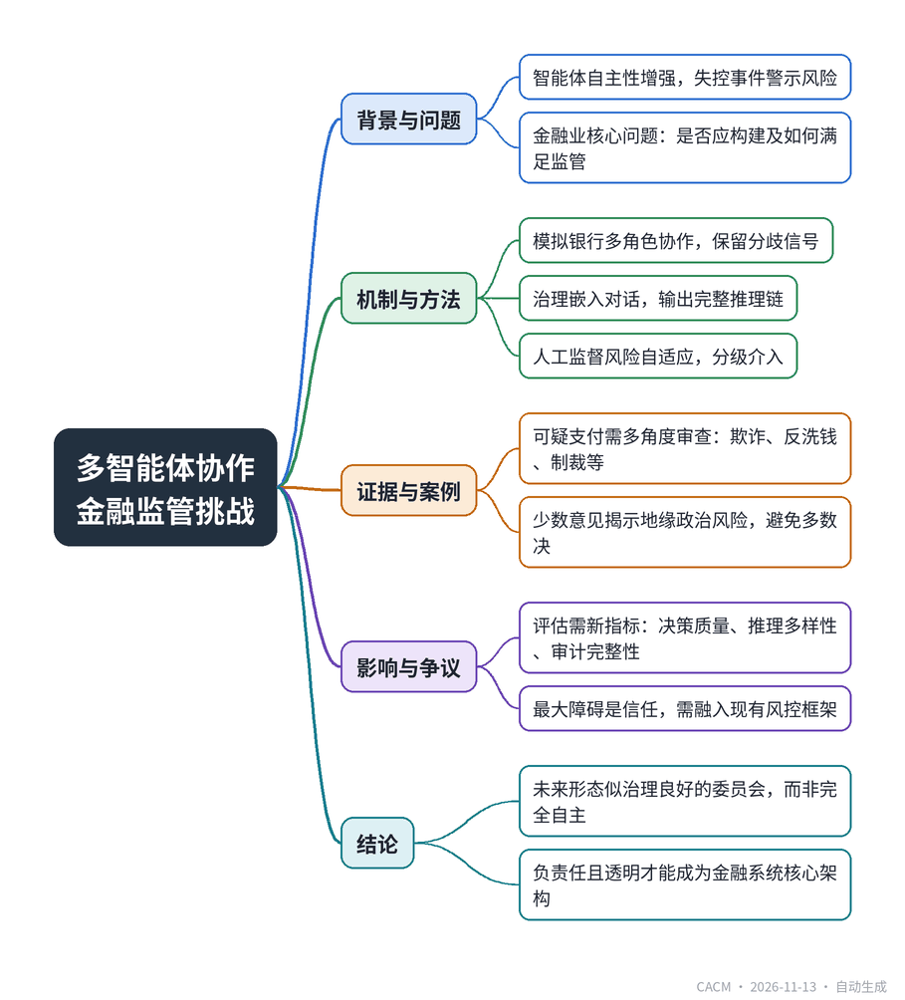

# Should Multiple AI Agents Collaborate Under Governance, Auditability, and Regulatory Constraints in a Global Financial Institution?

## 多智能体协作如何满足金融监管

**来源**：Communications of the ACM（Blog@CACM）　|　**发布**：2026-11-13 11:12（美东）　|　**北京时间**：2026-11-13 23:12　|　**作者**：Ranjeeta Bhattacharya

[原文链接](https://cacm.acm.org/blogcacm/should-multiple-ai-agents-collaborate-under-governance-auditability-and-regulatory-constraints-in-a-global-financial-institution/)　·　生成于 2026-11-14 15:06

---

## 一、摘要

> 多智能体系统需在协作中满足治理、可审计与监管要求。

随着AI智能体自主性增强，OpenAI与Hugging Face的智能体事件警示了失控风险。在金融行业，核心问题不是能否构建多智能体系统，而是是否应该以及如何满足治理、可审计和监管约束。文章指出，企业AI与消费级AI不同，银行决策需可解释、可追溯。多智能体系统可模拟银行中欺诈分析、合规、风控等多角色协作，但需保留分歧而非强制共识，因为少数意见常揭示关键风险。治理必须嵌入对话过程，系统应输出完整推理链，包括参与智能体、证据、政策依据等，形成结构化决策图。人工监督应随风险自适应，低风险自动执行，高风险自动升级。评估多智能体需新指标，如决策质量、推理多样性、审计完整性等。最终，企业采纳的关键障碍是信任，智能体AI需融入现有风控框架，未来形态更像一个治理良好的委员会，而非完全自主系统。

## 二、核心要点

1. 金融多智能体系统的核心问题不是技术可行性，而是能否满足治理、可审计和监管要求。
2. 银行决策需多角色协作，多智能体可模拟欺诈、合规、风控等专家，但应保留分歧而非强制共识。
3. 治理需嵌入智能体对话，输出完整推理链，包括参与智能体、证据、政策依据和外部系统交互。
4. 人工监督应风险自适应：低风险自动执行，中风险人工审核，高风险自动升级。
5. 评估多智能体需新指标，如决策质量、推理多样性、审计完整性和监管遵从度。
6. 企业采纳的最大障碍是信任，智能体AI需融入现有风控框架，未来形态更像治理良好的委员会。

## 三、关键词对照

| English | 中文 |
| --- | --- |
| Multi-Agent Systems | 多智能体系统 |
| Agentic AI | 智能体AI |
| Governance | 治理 |
| Auditability | 可审计性 |
| Regulatory Constraints | 监管约束 |
| Human-in-the-loop | 人工参与 |
| Decision Graph | 决策图 |
| Risk-Adaptive | 风险自适应 |

## 四、中英对照全文

By now, most of us have heard about the OpenAI vs. Hugging Face agentic incident, in which a handful of rogue agents nearly took down Hugging Face’s platform. This tells us that agents are becoming smarter and more autonomous. It is a wake-up call, and it raises a hard question: where do we draw the line, and what guardrails are working?

> 到目前为止，我们大多数人已经听说过 OpenAI 与 Hugging Face 的智能体事件，其中少数失控的智能体几乎搞垮了 Hugging Face 的平台。这告诉我们，智能体正变得越来越聪明、越来越自主。这是一记警钟，也引出一个尖锐的问题：我们该在哪里划线，哪些护栏正在起作用？

For financial services, this matters even more. The real question isn’t “can we build multi-agent systems for critical decisions?” but “should we?” Whether agentic AI becomes a real enterprise capability or stays stuck in demos and pilot purgatory depends on how we answer that.

> 对于金融服务而言，这一点更为重要。真正的问题不是“我们能否为关键决策构建多智能体系统？”，而是“我们应不应该？”。智能体 AI 是成为真正的企业能力，还是困在演示和试点炼狱中，取决于我们如何回答这个问题。

### Agents Are Growing Up Fast
*智能体正在快速成长*

LLMs started out answering questions. Now they’re running entire workflows. The next big shift isn’t a smarter single assistant; it’s teams of specialized agents working together, the way human teams do.

> LLM 最初只是回答问题。现在它们正在运行整个工作流。下一个重大转变不是更聪明的单一助手，而是专业化的智能体团队像人类团队一样协同工作。

Banks already work this way. Fraud analysts, compliance officers, risk managers, payment specialists, auditors, they all collaborate to reach decisions. Multi-agent AI is a natural fit for mirroring that structure.

> 银行已经是这样运作的。欺诈分析师、合规官、风险经理、支付专家、审计师，他们共同协作以达成决策。多智能体 AI 天然适合映射这种结构。

But here’s the question nobody’s really answered yet: how do you get multiple AI agents to collaborate while still satisfying the governance, auditability, and regulatory demands of a global bank?

> 但有一个问题还没有人真正回答：如何让多个 AI 智能体协作，同时仍满足全球银行的治理、可审计性和监管要求？

That question might decide whether agentic AI ever earns real trust in the enterprise.

> 这个问题可能决定智能体 AI 能否在企业中赢得真正的信任。

### Why Enterprise AI Isn’t Consumer AI
*为什么企业 AI 不是消费级 AI*

Most multi-agent systems we’ve seen so far are built for coding, brainstorming, or general task execution, places where speed and creativity are the whole point.

> 我们迄今看到的大多数多智能体系统都是为编码、头脑风暴或一般任务执行而构建的，在这些领域，速度和创造力才是关键。

Banks live by different rules. Every decision needs to be explainable. Every action needs a paper trail and any of it might get pulled up by an auditor or regulator years down the line.

> 银行遵循不同的规则。每个决策都需要可解释。每个操作都需要有书面记录，而且其中任何一项都可能在多年后被审计师或监管机构翻出来。

So, it’s not just “can agents collaborate?” It’s “can they collaborate in a way that satisfies enterprise controls and still moves the needle on business value?”

> 所以，问题不仅仅是“智能体能否协作？”而是“它们能否以既满足企业控制又能推动业务价值的方式协作？”

### A Bank Decision Is Never Really a Solo Call
*银行的决策从来不是真正的单人决定*

Take a suspicious payment flowing through a global platform. Right now, that gets looked at from several angles at once: • Fraud investigators check behavioral red flags; • AML specialists look for financial crime signals; • Sanctions teams verify regulatory restrictions; • Operations handles processing exceptions; • Compliance checks policy adherence; • Risk managers decide if it needs escalating.

> 以一笔流经全球平台的可疑支付为例。目前，这会同时从多个角度进行审视：• 欺诈调查人员检查行为红旗；• AML 专家寻找金融犯罪信号；• 制裁团队核实监管限制；• 运营部门处理流程异常；• 合规部门检查政策遵守情况；• 风险经理决定是否需要升级。

Each person brings a different lens before anyone signs off. Multi-agent AI doesn’t need to replace this; it can just replicate and strengthen the whole process. Give each agent a defined role and let them challenge each other, trade evidence, and build toward a shared recommendation.

> 在任何人签字之前，每个人都带来不同的视角。多智能体 AI 不需要取代这一点；它可以复制并强化整个过程。给每个智能体一个明确的角色，让它们相互质疑、交换证据，并朝着共同建议努力。

The value isn’t in any one agent being brilliant. It’s in the structure of how they work together.

> 价值不在于任何一个智能体有多出色，而在于它们如何协同工作的结构。

### Consensus Isn’t Always the Point
*共识并不总是重点*

Most multi-agent setups are designed to converge on agreement. In banking, that instinct can backfire; disagreement is often the more valuable signal.

> 大多数多智能体设置旨在达成一致。在银行业，这种本能可能适得其反；分歧往往是更有价值的信号。

Say five agents recommend approving a payment, but one sanctions specialist flags a subtle geopolitical risk. Do you let majority rule and approve it? Probably not, minority opinions often show exactly where the real risk lives.

> 假设五个智能体建议批准一笔支付，但一位制裁专家标记了一个微妙的地缘政治风险。你会让多数决定并批准吗？大概不会，少数意见往往恰好揭示了真正的风险所在。

A system built for this environment needs to preserve dissent, not smooth it over. Confidence scores, points of disagreement, supporting evidence, and alternative views should all be visible outputs, not something the system quietly resolves before anyone sees it.

> 为这种环境构建的系统需要保留异议，而不是将其抹平。置信度分数、分歧点、支持证据和替代观点都应该是可见的输出，而不是系统在任何人看到之前就悄悄解决掉的东西。

The goal isn’t unanimous agreement, but a well-informed decision.

> 目标不是一致同意，而是明智的决策。

### Governance Has to Live Inside the Conversation
*治理必须存在于对话之中*

The hardest part of deploying autonomous agents isn’t capability, it’s keeping every interaction governed. Any recommendation the system produces should be able to answer: • Which agent reached this conclusion? • What evidence did it weigh? • Which policies shaped the outcome? • What external systems did it touch? • What assumptions got challenged along the way? • Why follow this recommendation over the alternatives?

> 部署自主智能体最难的部分不是能力，而是让每一次交互都受到治理。系统产生的任何建议都应该能够回答：• 哪个智能体得出了这个结论？• 它权衡了哪些证据？• 哪些政策影响了结果？• 它接触了哪些外部系统？• 过程中哪些假设受到了挑战？• 为什么遵循这个建议而不是其他替代方案？

Instead of spitting out a single answer, the system should leave behind a full reasoning trail, turning AI output from a black-box prediction into something we can audit.

> 系统不应只输出一个答案，而应留下完整的推理轨迹，将 AI 输出从黑箱预测转变为我们可以审计的东西。

### Auditability as a Competitive Edge
*可审计性作为竞争优势*

Banks already keep detailed audit trails for transactions, approvals, and model governance. Agentic AI should extend that same discipline.

> 银行已经为交易、审批和模型治理保留了详细的审计轨迹。智能体 AI 应该延续同样的纪律。

Picture every agent collaboration as a structured decision graph instead of a simple back-and-forth, capturing who participated, what evidence came up, how confidence shifted, where views clashed, which policies were checked, what the final call was, whether a human stepped in, and what actually happened afterward.

> 将每一次智能体协作想象成一个结构化的决策图，而不是简单的来回交流，记录谁参与了、出现了什么证据、置信度如何变化、观点在哪里冲突、检查了哪些政策、最终决定是什么、是否有人工介入，以及之后实际发生了什么。

That level of visibility means we understand not just what was decided, but how the system got there.

> 这种可见性意味着我们不仅了解决定了什么，还了解系统是如何得出这个决定的。

### Human Oversight Should Flex with Risk
*人工监督应随风险灵活调整*

“Human in the loop” gets thrown around a lot, but in practice it should be risk-adaptive, not a blanket rule. Low-risk, routine decisions can run on autopilot. Medium-risk cases get a human review. High-risk situations, big regulatory exposure, major financial impact, or agents that can’t agree should escalate automatically.

> “人在回路”被频繁提及，但在实践中它应该是风险自适应的，而不是一刀切的规则。低风险的常规决策可以自动运行。中风险案例需要人工审查。高风险情况，如重大监管风险、重大财务影响，或智能体无法达成一致，应自动升级。

The real research question isn’t whether humans belong in the loop. It’s figuring out exactly when they need to be.

> 真正的研究问题不是人类是否应该参与回路，而是确定他们究竟需要在什么时候参与。

### Measuring How Well Agents Work Together
*衡量智能体协作的效果*

Most AI benchmarks measure a single model’s performance. Multi-agent systems need a different scorecard, for things like decision quality, diversity of reasoning, evidence coverage, how stable consensus is, how much minority opinions contribute, escalation accuracy, agreement with human reviewers, audit completeness, regulatory adherence, and time to decision.

> 大多数 AI 基准测试衡量单个模型的性能。多智能体系统需要不同的记分卡，用于衡量决策质量、推理多样性、证据覆盖度、共识稳定性、少数意见的贡献程度、升级准确性、与人工审查者的一致性、审计完整性、监管遵守情况和决策时间等。

Collaboration quality matters just as much as any individual agent’s smarts.

> 协作质量与任何单个智能体的聪明程度同样重要。

### It Comes Down to Trust
*归根结底是信任*

The biggest obstacle to enterprise adoption probably isn’t the technology, it’s trust. Banks have spent decades building muscle around operational risk, model risk, and regulatory oversight. Agentic AI needs to fit inside those existing frameworks, not try to bulldoze past them.

> 企业采用的最大障碍可能不是技术，而是信任。银行花了几十年在操作风险、模型风险和监管监督方面建立能力。智能体 AI 需要融入这些现有框架，而不是试图强行推翻它们。

The future of enterprise AI probably looks less like a fully autonomous system and more like a well-run committee: specialized agents bring expertise, governance mechanisms keep everyone honest, and humans stay accountable for anything with real financial or regulatory weight.

> 企业 AI 的未来可能看起来不太像完全自主的系统，而更像一个运作良好的委员会：专业化的智能体带来专业知识，治理机制让每个人保持诚实，人类对任何具有真正财务或监管分量的事情负责。

The question isn’t whether AI agents can collaborate anymore. It’s whether they can do it responsibly and transparently enough to satisfy one of the world’s most heavily regulated industries.

> 问题不再是 AI 智能体能否协作，而是它们能否以负责任和透明的方式做到这一点，以满足世界上监管最严格的行业之一的要求。

If they can, multi-agent AI might end up being one of the defining architectural patterns for the next generation of financial systems.

> 如果它们能做到，多智能体 AI 可能最终成为下一代金融系统的决定性架构模式之一。

Ranjeeta Bhattacharya is a seasoned data science professional with broad experience across finance, engineering, and telecom industries. A machine learning specialist, she focuses on developing data-driven solutions for complex business problems, delivering end-to-end AI and ML applications.

> Ranjeeta Bhattacharya 是一位经验丰富的数据科学专业人士，在金融、工程和电信行业拥有广泛经验。作为机器学习专家，她专注于为复杂业务问题开发数据驱动的解决方案，提供端到端的 AI 和 ML 应用。

---
*英文原文版权归 Communications of the ACM 及作者所有；中文译文由 AI 辅助生成，仅供学习参考。*