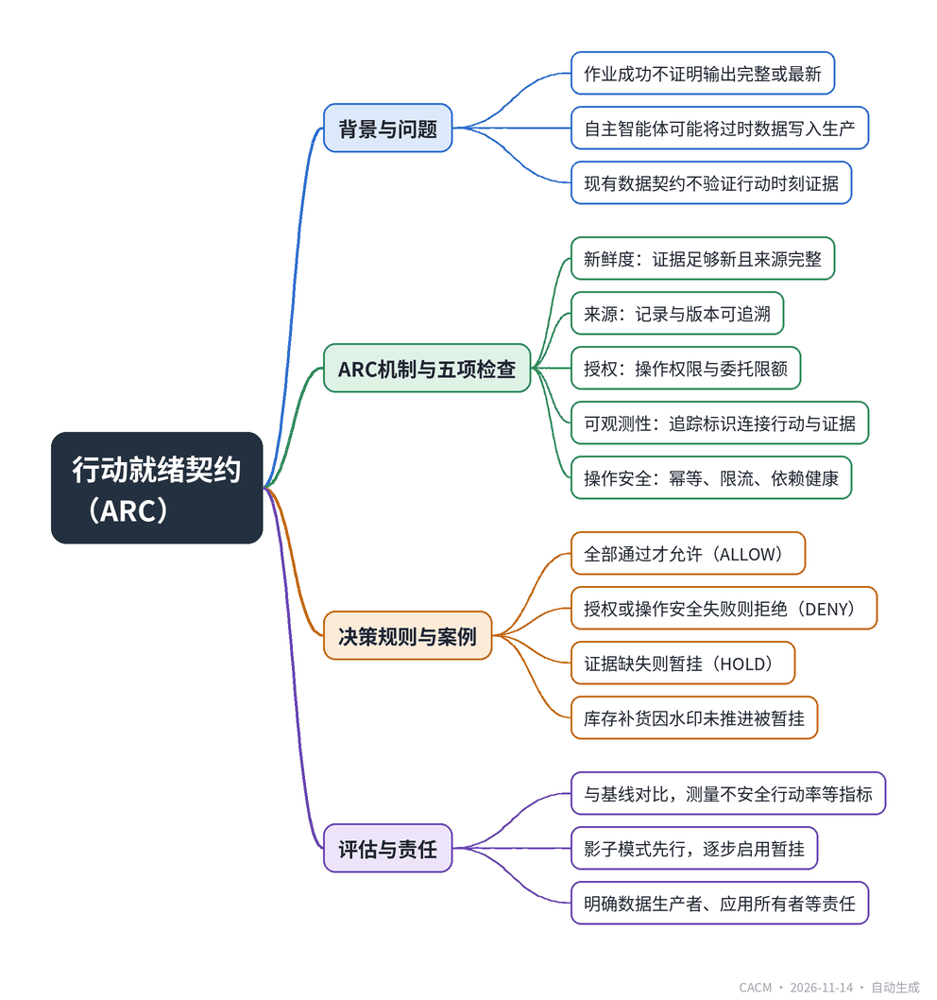

# The Missing Data Contract for Autonomous AI Systems

## 自主AI系统缺失的数据契约

**来源**：Communications of the ACM（Blog@CACM）　|　**发布**：2026-11-13 14:42（美东）　|　**北京时间**：2026-11-14 02:42　|　**作者**：Aditya Ranjan

[原文链接](https://cacm.acm.org/blogcacm/the-missing-data-contract-for-autonomous-ai-systems/)　·　生成于 2026-11-14 15:06

---

## 一、摘要

> 填补智能体提议与后续行动之间的鸿沟。

在企业数据工程中，作业成功并不证明输出完整或最新，但自主智能体可能将过时数据直接写入生产系统。现有数据契约（如Open Data Contract Standard）关注数据结构与语义，却无法判断智能体在提议行动时是否具备充分证据。为此，作者提出行动就绪契约（ARC），在智能体产生外部副作用前，立即评估五项谓词：新鲜度、来源、授权、可观测性和操作安全，每项返回PASS、FAIL或UNKNOWN。ARC作为独立于模型的策略执行点，采用保守决策规则：全部通过才允许，授权或操作安全失败则拒绝，证据缺失则暂挂。文章以库存补货为例说明ARC如何阻止基于不完整水印的采购订单，并建议通过影子模式、故障注入和量化指标（不安全行动率、误挂起率、延迟等）来评估其成本效益。ARC明确了数据生产者、应用所有者、安全和平台团队的责任，旨在为自主系统增加一层可机器评估的证据要求。

## 二、核心要点

1. 现有数据契约（如Open Data Contract Standard）只规定数据结构与语义，无法验证行动时刻的证据充分性。
2. ARC在智能体产生外部副作用前，对新鲜度、来源、授权、可观测性和操作安全五项谓词进行机器评估，每项返回PASS、FAIL或UNKNOWN。
3. 决策规则保守：全部通过才允许（ALLOW），授权或操作安全失败则拒绝（DENY），证据缺失则暂挂（HOLD），暂挂需有超时和升级路径。
4. 库存补货案例中，因仓库水印未推进，ARC将订单暂挂，直到缺失事件到达或人工解决。
5. 评估ARC需与基线（模式验证、API权限、日志）对比，测量不安全行动率、误挂起率、证据完整性和p95延迟，并报告置信区间。
6. ARC需明确责任归属：数据生产者负责时间戳与完整性信号，应用所有者定义新鲜度窗口，安全团队负责策略执行，平台团队运营门控。

## 三、关键词对照

| English | 中文 |
| --- | --- |
| Action-Readiness Contract (ARC) | 行动就绪契约 |
| Open Data Contract Standard | 开放数据契约标准 |
| watermark | 水印 |
| provenance | 来源 |
| W3C PROV-O | W3C PROV-O 本体 |
| W3C Trace Context | W3C 追踪上下文 |
| OpenTelemetry | OpenTelemetry |
| idempotency | 幂等性 |
| shadow mode | 影子模式 |
| NIST AI Risk Management Framework | NIST AI 风险管理框架 |

## 四、中英对照全文

A purchase order can be wrong even when every technical check passes. Imagine a procurement agent that reads an inventory snapshot, sees a low stock level, and places a replenishment order. The payload conforms to its schema. The service account is authorized. The pipeline completed successfully. What the agent cannot see is a delayed warehouse event that would have changed the quantity. The order is valid as a transaction and wrong as a decision.

> 即使所有技术检查都通过，采购订单仍可能出错。设想一个采购代理读取库存快照，发现库存水平低，于是下达补货订单。负载符合其模式。服务账户已获授权。管道成功完成。代理看不到的是一个延迟的仓库事件，该事件本会改变数量。该订单作为交易是有效的，但作为决策是错误的。

I have encountered the underlying distinction repeatedly in enterprise data engineering: a successful job is not proof that its output is complete or current. In reporting systems, people often notice the discrepancy before acting. An autonomous agent may not. It can turn a stale number into a write against a production system in seconds.

> 我在企业数据工程中反复遇到这种根本区别：作业成功并不证明其输出完整或最新。在报告系统中，人们往往在行动前就注意到差异。自主代理可能不会。它可以在几秒钟内将过时的数字转化为对生产系统的写入。

Existing data contracts are useful, but they address a different question. The Open Data Contract Standard, for example, describes data structure, semantics, and service expectations. Those agreements do not, by themselves, establish whether a particular action is justified at the instant an agent proposes it. That is the gap I want to address.

> 现有的数据契约很有用，但它们解决的是另一个问题。例如，开放数据契约标准描述了数据结构、语义和服务期望。这些协议本身并不能确定在代理提出某个特定行动的那一刻，该行动是否合理。这就是我想要解决的差距。

### A Contract for the Moment of Action
*行动时刻的契约*

I propose an Action-Readiness Contract (ARC): a set of action-specific, machine-evaluable evidence requirements checked immediately before an autonomous system causes an external side-effect. ARC is a design proposal, not a deployed standard or a claim of measured performance. It would sit alongside existing identity, authorization, and policy controls—not replace them.

> 我提出一种行动就绪契约（ARC）：一组针对具体行动、机器可评估的证据要求，在自主系统造成外部副作用之前立即检查。ARC 是一个设计提案，不是已部署的标准，也不是对实测性能的声明。它将与现有的身份、授权和策略控制并存——而不是取代它们。

The distinction matters. A model can explain why a purchase seems sensible, but it should not be able to waive a missing lineage record or approve its own spending limit. The gate that evaluates action readiness must operate outside the model, under a versioned policy controlled by the application and security owners. This follows the separation of policy decision and enforcement familiar from zero-trust architecture.

> 这种区别很重要。模型可以解释为什么采购看起来合理，但它不应能够放弃缺失的 lineage 记录或批准自己的支出限额。评估行动就绪性的门必须运行在模型之外，在由应用和安全所有者控制的版本化策略下。这遵循了零信任架构中熟悉的策略决策与执行分离原则。

### Five Checks, Evaluated Together
*五项检查，共同评估*

For each proposed action, ARC evaluates five predicates against a bounded snapshot of evidence. Each check returns PASS, FAIL, or UNKNOWN, together with a reason code. UNKNOWN is not silently treated as PASS.

> 对于每个提议的行动，ARC 针对有界证据快照评估五个谓词。每项检查返回 PASS、FAIL 或 UNKNOWN，并附带原因代码。UNKNOWN 不会被静默视为 PASS。

Freshness. The evidence must be recent enough for the action, and the source must be sufficiently complete. An event timestamp alone is not enough when late-arriving events are common; the system also needs a watermark or equivalent completeness signal. Streaming research explains why event time and processing time differ. A two-minute threshold might be appropriate for a shipment release, while a planning forecast may tolerate hours. Neither is a universal default: the owner must set the threshold according to operational risk.

> 新鲜度。证据必须对行动足够新，并且来源必须足够完整。当延迟到达的事件很常见时，仅事件时间戳是不够的；系统还需要水位线或等效的完整性信号。流处理研究解释了为什么事件时间和处理时间不同。两分钟的阈值可能适用于发货放行，而计划预测可能容忍数小时。两者都不是通用默认值：所有者必须根据操作风险设置阈值。

Provenance. The system must be able to identify which records and versions informed the decision. I would require every mandatory evidence reference to resolve to a stable source or snapshot. W3C PROV-O provides useful concepts for recording entities, activities, and agents. A model confidence score is not a substitute for traceable evidence.

> 来源。系统必须能够识别哪些记录和版本为决策提供了信息。我会要求每个强制证据引用都解析到稳定的来源或快照。W3C PROV-O 提供了记录实体、活动和代理的有用概念。模型置信度分数不能替代可追溯的证据。

Authorization. Permission to call a tool is not permission to perform every action through it. A procurement agent might be allowed to query orders but not commit purchases above a delegated spending limit. The gate checks the principal, operation, resource scope, approval requirements, and current policy as close to execution as practical. This also reduces the risk that a permission revoked after planning remains effective at commit time.

> 授权。调用工具的权限不是通过它执行每个行动的权限。采购代理可能被允许查询订单，但不能提交超过委托支出限额的采购。门在尽可能接近执行的地方检查主体、操作、资源范围、审批要求和当前策略。这也降低了在规划后撤销的权限在提交时仍然有效的风险。

Observability. A trace identifier must connect the proposed action, its evidence, the policy decision, and the eventual outcome. W3C Trace Context and OpenTelemetry describe how execution context can be propagated. They do not guarantee a durable business audit record; the application must create one before the external side effect.

> 可观测性。跟踪标识符必须连接提议的行动、其证据、策略决策和最终结果。W3C Trace Context 和 OpenTelemetry 描述了如何传播执行上下文。它们不保证持久的业务审计记录；应用程序必须在外部副作用之前创建一个。

Operational safety. Even a justified action can fail operationally. Retries can duplicate purchases; downstream systems can time out after accepting a request. ARC therefore checks idempotency, rate and monetary limits, dependency health, and whether compensation or escalation is available. These controls are established distributed-systems practices, applied explicitly at the agent’s action boundary.

> 操作安全。即使是有正当理由的行动也可能在操作上失败。重试可能重复采购；下游系统可能在接受请求后超时。因此，ARC 检查幂等性、速率和货币限制、依赖健康状况以及补偿或升级是否可用。这些控制是既定的分布式系统实践，在代理的行动边界明确应用。

### Where The Gate Belongs
*门应位于何处*

Figure 1 places the evidence checks beneath a conventional runtime policy-enforcement flow. Its upper portion covers tool access, user permission, task and data scope, approval, and risk. Its lower portion adds ARC evidence checks for freshness, provenance, and observability. Authorization and operational safety are represented in the broader enforcement logic. A real implementation would evaluate all five ARC predicates within one decision, using the same request identifier and policy version.

> 图 1 将证据检查置于常规运行时策略执行流程之下。其上半部分涵盖工具访问、用户权限、任务和数据范围、审批和风险。其下半部分增加了针对新鲜度、来源和可观测性的 ARC 证据检查。授权和操作安全在更广泛的执行逻辑中表示。实际实现将在单个决策中评估所有五个 ARC 谓词，使用相同的请求标识符和策略版本。

The decision rule is intentionally conservative. ALLOW requires all five predicates to pass. A failed authorization or operational-safety check results in DENY. Missing evidence, an incomplete freshness signal, or another unresolved check results in HOLD. A hold is not an endless retry loop: it needs an expiry, an escalation route, or a defined fallback. If the evidence changes before commit, the affected checks must run again.

> 决策规则有意保守。ALLOW 要求所有五个谓词通过。授权或操作安全检查失败导致 DENY。证据缺失、新鲜度信号不完整或其他未解决的检查导致 HOLD。保持不是无休止的重试循环：它需要过期时间、升级路径或定义的回退。如果证据在提交前发生变化，受影响的检查必须重新运行。

Consider the inventory example. The schema is valid and the agent has purchasing permission, but the warehouse watermark has not advanced beyond the period required to establish stock availability. ARC would place the order on HOLD until the missing event arrives or a human resolves the uncertainty. This is a hypothetical illustration, not a benchmark result.

> 考虑库存示例。模式有效且代理具有采购权限，但仓库水位线尚未推进到确定库存可用性所需的时期之后。ARC 将订单置于 HOLD，直到缺失事件到达或人工解决不确定性。这是一个假设性说明，不是基准测试结果。

### How to Determine Whether ARC is Worth the Cost
*如何确定 ARC 是否值得成本*

An architecture that blocks every risky action can also block legitimate work. That trade-off needs measurement. The useful comparison is not ARC versus an entirely unprotected agent; it is ARC versus a baseline with schema validation, API permissions, and normal application logging.

> 阻止每个风险行动的架构也可能阻止合法工作。这种权衡需要测量。有用的比较不是 ARC 与完全无保护的代理；而是 ARC 与具有模式验证、API 权限和正常应用日志记录的基线。

I would replay the same proposed actions through both designs, injecting delayed events, broken lineage references, revoked delegation, duplicate requests, and audit-storage failures. The principal measures would be unsafe-action rate, false-hold rate, evidence completeness, p95 gate latency, and the time needed to reconstruct a disputed decision. The test should report confidence intervals, workload characteristics, and operational overhead, not only the number of prevented actions.

> 我会通过两种设计重放相同的提议行动，注入延迟事件、损坏的 lineage 引用、撤销的委托、重复请求和审计存储故障。主要度量将是不安全行动率、错误保持率、证据完整性、p95 门延迟以及重建有争议决策所需的时间。测试应报告置信区间、工作负载特征和操作开销，而不仅仅是阻止的行动数量。

This creates falsifiable hypotheses: ARC should reduce unsafe writes under the same fault conditions; false holds must stay within a service-defined limit; and the added latency must fit the action’s budget. If it does not meet those conditions, the policy or architecture needs revision. That emphasis on measurable risk and operational governance is consistent with the NIST AI Risk Management Framework.

> 这创造了可证伪的假设：ARC 应在相同故障条件下减少不安全写入；错误保持必须保持在服务定义的限制内；增加的延迟必须适合行动的预算。如果它不满足这些条件，策略或架构需要修订。这种对可衡量风险和操作治理的强调与 NIST AI 风险管理框架一致。

### Who Owns the Contract?
*谁拥有契约？*

The data producer owns timestamps, lineage, and completeness signals. The application owner defines the consequences of a wrong action and the acceptable freshness window. Security owns delegation and policy enforcement. The platform team operates the gate and its audit path. Without clear ownership, action readiness becomes another checklist that is easy to bypass.

> 数据生产者拥有时间戳、lineage 和完整性信号。应用程序所有者定义错误行动的后果和可接受的新鲜度窗口。安全部门拥有委托和策略执行。平台团队操作门及其审计路径。没有明确的所有权，行动就绪性会成为另一个容易被绕过的检查清单。

I would introduce ARC in shadow mode first, recording what the gate would have decided without blocking production. The next stage would enable HOLD on a small number of high-consequence operations, with a clear escalation process. Only after teams understand false holds, latency, and audit reliability would I recommend broader enforcement. Shadow-mode observations would be evaluation data—not evidence that ARC has already been adopted or proven effective.

> 我会首先以影子模式引入 ARC，记录门在不阻止生产的情况下会做出的决定。下一阶段将在少量高后果操作上启用 HOLD，并具有清晰的升级流程。只有在团队了解错误保持、延迟和审计可靠性之后，我才会建议更广泛的执行。影子模式观察将是评估数据——不是 ARC 已被采用或证明有效的证据。

To make the proposal testable by others, the next useful artifacts would be a decision-record schema, a reference evaluator, and a reproducible fault corpus. Independent teams should be able to find cases where the checks prevent a bad action and cases where they impose unnecessary friction. Both findings matter.

> 为了使提案可被他人测试，下一个有用的工件将是决策记录模式、参考评估器和可重现的故障语料库。独立团队应该能够找到检查防止不良行动的案例以及它们施加不必要摩擦的案例。两者都很重要。

Data contracts have helped engineering teams agree on what data means and how it should arrive. Autonomous systems need one more agreement: what evidence must be present before software is permitted to act on that data.

> 数据契约帮助工程团队就数据含义及其应如何到达达成一致。自主系统需要再一个协议：在允许软件对该数据采取行动之前，必须存在哪些证据。

Disclosure: Generative AI tools assisted in drafting and language refinement of portions of this post and in generating Figure 1 from the author’s architectural specifications. The author originated the central concept, proposed framework, and technical direction and accepts responsibility for the final manuscript, its claims, and citations.

> 披露：生成式 AI 工具协助起草和语言润色本文的部分内容，并根据作者架构规范生成图 1。作者提出了核心概念、提议框架和技术方向，并对最终手稿、其主张和引用承担责任。

## 附录：参考与脚注（原文）

## References

1. Open Data Contract Standard (ODCS). Bitol; https://bitol.io/

2. Rose, S., Borchert, O., Mitchell, S., and Connelly, S. Zero Trust Architecture. NIST Special Publication 800-207 (2020); https://doi.org/10.6028/NIST.SP.800-207

3. Akidau, T. et al. The Dataflow Model: A Practical Approach to Balancing Correctness, Latency, and Cost in Massive-Scale, Unbounded, Out-of-Order Data Processing. Proceedings of the VLDB Endowment 8, 12 (2015), 1792–1803; https://doi.org/10.14778/2824032.2824076

4. PROV-O: The PROV Ontology. W3C Recommendation (2013); https://www.w3.org/TR/prov-o/

5. Trace Context. W3C Recommendation. W3C; https://www.w3.org/TR/trace-context/

6. OpenTelemetry. Context Propagation; https://opentelemetry.io/docs/concepts/context-propagation/

7. Tabassi, E. Artificial Intelligence Risk Management Framework (AI RMF 1.0). NIST AI 100-1 (2023); https://doi.org/10.6028/NIST.AI.100-1

8. OWASP GenAI Security Project. OWASP Top 10 for LLM Applications: Excessive Agency (LLM06:2025); https://genai.owasp.org/llmrisk/llm062025-excessive-agency/

Aditya Ranjan is a Senior Data Engineer with more than 16 years of experience in enterprise data engineering, distributed systems, and cloud-based data infrastructure. His interests include data reliability, governance, and the engineering foundations of autonomous AI.

---
*英文原文版权归 Communications of the ACM 及作者所有；中文译文由 AI 辅助生成，仅供学习参考。*