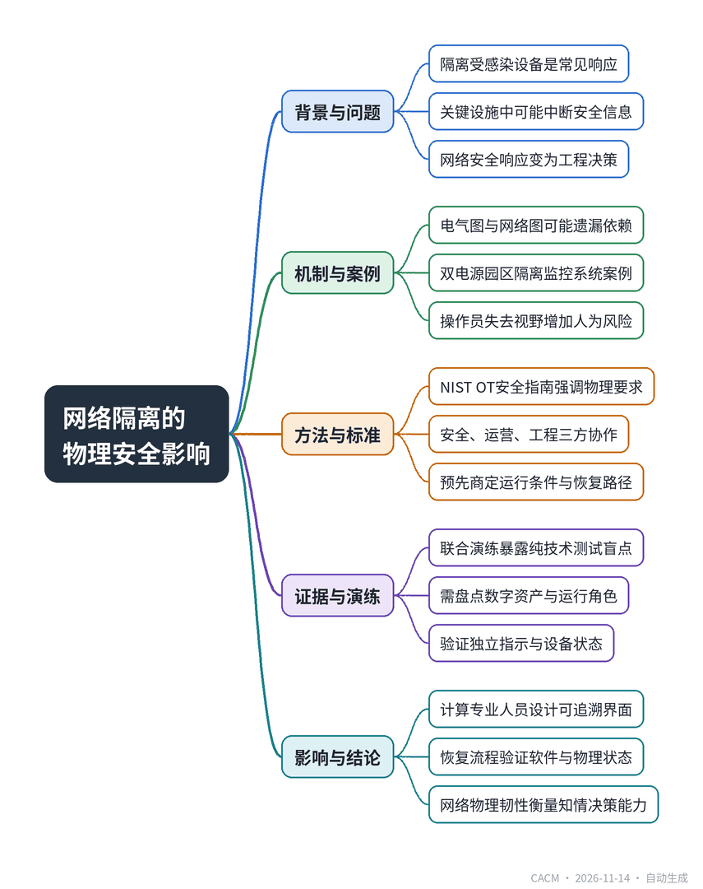

# When Cybersecurity Decisions Become Physical Safety Decisions

## 当网络安全决策成为物理安全决策

**来源**：Communications of the ACM（Blog@CACM）　|　**发布**：2026-11-13 14:48（美东）　|　**北京时间**：2026-11-14 02:48　|　**作者**：Mridul Agrawal

[原文链接](https://cacm.acm.org/blogcacm/when-cybersecurity-decisions-become-physical-safety-decisions/)　·　生成于 2026-11-14 15:06

---

## 一、摘要

> 数字隔离必须考虑其留下的物理状态。

在关键设施中，隔离受感染的IT设备可能中断操作员安全管控物理系统所需的信息，使网络安全响应变成工程决策。作者基于电气系统设计经验，指出需同时审视电气单线图和网络图，并考虑网络不可用时的物理后果。文章以双电源园区为例，说明隔离监控系统虽能阻止可疑流量，却可能让操作员在负载转移时失去可靠视野，增加人为失误风险。NIST的OT安全指南已强调性能、可靠性和安全要求，但实践需要安全、运营和工程三方协作。作者建议围绕预先商定的运行条件设计响应，如受限访问下持续运行、失去监控但本地保护激活、或受控过渡到安全状态，并需现场危害分析、明确决策权限和恢复路径。联合演练可暴露纯网络或纯电气测试遗漏的弱点。计算专业人员应设计能区分实时与历史数据、分离监控与操作权限、使命令可追溯的界面，并确保恢复流程验证软件完整性和物理状态。最终，网络物理韧性应衡量组织在数字能力受损时能否做出安全、知情的决策。

## 二、核心要点

1. 隔离受感染设备可能中断操作员安全管控物理系统所需的信息，使网络安全响应成为工程决策。
2. 电气单线图和网络图可能各自正确，却遗漏关键依赖，需评估网络不可用时的物理行为和操作员认知。
3. NIST的OT安全指南明确涉及物理世界的系统需满足性能、可靠性和安全要求，事件响应应纳入风险管理。
4. 事件响应应基于预先商定的运行条件（如受限运行、失去监控但本地保护激活、受控过渡到安全状态），而非单一隔离指令。
5. 联合演练从入侵检测后开始，可暴露纯网络渗透测试或纯电气调试遗漏的弱点，需准确盘点数字资产及其运行角色。
6. 计算专业人员应设计区分实时与历史数据、分离监控与操作权限、使命令可追溯的界面，并确保恢复流程验证软件完整性和物理状态。

## 三、关键词对照

| English | 中文 |
| --- | --- |
| Operational Technology (OT) | 运营技术 |
| one-line diagram | 单线图 |
| protective relay | 保护继电器 |
| load transfer | 负载转移 |
| incident playbook | 事件响应手册 |
| cyber-physical resilience | 网络物理韧性 |
| interlocking | 联锁 |

## 四、中英对照全文

In a conventional IT incident, isolating a compromised machine from the network is often a sensible first move. Now imagine that machine is part of the control environment for a hospital’s electrical distribution system or an airport terminal’s power infrastructure. Network isolation might stop unauthorized commands. It might also remove information that operators depend on to manage equipment safely. Whether the equipment itself changes state depends on the system architecture. That uncertainty is the point: a cybersecurity response has become an engineering decision.

> 在传统的IT事件中，将受感染的机器从网络中隔离通常是合理的第一步。现在想象一下，这台机器是医院配电系统或机场航站楼电力基础设施控制环境的一部分。网络隔离可能会阻止未经授权的命令，但也可能移除操作员安全管理人员所依赖的信息。设备本身是否改变状态取决于系统架构。这种不确定性正是关键所在：网络安全响应已成为一项工程决策。

In my work designing electrical systems for critical facilities, I have learned to look at two kinds of connections. An electrical one-line diagram shows how power reaches essential loads. A network diagram shows how measurements, commands, and alarms travel between devices. Either drawing may be correct while still leaving out a consequential dependency. The question is not simply whether the network is secure, but what the physical system will do—and what its operators will know—when part of that network becomes unavailable.

> 在我为关键设施设计电气系统的工作中，我学会了关注两种连接。电气单线图显示电力如何到达重要负载。网络图显示测量值、命令和警报如何在设备之间传输。任何一张图可能都是正确的，但仍会遗漏一个重要的依赖关系。问题不仅仅是网络是否安全，而是当部分网络不可用时，物理系统会做什么——以及其操作员会知道什么。

Consider a hypothetical campus with two incoming power sources, local protective relays, and a supervisory system that displays breaker positions and supports remote operating procedures. A security team detects suspicious traffic to the supervisory system and isolates its network connection. That may be exactly the right containment action. The protective relays could continue to perform their local functions, and the power supply might remain uninterrupted. Yet operators may lose reliable visibility into equipment status just as they need to decide whether a load transfer is safe. The new risk is not necessarily that isolation trips a breaker. It is that the next human decision is made with incomplete or stale information.

> 考虑一个假设的园区，有两个进线电源、本地保护继电器和一个监控系统，该监控系统显示断路器位置并支持远程操作程序。安全团队检测到对监控系统的可疑流量，并隔离了其网络连接。这可能是完全正确的遏制措施。保护继电器可以继续执行其本地功能，供电可能保持不间断。然而，操作员可能在需要决定负载转移是否安全时，失去对设备状态的可靠可见性。新的风险不一定是隔离导致断路器跳闸，而是下一个人工决策是在不完整或过时的信息下做出的。

This distinction changes how I think an incident playbook should be written. “Disconnect the affected controller” is a cybersecurity action, not a complete description of a safe operating state. Before an incident, teams should know which functions merely display information, which can issue control commands, which protections operate independently, and how equipment behaves when communications fail. They should also agree on how to verify the actual equipment state after telemetry has been interrupted. An automatic network response that is appropriate for one device may be inappropriate for another that participates in a time-sensitive physical process.

> 这种区别改变了我对事件响应手册编写方式的看法。“断开受影响的控制器”是一种网络安全行动，而不是对安全运行状态的完整描述。在事件发生前，团队应了解哪些功能仅显示信息，哪些可以发出控制命令，哪些保护独立运行，以及通信失败时设备如何行为。他们还应该就如何在遥测中断后验证实际设备状态达成一致。对一台设备合适的自动网络响应，可能不适合另一台参与时间敏感物理过程的设备。

The need to account for physical consequences is not new NIST’s Guide to Operational Technology (OT) Security explicitly addresses the performance, reliability, and safety requirements of systems that interact with the physical world. Its newer incident-response guidance also places response and recovery within a broader risk-management process. What these principles demand in practice is cooperation across a boundary that organizations often maintain for good reasons: security professionals understand the threat and containment options; operating teams understand the process; and engineers understand how the electrical equipment and its safeguards are intended to behave. A sound decision needs all three perspectives.

> 考虑物理后果的需要并不新鲜。NIST的《运营技术（OT）安全指南》明确阐述了与物理世界交互的系统的性能、可靠性和安全要求。其更新的事件响应指南也将响应和恢复置于更广泛的风险管理流程中。这些原则在实践中要求跨越组织通常出于充分理由而保持的边界进行合作：安全专业人员了解威胁和遏制选项；运营团队了解流程；工程师了解电气设备及其保护措施应如何行为。一个合理的决策需要所有三种视角。

I would therefore design incident responses around pre-agreed operating conditions rather than a single instruction to isolate or shut down. Depending on the facility, these might include continued operation with closely monitored, restricted access; loss of supervisory connectivity while verified local protections remain active; or a controlled transition to an engineered safe state. These are not universal recipes. Each condition needs site-specific hazard analysis, assigned decision authority, and a clear route back to normal operation. Sometimes prompt isolation is the safest choice. Sometimes containment must be coordinated with operations to avoid creating a second emergency.

> 因此，我会围绕预先商定的运行条件来设计事件响应，而不是单一的隔离或关闭指令。根据设施的不同，这些条件可能包括：在密切监控和限制访问下继续运行；失去监控连接但经验证的本地保护仍处于活动状态；或有控制地过渡到工程安全状态。这些不是通用配方。每个条件都需要针对具体场地的危害分析、指定的决策权限以及明确的恢复正常运行路径。有时迅速隔离是最安全的选择。有时遏制必须与运营协调，以避免造成第二次紧急情况。

One useful test is a joint exercise that begins after the intrusion has already been detected. Suppose the engineering workstation is unavailable, several status indications are stale, and the facility must perform a scheduled electrical transfer. Who can authorize the next action? Which independent indications can confirm the position of the equipment? Can the planned transfer be postponed without compromising essential service? What evidence is required before the isolated system can be reconnected? Those questions expose weaknesses that a network-only penetration test or an electrical-only commissioning exercise may miss. An accurate inventory of both digital assets and their operating roles is a prerequisite.

> 一个有用的测试是在入侵已被检测到之后开始的联合演练。假设工程工作站不可用，多个状态指示过时，设施必须执行预定的电力转移。谁可以授权下一步行动？哪些独立指示可以确认设备的位置？计划中的转移是否可以推迟而不影响基本服务？在隔离系统重新连接之前需要什么证据？这些问题暴露了仅网络渗透测试或仅电气调试演练可能遗漏的弱点。准确盘点数字资产及其运营角色是一个先决条件。

Computing professionals have an important role in making those decisions less fragile. Interfaces can distinguish live measurements from last-known values. Control systems can separate monitoring privileges from switching authority, make commands traceable, and communicate the consequences of a lost connection. Recovery workflows can require evidence that both software integrity and physical operating conditions have been restored. None of these features substitutes for independent protection, interlocking, trained operators, or sound engineering. They make it less likely that a security team and an operations team will act on different understandings of the same system.

> 计算专业人员在使这些决策不那么脆弱方面发挥着重要作用。接口可以区分实时测量值和最后已知值。控制系统可以将监控权限与开关权限分开，使命令可追溯，并传达失去连接的后果。恢复工作流程可以要求提供软件完整性和物理运行条件均已恢复的证据。这些功能都不能替代独立保护、联锁、训练有素的操作员或健全的工程。它们降低了安全团队和运营团队基于对同一系统的不同理解而采取行动的可能性。

I believe the most useful measure of cyber-physical resilience is not simply whether a system blocks an attacker or stays online. It is whether the organization can still make safe, informed decisions while some of its digital capabilities are impaired. In a critical facility, disconnecting a device changes more than a network diagram. It may change what the people responsible for the physical system can see, verify, and control. That is why cybersecurity response and physical-system safety must be designed together—before either team is making decisions under pressure.

> 我认为，网络物理韧性最有用的衡量标准不仅仅是系统是否阻止攻击者或保持在线，而是组织在部分数字能力受损时是否仍能做出安全、明智的决策。在关键设施中，断开设备改变的不仅仅是网络图。它可能改变负责物理系统的人员可以看到、验证和控制的内容。这就是为什么网络安全响应和物理系统安全必须一起设计——在任何一个团队在压力下做出决策之前。

Mridul Agrawal, PE, is an electrical engineer and technical author specializing in critical infrastructure, aviation, healthcare, and electrical power systems. His work focuses on infrastructure reliability, operational resilience, and the intersection of cybersecurity, operational technology, and physical safety.

> Mridul Agrawal，PE，是一名电气工程师和技术作者，专攻关键基础设施、航空、医疗保健和电力系统。他的工作侧重于基础设施可靠性、运营韧性以及网络安全、运营技术和物理安全的交叉领域。

---
*英文原文版权归 Communications of the ACM 及作者所有；中文译文由 AI 辅助生成，仅供学习参考。*