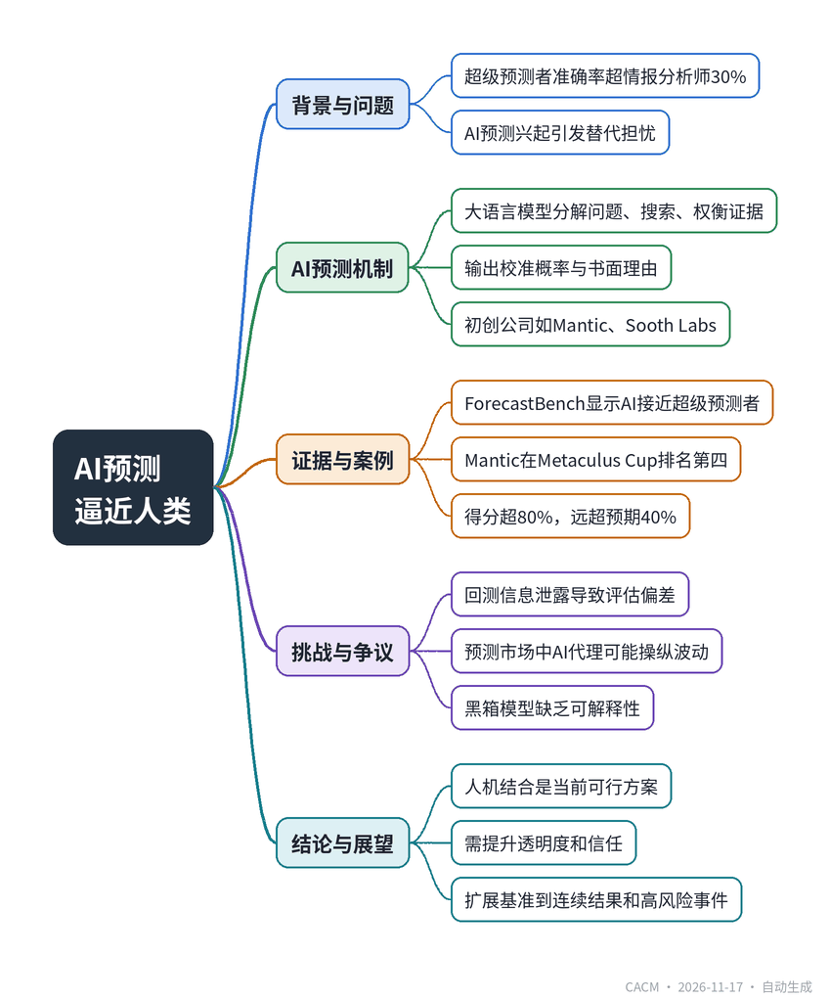

# AI’s Accuracy Nears the Best Human Forecasters

## AI预测准确率逼近顶尖人类预测者

**来源**：Communications of the ACM（News）　|　**发布**：2026-11-16 14:15（美东）　|　**北京时间**：2026-11-17 02:15　|　**作者**：Samuel Greengard

[原文链接](https://cacm.acm.org/news/ais-accuracy-nears-the-best-human-forecasters/)　·　生成于 2026-11-17 16:36

---

## 一、摘要

> AI正凭借海量数据处理能力，在地缘政治、商业和经济预测领域崭露头角。

在高度不确定的世界中，人类超级预测者（前2%的预测者）的准确率比拥有机密信息的专业情报分析师高约30%。如今，AI预测模型正迅速追赶。根据ForecastBench基准测试，AI模型的准确率在过去两年稳步提升，已接近超级预测者水平。多家初创公司（如FutureSearch、Mantic、Sooth Labs）利用前沿语言模型分解问题、搜索信息、权衡证据并输出校准概率。在Metaculus Cup中，Mantic系统在539名人类预测者中排名第四，得分超过80%，远超预期的40%。然而，AI预测仍面临挑战：回测中信息泄露可能导致结果偏差；预测市场中的AI代理可能通过操纵波动获利而非追求准确；黑箱模型缺乏可解释性，难以用于高风险决策。专家建议将人类判断与AI结合，并强调信任和透明度是AI预测投入实际决策的关键。

## 二、核心要点

1. 人类超级预测者（前2%）的准确率比专业情报分析师高约30%，但AI模型正迅速缩小差距。
2. ForecastBench基准显示，AI模型预测准确率过去两年稳步上升，已接近超级预测者水平。
3. Mantic的AI系统在Metaculus Cup中面对539名人类预测者排名第四，得分超80%，远超预期的40%。
4. 回测中信息泄露是主要挑战，模型可能接触截止日期后的信息，导致评估结果虚高。
5. 预测市场中AI代理可能通过制造波动获利，准确性与盈利能力并不等同。
6. 专家建议人机结合，并强调黑箱模型需提升可解释性才能用于高风险决策。

## 三、关键词对照

| English | 中文 |
| --- | --- |
| superforecasters | 超级预测者 |
| ForecastBench | 预测基准 |
| Brier score | 布里尔分数 |
| prediction markets | 预测市场 |
| backtesting | 回测 |
| data leakage | 数据泄露 |
| LLM (Large Language Model) | 大语言模型 |
| calibrated probability | 校准概率 |

## 四、中英对照全文

When business leaders, government officials, and others seek predictability in a highly unpredictable world, they turn to forecasts. Historically, the most accurate prognostications have come from a group of humans called superforecasters, who weigh probabilities and analyze questions before reaching conclusions.

> 当商界领袖、政府官员和其他人在高度不可预测的世界中寻求可预测性时，他们会求助于预测。历史上，最准确的预测来自一群被称为超级预测者（superforecasters）的人，他们会权衡概率并分析问题，然后得出结论。

These individuals—the top 2% of forecasters—perform about 30% better than professional intelligence analysts with access to classified information, according to research conducted by Barbara Mellers and Philip Tetlock. But now things are getting more complicated as AI forecasting enters the picture.

> 根据芭芭拉·梅勒斯（Barbara Mellers）和菲利普·泰特洛克（Philip Tetlock）进行的研究，这些人——预测者中排名前2%的人——的表现比能够访问机密信息的专业情报分析师高出约30%。但现在，随着AI预测进入画面，事情变得更加复杂。

“AI has transformed trading in prediction markets and in financial markets more generally,” said Rajiv Sethi, a professor of economics at Barnard College, Columbia University, and an external professor at the Santa Fe Institute. “Now there’s a question of whether superforecasters will become obsolete due to the AI revolution.”

> “AI已经改变了预测市场和更广泛的金融市场的交易方式，”哥伦比亚大学巴纳德学院经济学教授、圣菲研究所外部教授拉吉夫·塞西（Rajiv Sethi）说。“现在的问题是，超级预测者是否会因为AI革命而变得过时。”

According to ForecastBench, a benchmarking tool that scores AI models against human forecasters, model accuracy has climbed steadily over the past two years, reaching near parity with superforecasters. Yet parity isn’t judgment, and a growing number of observers are concerned that profit incentives and a lack of visibility into how prediction systems function could invite trouble.

> 根据ForecastBench——一个根据人类预测者给AI模型打分的基准测试工具——模型的准确性在过去两年中稳步攀升，已达到与超级预测者接近持平的水平。然而，持平并不等于判断力，越来越多的观察者担心，利润激励以及对预测系统运作方式缺乏可见性可能会招致麻烦。

A growing question is whether it’s acceptable to trade explanation for accuracy. “We’re not yet at a point where anyone is willing to take the best forecasting models and rely on them for high-stakes decisions,” said Ezra Karger, a senior economist at the Federal Reserve Bank of Chicago who leads the team that built ForecastBench.

> 一个日益增长的问题是，用可解释性换取准确性是否可以接受。“我们还没有到任何人都愿意采用最佳预测模型并依赖它们进行高风险决策的地步，”芝加哥联邦储备银行高级经济学家、领导构建ForecastBench团队的埃兹拉·卡格尔（Ezra Karger）说。

Guessing Games

> 猜谜游戏

It is not surprising that forecasters would turn to AI to unravel complex geopolitical and economic events. LLMs can digest thousands of pages of reports in seconds and spot connections that humans miss. They excel at predicting the next word—though that’s far from predicting the outcome of world events.

> 预测者转向AI来解读复杂的地缘政治和经济事件并不令人意外。LLM可以在几秒钟内消化数千页报告，并发现人类遗漏的联系。它们擅长预测下一个词——尽管这远非预测世界事件的结果。

Already, a handful of startups are looking to reinvent the way forecasting takes place. While the approaches of these firms, including FutureSearch, Mantic, and Sooth Labs vary, all rely on a frontier language model and software that decomposes questions, directs searches, weighs conflicting information, and returns a calibrated probability with a written rationale.

> 已经有几家初创公司希望重塑预测的方式。尽管这些公司——包括FutureSearch、Mantic和Sooth Labs——的方法各不相同，但都依赖前沿语言模型和软件，这些软件分解问题、指导搜索、权衡冲突信息，并返回带有书面理由的校准概率。

For example, U.K.-based Mantic describes its mission as predicting “like an expert human forecaster but with digital speed and scale.” The firm focuses on geopolitics, business, policy, and technology anywhere from one week to one year out. Sooth Labs claims that it “delivers reliable forecasts to the questions that matter most,” helping “allocate capital, manage risk, and act with insight, not instinct.”

> 例如，总部位于英国的Mantic将其使命描述为“像专家人类预测者一样预测，但具有数字速度和规模”。该公司专注于地缘政治、商业、政策和技术领域，时间范围从一周到一年不等。Sooth Labs声称它“为最重要的问题提供可靠的预测”，帮助“分配资本、管理风险，并以洞察力而非直觉行事”。

Those claims have faced at least one public test. In the Metaculus Cup, Mantic’s system finished fourth against 539 human forecasters. Entrants had predicted the top bot would score 40% compared to human predictions, yet Mantic topped 80%.

> 这些说法至少面临过一次公开测试。在Metaculus Cup中，Mantic的系统在539名人类预测者中排名第四。参赛者曾预测顶级机器人相对于人类预测的得分将达到40%，但Mantic超过了80%。

Tests like this are possible because predictions eventually play out in the real world, and scoring across many forecasts separates skill from luck. “One critical factor is gathering important context, and the other is reasoning about the context, weighing this evidence, and coming up with a forecast,” said Shashwat Goel, a former research intern at Meta and currently a Ph.D. student at the ELLIS Institute in Tübingen, Germany.

> 这样的测试之所以可行，是因为预测最终会在现实世界中展开，而对许多预测进行评分可以将技能与运气区分开来。“一个关键因素是收集重要的背景信息，另一个是对背景进行推理、权衡证据并得出预测，”前Meta研究实习生、目前是德国图宾根ELLIS研究所博士生的Shashwat Goel说。

Goel, who studies ways to train and evaluate AI forecasters, pointed out that there’s little uniformity in the prediction space. Forecast methods can vary greatly across questions and across human and machine systems. A U.S. general election or interest rate hike produces mountains of data, while a conflict in sub-Saharan Africa or software release date may hinge on an obscure document.

> Goel研究训练和评估AI预测者的方法，他指出预测领域缺乏统一性。预测方法在不同问题之间以及人类和机器系统之间可能差异很大。美国总统大选或加息会产生大量数据，而撒哈拉以南非洲的冲突或软件发布日期可能取决于一份不起眼的文件。

AI’s real edge is sheer scale. Many human superforecasters are hobbyists who enjoy the process but face time limitations, Goel said. Models can search relentlessly, yet there’s a catch: faster retrieval doesn’t mean better judgment. “Right now, most performance is driven by the quality of web search,” he explained.

> AI的真正优势在于规模。Goel说，许多人类超级预测者是爱好者，他们享受这个过程但面临时间限制。模型可以无情地搜索，但有一个问题：更快的检索并不意味着更好的判断。“目前，大多数性能是由网络搜索的质量驱动的，”他解释说。

Blind Spots

> 盲点

Gauging the accuracy of AI prediction systems remains tricky. “Success” depends on the criteria a scoring system applies—typically a Brier score, which measures how far a forecaster’s assigned probability landed from the outcome. Yet, scoreboards look backward, so it can take months or even years to learn whether a prediction was correct.

> 评估AI预测系统的准确性仍然棘手。“成功”取决于评分系统应用的标准——通常是Brier分数，它衡量预测者分配的概率与结果之间的差距。然而，记分牌是向后看的，因此可能需要数月甚至数年才能知道预测是否正确。

Backtests speed the process. They work because a model’s training ends at a fixed cutoff date. Events after that date remain unknown to the model, even though they have already taken place. So, while developers can score a model based on settled questions, they may inadvertently feed it information that wasn’t known on the date of the forecast. “It’s very easy for information to leak into a system beyond the cutoff date, and that can reveal the answer,” Goel said.

> 回测加快了这一过程。它们之所以有效，是因为模型的训练在固定的截止日期结束。该日期之后的事件对模型来说仍然未知，即使它们已经发生。因此，尽管开发人员可以根据已解决的问题对模型进行评分，但他们可能会无意中向模型提供预测日期尚不知晓的信息。“信息很容易泄露到截止日期之后的系统中，这可能会揭示答案，”Goel说。

Guarding against this problem is a significant challenge. It’s difficult to build a closed model or rebuild the information environment as a frozen snapshot. Backtests, no matter how elaborate, can miss this data leakage and produce skewed results. In addition, system builders don’t always adhere to best practices—and sometimes their evaluation methods are “sloppy,” said Daniel Paleka, a Ph.D. student who has studied AI forecasting at ETH Zurich’s SPY Lab.

> 防范这个问题是一项重大挑战。构建封闭模型或将信息环境重建为冻结的快照很困难。无论回测多么精细，都可能遗漏这种数据泄露并产生扭曲的结果。此外，系统构建者并不总是遵循最佳实践——有时他们的评估方法“草率”，在苏黎世联邦理工学院SPY实验室研究AI预测的博士生Daniel Paleka说。

Paleka is not skeptical of AI’s forecasting ability—he believes it can complement human forecasters through smart data aggregation—but he’s concerned benchmark scores can be wildly inaccurate without a frozen snapshot of the Internet. His testing has revealed that AI forecasting is “broadly reasonable but not ingenious.” Systems roughly match smart humans over the short term, but long-term accuracy remains an open question.

> Paleka并不怀疑AI的预测能力——他相信通过智能数据聚合可以补充人类预测者——但他担心如果没有互联网的冻结快照，基准分数可能会严重不准确。他的测试表明，AI预测“大体合理但并非独创”。系统在短期内大致与聪明的人类相当，但长期准确性仍然是一个悬而未决的问题。

There’s another issue: recruiting superforecasters is slow and costly. As a result, ForecastBench frequently measures today’s models against scores that humans posted roughly two years ago and then applies statistical adjustments. So, what appears to be a dead heat may fall within a margin of error. The takeaway? It is essential not to “overstate” results, Karger said.

> 还有一个问题：招募超级预测者既慢又昂贵。因此，ForecastBench经常将当今的模型与大约两年前人类发布的分数进行比较，然后应用统计调整。因此，看似势均力敌的结果可能落在误差范围内。结论是什么？卡格尔说，重要的是不要“夸大”结果。

Making Prophets

> 制造先知

AI in prediction markets introduces a different problem. Venues like Kalshi and Polymarket now accommodate AI agents on their trading platforms. Yet accuracy and profitability are distinct things, Sethi said. An agent might make money by baiting rival bots into desirable responses, then trading against them. An accurate forecast could lose out to one that can generate and profit from short-term volatility. And because prediction markets are zero-sum, if agents consistently beat unassisted humans, the trading population eventually narrows to agents and insiders.

> 预测市场中的AI引入了不同的问题。Kalshi和Polymarket等场所现在在其交易平台上容纳AI代理。然而，准确性和盈利能力是两回事，Sethi说。代理可能通过引诱 rival bots 做出期望的回应，然后与之交易来赚钱。准确的预测可能会输给能够产生并从短期波动中获利的预测。而且由于预测市场是零和的，如果代理持续击败无辅助的人类，交易人群最终会缩小到代理和内部人士。

The success of AI prediction largely hinges on trust, Karger said. Right now, no one knows why model accuracy is improving—or how precise AI forecasting might become. “People don’t trust black boxes to make forecasts,” he added. There’s also a need to improve methodologies. For example, every ForecastBench result currently rests on a yes-or-no question, leaving continuous outcomes and high-value, high-consequence events untouched and unmeasured. The team is working to expand the benchmark to these domains.

> Karger说，AI预测的成功在很大程度上取决于信任。目前，没有人知道为什么模型的准确性在提高——或者AI预测可能变得多精确。“人们不信任黑箱来做出预测，”他补充道。还需要改进方法。例如，目前每个ForecastBench结果都基于是或否的问题，连续结果和高价值、高后果的事件未被触及和衡量。该团队正在努力将基准扩展到这些领域。

Paleka suggests that the solution, at least for now, is to pair human judgment and AI so that each can handle what it does best. Karger sets a higher bar: “If we get to the point where automated forecasts are being used in decision making at companies, policy groups, and the government, it would only be because people trust these models and understand what is happening under the hood.”

> Paleka建议，至少目前，解决方案是将人类判断和AI结合起来，以便各自处理最擅长的事情。Karger设定了更高的标准：“如果我们达到在公司、政策团体和政府决策中使用自动预测的地步，那只是因为人们信任这些模型并了解其内部运作。”

Samuel Greengard is an author and journalist based in West Linn, OR, USA.

> Samuel Greengard是位于美国俄勒冈州西林恩的作者和记者。

---
*英文原文版权归 Communications of the ACM 及作者所有；中文译文由 AI 辅助生成，仅供学习参考。*