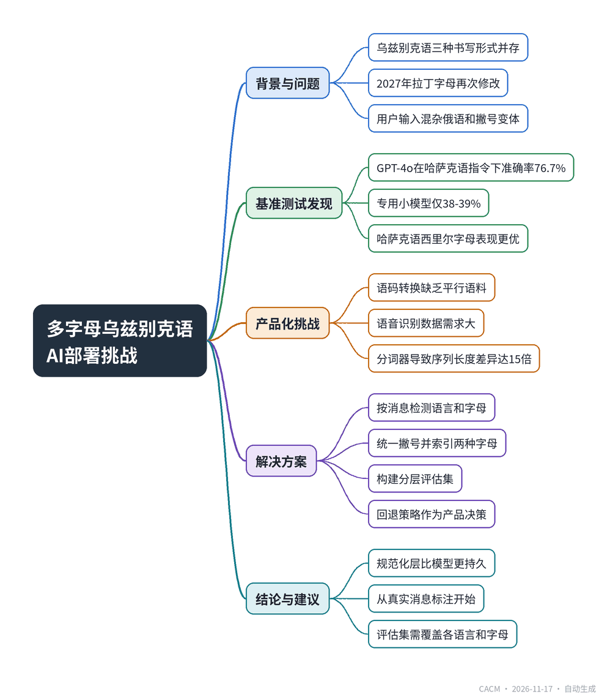

# When a Model Writes Uzbek in Three Alphabets

## 当模型用三种字母书写乌兹别克语

**来源**：Communications of the ACM（Blog@CACM）　|　**发布**：2026-11-16 16:51（美东）　|　**北京时间**：2026-11-17 04:51　|　**作者**：Ivan Lapa

[原文链接](https://cacm.acm.org/blogcacm/when-a-model-writes-uzbek-in-three-alphabets/)　·　生成于 2026-11-17 16:36

---

## 一、摘要

> 用户可能将不同语言的回答视为模型并非为他们而建。

在中亚地区部署AI功能时，团队常纠结于模型选择，但多数失败发生在模型之前：用户输入混杂西里尔字母、拉丁字母及多种撇号变体，且常夹杂俄语。乌兹别克斯坦自1993年向拉丁字母过渡，截止日期多次推迟，2026年又签署新法修改拉丁字母，2027年起将出现三种书写形式。基准测试显示，GPT-4o在哈萨克语指令下准确率76.7%，远超专用小模型；TUMLU测试发现哈萨克语西里尔字母表现更好，拉丁字母提示常导致输出类似鞑靼语。此外，代码转换、语音识别和分词器差异也构成挑战。文章建议在模型前进行规范化：按消息检测语言和字母、统一撇号变体、索引两种字母、存储字母版本字段。同时构建分层评估集，按语言和字母分别评分，并将回退策略视为产品决策。最终强调，规范化层和评估集比模型更持久。

## 二、核心要点

1. 乌兹别克斯坦将于2027年4月22日起修改拉丁字母，导致乌兹别克语出现三种书写形式，增加文本处理复杂度。
2. KazMMLU基准显示，GPT-4o在哈萨克语指令下平均准确率76.7%，而两个哈萨克语专用80亿参数模型仅38-39%。
3. TUMLU测试表明，哈萨克语在西里尔字母下表现更好，拉丁字母提示常使模型输出类似鞑靼语；乌兹别克语字母差异影响较小。
4. 分词器可将同一文本转化为长达15倍的序列长度，影响价格、延迟和上下文容量，需按语言和字母统计令牌数。
5. 建议按消息检测语言和字母，统一撇号变体，索引两种字母，并存储字母版本字段以应对2027年后的拼写变化。
6. 构建分层评估集，按语言和字母分别评分，使用不同世代的母语标注者，并将回退策略作为产品决策记录日志。

## 三、关键词对照

| English | 中文 |
| --- | --- |
| KazMMLU | 哈萨克语多任务语言理解基准 |
| TUMLU | 土耳其语系语言理解基准 |
| code-switching | 语码转换 |
| tokenizer | 分词器 |
| transliteration | 音译 |

## 四、中英对照全文

When a team in Tashkent or Almaty ships an AI feature, whether a support bot, menu search, or voice-note parsing, the first debate is almost always about the model: which one understands Uzbek, whether to use a Kazakhstan-built model, whether GPT is good enough. Most failures happen upstream of the model. One user writes Uzbek in Cyrillic, another in Latin, a third in Latin with three different apostrophes, and many messages are partly Russian. A model that looks strong on a benchmark behaves very differently on that stream.

> 当塔什干或阿拉木图的团队上线一项 AI 功能时，无论是客服机器人、菜单搜索还是语音笔记解析，第一场争论几乎总是围绕模型展开：哪个模型懂乌兹别克语，是否该用哈萨克斯坦自研的模型，GPT 是否够用。而大多数失败其实发生在模型的上游。一个用户用西里尔字母写乌兹别克语，另一个用拉丁字母，第三个用拉丁字母但用了三种不同的撇号，还有许多消息夹杂着俄语。一个在基准测试上表现强劲的模型，面对这样的数据流时表现会大不相同。

The script problem is about to get harder. Uzbekistan began moving from Cyrillic to Latin script in 1993; the deadline for the change slipped from 2000 to 2005, 2010, and then 2023, and both scripts remain in wide use. On October 21, 2026, Uzbekistan President Shavkat Mirziyoyev signed a law revising the Latin alphabet itself: from April 22, 2027, sh becomes Ş, ch becomes Ç, o‘ becomes Ö, and g‘ becomes Ğ, with no single deadline for the switch. Uzbek text will arrive in three written forms, because old text and typing habits remain. Even today, o‘ is typed as oʻ, o’, o` or o’, since the correct character isn’t on a standard keyboard. A person reads one word; your search index, tokenizer, and string matching see four. Kazakhstan’s own Latin transition still has no timeline, and Kazakh online is mostly Cyrillic, with Russian mixed in mid-sentence.

> 文字系统的问题即将变得更棘手。乌兹别克斯坦从 1993 年开始从西里尔字母转向拉丁字母；转换的截止期限从 2000 年推迟到 2005 年、2010 年，再到 2023 年，而两种文字至今仍被广泛使用。2026 年 10 月 21 日，乌兹别克斯坦总统 Shavkat Mirziyoyev 签署了一项修订拉丁字母本身的法律：自 2027 年 4 月 22 日起，sh 变为 Ş，ch 变为 Ç，o‘ 变为 Ö，g‘ 变为 Ğ，且没有统一的切换截止期限。乌兹别克语文本将以三种书写形式出现，因为旧文本和打字习惯依然存在。即使在今天，o‘ 仍被输入为 oʻ、o’、o` 或 o’，因为标准键盘上没有正确的字符。人读到的是一个词；而你的搜索索引、分词器和字符串匹配看到的却是四个。哈萨克斯坦自己的拉丁化过渡仍无时间表，哈萨克语网络内容大多使用西里尔字母，且句中夹杂俄语。

What do the benchmarks say? KazMMLU, comprised of about 23,000 questions in Kazakh and Russian, offers two lessons. Global frontier models lead by a wide margin: with Kazakh instructions, GPT-4o averages 76.7% accuracy, while two Kazakh-specialized eight-billion-parameter models land around 38–39%. And results depend on the language of the instructions in ways that vary by model: GPT-4o barely moves between English and Kazakh instructions, while in the KazMMLU paper’s tables DeepSeek V3 falls from 76.9% to 45.5%. That is one model in one run, but the practical lesson holds: test with the exact prompt you will ship.

> 基准测试怎么说？KazMMLU 包含约 23,000 道哈萨克语和俄语题目，提供了两点启示。全球前沿模型大幅领先：在哈萨克语指令下，GPT-4o 平均准确率为 76.7%，而两个哈萨克语专用的 80 亿参数模型仅在 38–39% 左右。而且结果会因指令语言而异，且因模型不同而不同：GPT-4o 在英语和哈萨克语指令之间几乎不变，而在 KazMMLU 论文的表格中，DeepSeek V3 从 76.9% 跌至 45.5%。这只是单次运行中的单个模型，但实际教训依然成立：用你实际要上线的提示词来测试。

TUMLU is unusual in testing both scripts. On Kazakh, all three tested models performed better in the Cyrillic script, and Latin-script prompts often pushed them into output that resembled Tatar. On Uzbek, the script made little difference (Claude 3.5 Sonnet scored 67.9 in Cyrillic, and 68.6 in Latin), because Uzbek text online is split more evenly. The paper also carries a warning: Uzbek looked most difficult partly because its questions were modeled on university entrance exams. Comparing languages by one number from someone else’s benchmark mostly compares the people who wrote the questions.

> TUMLU 的特别之处在于同时测试两种文字。在哈萨克语上，三个受测模型在西里尔字母下表现都更好，拉丁字母提示词常常使它们输出类似鞑靼语的内容。在乌兹别克语上，文字差异影响不大（Claude 3.5 Sonnet 在西里尔字母下得 67.9 分，拉丁字母下得 68.6 分），因为网上的乌兹别克语文本分布更均衡。该论文还附带一个警告：乌兹别克语看起来最难，部分原因是其题目模仿了大学入学考试。用别人基准测试中的单一数字来比较语言，很大程度上比较的是出题人。

Three more gaps matter for products. Code-switching is barely studied: researchers working on Kazakh-Russian translation found no public parallel corpus and built one of 618 sentences. For voice, the Whisper paper found that recognition error roughly halves with every sixteen-fold increase in training data for a language, so strong Russian recognition says nothing about Uzbek. And tokenizers can turn the same text into sequences up to fifteen times longer depending on the language, which moves price, latency, and how much history fits in context. Count tokens per message for each language and script in your own traffic before you sign off on unit economics.

> 还有三个缺口对产品至关重要。语码转换几乎无人研究：从事哈萨克语-俄语翻译的研究人员找不到公开的平行语料库，于是自建了一个包含 618 句的语料库。在语音方面，Whisper 论文发现，对一种语言而言，训练数据每增加十六倍，识别错误率大约减半，因此强大的俄语识别能力并不能说明乌兹别克语的情况。而分词器可能将同一文本切分成长达十五倍的序列，具体取决于语言，这会影响价格、延迟以及上下文能容纳多少历史记录。在敲定单位经济模型之前，先按你自己流量中的每种语言和文字统计每条消息的 token 数。

So normalize before the model. Detect language and script per message, not per user profile: the same person may type Latin on a phone in the morning and Cyrillic on a laptop at night. Map all apostrophe variants to one canonical character in a copy used for search and matching, and keep the original. Index both scripts, using transliteration tables built with a native speaker and tested on real dish, street, and product names. Don’t convert Kazakh to Latin before the model for consistency’s sake, since TUMLU suggests Cyrillic works better. Reply in the script the user wrote in. And store the alphabet version as a data field, so that a search conducted after April 2027 finds a word in any spelling without relabeling the archive.

> 所以要在模型之前做归一化。按每条消息而非用户画像检测语言和文字：同一个人可能早上在手机上用拉丁字母，晚上在笔记本电脑上用西里尔字母。将所有撇号变体映射到一个用于搜索和匹配的副本中的规范字符，并保留原文。为两种文字建立索引，使用由母语者构建并在真实菜名、街道名和产品名上测试过的转写表。不要为了统一性在模型之前将哈萨克语转换为拉丁字母，因为 TUMLU 表明西里尔字母效果更好。用用户书写时所用的文字回复。并将字母版本存储为数据字段，这样 2027 年 4 月之后进行的搜索就能找到任何拼写的词，而无需重新标注存档。

Then build your own evaluation set from real requests, split into strata: Uzbek Cyrillic, Uzbek Latin (soon in both orthographies), Kazakh, Russian, mixed messages, and voice. Score each stratum separately; if most traffic is Russian, an overall average will hide a failure on Uzbek Cyrillic. Use native-speaker labelers from different generations, since people schooled before and after the switch to Latin write differently, and trust an LLM judge only on strata where you have checked it against human ratings.

> 然后基于真实请求构建你自己的评估集，按层划分：乌兹别克语西里尔字母、乌兹别克语拉丁字母（很快将涵盖两种正字法）、哈萨克语、俄语、混合消息和语音。分别对每一层评分；如果大部分流量是俄语，总体平均值会掩盖乌兹别克语西里尔字母上的失败。使用来自不同世代的母语标注者，因为在拉丁字母切换前后受教育的人书写方式不同，并且只在你已对照人工评分验证过的层上信任 LLM 评判。

Finally, treat fallback as a product decision. Some users will accept a Russian reply to an Uzbek question; others will read it as a sign that the product wasn’t built for them. When confidence is low, ask a clarifying question in the user’s language or offer buttons. In payments, safety, or account blocks, route to a person who speaks the language. Offer Russian as a choice rather than switching silently, and log every fallback with its language and script, because a month of logs shows where the model fails systematically.

> 最后，将回退视为产品决策。有些用户会接受用俄语回答乌兹别克语问题；另一些用户则会将其视为产品并非为他们而建的信号。当置信度低时，用用户的语言提出澄清问题或提供按钮。在支付、安全或账户封禁场景中，转接给会说该语言的人工客服。将俄语作为选项提供，而不是静默切换，并记录每次回退及其语言和文字，因为一个月的日志能显示模型在哪些方面系统性失败。

Where to start? Pull a week of real messages and label them by language and script. It takes a couple of days and shows what traffic you are actually serving. You can swap a model in a week; your normalization layer and evaluation set will outlast several model changes and the move to Uzbekistan’s new Latin alphabet.

> 从哪里开始？抽取一周的真实消息，并按语言和文字标注。这只需几天时间，却能显示你实际服务的流量构成。你可以在一周内更换模型；而你的归一化层和评估集将比多次模型更换以及乌兹别克斯坦新拉丁字母的推行存续得更久。

Disclosure: The views expressed are my own and do not necessarily reflect those of my employer.

> 披露：本文观点仅代表我个人，不一定反映我雇主的观点。

Ivan Lapa is a product manager at Uzum Tezkor in Tashkent, Uzbekistan. He previously worked on courier products at Yandex Pro.

> Ivan Lapa 是位于乌兹别克斯坦塔什干的 Uzum Tezkor 的产品经理。他此前在 Yandex Pro 从事快递产品工作。

---
*英文原文版权归 Communications of the ACM 及作者所有；中文译文由 AI 辅助生成，仅供学习参考。*