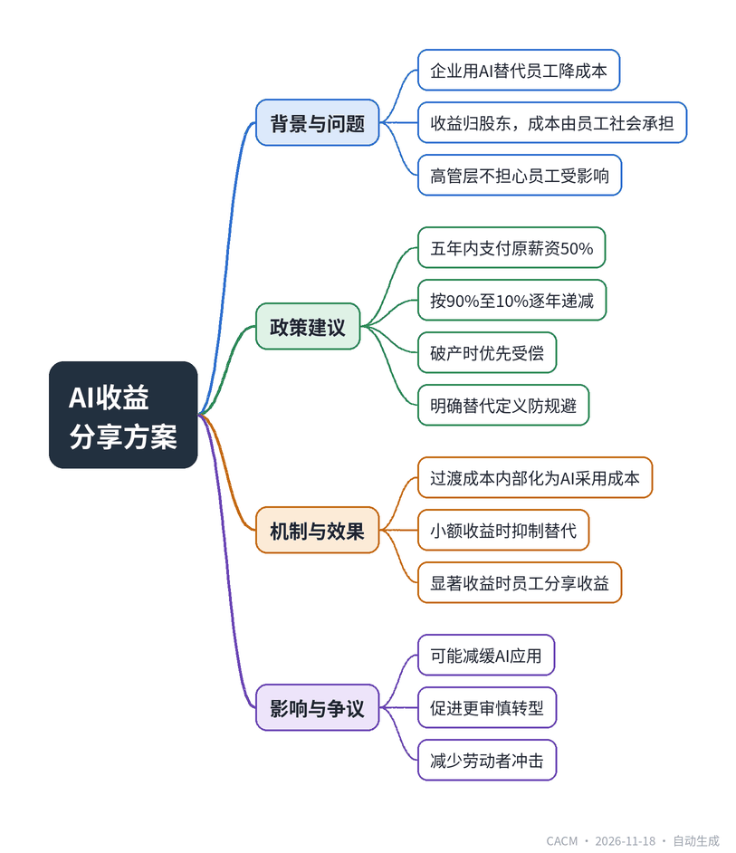

# Sharing AI’s Gains

## 分享AI收益：裁员补偿新思路

**来源**：Communications of the ACM（）　|　**发布**：2026-11-17 15:33（美东）　|　**北京时间**：2026-11-18 03:33　|　**作者**：

[原文链接](https://cacm.acm.org/opinion/sharing-ais-gains/)　·　生成于 2026-11-18 16:00

---

## 一、摘要

> 企业应以财务缓冲和再就业激励补偿被AI替代的员工。

随着企业用AI替代员工以削减成本，收益流向股东，而失业、职业中断和社区损害等成本由员工和社会承担。文章提出一项政策建议：要求因AI替代员工的公司与员工分享节省的成本，具体为依法保证被替代员工五年内获得原薪资的一半，并按90%、70%、50%、30%、10%的比例逐年递减支付，以缓冲过渡并提供寻找新职业的激励。该义务需在破产时优先保障，并需定义“替代”以防止外包规避。此举将AI采用的社会成本内部化，可能减缓部分AI应用，但能促使企业更审慎地推进转型，减少对劳动者的冲击。

## 二、核心要点

1. 企业用AI替代员工后，股价和期权价值上涨，但失业和社区损害等成本主要由员工和社会承担。
2. 建议立法要求因AI替代员工的公司五年内支付员工原薪资的50%，并按90%至10%逐年递减。
3. 该支付义务应在公司破产时优先受偿，并需明确“替代”定义以防外包或自然减员规避。
4. 若AI仅带来小幅成本优势，该政策将抑制因微小收益而破坏员工生活的行为；若AI优势显著，员工可分享收益以助转型。
5. 该政策将过渡成本纳入AI采用总成本，类似设备、集成、培训和维护费用，可能减缓部分AI应用但促进更审慎的转型。

## 三、关键词对照

| English | 中文 |
| --- | --- |
| Communications of the ACM | 美国计算机学会通讯 |
| Editor-in-Chief | 主编 |
| editorial board | 编辑委员会 |
| peer review | 同行评审 |
| C-suite | 高管层 |
| private equity | 私募股权 |
| enshittification | 恶化（平台质量下降） |
| transition cost | 过渡成本 |
| front-load | 前置支付 |
| attrition | 自然减员 |
| retraining | 再培训 |

## 四、中英对照全文

As Editor-in-Chief of Communications, I dream of the day I can replace my editorial board and reviewers with AI. No more editorial turnover and constant recruiting, no more waiting weeks or months for a review, no more one-line reviews or ambiguous recommendations, and no more management of 100+ volunteers. Just click a button, and a few minutes later, three assured, well-written evaluations of a submission and a recommendation appear. I’m confident that most journal editors and program committee chairs share my fantasy.

> 作为《Communications》的主编，我梦想有一天能用AI取代我的编辑委员会和审稿人。不再有编辑更替和不断招募，不再需要等待数周或数月才能得到审稿意见，不再有一行评论或模棱两可的建议，也不再需要管理100多名志愿者。只需点击一个按钮，几分钟后，就会出现三份可靠、撰写良好的投稿评估和一份建议。我相信大多数期刊编辑和程序委员会主席都有同感。

My fantasy is harmless because I do not intend to act on it. If you read my earlier editorial about Communications and AI, you might suspect I do not plan to replace my editorial board with AI. As facile, quick, and capable as AI appears, it lacks the perspective and judgment essential to review and edit material written by people for human readers. In industry, however, the same economic temptation is increasingly real—and the people making the decision do not bear most of its human cost.

> 我的幻想无害，因为我不打算付诸行动。如果你读过我之前关于《Communications》和AI的社论，你可能会怀疑我不打算用AI取代我的编辑委员会。尽管AI看起来简单、快速且有能力，但它缺乏审阅和编辑人类为人类读者撰写的材料所必需的视角和判断力。然而，在工业界，同样的经济诱惑越来越真实——而做出决定的人并不承担大部分人力成本。

We’ve all seen CEOs and CFOs who not only share this vision but put it into effect by laying off employees and replacing them with AI. Their company’s stock price soars, their stock options become more valuable, and why not? They’re riding the wave of the future while cutting operating costs. The financial gains accrue to the company and its shareholders, while much of the cost—lost income, disrupted careers, and damaged communities—is borne by workers and society. Perhaps concerns will change when AI starts replacing CEOs and CFOs, but right now the C-suite doesn’t seem too worried about AI’s effect on their (former) employees.

> 我们都见过这样的CEO和CFO：他们不仅认同这一愿景，还通过裁员并用AI取代员工来付诸实施。公司股价飙升，他们的股票期权变得更有价值，何乐而不为呢？他们在削减运营成本的同时，正乘着未来的浪潮。财务收益归公司及其股东所有，而大部分成本——收入损失、职业中断和社区受损——则由员工和社会承担。也许当AI开始取代CEO和CFO时，担忧会改变，但眼下高管层似乎并不太担心AI对他们（前）员工的影响。

At the same time, you might not feel comfortable with the CEOs’ motivations. The rise of private equity in America and the “enshittification” of many products and services demonstrates that many industrial leaders prioritize returns to investors over quality, and that finding new ways to cut costs takes priority over long-term reputations.

> 同时，你可能对CEO们的动机感到不安。美国私募股权的兴起以及许多产品和服务的“恶化”表明，许多行业领袖优先考虑投资者的回报而非质量，并且寻找新的削减成本的方法优先于长期声誉。

I have a modest proposal to push back against this pressure. My proposal is that a company that replaces an employee with AI should be required to share some of the resulting savings with that employee. In economic terms, the company should bear part of the transition cost its decision creates rather than shifting the entire burden onto the worker and society. By law, employers should guarantee every employee half their salary for five years if AI replaces them. It would probably make sense to front-load the payout (e.g., 90%, 70%, 50%, 30%, 10% per year) to cushion the transition and provide incentives and financial support to find a new career. Of course, the obligation would need to be secured, so ex-employees would be first in line if the company declares bankruptcy.

> 我有一个温和的建议来抵制这种压力。我的建议是，用AI取代员工的公司应被要求与该员工分享部分由此节省的成本。从经济角度讲，公司应承担其决策产生的部分过渡成本，而不是将全部负担转嫁给员工和社会。法律规定，如果AI取代员工，雇主应保证在五年内支付员工一半的工资。提前支付可能是有意义的（例如，每年90%、70%、50%、30%、10%），以缓冲过渡，并提供激励和财务支持以寻找新职业。当然，这一义务需要得到保障，因此如果公司破产，前员工应优先受偿。

Defining replacement would not be simple. The obligation might be triggered when a company eliminates a position or materially reduces employment in a job category while deploying AI to perform substantially the same work. Rules would also have to prevent evasion through outsourcing, contracting, or attrition.

> 定义“取代”并不简单。当公司取消一个职位或大幅减少某一职类的工作，同时部署AI执行基本相同的工作时，该义务可能被触发。还必须制定规则，防止通过外包、承包或自然减员来规避。

If AI only offers a small improvement in cost and productivity over an employee, this proposal will make it financially unattractive to disrupt someone’s life. If AI is far cheaper and more productive, the fired worker would share its financial benefits for a fixed period to help them start a new career. The company’s “investment” in AI would not be fully realized for several years. The transition payment would become part of the cost of adopting AI, just like equipment purchase, integration, training, and maintenance costs are today.

> 如果AI在成本和生产效率上仅比员工略有改善，这一提议将使扰乱他人生活变得在经济上不具吸引力。如果AI便宜得多且生产力更高，被解雇的工人将在固定期限内分享其财务收益，以帮助他们开始新的职业生涯。公司对AI的“投资”将在数年内无法完全实现。过渡付款将成为采用AI成本的一部分，就像今天的设备采购、集成、培训和维护成本一样。

From society’s perspective, this would fund support and retraining for people in roles that machines could handle better or cheaper. The funding would come directly from industries that benefit from AI and go directly to people adversely affected by AI. Globalization has shown that economic transformation can benefit society overall while devastating workers and communities. Promises that those workers will be retrained for better jobs have too often proved inadequate. This proposal does not rely on an organized retraining program; instead, it would offer a financial cushion and incentive to find a new career.

> 从社会的角度来看，这将为那些机器能更好或更便宜地处理的岗位人员提供支持和再培训资金。资金将直接来自受益于AI的行业，并直接流向受AI不利影响的人。全球化表明，经济转型可以使社会整体受益，同时摧毁工人和社区。关于这些工人将接受再培训以获得更好工作的承诺往往被证明是不够的。这一提议不依赖于有组织的再培训计划；相反，它将提供财务缓冲和寻找新职业的激励。

This policy would undoubtedly slow some AI adoption. That is a feature, not a flaw, when the financial advantage is too small to compensate for the disruption it causes. Truly transformative uses of AI would still proceed, but workers would share temporarily in the gains they helped make possible. Still, I suspect most people would be happy to see AI adoption proceed more slowly and thoughtfully, with fewer casualties on the road to the future.

> 这一政策无疑会减缓一些AI的采用。当财务优势太小而无法补偿其造成的破坏时，这是一个特点，而不是缺陷。真正具有变革性的AI应用仍将继续进行，但工人将暂时分享他们帮助实现的收益。尽管如此，我怀疑大多数人会乐于看到AI的采用更加缓慢和深思熟虑，在通往未来的道路上减少伤亡。

---
*英文原文版权归 Communications of the ACM 及作者所有；中文译文由 AI 辅助生成，仅供学习参考。*