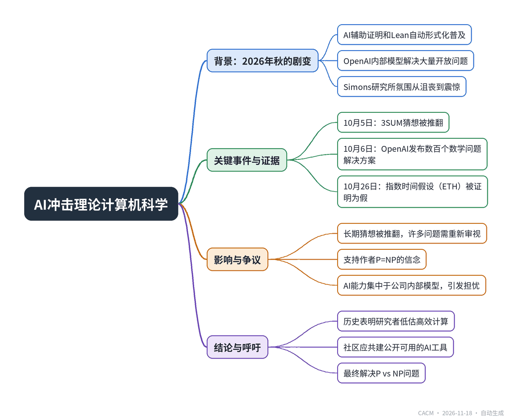

# What Happened in Fall 2026: AI and P vs NP

## 2026年秋：AI与P vs NP

**来源**：Communications of the ACM（Blog@CACM）　|　**发布**：2026-11-17 13:34（美东）　|　**北京时间**：2026-11-18 01:34　|　**作者**：Emanuele Viola 

[原文链接](https://cacm.acm.org/blogcacm/what-happened-in-fall-2026-ai-and-p-vs-np/)　·　生成于 2026-11-18 16:00

---

## 一、摘要

> OpenAI证明指数时间假设为假，支持P=NP信念。

2026年秋，理论计算机科学因AI发生剧变。作者在Simons研究所发现，AI辅助证明和Lean自动形式化成为常态。OpenAI于9月8日宣布解决纳维-斯托克斯千禧年问题，随后传闻其内部模型系统性地攻克数学与理论计算机科学的重大开放问题。10月6日，OpenAI发布数百个数学问题的解决方案，包括理论计算机科学的突破性结果：Alman和Vassilevska Williams于10月5日发表论文，用Anthropic内部模型发现的算法推翻3SUM猜想；OpenAI给出比n log n更快的整数乘法算法；10月26日，OpenAI证明指数时间假设（ETH）为假。这些结果动摇了长期持有的猜想，支持了作者认为P=NP的信念。作者认为，历史表明研究者低估了高效计算的能力，未来应共建公开可用的AI工具，最终解决P vs NP问题。

## 二、核心要点

1. 2026年秋，AI辅助证明和Lean自动形式化在理论计算机科学中普及，OpenAI内部模型解决大量开放问题。
2. 10月5日，Alman和Vassilevska Williams发表论文，用Anthropic内部模型发现的算法推翻3SUM猜想，该猜想曾用于判定许多问题的复杂性。
3. 10月6日，OpenAI发布数百个数学问题的解决方案，包括比n log n更快的整数乘法算法。
4. 10月26日，OpenAI证明指数时间假设（ETH）为假，该假设是P≠NP的强化版本，曾支撑数十年的研究。
5. 这些结果支持作者P=NP的信念，作者认为历史表明研究者低估了高效计算的能力。
6. 作者呼吁社区共建更智能、公开可用的AI工具，以最终解决P vs NP问题。

## 三、关键词对照

| English | 中文 |
| --- | --- |
| Exponential Time Hypothesis | 指数时间假设 |
| P vs NP | P与NP问题 |
| 3SUM conjecture | 3SUM猜想 |
| BPL vs L | BPL与L问题 |
| Lean autoformalization | Lean自动形式化 |
| Navier–Stokes Millennium Prize Problem | 纳维-斯托克斯千禧年问题 |
| derandomization | 去随机化 |
| circuit-size lower bound | 电路大小下界 |

## 四、中英对照全文

Theoreticians will never forget 2026. When I left Massachusetts in the summer for a coast-to-coast trip, research in my field, theoretical computer science, was still done the way math had been done for the previous several millennia. Sure, artificial intelligence seemed to be getting better, but hadn’t we been there before? It was natural to be a little skeptical.

> 理论家们永远不会忘记2026年。那年夏天，我离开马萨诸塞州，踏上一场横跨东西海岸的旅程。当时，我所在的研究领域——理论计算机科学——仍然沿用着几千年来数学研究的老方法。诚然，人工智能似乎越来越强大，但我们不是早就见过这种场面吗？保持一点怀疑是很自然的。

But when I arrived in California to attend a program on pseudorandomness at the Simons Institute for the Theory of Computing, I found the field transformed almost beyond recognition. Suddenly, every proof was AI-assisted, and all the talk was about swarms of AI agents and Lean autoformalization. Then, on September 8, OpenAI announced a solution to the Navier–Stokes Millennium Prize Problem. Still, the impact on theoretical computer science was hard to judge; this was a problem in fluid dynamics, not computer science. Maybe there was something about this problem that made it particularly easy for AI, plus apparently researchers working on the problem who had been using AI models for a while got very close. Maybe OpenAI had somehow used their ideas and just wrapped up the solution faster than them. But soon afterward, rumors started circulating that a merry gang at OpenAI was systematically attacking all major open problems in mathematics and theoretical computer science, and unbelievably solving a large fraction of them. One of these was a problem central to the program at the Simons Institute: BPL versus L, asking whether randomized algorithms using logarithmic memory can be “derandomized,” that is, simulated deterministically while still using logarithmic memory. Worse, these incredible AI feats were beyond the grasp of publicly available models; only the companies’ internal models were strong enough.

> 但当我抵达加利福尼亚，参加西蒙斯计算理论研究所举办的伪随机性项目时，我发现这个领域已经变得几乎认不出来了。突然间，每一个证明都有AI辅助，所有讨论都围绕着AI智能体集群和Lean自动形式化展开。接着，在9月8日，OpenAI宣布解决了纳维-斯托克斯千禧年大奖难题。不过，这对理论计算机科学的影响还难以判断；毕竟这是流体动力学的问题，不是计算机科学。也许这个问题本身有什么特别之处，让AI觉得格外容易，再加上显然有一些研究这个问题的人已经使用AI模型好一阵子了，并且非常接近解决。也许OpenAI以某种方式利用了他们的想法，只是比他们更快地完成了收尾。但不久之后，谣言开始流传：OpenAI的一群快乐伙伴正在系统地攻克数学和理论计算机科学中所有重大的开放问题，并且令人难以置信地解决了其中很大一部分。其中之一正是西蒙斯研究所项目的核心问题：BPL与L，即询问使用对数内存的随机算法能否被“去随机化”，也就是在仍然使用对数内存的情况下进行确定性模拟。更糟糕的是，这些惊人的AI成就超出了公开可用模型的能力范围；只有公司内部的模型才足够强大。

The atmosphere at the Institute became increasingly gloomy. People felt discouraged, hopeless; there didn’t seem to be any point in talking research anymore. I had looked forward to research collaborations with longtime colleagues; instead, we ended up sitting in adjacent rooms, each of us prompting an AI model.

> 研究所的气氛变得越来越阴沉。人们感到沮丧、绝望；似乎再谈论研究已经没有任何意义。我曾期待与长期共事的同事们进行合作研究；结果，我们最终坐在相邻的房间里，每个人都在给一个AI模型写提示词。

In the evening, I would come back to my rental in the El Cerrito hills to watch the sun set over the bay and San Francisco, where OpenAI’s headquarters are located, pondering the end of the field to which I had devoted 30 years.

> 傍晚，我会回到我在埃尔塞里托山上的租住处，看着太阳从海湾和旧金山——OpenAI总部所在地——上空落下，思考着我倾注了30年心血的领域的终结。

Then, another rumor started circulating: OpenAI was going to release its findings on October 6. When that date approached, there was a flood of papers on the Web, as researchers rushed to post whatever partial results they had in order to secure some recognition before the OpenAI release.

> 然后，另一个谣言开始流传：OpenAI将于10月6日发布其研究结果。随着这个日期临近，网上涌现出大量论文，研究人员纷纷抢发他们手头的部分结果，以便在OpenAI发布之前争取一些认可。

When October 6 finally came and OpenAI indeed released its findings, there was a party at the Institute. Finally, the tension was released, and there was something to look at. But the atmosphere soon became somber again. The OpenAI dump contained solutions to hundreds of major mathematical problems, many of which had stood for decades and some for over a century. The proofs seemed to originate from an alien mind. They were the product of gigantic datacenters, scattered over desolate parts of the globe and effectively turning Mother Earth into a motherboard.

> 当10月6日终于到来，OpenAI确实发布了其研究结果时，研究所里举行了一场派对。紧张气氛终于释放，而且有了可以看的东西。但气氛很快又变得凝重起来。OpenAI的发布内容包含数百个重大数学问题的解决方案，其中许多问题已经悬而未决数十年，有些甚至超过一个世纪。这些证明似乎源自一个异类心智。它们是遍布全球荒凉地区的庞大数据中心的产物，实际上把地球母亲变成了一块主板。

The results in theoretical computer science were absolutely eye-popping. They were like looking into the next 20 years of theoretical breakthroughs, condensed into a single moment. Matrix multiplication, BPL, unique games, fast Fourier transform, and countless more; each would require a separate post to convey the magnitude of the improvement.

> 理论计算机科学领域的成果绝对令人瞠目结舌。它们就像把未来20年的理论突破浓缩到了一个瞬间。矩阵乘法、BPL、唯一游戏、快速傅里叶变换，以及无数其他成果；每一项都需要单独写一篇文章才能传达改进的幅度。

Yet there was something that shocked many people even more. Many of the results countered long-held conjectures related to the grand challenge of theoretical computer science, and my main area of research: understanding the power and limitations of efficient computation. The most famous instance is the P versus NP problem, another Millennium Prize Problem, but one that has not yet been solved. In a nutshell, it asks whether a prominent class of problems—including the satisfiability of Boolean formulae and the traveling salesman problem—admits efficient algorithms, running in time n for a constant c on inputs of length n. Virtually all researchers believe these problems cannot be solved efficiently, and thus that P is not equal to NP.

> 然而，还有一件事让许多人更加震惊。许多结果推翻了与理论计算机科学重大挑战相关的长期猜想，而这也是我的主要研究领域：理解高效计算的威力与局限。最著名的例子是P versus NP问题，另一个千禧年大奖难题，但尚未被解决。简而言之，它问的是一大类问题——包括布尔公式的可满足性和旅行商问题——是否存在高效算法，对于长度为n的输入，能在n的c次方时间内运行，其中c为常数。几乎所有研究人员都认为这些问题无法高效解决，因此P不等于NP。

The AI results did not prove that P equals NP, but they did give several faster algorithms for a number of problems that were conjectured to not admit such improvements.

> AI的成果并没有证明P等于NP，但它们确实为一些被推测不会存在此类改进的问题提供了若干更快的算法。

First, on October 5, Alman and Vassilevska Williams released a paper explaining an algorithm discovered by an internal model at Anthropic that disproves the 3SUM conjecture. Stated in the 1990s, this conjecture asserts that deciding if three numbers sum to zero in a given list of n numbers requires time quadratic in n, a time which can be essentially achieved by an undergraduate-level algorithm using sorting and binary search. Anthropic’s new algorithm solves the problem in less time. This development is especially significant because in the last three decades, researchers had been using the 3SUM conjecture as a basis to settle the complexity of many other problems. The falsity of the 3SUM conjecture means that all these problems must now be re-examined.

> 首先，10月5日，Alman和Vassilevska Williams发表了一篇论文，解释了一个由Anthropic的内部模型发现的算法，该算法否定了3SUM猜想。这个猜想于20世纪90年代提出，断言在给定n个数字的列表中判断三个数字之和是否为零需要n的平方时间，而一个本科水平的算法使用排序和二分查找基本上就能达到这个时间。Anthropic的新算法用更少的时间解决了这个问题。这一进展尤其重要，因为在过去三十年里，研究人员一直将3SUM猜想作为确定许多其他问题复杂性的基础。3SUM猜想的错误意味着所有这些问题现在都必须重新审视。

Second, as part of the October 6 dump, OpenAI presented an algorithm to multiply two n-bit integers faster than n log n, something conjectured to be impossible in the 1970s.

> 其次，作为10月6日发布内容的一部分，OpenAI提出了一个比n log n更快地相乘两个n位整数的算法，而这在20世纪70年代曾被推测为不可能。

And finally, the biggest blow of all: on October 26, OpenAI proved that the Exponential Time Hypothesis is false. Introduced in the late 1990s, this conjecture is a strengthening of the conjecture that P is different from NP. It states that Boolean satisfiability not only cannot be solved in time n for a constant c, but in fact requires exponential time, even for restricted formulae in conjunctive normal form with three literals per clause. Like the 3SUM conjecture, but to a much greater extent, this hypothesis underpinned decades of research. While the most glaring consequence of OpenAI’s discovery is to remove the basis for many subsequent works, the discovery has other consequences as well. For example, it yields a circuit-size lower bound of the order for a “half-explicit” function on n bits computable in exponential time, while we still do not know if explicit functions such as Boolean satisfiability admit circuits of size 10 n.

> 最后，也是最沉重的打击：10月26日，OpenAI证明了指数时间假设是错误的。这个猜想于20世纪90年代末提出，是对P不同于NP这一猜想的强化。它指出，布尔可满足性不仅不能在n的c次方时间内解决（c为常数），事实上需要指数时间，即使对于每个子句包含三个文字的合取范式的受限公式也是如此。与3SUM猜想一样——但程度要大得多——这个假设支撑了数十年的研究。虽然OpenAI这一发现最明显的后果是移除了许多后续工作的基础，但该发现还有其他后果。例如，它给出了一个在指数时间内可计算的n位“半显式”函数的电路规模下界，量级为[公式]，而我们仍然不知道像布尔可满足性这样的显式函数是否允许大小为10n的电路。

These and other new findings actually support my iconoclastic belief that P equals NP. I have articulated the reasons behind my belief in my book Mathematics of the Impossible and in my 2018 blog post, “I believe P=NP.” Part of the “evidence” I collected is a comprehensive list of historical examples showing that researchers have consistently underestimated the power of efficient computation. Therefore, if one is to extrapolate from history, I believe the only reasonable direction is toward P equals NP. I expect that even more conjectures will fall soon.

> 这些以及其他新发现实际上支持了我那个离经叛道的信念：P等于NP。我在我的书《不可能性的数学》以及2018年的博客文章《我相信P=NP》中阐述了我信念背后的理由。我收集的“证据”部分是一份全面的历史案例清单，表明研究人员一直低估了高效计算的威力。因此，如果要从历史中推断，我相信唯一合理的方向是走向P等于NP。我预计很快会有更多猜想被推翻。

The future of the field lies with AI. The community must get together and build smarter and faster AI tools, trained by and publicly accessible to all researchers. With them, we will finally settle P vs NP.

> 该领域的未来在于AI。社区必须团结起来，构建更智能、更快速的AI工具，由所有研究人员训练并公开访问。有了它们，我们将最终解决P vs NP。

## 附录：参考与脚注（原文）

## References

1. Simons Institute for the Theory of Computing. Pseudorandomness & High-Dimensional Expansion (2026).

2. OpenAI. On the Navier–Stokes Millennium Prize Problem (Sept. 8, 2026).

3. OpenAI. Sharing AI progress in mathematics (Oct. 6, 2026).

4. Clay Mathematics Institute. P vs NP.

5. Alman, J. and Vassilevska Williams, V. Truly Subquadratic 3SUM and Truly Subcubic APSP via Triangles in Sparse Lopsided Graphs. arXiv:2610.06783 (Oct. 5, 2026).

6. Gajentaan, A. and Overmars, M.H. On a class of O(n²) problems in computational geometry. Computational Geometry 5, 3 (1995), 165–185.

7. OpenAI. Integer multiplication below n log n. Manuscript dated Sept. 23, 2026; released Oct. 6, 2026.

8. Schönhage, A. and Strassen, V. Schnelle Multiplikation großer Zahlen. Computing 7 (1971), 281–292.

9. OpenAI. The Exponential Time Hypothesis Is False (Oct. 25, 2026).

10. Impagliazzo, R. and Paturi, R. Complexity of k-SAT. Proceedings of the 14th Annual IEEE Conference on Computational Complexity (1999), 237–240.

11. Jahanjou, H., Miles, E., and Viola, E. Local reduction. Information and Computation 261, Part 2 (2018), 281–295.

12. Viola, E. Mathematics of the Impossible: The Complexity of Computation. Cambridge University Press (Expected publication July 2027).

13. Viola, E. I believe P=NP. Thoughts (Feb. 16, 2018).

14. Viola, E. Thoughts (2026).

Emanuele Viola is a professor of computer science at Northeastern University, the author of numerous research papers and the forthcoming Cambridge University Press book Mathematics of the Impossible, and a former video game developer. His honors include an NSF CAREER Award, a Computational Complexity Conference Best Paper Award, and a SIAM Student Paper Prize; he blogs at Thoughts.

---
*英文原文版权归 Communications of the ACM 及作者所有；中文译文由 AI 辅助生成，仅供学习参考。*