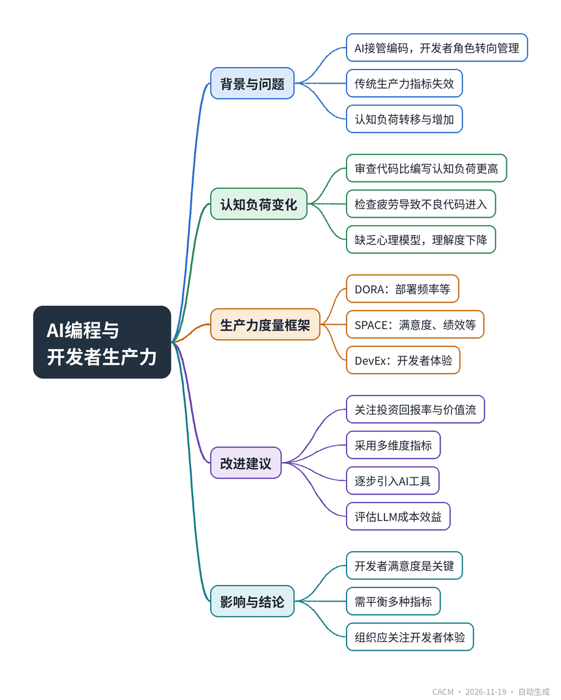

# AI Coding Shifts Cognitive Load and Hits Developer Productivity

## AI编程改变开发者认知负荷与生产力

**来源**：Communications of the ACM（News）　|　**发布**：2026-11-18 17:52（美东）　|　**北京时间**：2026-11-19 05:52　|　**作者**：Amy Buttell

[原文链接](https://cacm.acm.org/news/ai-coding-shifts-cognitive-load-and-hits-developer-productivity/)　·　生成于 2026-11-19 16:05

---

## 一、摘要

> AI接管编码，开发者角色转向管理，传统生产力度量失效。

随着AI编程工具和智能体编写更多代码，开发者角色从写代码转向审查和管理代码，认知负荷发生转移。传统生产力指标如代码行数、提交次数等只捕捉工作的一小部分，且可能增加认知负荷、降低生产力，导致错误、运营失败、入职缓慢和开发者倦怠。专家指出，审查代码比编写代码认知负荷更高，且对AI生成代码的审查疲劳可能导致不良代码进入系统。行业已有DORA、SPACE、DevEx等框架，但缺乏共识。为提高生产力，组织应关注投资回报率、采用新兴指标、减少摩擦、评估AI辅助编码的成本效益，并逐步引入AI工具。开发者满意度是重要方面，需平衡多种指标。

## 二、核心要点

1. 传统生产力指标如代码行数、提交次数只反映开发者工作的一小部分，在AI时代可能增加认知负荷并降低生产力。
2. 开发者角色从编写代码转向审查AI生成代码，审查任务认知负荷更高，且易产生检查疲劳，导致不良代码进入系统。
3. 行业已有DORA（2014-2018）、SPACE（2021）、DevEx（2023）等生产力框架，但如何衡量开发者生产力仍缺乏共识。
4. 专家建议组织关注投资回报率、采用SPACE等多维度指标、减少摩擦、评估AI工具成本效益，并逐步引入AI。
5. 开发者满意度与生产力相关，当开发者感到快乐时通常能产出更多好代码，组织应关注开发者体验。

## 三、关键词对照

| English | 中文 |
| --- | --- |
| Cognitive Load | 认知负荷 |
| Developer Productivity | 开发者生产力 |
| Agentic AI | 智能体AI |
| DORA | DevOps研究与评估 |
| SPACE | SPACE框架 |
| DevEx | 开发者体验 |
| Pull Request | 拉取请求 |
| LLM | 大语言模型 |

## 四、中英对照全文

Traditional measurements of developer productivity—including lines of code written, number of commits, or tickets closed—capture only a small fraction of the work developers perform in the age of AI coding platforms.

> 传统衡量开发者生产力的指标——包括编写的代码行数、提交次数或关闭的工单数——在AI编码平台时代仅能捕捉开发者实际工作的一小部分。

That’s why evaluating developer productivity with traditional tools has the potential to not only increase developer cognitive load, but could also lead to lower developer productivity. Because AI has changed the work developers do, the methods traditionally used to gauge developer productivity create the potential for increased developer mistakes, higher organizational operational failures, slower onboarding and knowledge transfer among teams, and developer burn-out and retention challenges.

> 这就是为什么用传统工具评估开发者生产力不仅可能增加开发者的认知负荷，还可能导致开发者生产力下降。因为AI改变了开发者的工作内容，传统上用于衡量开发者生产力的方法有可能导致开发者错误增加、组织运营故障率上升、团队入职和知识转移变慢，以及开发者倦怠和留任挑战。

“Measuring activity metrics alone pretty much never works,” said Jenna Butler, principal applied research science manager at Microsoft. “Is that really the goal, or is the goal to have good, secure software that meets the needs of the customer? That’s so hard to measure—you need to be a lot more creative.”

> “仅衡量活动指标几乎从来不起作用，”微软首席应用研究科学经理Jenna Butler说。“那真的是目标吗，还是目标是拥有满足客户需求的安全优质软件？这很难衡量——你需要更有创造力。”

At the same time developer cognitive loads are shifting—and, some believe, increasing—the role of software developers is changing, as AI subsumes what used to be the principal job of a developer. The change in the developer job description from writing code to reviewing AI-assisted or generated code contributes to where, when, and how developers experience cognitive load.

> 与此同时，开发者的认知负荷正在转移——一些人认为在增加——软件开发者的角色也在变化，因为AI取代了开发者过去的主要工作。开发者工作描述从编写代码转变为审查AI辅助或生成的代码，这影响了开发者体验认知负荷的地点、时间和方式。

“Every developer who spent his whole life just writing software now has to rebuild himself into a manager,” said Asia Solnyshkina, founder and CEO at ProSense.digital, a consulting firm that builds software and AI products. “It doesn’t matter whether you manage real people or an AI machine, it’s still management. Management itself, taking responsibility for your actions, is exactly what creates the mental overload.”

> “每个一辈子只写软件的开发者现在都必须把自己重塑为管理者，”ProSense.digital的创始人兼CEO Asia Solnyshkina说，这是一家构建软件和AI产品的咨询公司。“无论你管理的是真人还是AI机器，都是管理。管理本身，对自己的行为负责，正是造成精神过载的原因。”

Today, organizations and teams all too often measure developer productivity based on surface activity metrics. But to improve productivity, reduce cognitive load, avoid risk, and improve the developer experience, experts say organizations and teams can focus on return on investment, adopt emerging productivity metrics, reduce friction before adding more AI into the software development lifecycle, assess the cost versus benefits of AI assisted coding—and more.

> 如今，组织和团队常常基于表面活动指标来衡量开发者生产力。但专家表示，为了提高生产力、减少认知负荷、规避风险并改善开发者体验，组织和团队可以关注投资回报率、采用新兴的生产力指标、在将更多AI引入软件开发生命周期之前减少摩擦、评估AI辅助编码的成本与收益——等等。

### AI Coding Affects Developer Cognitive Load
*AI编码影响开发者认知负荷*

As AI-assisted coding tools and agentic AI write more code, and developers spend more time reviewing code, developers are grappling with a shifting cognitive load. That’s because they must build understanding of code they didn’t write, check that the code actually does what was intended, and that it fits appropriately into the rest of the system.

> 随着AI辅助编码工具和代理式AI编写更多代码，开发者花更多时间审查代码，开发者正在应对不断变化的认知负荷。这是因为他们必须理解并非自己编写的代码，检查代码是否确实实现了预期功能，以及是否恰当地融入系统其余部分。

For developers, like everyone else, cognitive load increases as their brains work harder to understand something. Developers experience lower cognitive load when they work in an area where they have significant prior knowledge—like writing code—and increased cognitive load in an area where they lack familiarity.

> 对于开发者，就像其他人一样，当大脑更努力地理解某事物时，认知负荷会增加。开发者在具有丰富先验知识的领域（如编写代码）工作时认知负荷较低，而在不熟悉的领域认知负荷增加。

Reading and reviewing code is a far different task than writing code, and one that imposes a higher cognitive load, said Felienne Hermans, a professor of computer science at Vrije Universiteit in Amsterdam, the Netherlands. “A goal of doing a pull request or analyzing code is to gain an understanding of what is happening with the code,” she said. “You might ask the person who wrote the code, and they tell you the reason. But at least you know what the intent is and even if you have to review fifty pull requests a day, you’ll have some fatigue.”

> 阅读和审查代码与编写代码是截然不同的任务，并且会带来更高的认知负荷，荷兰阿姆斯特丹自由大学计算机科学教授Felienne Hermans说。“发起拉取请求或分析代码的目标是理解代码正在发生什么，”她说。“你可能会问写代码的人，他们告诉你原因。但至少你知道意图是什么，即使你每天必须审查五十个拉取请求，你也会感到疲劳。”

“This checking fatigue is also true for AI-generated code,” she said. “If developers are looking at AI-generated code, it seems to be fine, even if it isn’t. The result is that bad code will go in, and developers at the same time are not building mental models of what the code is designed to accomplish, which creates less and less understanding in the code base as time goes on.”

> “这种检查疲劳对于AI生成的代码也是如此，”她说。“如果开发者查看AI生成的代码，即使它有问题，看起来似乎也没问题。结果是坏代码会被引入，同时开发者没有建立代码设计目标的心智模型，随着时间的推移，代码库中的理解越来越少。”

### The Developer Productivity Challenge
*开发者生产力挑战*

Even before AI-assisted coding tools became more common, developer productivity did not lend itself particularly well to measurement. That’s because the factors involved in measuring developer productivity are complex.

> 甚至在AI辅助编码工具变得更普遍之前，开发者生产力就不太适合衡量。这是因为衡量开发者生产力涉及的因素很复杂。

“Developer productivity is a confounding factor because it is very hard to measure,” said Hermans. “Because managers don’t understand programming very well, they’ve tried to encapsulate it into something that is measurable, which takes the form of measuring lines of code and story points.” Story points estimate the effort involved to complete a developer task.

> “开发者生产力是一个混杂因素，因为它很难衡量，”Hermans说。“因为管理者不太懂编程，他们试图将其封装成可衡量的东西，形式就是衡量代码行数和故事点。”故事点估计完成开发者任务所需的工作量。

Over time, the industry has developed frameworks designed to measure developer productivity, including:

> 随着时间的推移，业界开发了旨在衡量开发者生产力的框架，包括：

- DORA: DevOps Research and Assessment, developed 2014-2018;

  > DORA：DevOps研究与评估，2014-2018年开发；

- SPACE: Satisfaction, Performance, Activity, Communication/Collaboration, and Efficiency and flow, developed in 2021; and

  > SPACE：满意度、绩效、活动、沟通/协作、效率与心流，2021年开发；以及

- DevEx: Developer Experience, developed in 2023.

  > DevEx：开发者体验，2023年开发。

The three productivity frameworks have built upon each other over time and are used in different ways across industry to measure productivity. DORA, which is the most widely utilized, is employed as an automated dashboard to track how fast teams ship code. SPACE is used as a broad diagnostic checklist to ensure teams are committed to a broad measurement of productivity. DevEx is used as a recurring developer survey and systems metric to pinpoint friction in a system.

> 这三个生产力框架随着时间的推移相互构建，并在业界以不同方式用于衡量生产力。DORA是最广泛使用的，被用作自动化仪表板来跟踪团队交付代码的速度。SPACE被用作广泛的诊断清单，以确保团队致力于广泛的生产力度量。DevEx被用作定期的开发者调查和系统指标，以 pinpoint 系统中的摩擦。

Little industry consensus exists on how to measure developer productivity; developers also lack confidence that the measurements organizations use adequately reflect the contributions they make to their organizations.

> 关于如何衡量开发者生产力，业界很少达成共识；开发者也不相信组织使用的衡量标准充分反映了他们对组织的贡献。

As AI coding tools and agentic AI coding tools continue to evolve, the role of developers continues to shift towards managing code rather than writing it, which highlights one aspect of software development that is correlated with productivity: developer satisfaction.

> 随着AI编码工具和代理式AI编码工具的不断发展，开发者的角色继续转向管理代码而非编写代码，这凸显了与生产力相关的一个软件开发方面：开发者满意度。

“From the developer experience perspective, one of the central aspects of whether things are going well is how motivated they are, and part of that motivation is that they have some kind of personal and professional pride in their work,” said Fabian Fagerholm, associate professor of computer science at Finland’s Aalto University. “Am I actually producing something of value? Am I the one producing the value, or am I just watching something else produce some value, and I’m supposed to be some kind of gatekeeper?”

> “从开发者体验的角度来看，事情是否顺利的核心方面之一是他们的积极性，而这种积极性的一部分是他们对工作有一种个人和职业的自豪感，”芬兰阿尔托大学计算机科学副教授Fabian Fagerholm说。“我是否真的在生产有价值的东西？是我在生产价值，还是我只是看着别的东西生产价值，而我应该是个守门人？”

### How to Measure Developer Productivity Appropriately
*如何适当衡量开发者生产力*

While some aspects of measuring developer productivity in relation to AI-assisted coding have changed, others have not, said Butler, one of the authors of the original SPACE productivity framework paper. “A lot hasn’t changed and if anything, people are doubling down on what has never worked, not by lines of code or numbers of pull requests,” she said. “Suddenly, developer productivity matters a lot because there’s a lot of money on the line.”

> 虽然衡量开发者生产力与AI辅助编码相关的某些方面已经改变，但其他方面没有改变，Butler说，她是原始SPACE生产力框架论文的作者之一。“很多没有改变，如果说有什么变化，人们正在加倍投入从未奏效的东西，不是按代码行数或拉取请求数量，”她说。“突然之间，开发者生产力变得非常重要，因为有很多钱悬而未决。”

For Matthew Skelton, co-author of Team Topologies: Organizing Business and Technology for Fast Flow of Value, measuring developer productivity boils down to building a system that is an effective and efficient steward of value and the flow of value across an organization.

> 对于《团队拓扑：组织业务和技术以实现快速价值流》的合著者Matthew Skelton来说，衡量开发者生产力归结为构建一个系统，该系统是价值和价值流跨组织流动的有效且高效的管家。

“What technologies are appropriate to use?” he asked. “What are the criteria that is needed? Thinking about cognitive load, how can extraneous cognitive load be reduced within the flow of value? Those questions guide us towards using certain technologies in a certain way, because it is very much focused on the ongoing health of that value flow.”

> “适合使用什么技术？”他问。“需要什么标准？考虑认知负荷，如何在价值流中减少外在认知负荷？这些问题引导我们以某种方式使用某些技术，因为它非常关注价值流的持续健康。”

This kind of evaluation holds true when it comes to adding AI tools to an organization. To effectively use such tools to enhance organizational value, organizations must create clearly defined boundaries of responsibility around AI use and assign accountability for outcomes related to focused areas of AI activity, Skelton said.

> 这种评估在向组织添加AI工具时也适用。Skelton说，为了有效使用此类工具来增强组织价值，组织必须围绕AI使用创建明确的责任边界，并为与AI活动重点领域相关的成果分配问责制。

In regard to more specific measurements of developer productivity, Butler noted the SPACE framework recommends examining several different categories of data to get a handle on developer productivity. “Are my developers feeling like they are learning? Are they able to communicate well? What is the quality of the code?” Butler asked. “When developers are happy, they are usually churning out lots of good code.”

> 关于更具体的开发者生产力衡量，Butler指出SPACE框架建议检查几个不同类别的数据以掌握开发者生产力。“我的开发者感觉他们在学习吗？他们能够很好地沟通吗？代码质量如何？”Butler问。“当开发者快乐时，他们通常会产出大量好代码。”

“You pick and choose a few metrics from totally different categories that hold each other somewhat in tension, and I think this is still the best way to measure productivity,” she added. “You become agnostic about the AI tool they are using and look at whether the organization is shipping more secure code, whether the number of incidents are down, what the code survivability is, and whether there are more bugs.”

> “你从完全不同的类别中挑选几个彼此有些张力的指标，我认为这仍然是衡量生产力的最佳方式，”她补充道。“你对他们使用的AI工具保持不可知，看看组织是否交付更安全的代码，事件数量是否下降，代码存活率如何，以及是否有更多bug。”

Nethanel Bar, co-founder and CEO at Coddy, a platform that teaches coding, noted that any assessment of developer productivity must be made in the context of how developers impact business development. “Phased roll-out of AI often proves more effective than full-fledged adoption right away, since it allows the team to discover the most beneficial ways to use the technology,” he said. “Adopting new tools gradually, not all at once, is the best way to figure out what works and what does not.”

> Coddy的联合创始人兼CEO Nethanel Bar指出，任何对开发者生产力的评估都必须在开发者如何影响业务发展的背景下进行，Coddy是一个教授编码的平台。“分阶段推出AI通常比立即全面采用更有效，因为它允许团队发现使用该技术的最有益方式，”他说。“逐步采用新工具，而不是一次性全部采用，是找出什么有效什么无效的最佳方式。”

For Fagerholm, the costs of using large language models (LLMs) are an appropriate question to consider in relation to developer productivity. “We aren’t completely certain how we should measure the cost of a developer using a LLM,” he said. “How can we compare productivity of a developer and an LLM if we think of productivity as the relationship between some kind of input or effort and the output that I get?”

> 对于Fagerholm来说，使用大型语言模型（LLM）的成本是与开发者生产力相关的适当考虑问题。“我们不完全确定应该如何衡量开发者使用LLM的成本，”他说。“如果我们把生产力视为某种输入或努力与我得到的输出之间的关系，我们如何比较开发者和LLM的生产力？”

“Developers have a certain salary so we know roughly what they cost, but with an LLM, it has turned out to be very difficult to control costs because developers can rack up large bills trying out different things,” Fagerholm said. “The situation creates a challenge for companies trying to measure the productivity of LLM-assisted development, which are going to need to calculate to determine if it is worth using certain models for certain tasks.”

> “开发者有固定的工资，所以我们大致知道他们的成本，但对于LLM，事实证明很难控制成本，因为开发者尝试不同东西可能会累积大额账单，”Fagerholm说。“这种情况给试图衡量LLM辅助开发生产力的公司带来了挑战，这些公司需要计算以确定某些模型是否值得用于某些任务。”

## 附录：参考与脚注（原文）

References

1. Developers’ Experience with Generative AI – First Insights from Empirical Mixed-Methods Field Study, ICSE-SEIP ’26: Proceedings of the IEEE/ACM 48 International Conference on Software Engineering: Software Engineering in Practice, Pages 259-268 (July 11, 2026); https://dl.acm.org/doi/10.1145/3786583.3786870

2. Beyond the Hype: A Comprehensive Review of Current Trends in Generative AI Research, Teaching Practices, and Tools. TiCSE 2024: 2024 Working Group Reports on Innovation and Technology in Computer Science Education. Association for Computing Machinery (Jan. 23, 2025); https://dl.acm.org/doi/10.1145/3689187.3709614

3. Agile Estimating and Planning, Mountain Goat Software; https://www.mountaingoatsoftware.com/books/agile-estimating-and-planning

4. Agile Alliance, Demystifying Story Points (July 14, 2017); https://agilealliance.org/resources/experience-reports/improving-estimation-story-points/

5. Gitmore.io, What are DORA Metrics? A Practical Guide for Engineering Teams (July 20, 2026); https://gitmore.io/blog/dora-metrics-guide

6. SPACE Framework, The SPACE Framework: A Complete Guide to Developer Productivity (Jan. 4, 2025); https://space-framework.com

7. DevEx: What Actually Drives Productivity, Communications (Nov. 1, 2023); https://cacm.acm.org/practice/devex-what-actually-drives-productivity/

8. SPACEX: Exploring Metrics with the SPACE Model for Developer Productivity (article pre-print), Association for Computing Machinery (Nov. 26, 2025); https://arxiv.org/html/2511.20955v1

9. JetBrains, The State of Developer Experience and Developer Productivity: What Developers Truly Want (Oct. 15, 2025); https://devecosystem-2025.jetbrains.com/productivity

10. Towards a Theory of Software Developer Job Satisfaction and Perceived Productivity, IEEE Transactions on Software Engineering (September 2019); https://bit.ly/3X7H60d

11. The SPACE of Developer Productivity, Communications (June 1, 2021); https://cacm.acm.org/practice/the-space-of-developer-productivity/

Amy Buttell is a Silver Spring, MD-based technology, legal, and business journalist, content creator, writer, and ghostwriter.

---
*英文原文版权归 Communications of the ACM 及作者所有；中文译文由 AI 辅助生成，仅供学习参考。*