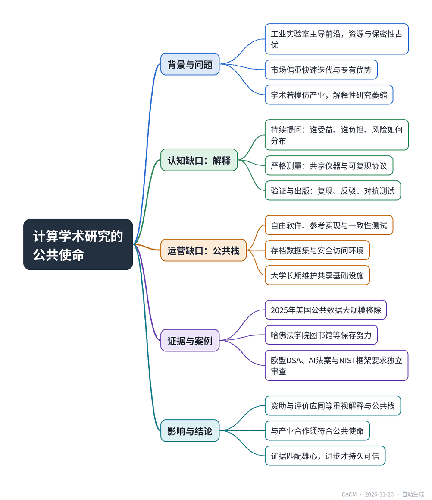

# The Public Mission of Academic Research in Computing

## 计算学术研究的公共使命

**来源**：Communications of the ACM（）　|　**发布**：2026-11-19 13:17（美东）　|　**北京时间**：2026-11-20 01:17　|　**作者**：

[原文链接](https://cacm.acm.org/opinion/the-public-mission-of-academic-research-in-computing/)　·　生成于 2026-11-20 15:52

---

## 一、摘要

> 学术计算应守护公共利益，而非追逐产业竞赛。

计算领域的前沿日益由工业实验室主导，其资源与保密性使大学难以匹敌。若仅靠市场，计算可能偏向快速迭代与专有优势，忽视公共可理解性与长期危害评估。学术研究应生产可检验、可教学、可复用、可保存的公共产品，填补市场留下的认知与运营缺口。认知缺口要求学术界通过持续提问、测量与验证来解释计算系统，使其可问责；运营缺口则需构建并维护公共栈，包括自由软件、参考实现、一致性测试、存档数据集与安全访问环境。文章以2025年美国公共数据大规模移除为例，说明关键科学资产可能突然消失，强调大学图书馆等机构在数据保存中的作用。结论是，资助与评价体系应同等重视科学解释与公共栈维护，使计算进步持久且值得公众信任。

## 二、核心要点

1. 工业实验室在保密与资源上占优，若仅靠市场，计算将偏向快速迭代与专有优势，忽视公共可理解性与长期危害评估。
2. 学术计算的核心公共使命是解释：通过持续提问、严格测量与验证，使系统机制、假设、不确定性及生命周期成本可被审视。
3. 测量需建立共享仪器，如基准、一致性规范、预注册评估计划与文档，将技术性能与安全、可靠性、隐私等人类结果更紧密联系。
4. 验证与出版生态需支持复现、反驳、对抗测试与负面结果，并明确认可同行评审与工件评估等学术劳动。
5. 运营缺口要求大学构建并维护公共栈，包括自由软件、参考实现、一致性测试、存档数据集与安全访问环境，避免单一供应商依赖。
6. 2025年美国公共数据与工具的大规模移除表明关键科学资产可能突然消失，凸显大学图书馆等机构在数据保存中的关键作用。

## 三、关键词对照

| English | 中文 |
| --- | --- |
| public goods | 公共产品 |
| epistemic gap | 认知缺口 |
| operational gap | 运营缺口 |
| metrology | 计量学 |
| verification and validation | 验证与确认 |
| artifact evaluation | 工件评估 |
| public stack | 公共栈 |
| free software | 自由软件 |
| conformance tests | 一致性测试 |
| EU AI Act | 欧盟人工智能法案 |
| NIST AI Risk Management Framework | NIST人工智能风险管理框架 |

## 四、中英对照全文

Headline advances in computing are impressive. Many core ideas rest on academic foundations, but the frontier is increasingly shaped by industrial labs operating under nondisclosure and powered by resources few universities can match. Left to industry alone, computing can become an uneven landscape: competitive markets often reward rapid iteration, proprietary advantage, and product fit at scale more than public intelligibility, long-horizon stewardship, or rigorous accounting of harms.

> 计算领域的头条进展令人印象深刻。许多核心思想建立在学术基础之上，但前沿日益由在保密协议下运营、拥有少数大学无法匹敌的资源的企业实验室所塑造。若仅由产业界主导，计算可能变得不均衡：竞争市场往往更奖励快速迭代、专有优势和规模化产品适配，而非公共可理解性、长期管理和对危害的严格核算。

Academic research can repay investment by producing public goods that can be inspected, taught, reused, and preserved for decades. Consistent with computing’s professional obligations to avoid harm and act in the public interest, these goods help fill gaps markets leave. One gap is epistemic: explanation sustained over decades through open questioning, measurement, and verification. The other is operational: the invention and long-term stewardship of services and artifacts that help keep computing dependable and beneficial for everyone.

> 学术研究可以通过生产可被检查、教学、重用和保存数十年的公共产品来回报投资。与计算专业避免伤害和符合公共利益的义务一致，这些产品有助于填补市场留下的空白。一个空白是认识论的：通过开放质疑、测量和验证来维持数十年的解释。另一个是操作性的：发明和长期管理有助于保持计算可靠且对所有人有益的服务和制品。

### The Epistemic Gap: Explanation through Questioning, Measurement, and Verification
*认识论空白：通过质疑、测量和验证进行解释*

We cannot control downstream adoption, incentives, or repurposing of the science and technology we release into the world. What enables scrutiny, safeguards, and defense when systems are misused or turned against the public is intelligibility: clear mechanisms, stated assumptions and limits, quantified uncertainty, foreseeable consequences, and life-cycle costs. For this reason, the public mission of academic computing is not only to invent, but to explain—to make computing, from foundations to applications, accountable through sustained questioning, measurement, and verification. When incentives push academic research to mirror industry, explanation recedes. Computing then drifts from cumulative science toward ephemeral engineering claims about opaque artifacts with poorly tracked harms. Those artifacts become everyday products, policies, and infrastructure, and allocate opportunities and risks in schools and hospitals, vehicles and factories, governments and homes. Misuse then becomes more difficult to detect, claims more difficult to contest, and defenses more difficult to build, especially for the most vulnerable.

> 我们无法控制我们释放到世界上的科学技术的下游采用、激励或重新利用。当系统被滥用或转向公众时，能够实现审查、保障和防御的是可理解性：清晰的机制、陈述的假设和限制、量化的不确定性、可预见的后果以及生命周期成本。因此，学术计算的公共使命不仅是发明，更是解释——通过持续的质疑、测量和验证，使计算从基础到应用都负责任。当激励推动学术研究模仿产业时，解释就会消退。计算然后从累积科学漂向关于不透明制品及其追踪不善的危害的短暂工程主张。这些制品成为日常产品、政策和基础设施，并在学校和医院、车辆和工厂、政府和家庭中分配机会和风险。滥用然后变得更难检测，主张更难质疑，防御更难建立，尤其是对最脆弱者。

Thorough questioning is the starting point. Academic research can serve the public by widening the frame before optimization, scale, implementation cost, marketing momentum, and habit narrow it. We can ask who benefits, who is burdened, and how failures and externalities are distributed across populations and over time. We can translate public concerns and unspoken needs into technical questions that admit empirical answers. Universities are often positioned to pursue these questions without immediate commercial pressure, and to design studies that privilege long horizons, uncertainty, and user protections over short-run performance gains. This is also where academia can do work that markets underprioritize: accessible, inclusive, and localized design, including in low-resource settings; methods for safe and intelligible systems; and historical and philosophical scholarship that sharpens disciplinary self-knowledge, calibrates the scope and humility of our claims, and clarifies what is ethical.

> 彻底的质疑是起点。学术研究可以通过在优化、规模、实施成本、营销势头和习惯缩小框架之前扩大框架来服务公众。我们可以问谁受益、谁负担，以及失败和外部性如何在人群和时间中分布。我们可以将公众关切和未言明的需求转化为可经验回答的技术问题。大学通常处于有利位置，可以在没有即时商业压力的情况下追求这些问题，并设计优先考虑长期、不确定性和用户保护而非短期性能收益的研究。这也是学术界可以做市场优先级较低的工作的地方：可访问、包容和本地化的设计，包括在低资源环境中；安全和可理解系统的方法；以及历史和哲学学术，它锐化学科自我认识，校准我们主张的范围和谦逊，并澄清什么是道德的。

Rigorous measurement helps questions become answerable. Because deployed systems are complex empirical objects embedded in organizations and lives, computing needs stronger metrology for technical and sociotechnical systems: agreed definitions, calibration artifacts, stated measurement uncertainty, and inter-lab protocols so that results are reproducible and comparable over time. The goal is not merely better metrics, but tighter links from technical performance to human outcomes: safety, reliability, accessibility, privacy, and trust. Well-designed measurement makes explicit what remains unmeasured and where uncertainty persists. It also depends on shared instruments: benchmarks, conformance specifications, preregistered evaluation plans, and documentation that makes assumptions, populations, and life-cycle costs legible. Creating and maintaining these instruments is both a scientific contribution and a public service.

> 严格的测量有助于问题变得可回答。因为部署的系统是嵌入组织和生活中的复杂经验对象，计算需要更强的计量学用于技术和社会技术系统：商定的定义、校准制品、陈述的测量不确定性以及实验室间协议，以便结果可重现且随时间可比。目标不仅是更好的指标，而是从技术性能到人类结果的更紧密联系：安全、可靠性、可访问性、隐私和信任。精心设计的测量明确什么仍未测量以及不确定性持续存在的地方。它还依赖于共享工具：基准、一致性规范、预注册评估计划和文档，使假设、人群和生命周期成本清晰可读。创建和维护这些工具既是科学贡献也是公共服务。

Measurement can then inform verification and validation, helping turn evidence into trusted, cumulative knowledge. Before publication, this includes peer review and artifact evaluation; after publication it includes replication, refutation, adversarial testing, and post-deployment scrutiny. Careful peer review and artifact evaluation are essential scholarly labor, yet remain underincentivized and unevenly supported. Funders, universities, and professional societies should explicitly recognize high-quality reviewing and editorial work, support reviewer training, and treat artifact evaluation as research infrastructure rather than invisible volunteer labor.

> 测量然后可以告知验证和确认，帮助将证据转化为可信的、累积的知识。在发表之前，这包括同行评审和制品评估；在发表之后，它包括复制、反驳、对抗性测试和部署后审查。仔细的同行评审和制品评估是必不可少的学术劳动，但仍然激励不足且支持不均。资助者、大学和专业学会应明确认可高质量的评审和编辑工作，支持评审员培训，并将制品评估视为研究基础设施而非无形的志愿劳动。

Verification would also benefit from a healthier publication ecosystem. Computing needs routine venues for replications, refutations, and negative or inconvenient results, alongside systematic adversarial testing. These outputs are not second class: they reduce recurring failures, temper overbroad generalization, and make deployments safer. A stable share of research portfolios can be reserved for verification work, and hiring and promotion criteria should explicitly value it.

> 验证还将受益于更健康的出版生态系统。计算需要常规场所用于复制、反驳以及负面或不便的结果，以及系统的对抗性测试。这些产出不是二等：它们减少重复失败，缓和过宽的泛化，并使部署更安全。研究组合的稳定份额可以保留给验证工作，招聘和晋升标准应明确重视它。

Rigorous explanation also requires access. Policy and contracting can ensure access for scrutiny of critical code, data, and trained models by researchers, civil society, journalists, regulators, and affected communities—through reproducible releases, secure research environments, or audited interfaces that preserve privacy and safety. Regulation and guidance increasingly establish expectations for independent scrutiny, risk assessment, and post-deployment monitoring, as illustrated by the EU Digital Services Act, the EU AI Act, and NIST’s AI Risk Management Framework. Meanwhile, some platform policy changes are restricting research access and deepening the “world’s growing information black box.” A fair principle is proportionality: the larger the claim or deployment, the stronger the evidence and access required for independent audit, replication, and ongoing monitoring.

> 严格的解释还需要访问。政策和合同可以确保研究人员、公民社会、记者、监管者和受影响社区访问关键代码、数据和训练模型以进行审查——通过可重现的发布、安全的研究环境或保护隐私和安全的审计接口。监管和指导越来越多地建立独立审查、风险评估和部署后监控的期望，如欧盟数字服务法、欧盟人工智能法案和NIST的人工智能风险管理框架所示。同时，一些平台政策变化正在限制研究访问并加深“世界日益增长的信息黑箱”。一个公平原则是比例性：主张或部署越大，独立审计、复制和持续监控所需的证据和访问就越强。

### The Operational Gap: Building and Maintaining the Public Stack
*操作空白：构建和维护公共栈*

Vendors often undersupply shared capabilities that confer little proprietary advantage. Yet computing reaches its full potential when rigorous explanation is paired with durable, trusted services and artifacts that the public can use, inspect, adapt, and sustain beyond any single vendor’s terms and horizon. Even when capabilities are temporarily available, society inherits a single point of failure if critical infrastructure is controlled through proprietary interfaces or discretionary access. Business priorities can shift, access can be revoked, interfaces can be degraded, and the basis for oversight can vanish. Even critical scientific assets can disappear suddenly through political decisions or changes in government, as the large-scale removals of U.S. public data and tools in 2025 illustrated—underscoring the importance of data-preservation efforts by university libraries such as Harvard Law School Library. This operational gap constrains society’s ability to use computing in the public interest.

> 供应商往往供应不足的共享能力，这些能力赋予很少的专有优势。然而，当严格的解释与持久、可信的服务和制品配对时，计算达到其全部潜力，公众可以使用、检查、适应和维持这些服务和制品，超越任何单一供应商的条款和视野。即使能力暂时可用，如果关键基础设施通过专有接口或酌情访问控制，社会就继承了单点故障。业务优先级可以改变，访问可以撤销，接口可以降级，监督的基础可以消失。甚至关键科学资产也可以通过政治决策或政府变化突然消失，如2025年美国公共数据和工具的大规模移除所示——强调大学图书馆如哈佛法学院图书馆的数据保存努力的重要性。这种操作空白限制了社会利用计算服务公共利益的能力。

Universities are well suited to reduce this fragility because they already steward shared infrastructure over decades and across competing interests. They preserve knowledge through libraries and archives; operate identity, access, and computing services for heterogeneous communities; and maintain and adapt educational tools year after year. That institutional shape lets academia provide not only explanation, but also what we can call the public stack: maintained free software, reference implementations, conformance tests, archival datasets, and secure access environments that remain usable even when they are inconvenient to monetize.

> 大学非常适合减少这种脆弱性，因为它们已经在数十年和竞争利益中管理共享基础设施。它们通过图书馆和档案馆保存知识；为异质社区运营身份、访问和计算服务；并年复一年地维护和适应教育工具。这种制度形态让学术界不仅提供解释，还提供我们可以称之为公共栈的东西：维护的自由软件、参考实现、一致性测试、档案数据集和安全访问环境，即使在不便于货币化时也保持可用。

Free software is central because code is both explanation and capability. It gives the public the ability to learn without permission, to audit rather than assume, to adapt systems to local constraints, and to exit dependencies. But the public stack is brittle when stewardship is treated as extracurricular. Widely relied-upon components can become societal liabilities when maintenance depends on burnout-prone volunteer labor or short-term grants. Treating maintenance and operation as first-class academic output is not charity; it is risk management for a society that runs on code. Funding and evaluation could reward building, governance, and long-term staffing for public artifacts and services so that computing remains dependable for everyone.

> 自由软件是核心，因为代码既是解释也是能力。它赋予公众无需许可学习、审计而非假设、适应系统到本地约束以及退出依赖的能力。但当管理被视为课外活动时，公共栈是脆弱的。广泛依赖的组件可能成为社会负担，当维护依赖于易倦怠的志愿劳动或短期资助时。将维护和运营视为一流的学术产出不是慈善；这是对运行在代码上的社会的风险管理。资助和评估可以奖励公共制品和服务的构建、治理和长期人员配置，以便计算对所有人保持可靠。

### Computing with Head, Hands, and Heart
*用头脑、双手和心计算*

Industry brings scale and speed: the hands of the enterprise. Academia should not mirror industry’s priorities and should partner with firms only on terms consistent with its public mission. If computing is to meet its public mission, funding and evaluation must reward scientific explanation and the public stack with the same seriousness as new capabilities. When evidence matches ambition and results remain open to challenge, progress becomes durable and worthy of public trust. That is our frontier.

> 产业带来规模和速度：企业之手。学术界不应镜像产业的优先级，并应仅在与公共使命一致的条件下与公司合作。如果计算要履行其公共使命，资助和评估必须像对待新能力一样严肃对待科学解释和公共栈。当证据与雄心匹配且结果保持开放挑战时，进步变得持久并值得公众信任。这就是我们的前沿。

---
*英文原文版权归 Communications of the ACM 及作者所有；中文译文由 AI 辅助生成，仅供学习参考。*