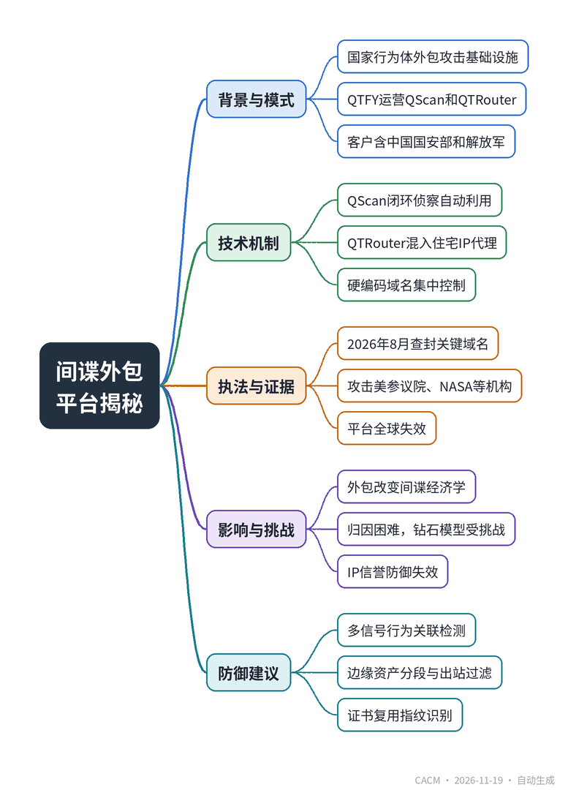

# When Espionage is Outsourced

## 间谍外包：QScan与QTRouter揭秘

**来源**：Communications of the ACM（News）　|　**发布**：2026-11-19 09:25（美东）　|　**北京时间**：2026-11-19 21:25　|　**作者**：David Geer

[原文链接](https://cacm.acm.org/news/when-espionage-is-outsourced/)　·　生成于 2026-11-20 15:52

---

## 一、摘要

> 国家资助黑客外包，美执法查封两大平台。

国家行为体将网络间谍活动外包给私营攻击供应商，形成“国家赋能”模式：客户购买托管中继网络和自动化扫描套件，而非自研工具。2026年8月26日，美国联邦当局查封了QScan和QTRouter两个互补黑客平台的域名。法庭文件显示，中国国家赞助的基础设施提供商QTFY（关联南京新九维网络科技公司）自2018年起运营这两个平台，客户包括中国国家安全部和解放军。QScan执行自动化侦察与漏洞扫描，QTRouter混淆攻击流量。攻击尝试涉及美参议院、卫生与公众服务部及电力设施，并确认利用NASA、三个能源部实验室、NIH、国防承包商和金融机构。执法通过查封硬编码的控制平面和服务域名，使平台全球失效。文章分析了闭环侦察、住宅IP网络混淆、硬编码基础设施的经济学、外包带来的归因挑战，以及检测与防御建议。

## 二、核心要点

1. QTFY自2018年运营QScan和QTRouter，客户包括中国国安部和解放军，2026年8月被美执法查封域名。
2. QScan使用RabbitMQ和Redis，集成200多个Python漏洞利用，实现无人工干预的扫描到利用闭环。
3. QTRouter基于OpenWrt和Clash，将攻击流量混入住宅IP和商业代理，使IP信誉防御失效。
4. 硬编码控制域名带来部署简便，但成为单点故障，域名查封即瘫痪全球任务队列和认证通道。
5. 外包基础设施从运营聚焦、规模经济、行动速度和归因掩护四方面改变间谍经济学，使小型单位获得顶级能力。
6. 防御需多信号行为关联、DNS关系映射、边缘资产分段和出站过滤，并利用证书复用等指纹识别多租户基础设施。

## 三、关键词对照

| English | 中文 |
| --- | --- |
| state-enablement model | 国家赋能模式 |
| managed relay networks | 托管中继网络 |
| automated scanning suites | 自动化扫描套件 |
| control-plane | 控制平面 |
| closed-loop reconnaissance | 闭环侦察 |
| proof-of-concept exploits | 概念验证漏洞利用 |
| botnet-management systems | 僵尸网络管理系统 |
| proxy network | 代理网络 |
| OpenWrt firmware | OpenWrt固件 |
| Clash routing software | Clash路由软件 |
| DHCP pools | DHCP地址池 |
| IP reputation | IP信誉 |
| CIDR blocklists | CIDR黑名单 |
| hard-coded domains | 硬编码域名 |
| multi-tenant networks | 多租户网络 |
| Diamond Model of Intrusion Analysis | 入侵分析钻石模型 |
| APT groups | APT组织 |
| egress filtering | 出站过滤 |
| FQDN allowlists | 全限定域名允许列表 |
| X.509 TLS certificates | X.509 TLS证书 |
| multi-tenant infrastructure | 多租户基础设施 |

## 四、中英对照全文

When nation-states rely on private offensive vendors to attack infrastructure, cyber espionage operates under a state-enablement model. Instead of engineering custom tools per operation, state actors consume managed relay networks and automated scanning suites from shared vendors. This model speeds perimeter probing across global targets while masking the origins of attacks behind compromised consumer hardware.

> 当民族国家依赖私营攻击性供应商攻击基础设施时，网络间谍活动便在国家赋能模式下运作。国家行为体不再为每次行动定制工具，而是从共享供应商处消费托管中继网络和自动化扫描套件。这种模式加速了对全球目标的边界探测，同时将攻击源头隐藏在受感染的消费级硬件之后。

On August 26, 2026, federal authorities announced court-authorized domain seizures disrupting two complementary hacking platforms, QScan and QTRouter. Court documents and joint government advisories describe QTFY, a China state-sponsored infrastructure provider associated with Nanjing Xinjiuwei Network Technology Company, as the operator serving clients that included China’s Ministry of State Security and People’s Liberation Army. Operating since 2018, QScan ran automated reconnaissance with vulnerability scans, while QTRouter obfuscated operational traffic. Intrusions and scanning ranged from unsuccessful access attempts against the U.S. Senate, Department of Health and Human Services, and power utilities to confirmed exploitation against the National Aeronautics and Space Administration, three Department of Energy laboratories, the National Institutes of Health, defense contractors, and financial institutions. Authorities disabled the platforms by seizing the hard-coded control-plane and service domains that made authentication and communication possible.

> 2026年8月26日，联邦当局宣布经法院授权的域名查封行动，捣毁了QScan和QTRouter两个互补的黑客平台。法庭文件和联合政府公告称，QTFY是一家与中国政府有关联的基础设施提供商，隶属于南京新九维网络科技有限公司，作为运营商为包括中国国家安全部和中国人民解放军在内的客户提供服务。QScan自2018年开始运营，运行带有漏洞扫描的自动化侦察，而QTRouter则混淆行动流量。入侵和扫描活动包括对美国参议院、卫生与公众服务部和电力设施的不成功访问尝试，以及对美国国家航空航天局、三个能源部实验室、美国国立卫生研究院、国防承包商和金融机构的已确认利用。当局通过查封使认证和通信得以实现的硬编码控制平面和服务域名，使这些平台瘫痪。

Closed-Loop Reconnaissance and Automated Exploitation

> 闭环侦察与自动化利用

Explained Viktor Bulanek, founder of AI penetration testing company Penetrify, “A scanner alone produces a list of possibilities, most of which are false or unreachable in practice, and a human then spends the expensive hours deciding which possibilities are real. Wiring the exploit engine to the scanner collapses the loop. The system does not report ‘port open, version vulnerable’; it attempts the exploit, confirms actual access, and then feeds what it just gained back into the next round of scanning from the new vantage point. That feedback loop is the whole point; it converts reconnaissance from a static inventory into a self-extending process where each confirmed foothold rescopes the scan.” Bulanek engineered a similar automated penetration testing pipeline, providing insight into how QTFY weaponized the design for state operations.

> AI渗透测试公司Penetrify创始人Viktor Bulanek解释道：“仅靠扫描器会产生一份可能性列表，其中大部分在实践中是虚假或不可达的，然后人类花费昂贵的时间来决定哪些可能性是真实的。将利用引擎连接到扫描器就闭合了循环。系统不会报告‘端口开放，版本存在漏洞’；它会尝试利用，确认实际访问权限，然后将刚刚获得的信息反馈到从新观察点进行的下一轮扫描中。这个反馈循环才是关键；它将侦察从静态清单转变为自我扩展的过程，每个确认的立足点都会重新界定扫描范围。”Bulanek设计了一个类似的自动化渗透测试流水线，为理解QTFY如何将该设计武器化用于国家行动提供了洞见。

Functioning as a distributed task-processing platform, QScan used a RabbitMQ task server to assign jobs to scanner workers and a Redis service to gather results. The system executed webpage scraping, certificate harvesting, subdomain enumeration, and vulnerability verification using a library of more than 200 Python proof-of-concept exploits. Upon identifying responsive edge devices, QScan attempted exploitation without human triage, while separate QTFY botnet-management systems enrolled compromised devices into its proxy network.

> QScan作为一个分布式任务处理平台运行，使用RabbitMQ任务服务器将作业分配给扫描器工作进程，并使用Redis服务收集结果。该系统使用包含200多个Python概念验证漏洞利用的库执行网页抓取、证书收集、子域名枚举和漏洞验证。在识别出有响应的边缘设备后，QScan未经人工分诊即尝试利用，而单独的QTFY僵尸网络管理系统则将受感染设备纳入其代理网络。

“For an IoT-heavy target set that matters even more, because the devices are numerous, homogeneous, and rarely patched, so an automated confirm-and-pivot loop turns a class of weak devices into a reliable entry pipeline without human attention per device,” said Bulanek. “The architecture is not exotic; it is the natural design once you decide a machine, not a person, will do the deciding.”

> Bulanek说：“对于以物联网设备为主的目标集来说，这一点更为重要，因为这些设备数量众多、同质化严重且很少打补丁，因此自动确认和转向循环将一类薄弱设备转变为可靠的入口管道，而无需对每台设备进行人工关注。这种架构并不奇特；一旦你决定由机器而非人来做出决定，这就是自然的设计。”

Obfuscating Attack Streams Across Residential IP Networks

> 在住宅IP网络中混淆攻击流

Michael Nizich, assistant dean and director of the Center of Academic Excellence in Cyber Defense Education at New York Institute of Technology, said “The consumer hardware in this case is the routers in our own homes and businesses. It appears to be about making the attack look like it is coming from a constantly changing population of unrelated networks, which may be why they chose this approach. That is why IP reputation alone is a weak control against this architecture.”

> 纽约理工学院学术卓越网络安全教育中心助理院长兼主任Michael Nizich表示：“本案中的消费级硬件就是我们自己家庭和企业中的路由器。这似乎是为了让攻击看起来来自不断变化的不相关网络群体，这可能就是他们选择这种方法的原因。这就是为什么仅靠IP信誉是对抗这种架构的薄弱控制手段。”

QTRouter operated as a layer of a broader obfuscation architecture rather than as a proxy mesh. Running custom OpenWrt firmware at the edge and employing Clash routing software, QTRouter chained connections across commercial proxy services, cloud IPs, and compromised IoT hardware. Multiplexing attack streams across diverse residential networks decouples adversaries from physical egress addresses. When malicious traffic originates from dynamic residential DHCP pools alongside legitimate browsing, static IP scoring models suffer high false-positive rates, limiting efficacy for IP reputation feeds, CIDR blocklists, and geolocation controls, experts said.

> QTRouter作为更广泛混淆架构的一层而非代理网格运行。它在边缘运行定制的OpenWrt固件并采用Clash路由软件，将连接串联跨越商业代理服务、云IP和受感染的物联网硬件。将攻击流多路复用到多样化的住宅网络中，使对手与物理出口地址解耦。专家表示，当恶意流量与合法浏览一起源自动态住宅DHCP池时，静态IP评分模型会遭受高误报率，从而限制了IP信誉源、CIDR黑名单和地理定位控制的有效性。

The Engineering Economics of Hard-Coded Infrastructure

> 硬编码基础设施的工程经济学

Damon Rouse, senior lead information security engineer at Black Lotus Labs, a cybersecurity research division of Lumen Technologies, said state-backed developers accept central dependency risks in hard-coded domains in return for operational simplicity, centralized orchestration, and stealth. Fixed service endpoints eliminate the operational complexity of generating domains dynamically, letting operators manage traffic across multi-tenant networks from a single hub while relying on back-end proxy layers for cover.

> Lumen Technologies网络安全研究部门Black Lotus Labs的高级首席信息安全工程师Damon Rouse表示，国家支持的开发者接受硬编码域名的中心化依赖风险，以换取操作简便性、集中编排和隐蔽性。固定服务端点消除了动态生成域名的操作复杂性，让操作员可以从单一枢纽管理多租户网络中的流量，同时依赖后端代理层作为掩护。

Hard-coding control domains can ease deployment but create critical centralized dependencies in the Domain Name System (DNS). QScan and QTRouter implants relied on these fixed domain structures for communications and authentication without secondary fallback channels, so federal domain seizures rendered the known platform implementations inoperable, severing tasking queues, agent authentication, and control channels worldwide.

> 硬编码控制域名可以简化部署，但在域名系统（DNS）中造成关键的中心化依赖。QScan和QTRouter植入物依赖这些固定域名结构进行通信和认证，没有辅助回退通道，因此联邦域名查封使已知的平台实现无法运行，切断了全球范围内的任务队列、代理认证和控制通道。

Scaling Reach and Velocity Through Outsourced Infrastructure

> 通过外包基础设施扩展覆盖范围和速度

Moving from custom, in-house military pipelines to a provider of shared infrastructure transforms the operational economics of state-sponsored espionage. According to Rouse, outsourcing infrastructure management to a centralized contractor creates efficiencies across four core dimensions: operational focus; economies of scale; campaign velocity; and attribution cover. By offloading hardware acquisition, scanner development, and proxy management overhead to a third-party contractor like QTFY, state-sponsored operators can concentrate on target exploitation and reaching their objectives. This centralized model democratizes top-tier capabilities and can allow smaller or less-resourced units to rival the reach of an elite cyber program by drawing from shared bandwidth and pre-built tooling.

> 从定制的内部军事流水线转向共享基础设施提供商，改变了国家支持间谍活动的操作经济学。据Rouse称，将基础设施管理外包给集中承包商在四个核心维度上创造效率：操作专注度；规模经济；行动速度；归属掩护。通过将硬件采购、扫描器开发和代理管理开销转移给像QTFY这样的第三方承包商，国家支持的操作员可以专注于目标利用和实现其目标。这种集中模式使顶级能力民主化，并可以通过利用共享带宽和预构建工具，让较小或资源较少的单位与精英网络项目的覆盖范围相匹敌。

Outsourcing infrastructure alters offensive software economics. Centralized managed stacks convert fixed development costs into scalable compute overhead, allowing state operators to execute parallel campaigns without dedicating engineering hours to setup.

> 外包基础设施改变了攻击性软件的经济学。集中管理的堆栈将固定开发成本转化为可扩展的计算开销，使国家操作员能够执行并行行动，而无需将工程时间专用于设置。

Rouse said this approach shrinks operational setup. Operators don’t have to pause between campaigns to provision new infrastructure; they just pull pre-configured routing paths and freshly scanned targets directly off the provider’s shelf. Funneling distinct threat groups through identical commercial proxy layers scrambles attribution. It conflates independent espionage units and makes defenders untangle common infrastructure rather than track a single threat actor.

> Rouse表示，这种方法缩短了操作设置时间。操作员不必在行动之间暂停来配置新基础设施；他们只需直接从供应商的货架上获取预配置的路由路径和新扫描的目标。将不同的威胁组织汇集通过相同的商业代理层会扰乱归属。它将独立的间谍单位混为一谈，使防御者不得不理清共同的基础设施，而不是追踪单个威胁行为者。

This shared operational model complicates traditional threat intelligence attribution frameworks, as is the case in the Diamond Model of Intrusion Analysis. When distinct APT groups route payloads through identical QTRouter egress nodes, network-level indicators become shared vendor artifacts, not signatures specifying particular threat groups. Security analysts observing Layer 3 and Layer 4 network telemetry cannot reliably isolate specific threat actors when transport infrastructure reflects the provider’s baseline proxy network rather than a tenant’s unique operational identity.

> 这种共享操作模式使传统的威胁情报归属框架复杂化，入侵分析钻石模型就是如此。当不同的APT组织通过相同的QTRouter出口节点路由有效载荷时，网络级指标成为共享的供应商产物，而不是指定特定威胁组织的特征。当传输基础设施反映的是提供商的基线代理网络而非租户的独特操作身份时，观察第3层和第4层网络遥测的安全分析师无法可靠地隔离特定威胁行为者。

Unmasking Malicious Flows Within Commercial Proxy Streams

> 在商业代理流中揭露恶意流量

Guofei Gu, Eppright Professor in Engineering and director of the SUCCESS Lab at Texas A&M University, said effective detection in legitimate proxy networks relies on multi-signal behavior correlation across time, network flows, and infrastructure relationships rather than static IP signatures. Advanced detection engines must evaluate temporal telemetry, such as connection sequences, flow duration, port anomalies, and transitions from broad scanning to selective target connections. While individual signals like periodic beaconing or connection failures appear benign alone, correlating the behaviors across hosts exposes the underlying operation, he said.

> 德克萨斯A&M大学Eppright工程学教授兼SUCCESS实验室主任Guofei Gu表示，在合法代理网络中进行有效检测依赖于跨时间、网络流和基础设施关系的多信号行为关联，而非静态IP特征。高级检测引擎必须评估时间遥测，例如连接序列、流持续时间、端口异常以及从广泛扫描到选择性目标连接的过渡。他说，虽然像周期性信标或连接失败这样的单个信号单独看起来是良性的，但跨主机关联这些行为会暴露底层操作。

Effective detection requires DNS relationship mapping and active probing, Gu said. Analyzing co-occurrence patterns among domains, IP addresses, certificates, and client endpoints while interacting with suspicious infrastructure can reveal malicious backends that passive traffic observation cannot detect on its own.

> Gu表示，有效检测需要DNS关系映射和主动探测。分析与可疑基础设施交互时域名、IP地址、证书和客户端端点之间的共现模式，可以揭示被动流量观察本身无法检测到的恶意后端。

Segmenting Edge Assets to Neutralize Compromised Hardware

> 分割边缘资产以中和受感染硬件

Said Tom Hegel, Distinguished Threat Researcher at cybersecurity company SentinelOne, “It comes down to designing the network so that a fully compromised IoT device still has almost nowhere useful to go. This would be something like blocking both its direct access to core assets and indirect access through controllers, recorders, gateways, and management systems,”

> 网络安全公司SentinelOne的杰出威胁研究员Tom Hegel表示：“关键在于设计网络，使得一个完全被攻陷的物联网设备仍然几乎无处可去。这就像既阻止它直接访问核心资产，也阻止它通过控制器、记录器、网关和管理系统进行间接访问。”

“Networks can be configured very tightly so an IoT device can communicate outbound as needed, with strict restrictions on how it communicates,” said Hegel. “Depending on the type of device, that could be something like it only being allowed to communicate outbound over a specific network protocol, to a specific destination, and never being able to reach internal network devices. The specific method used completely depends on how much Internet access the IoT device needs, and how specifically it needs to function inside a network.”

> Hegel说：“网络可以配置得非常严格，使物联网设备能够根据需要向外通信，但对其通信方式有严格限制。根据设备类型，这可能意味着它只被允许通过特定网络协议、向特定目的地进行出站通信，并且永远无法访问内部网络设备。所使用的具体方法完全取决于物联网设备需要多少互联网访问权限，以及它在网络内部需要如何具体运作。”

Enforcing egress filtering requires explicit destination IP and FQDN allowlists, combined with strict protocol and transport encryption policies. Blocking arbitrary outbound TCP and UDP connections prevents compromised firmware from establishing reverse shells or connecting with external relay networks, while isolating management planes onto dedicated out-of-band networks keeps edge hardware from reaching gateway controllers.

> 实施出口过滤需要明确的目的地IP和FQDN允许列表，并结合严格的协议和传输加密策略。阻止任意的出站TCP和UDP连接可防止受感染的固件建立反向shell或与外部中继网络连接，而将管理平面隔离到专用的带外网络则可防止边缘硬件访问网关控制器。

Fingerprinting Multi-Tenant Espionage Infrastructure

> 对多租户间谍基础设施进行指纹识别

Borja Rodriguez, head of threat intelligence at cybersecurity company Outpost24, said, “[The] reuse [of] the same certificates, registration patterns, and hosting fingerprints across victims with nothing in common [exposes multi-tenant infrastructure]. A single-client pipeline gets built and discarded for one operation, so overlap gives it away.”

> 网络安全公司Outpost24的威胁情报负责人Borja Rodriguez表示：“在毫无共同点的受害者之间重复使用相同的证书、注册模式和托管指纹[暴露了多租户基础设施]。单客户流水线是为一次行动构建并丢弃的，因此重叠就会暴露它。”

In multi-tenant attack infrastructure, vendor shortcuts create shared technical footprints across unrelated campaigns. Unlike single-use pipelines built for one target, shared operational vendors use standardized provisioning scripts and centralized orchestration backends. When incident response teams find recurring artifacts, including reused X.509 TLS certificates, across unrelated sectors, such as energy and higher education, the forensic overlaps distinguish commercial espionage platforms from bespoke pipelines and reveal a centralized infrastructure vendor serving multiple state clients.

> 在多租户攻击基础设施中，供应商的捷径在无关行动之间创造了共享的技术足迹。与为单一目标构建的一次性流水线不同，共享运营供应商使用标准化的配置脚本和集中编排后端。当事件响应团队在能源和高等教育等无关领域发现重复出现的工件（包括重复使用的X.509 TLS证书）时，取证重叠将商业间谍平台与定制流水线区分开来，并揭示出一个为多个国家客户提供服务的集中基础设施供应商。

David Geer is a journalist who focuses on issues related to cybersecurity. He writes from Cleveland, OH, USA.

> David Geer是一名专注于网络安全相关问题的记者。他来自美国俄亥俄州克利夫兰。

---
*英文原文版权归 Communications of the ACM 及作者所有；中文译文由 AI 辅助生成，仅供学习参考。*