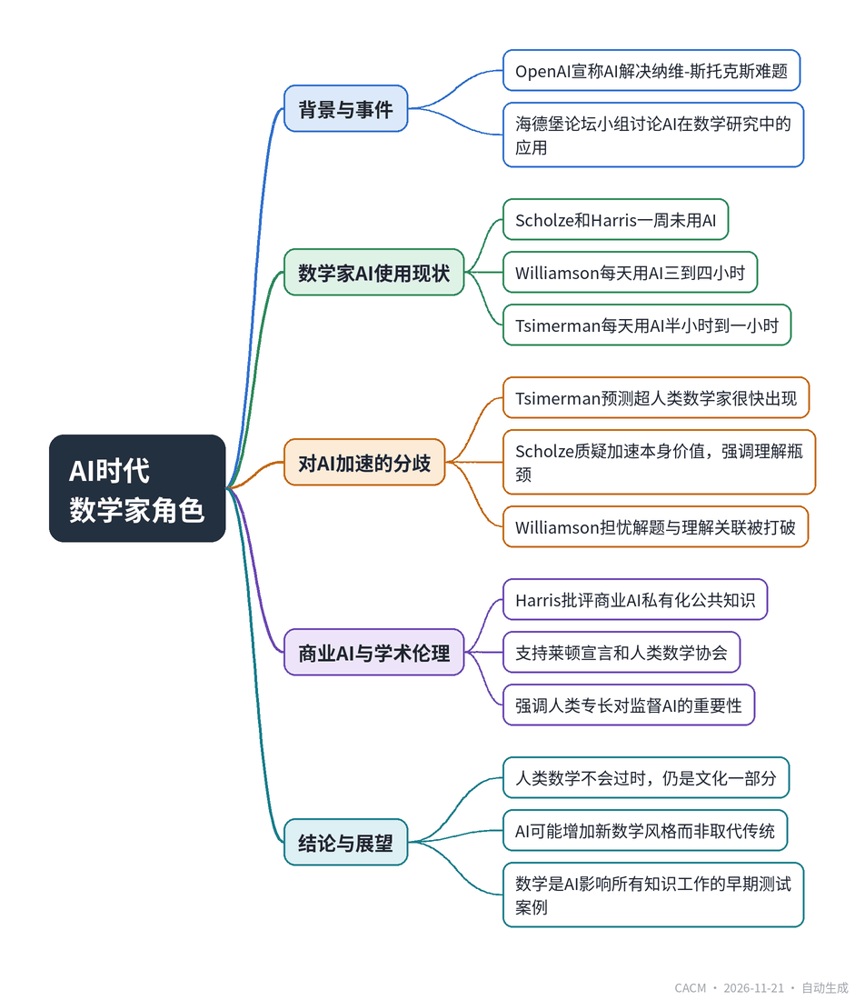

# Do We Still Need Mathematicians?

## 数学家是否仍被需要？

**来源**：Communications of the ACM（News）　|　**发布**：2026-11-20 14:14（美东）　|　**北京时间**：2026-11-21 02:14　|　**作者**：Bennie Mols

[原文链接](https://cacm.acm.org/news/do-we-still-need-mathematicians/)　·　生成于 2026-11-21 15:47

---

## 一、摘要

> 海德堡获奖者论坛小组讨论AI如何改变数学研究及数学家的角色。

2026年9月OpenAI宣称其内部AI系统解决了纳维-斯托克斯千禧年难题，引发数学界震动。一周后海德堡获奖者论坛举办“AI在数学研究中的应用”专题讨论，由加州大学伯克利分校数学家Tony Feng主持，参与者包括菲尔兹奖得主Peter Scholze、Jacob Tsimerman，AI数学研究先驱Geordie Williamson和数论学家Michael Harris。讨论中，Scholze和Harris表示过去一周未使用AI，而Williamson每天使用AI三到四小时，Tsimerman每天使用半小时到一小时，并已加入OpenAI从事AI安全研究。Tsimerman预测超人类数学家将很快出现，数学将以超人类速度推进；Scholze则质疑加速本身的价值，认为数学研究的瓶颈在于人类对结果的理解而非产出速度；Williamson担忧AI可能打破解题能力与数学理解之间的关联，迫使社区重新评估人才评价和教育方式；Harris批评商业AI将公共知识私有化，并支持《莱顿宣言》和“人类数学协会”的倡议。尽管观点分歧，小组成员一致认为人类数学不会过时，人类专长对于监督AI系统仍然至关重要。

## 二、核心要点

1. OpenAI于2026年9月8日宣称其AI系统解决了纳维-斯托克斯千禧年难题，引发数学界对AI能力的广泛关注。
2. 海德堡获奖者论坛小组讨论中，Scholze和Harris表示过去一周未使用AI，而Williamson每天使用AI三到四小时，Tsimerman每天使用半小时到一小时。
3. Tsimerman预测超人类数学家将很快出现，数学将以超人类速度推进，但强调这并不意味着人类数学失去价值。
4. Scholze认为数学研究的真正瓶颈是人类对结果的理解而非产出速度，AI加速可能导致人类理解减少。
5. Williamson担忧AI可能打破解题能力与数学理解之间的关联，社区需重新评估人才评价和教育方式。
6. Harris批评商业AI将公共知识私有化，支持《莱顿宣言》和“人类数学协会”的倡议，强调人类想象力应得到认可。

## 三、关键词对照

| English | 中文 |
| --- | --- |
| Navier-Stokes Millennium Prize Problem | 纳维-斯托克斯千禧年难题 |
| Heidelberg Laureate Forum | 海德堡获奖者论坛 |
| Fields Medalist | 菲尔兹奖得主 |
| large language model (LLM) | 大语言模型 |
| coding agent | 编码代理 |
| superhuman mathematicians | 超人类数学家 |
| gift economy | 礼物经济 |
| Humboldtian university | 洪堡式大学 |
| Leiden Declaration | 莱顿宣言 |
| Association for Human Mathematics | 人类数学协会 |

## 四、中英对照全文

When OpenAI claimed on September 8, 2026, that an internal AI system had produced a solution to the Navier-Stokes Millennium Prize Problem, it sent shock waves through the mathematical community and far beyond it. Scientific American first ran an article under the headline “The summer AI ate math,” but later changed it to the still rather hyperbolic “If AI can do math, what’s the point of mathematicians?”

> 2026年9月8日，OpenAI声称一个内部AI系统给出了纳维-斯托克斯千禧年大奖难题的解决方案，这在数学界乃至更广范围内引发了巨大震动。《科学美国人》最初以“AI吞噬数学的夏天”为标题发表文章，但后来改成了仍然相当夸张的“如果AI能做数学，数学家还有什么用？”

The Heidelberg Laureate Forum’s panel discussion “AI in Mathematical Research,” held one week later, could not have come at a better time. Moderated by mathematician Tony Feng of the University of California, Berkeley, the panel brought together Fields Medalists Peter Scholze of Germany’s Max Planck Institute for Mathematics and Jacob Tsimerman of Canada’s University of Toronto, as well as Geordie Williamson of Australia’s University of Sydney, a pioneer in applying AI to mathematical research, and Michael Harris of Columbia University, a prominent number theorist.

> 一周后举行的海德堡获奖者论坛“数学研究中的AI”专题讨论会来得正是时候。该讨论会由加州大学伯克利分校数学家Tony Feng主持，汇聚了德国马克斯·普朗克数学研究所的菲尔兹奖得主Peter Scholze、加拿大多伦多大学的菲尔兹奖得主Jacob Tsimerman、澳大利亚悉尼大学的Geordie Williamson（将AI应用于数学研究的先驱）以及哥伦比亚大学著名数论学家Michael Harris。

Asked how much time they each had spent talking to AI during the previous week, Harris and Scholze both answered: zero. “I’ve never typed anything into a large language model,” Scholze said, adding, “I’m living in a small AI-free bubble, but it’s about to burst, I think.” Williamson estimated his AI-for-math use at three or four hours a day, sometimes leaving AI systems running overnight. Tsimerman said his AI use for math was limited to 30 minutes to an hour a day, which he called “a low week.”

> 当被问及过去一周各自花多少时间与AI交流时，Harris和Scholze都回答：零。“我从未在大语言模型里输入过任何东西，”Scholze说，并补充道，“我生活在一个没有AI的小气泡里，但我想这个气泡即将破裂。”Williamson估计自己每天使用AI做数学三到四个小时，有时会让AI系统彻夜运行。Tsimerman表示自己每天用于数学的AI使用时间限制在30分钟到一小时，他称之为“使用较少的一周”。

For Tsimerman, who recently joined OpenAI to work on AI safety, AI has become something like a research collaborator. His use has evolved from searching the literature and checking ideas in fields in which he is not an expert, to directing coding agents and sub-agents to explore different approaches. “I would essentially prompt the coding agent with: ‘I think something like this should work. Please spawn several sub-agents: you try this method, you try that method, report back, write a report to me’.”

> 对于最近加入OpenAI从事AI安全工作的Tsimerman来说，AI已经有点像研究合作者。他的使用方式从搜索文献、在自己非专家领域核查想法，发展到指挥编码智能体和子智能体探索不同方法。“我基本上会这样提示编码智能体：‘我觉得类似这样的方法应该可行。请生成几个子智能体：你试试这个方法，你试试那个方法，然后汇报，给我写份报告。’”

Tsimerman expects much more to come. “We’re going to get superhuman mathematicians very soon, and mathematics itself will be pushed forward.” Problems that today lie beyond the reach of human researchers may suddenly become accessible as mathematics begins to move “at a superhuman rate,” he said. Rather than fearing that acceleration, he said mathematicians should prepare for this radically new reality.

> Tsimerman预计还会有更多进展。“我们很快就会拥有超人数学家，数学本身将被推向前进。”他说，随着数学开始以“超人的速度”发展，今天人类研究者无法企及的问题可能会突然变得可解。他表示，数学家不应恐惧这种加速，而应为这一全新现实做好准备。

Scholze questioned the premise that faster mathematics is necessarily better. He compared the seven Millennium Prize Problems to “mountains far out in the mathematical landscape, where we don’t even know the landscape around them.” Their real purpose, he argued, is “to illuminate that landscape, not so much to solve the specific problem.”

> Scholze质疑“更快的数学必然更好”这一前提。他将七个千禧年大奖难题比作“数学景观中远处的群山，我们甚至不了解它们周围的景观”。他认为，这些问题的真正目的是“照亮那片景观，而非解决具体问题”。

The real bottleneck in mathematical research, said Scholze, is not the production of new results, but the ability of mathematicians to develop a shared human understanding of them. “AI wants to accelerate everything, and I don’t see any inherent value in acceleration itself,” he said. “If results accelerate further, there’s just less human understanding.”

> Scholze表示，数学研究的真正瓶颈不是新结果的产出，而是数学家对其形成共同的人类理解的能力。“AI想要加速一切，而我看不到加速本身有任何内在价值，”他说，“如果结果进一步加速，人类理解只会更少。”

Williamson is much more enthusiastic about using AI, but said he sees a related problem. For a long time, solving difficult problems served as a reasonable proxy for mathematical understanding and contribution to the community. AI may now be breaking that link. “Now our community has the challenge to reevaluate how we assess people, who gets jobs, how we educate people et cetera.”

> Williamson对使用AI热情得多，但表示看到了一个相关问题。长期以来，解决难题是数学理解和社区贡献的合理替代指标。AI现在可能正在打破这种联系。“现在我们的社区面临挑战，要重新评估我们如何评价人、谁获得职位、如何教育人等等。”

Harris was by far the most critical of the panelists, particularly of commercial AI. He said he refuses to use commercial LLMs, which he sees as appropriating publicly shared intellectual work for private profit. Mathematics has always functioned as a gift economy, he said: researchers freely build on one another’s work as part of a shared intellectual culture.

> Harris是讨论嘉宾中批评最尖锐的，尤其是对商业AI。他说自己拒绝使用商业大语言模型，认为它们将公开共享的智力工作挪为私利。他说，数学一直作为一种礼物经济运作：研究者自由地在彼此工作基础上构建，这是共享知识文化的一部分。

“The vision of a Humboldtian university,” said Harris, “where the principles are independence from external interference and from subordination to short-term economic considerations, is under attack, specifically from ideologues in Silicon Valley.” In that spirit, he endorses the Leiden Declaration published in June for, among other things, university-based laboratories for automated mathematics.

> “洪堡式大学的愿景，”Harris说，“其原则是独立于外部干涉、不服从于短期经济考量，这一愿景正受到攻击，特别是来自硅谷意识形态者的攻击。”本着这一精神，他支持6月发布的《莱顿宣言》，该宣言呼吁建立大学附属的自动化数学实验室等。

Some younger mathematicians already are organizing around similar concerns. Students and postdocs recently founded the Association for Human Mathematics. Members pledge either not to work with commercial AI labs and not to use AI to write papers or, more strongly, not to use AI at all. Harris called this “an expression of confidence in human imagination that should be recognized and applauded.”

> 一些年轻数学家已经围绕类似关切组织起来。学生和博士后最近成立了人类数学协会。成员承诺不与商业AI实验室合作、不使用AI写论文，或者更严格地承诺完全不用AI。Harris称这是“对人类想象力的信心表达，应该得到认可和赞扬”。

Tsimerman, however, noted a lack of urgency in the mathematical community. “The world in two years is going to look so incredibly different than it does now,” he said.

> 然而，Tsimerman指出数学界缺乏紧迫感。“两年后的世界将与现在截然不同，”他说。

Yet predicting superhuman mathematical AI, he stressed, is not the same as declaring human mathematics obsolete. “There’s a big difference between ‘there’s not going to be forefront theorems proven by human mathematicians,’ which is something that I believe is going to be true very soon, and ‘there’s no place for human mathematics,’ which I very much don’t believe.”

> 但他强调，预测超人类数学AI并不等同于宣布人类数学过时。“‘不会有人类数学家证明的前沿定理’——我相信这很快就会成真——与‘人类数学没有位置’之间有很大区别，我非常不认同后者。”

Human engagement with mathematics, Tsimerman said, remains valuable as part of human culture. And because AI systems can be unreliable or unaligned with human values, human expertise remains essential: “It’s very hard to have oversight if you don’t have expertise,” he said.

> Tsimerman说，人类对数学的参与作为人类文化的一部分仍然有价值。而且由于AI系统可能不可靠或与人类价值观不一致，人类专业知识仍然至关重要：“如果你没有专业知识，就很难进行监督，”他说。

For Williamson, the impact of AI extends far beyond mathematics. “Do we want to construct a world in which human understanding plays no role?” he asked. “I think that I don’t.” Mathematics, he suggested, seems an early test case for what is about to happen across all intellectual work. AI may add a new style of doing mathematics without making the traditional one superfluous. Scholze clearly prefers the traditional style. Calling himself “a dinosaur,” he said he does not even like to sit in front of a computer and type. “I like to think about mathematics on my own, just wander around, talk to others.”

> 对Williamson来说，AI的影响远远超出数学。“我们想构建一个人类理解不起作用的世界吗？”他问道。“我想我不愿意。”他认为，数学似乎是所有智力工作中即将发生的事情的早期测试案例。AI可能增加一种新的数学研究风格，而不会使传统风格变得多余。Scholze显然更喜欢传统风格。他自称“恐龙”，说自己甚至不喜欢坐在电脑前打字。“我喜欢独自思考数学，四处漫步，与人交谈。”

Williamson enjoys using AI to explore new territory. “One of the many things that I adore about mathematics is just the surprise,” he said. “Some problem that you have been working on for some time is solved by a colleague, and the solution is really surprising. And I’ve had a couple of experiences now with AI where it suggests something about a problem that is really surprising, and I love that.”

> Williamson喜欢用AI探索新领域。“我热爱数学的众多原因之一就是惊喜，”他说。“你研究了一段时间的某个问题被同事解决了，而解决方案真的很令人惊讶。我现在有过几次与AI的经历，它针对一个问题提出了真正令人惊讶的东西，我喜欢这样。”

Bennie Mols is a science and technology writer based in Amsterdam, the Netherlands.

> Bennie Mols是位于荷兰阿姆斯特丹的科学与技术作家。

---
*英文原文版权归 Communications of the ACM 及作者所有；中文译文由 AI 辅助生成，仅供学习参考。*