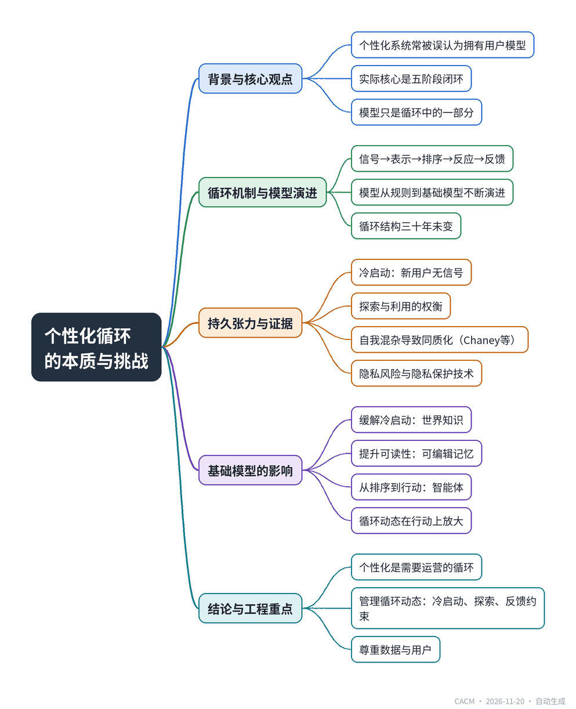

# Personalization Is a Loop, Not a Model

## 个性化是循环，而非模型

**来源**：Communications of the ACM（Blog@CACM）　|　**发布**：2026-11-20 09:23（美东）　|　**北京时间**：2026-11-20 21:23　|　**作者**：Sriram Ramakrishnan

[原文链接](https://cacm.acm.org/blogcacm/personalization-is-a-loop-not-a-model/)　·　生成于 2026-11-21 15:48

---

## 一、摘要

> 闭环是个性化产品力量的源泉，也是其最严重问题的根源。

个性化系统常被误解为拥有一个“懂你”的模型，但实际上，其核心是一个由信号、用户表示、候选生成与排序、用户反应、反馈构成的闭环。三十年来，循环中间的模型从手写规则、协同过滤、深度学习、上下文赌博机演进到基础模型，但循环本身未变。循环的动态特性带来了四个持久难题：冷启动、探索与利用的权衡、自我混杂导致的同质化、以及隐私风险。基础模型通过世界知识和可编辑记忆缓解了冷启动并提升了个性化的可读性，还将个性化从排序推向生成与行动，但并未改变循环的本质——智能体的行动成为新信号，自我混杂和探索权衡在真实后果上放大，隐私风险随持久记忆上升。结论是：个性化不是交付的模型，而是需要运营的循环；工程重点应放在循环的动态上——冷启动、探索、反馈约束和尊重数据。

## 二、核心要点

1. 个性化系统的核心是一个五阶段闭环：信号→用户表示→候选生成与排序→用户反应→反馈，而非一个静态模型。
2. 模型技术历经规则、协同过滤、深度学习、上下文赌博机和基础模型，但循环结构保持不变。
3. 循环的四个持久张力：冷启动、探索与利用的权衡、自我混杂导致的同质化（Chaney等人证明会降低效用）、隐私风险。
4. 基础模型通过世界知识缓解冷启动，并通过可编辑记忆使个性化更可读，但未改变循环的动态。
5. 智能体将个性化从排序推向行动，但行动成为新信号，自我混杂和探索权衡在真实后果上放大，隐私风险随持久记忆上升。
6. 个性化应被视为需要运营的循环，工程重点在于管理循环动态：冷启动、探索、反馈约束和数据尊重。

## 三、关键词对照

| English | 中文 |
| --- | --- |
| Personalization Loop | 个性化循环 |
| User Representation | 用户表示 |
| Collaborative Filtering | 协同过滤 |
| Matrix Factorization | 矩阵分解 |
| Contextual Bandits | 上下文赌博机 |
| Foundation Models | 基础模型 |
| Cold Start | 冷启动 |
| Exploration-Exploitation Tradeoff | 探索与利用的权衡 |
| Algorithmic Confounding | 算法混杂 |
| Federated Learning | 联邦学习 |
| Differential Privacy | 差分隐私 |
| Retrieval-Augmented Memory | 检索增强记忆 |

## 四、中英对照全文

When a feed seems to read your mind, or a store surfaces the one thing you did not know you wanted, it is tempting to say the system “knows” you—as if somewhere there is a model of you it consults. There is not. What there is, in every personalized product I have helped build, is a loop. The system watches your behavior, updates a learned representation of you, predicts what you will engage with, shows it, and then learns from how you react. The model is the famous part; the loop is the system. And once you see personalization as a loop rather than a model, the things that actually matter—where it fails, why it narrows, what it costs the people inside it—come into focus.

> 当信息流似乎能读懂你的心思，或者商店恰好展示出你未曾察觉自己想要的东西时，人们很容易说系统“懂”你——仿佛某处存在一个关于你的模型供它查询。其实并没有。在我参与构建的每一个个性化产品中，真正存在的是一个循环。系统观察你的行为，更新一个关于你的学习表征，预测你会对什么产生互动，将其展示出来，然后从你的反应中学习。模型是那个著名的部分；循环才是系统本身。一旦你把个性化看作一个循环而非一个模型，真正重要的事情——它在哪里失败、为何会收窄、它让身处其中的人付出了什么代价——就会变得清晰起来。

### The Loop
*循环*

Figure 1 shows the five stages of the personalization loop. It begins with signals: the implicit and explicit traces of behavior—clicks, dwell time, purchases, ratings, and context such as time and device. Those signals are compressed into a user representation, and this is the central move of the whole field: a person is turned into a vector, a handful of numbers that stand in for taste. A model then maps that representation to an experience—usually in two steps, generating a manageable set of candidates from a vast catalog and then ranking them. The user reacts, and that reaction is feedback, which becomes the next round of signals. The loop closes. That closure is the source of all the system’s power, and, as we will see, of its worst pathologies.

> 图1展示了个性化循环的五个阶段。它始于信号：行为的隐式和显式痕迹——点击、停留时长、购买、评分，以及时间和设备等上下文。这些信号被压缩为用户表征，而这是整个领域的核心动作：一个人被转化为一个向量，用几个数字来代表品味。然后模型将该表征映射为一种体验——通常分两步：从海量目录中生成一组可管理的候选，再对其进行排序。用户做出反应，该反应即为反馈，成为下一轮信号。循环闭合。这种闭合是系统全部力量的来源，也是——正如我们将看到的——其最严重病态的根源。

### The Loop Stayed; the Model Changed
*循环留存，模型更迭*

What has evolved over three decades is the box in the middle. The earliest systems were hand-written rules: “customers who bought X also bought Y.” Then came collaborative filtering, and with it the insight that you do not need to know why someone likes something: matrix factorization learns latent factors from the user-item matrix and predicts the gaps. Deep learning generalized this—representations became learned embeddings, and architectures scaled candidate generation and ranking to billions of items. Contextual bandits reframed each recommendation as an action with an uncertain reward, choosing online between options to balance learning and earning. And now foundation models invert the usual arrangement: instead of training a bespoke model per user, a single large model is conditioned on a user’s context through retrieval-augmented memory or parameter-efficient fine-tuning, so personalization becomes a matter of prompting and memory rather than a separate learned artifact.

> 三十年来不断演进的是中间那个方框。最早的系统是手写规则：“购买了X的顾客也购买了Y。”随后出现了协同过滤，随之而来的洞见是：你不需要知道某人为何喜欢某物——矩阵分解从用户-物品矩阵中学习潜在因子并预测空缺。深度学习对此进行了推广——表征变为学习到的嵌入，架构将候选生成和排序扩展到数十亿物品。上下文赌博机将每次推荐重新定义为具有不确定回报的动作，在线地在选项之间选择，以平衡学习与收益。而如今基础模型颠倒了通常的格局：不再为每个用户训练定制模型，而是通过检索增强记忆或参数高效微调，让单个大模型以用户上下文为条件，于是个性化变成了提示和记忆的问题，而非一个单独的学习产物。

### The Loop’s Enduring Tensions
*循环的持久张力*

Because the unit of analysis is the loop, its hard problems are problems of dynamics, not of any single model. The first is cold start: a new user or item has no signals, so the representation is empty and the loop has nothing to turn. The second is the tradeoff the bandits formalize: a loop that only exploits what it already knows about you starves itself of the new signal it needs, so it must deliberately explore. The third is the deepest, and it follows directly from closure: the loop trains on data it generated, because you can only react to what you were shown. That self-confounding amplifies popular items, narrows what each person sees, and makes users more alike over time; Chaney and colleagues demonstrated this algorithmic confounding increases homogeneity and decreases utility. The loop’s greatest strength—learning from its own outputs—is also its characteristic failure.

> 由于分析单元是循环，其难题是动力学问题，而非任何单一模型的问题。第一个是冷启动：新用户或新物品没有信号，表征为空，循环无从转动。第二个是赌博机形式化的权衡：一个只利用已知信息的循环会耗尽自身所需的新信号，因此必须刻意探索。第三个最为深刻，且直接源于闭合性：循环在其自身生成的数据上训练，因为你只能对展示给你的内容做出反应。这种自我混淆会放大热门物品，收窄每个人看到的内容，并随时间推移使用户更加趋同；Chaney及其同事证明了这种算法混淆会增加同质性并降低效用。循环最大的优势——从其自身输出中学习——也正是其典型失败。

The fourth tension is privacy, because the representation is assembled from intimate behavioral data. Three lines of work move the computation toward the data rather than the data toward the computation: federated learning trains across devices without centralizing raw records; differential privacy bounds how much any one person’s data can reveal; and on-device personalization keeps the loop local to the phone. None of these is free—each trades some accuracy or freshness for protection—but together they make it possible to personalize without hoarding.

> 第四个张力是隐私，因为表征是由私密的行为数据组装而成的。三条工作路线将计算移向数据，而非将数据移向计算：联邦学习跨设备训练而不集中原始记录；差分隐私限制任何单个人的数据能泄露多少；设备端个性化将循环保持在手机本地。这些都不是免费的——每一项都以一定的准确性或新鲜度换取保护——但它们共同使得在不囤积数据的情况下实现个性化成为可能。

### What Foundation Models Change, and What They Do Not
*基础模型改变了什么，没有改变什么*

The current shift is real, and it changes two things. Cold start eases: a model with broad world knowledge can personalize from a sentence—“I am vegetarian and training for a marathon” is enough to be useful before a single click. And personalization becomes legible; stored as memory and text a person can inspect and edit, rather than an opaque embedding no one can read. The deeper move is from ranking what exists to generating and acting: an assistant no longer just orders restaurants by predicted preference, it books one. But none of this leaves the loop. The agent’s actions become signals; its outputs shape the behavior that trains it next; the same self-confounding and the same exploration tradeoff now operate over actions with real consequences, and the privacy stakes rise as the representation becomes a rich, persistent memory of a life.

> 当前的转变是真实的，它改变了两件事。冷启动得到缓解：具有广泛世界知识的模型可以从一句话开始个性化——“我是素食者，正在为马拉松训练”——在没有任何点击之前就足以发挥作用。个性化变得可读：以记忆和文本形式存储，人可以检查和编辑，而非无人能读的不透明嵌入。更深层的转变是从对已有内容排序转向生成和行动：助手不再只是根据预测偏好订购餐厅，而是直接预订。但这些都没有脱离循环。智能体的行动成为信号；其输出塑造训练它下一步的行为；同样的自我混淆和同样的探索权衡现在作用于具有真实后果的行动，而随着表征成为对一段生活的丰富、持久记忆，隐私风险也随之上升。

The enduring lesson is the one that survives every change of model: personalization is not an artifact you ship, but a loop you operate. The interesting engineering lives in the loop’s dynamics: starting it cold, exploring without annoying, bounding the feedback so it does not collapse into itself, and honoring the data that feeds it. Foundation models replaced the contents of the box; they did not repeal the loop around it. Treating personalization as a loop—measuring it, constraining it, and respecting the person it represents—is what separates a system that serves the user from one that merely converges on its own predictions.

> 持久的教训是那个历经每次模型更迭而存续的教训：个性化不是你交付的产物，而是你运营的循环。有趣的工程存在于循环的动力学中：冷启动它、探索而不惹人烦、约束反馈使其不自我坍缩，以及尊重为其提供数据的人。基础模型替换了方框的内容；它们没有废除围绕它的循环。将个性化视为一个循环——度量它、约束它、尊重它所代表的人——正是区分一个服务用户的系统与一个仅仅收敛于自身预测的系统之所在。

Disclosure: In accordance with ACM policy, the author discloses that a large language model was used to assist with drafting, structuring, and copy-editing this post. The model presented, all technical claims, and the final text were reviewed, verified, and approved by the author, who takes full responsibility for the content. Figure 1 is the author’s original work.

> 披露：根据ACM政策，作者披露使用了一个大语言模型来协助起草、组织和文字编辑本文。所呈现的模型、所有技术主张和最终文本均由作者审阅、验证并批准，作者对内容承担全部责任。图1为作者原创作品。

## 附录：参考与脚注（原文）

References

1. Chaney, A.J.B., Stewart, B.M., and Engelhardt, B.E. How Algorithmic Confounding in Recommendation Systems Increases Homogeneity and Decreases Utility, In Proceedings of the 12th ACM Conference on Recommender Systems (RecSys ’18), 224–232; https://arxiv.org/abs/1710.11214

2. Covington, P., Adams, J.,and Sargin, E. Deep Neural Networks for YouTube Recommendations, In Proceedings of the 10th ACM Conference on Recommender Systems (RecSys ’16), 191–198. New York: ACM, 2016; https://bit.ly/3UvQGcD

3. Dwork, C. Differential Privacy. Automata, Languages and Programming (ICALP 2006), 1–12. Berlin: Springer, 2006; https://dl.acm.org/doi/10.1007/11787006_1

4. Koren, Y., Bell, R., and Volinsky, C. Matrix Factorization Techniques for Recommender Systems. Computer 42, 8 (2009), 30–37; https://ieeexplore.ieee.org/document/5197422/authors#authors

5. Li, L., Chu, W., Langford, J., and Schapire, R.E. A Contextual-Bandit Approach to Personalized News Article Recommendation. In Proceedings of the 19th International Conference on World Wide Web (WWW ’10), 661–670; https://arxiv.org/abs/1003.0146

6. Liu, J., Qiu, Z., Li, Z., Dai, Q., Zhu, J., Hu, M., Yang, M., and King, I. A Survey of Personalized Large Language Models: Progress and Future Directions. arXiv:2502.11528; arxiv.org/abs/2502.11528 (accessed June 2026)

7. McMahan, H.B., Moore, E., Ramage, D., Hampson, S., and Agüera y Arcas, B. Communication-Efficient Learning of Deep Networks from Decentralized Data. In Proceedings of the 20th International Conference on Artificial Intelligence and Statistics (AISTATS 2017), 1273–1282; https://arxiv.org/abs/1602.05629

Sriram Ramakrishnan is a product director in digital finance and payments infrastructure with over two decades of experience building cross-border payment systems, embedded-finance products, and blockchain-based settlement rails across Asia, Europe, and the Middle East. His current work focuses on machine-learning personalization, payment architecture, and agentic commerce.

---
*英文原文版权归 Communications of the ACM 及作者所有；中文译文由 AI 辅助生成，仅供学习参考。*