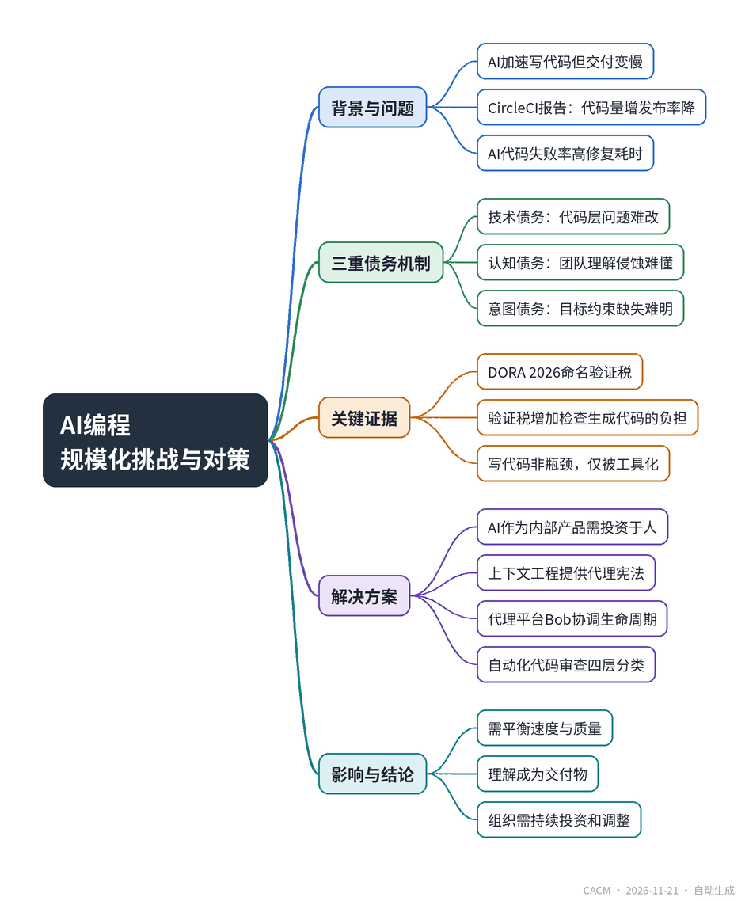

# The Next Frontier in AI-Enabled Coding: Scaling Development

## AI编程的下一前沿：规模化开发

**来源**：Communications of the ACM（News）　|　**发布**：2026-11-20 13:52（美东）　|　**北京时间**：2026-11-21 01:52　|　**作者**：Amy Buttell

[原文链接](https://cacm.acm.org/news/the-next-frontier-in-ai-enabled-coding-scaling-development/)　·　生成于 2026-11-21 15:47

---

## 一、摘要

> AI写代码更快，但交付更慢，三重债务是瓶颈。

AI编程工具能加速代码编写，但代码写完后瓶颈显现，开发完成和发布速度反而下降。CircleCI 2026报告显示，2025年9月研究期间代码量增加，但开发完成和发布率下降；AI代码失败率更高、修复更耗时，导致开发者时间损失和产品交付减少。维多利亚大学教授Margaret-Anne Storey提出三重债务概念：技术债务（代码层问题）、认知债务（团队共享理解侵蚀）、意图债务（外部化目标、约束和理由缺失）。DORA 2026报告将验证生成代码正确性、安全性和架构一致性的额外努力称为“验证税”。解决方案包括：将AI视为内部产品或服务，需投资于人和可观测性；采用上下文工程，为AI代理提供类似宪法的指导信息；使用代理式AI开发平台如IBM的Bob，协调专业代理覆盖软件生命周期；构建自动化代码审查，在提交、拉取请求、功能和发布四个层面分类发现。这些方案旨在简化AI编程流程，加速产品交付。

## 二、核心要点

1. CircleCI 2026报告：2025年9月研究期间，代码量增加但开发完成和发布率下降，AI代码失败率更高、修复更耗时。
2. Storey提出三重债务：技术债务使系统难改，认知债务使系统难懂，意图债务使系统目的难明。
3. DORA 2026报告命名“验证税”：检查生成代码正确性、安全性和架构一致性的额外努力。
4. 解决方案一：将AI作为内部产品或服务，需投资于人员培训和可观测性，而非仅技术。
5. 解决方案二：上下文工程，为AI代理提供类似宪法的指导信息，确保任务正确执行。
6. 解决方案三：IBM的Bob平台协调专业AI代理覆盖软件生命周期；Strider在四个层面用LLM审查代码并平衡工作量。

## 三、关键词对照

| English | 中文 |
| --- | --- |
| triple-debt concept | 三重债务概念 |
| technical debt | 技术债务 |
| cognitive debt | 认知债务 |
| intent debt | 意图债务 |
| verification tax | 验证税 |
| context engineering | 上下文工程 |
| agentic AI development platform | 代理式AI开发平台 |
| LLM | 大语言模型 |

## 四、中英对照全文

There’s little doubt AI-enabled coding tools can expedite the first part of the coding process: writing code. However, bottlenecks appear once the code is written, which call into question whether AI-enabled coding genuinely improves the speed at which development takes place and products ship.

> 毫无疑问，AI赋能的编码工具可以加速编码过程的第一部分：编写代码。然而，一旦代码编写完成，瓶颈就会出现，这让人质疑AI赋能的编码是否真正提高了开发速度和产品交付速度。

CircleCI’s 2026 State of Software Delivery documents the costs: while more code is being written, the rate at which development is finished and released fell at the same time during their study, which occurred between Sept. 1 to Sept. 28, 2025. AI-enabled code tends to fail at higher rates and takes longer to fix, which leads to more developer time lost, fewer products shipping, and questionable AI investment ROI.

> CircleCI的《2026年软件交付状况》记录了这些成本：在2025年9月1日至9月28日的研究期间，虽然编写的代码更多，但开发完成和发布的速率却同时下降。AI生成的代码失败率往往更高，修复时间更长，导致开发人员时间损失更多，产品交付更少，AI投资回报率存疑。

The next frontier in AI-enabled development seeks to harness the power of LLM-based AI coding platforms to scale coding and development to speed products (codes and programs) to market. Because LLM platforms develop and release new versions rapidly, defining the challenges involved in AI-enabled coding is a moving target.

> AI赋能开发的下一个前沿是 harnessing 基于LLM的AI编码平台的力量，以扩展编码和开发，加速产品（代码和程序）上市。由于LLM平台快速开发和发布新版本，定义AI赋能编码所涉及的挑战是一个不断变化的目标。

“The bottleneck is both a process problem and an understanding problem,” said Margaret-Anne Storey, professor of computer science at Canada’s University of Victoria. “Understanding now needs to be a deliverable. We always thought of code as the deliverable when humans were writing code because you would write the code, your program would execute, and your understanding was recoverable from the code. Now, AI writes the code, so what we need to do is think about the architecture, which influences product security, performance, integration, and evolution.”

> “瓶颈既是流程问题，也是理解问题，”加拿大维多利亚大学计算机科学教授Margaret-Anne Storey说。“理解现在需要成为一项交付成果。当人类编写代码时，我们一直认为代码是交付成果，因为你会编写代码，程序会执行，而你的理解可以从代码中恢复。现在，AI编写代码，所以我们需要做的是思考架构，这会影响产品安全性、性能、集成和演进。”

As understanding evolves, developers, teams, and organizations are identifying solutions to streamline the AI-enabled coding process and accelerate development and product shipment.

> 随着理解的发展，开发人员、团队和组织正在确定解决方案，以简化AI赋能的编码流程，加速开发和产品交付。

Challenges to Scaling AI-Enabled Coding

> 扩展AI赋能编码的挑战

AI-enabled coding, whether directly through AI coding assistants or through AI agents, creates three specific types of debt that then cascade into a variety of concrete challenges that developers, teams, and organizations encounter as they seek to accelerate development and product shipment.

> AI赋能的编码，无论是直接通过AI编码助手还是通过AI代理，都会产生三种特定类型的债务，然后级联成开发人员、团队和组织在寻求加速开发和产品交付时遇到的各种具体挑战。

Storey originated the triple-debt concept around software health, which she explained in a paper published in ACM Queue: “Technical debt refers to problems in the code layer, cognitive debt refers to erosion of the shared understanding across a team over time, and intent debt refers to a lack of externalized goals, constraints, and rationale that both humans and AI systems need to work safely and efficiently within a codebase.”

> Storey提出了关于软件健康的三重债务概念，她在发表于ACM Queue的一篇论文中解释道：“技术债务是指代码层的问题，认知债务是指团队共享理解随时间的侵蚀，意图债务是指缺乏外化的目标、约束和理由，而人类和AI系统都需要这些来在代码库中安全高效地工作。”

“Technical debt makes systems harder to change,” she continued in the paper. “Cognitive debt makes systems harder to understand. Intent debt makes it difficult to know what the system is actually for.”

> “技术债务使系统更难改变，”她在论文中继续道。“认知债务使系统更难理解。意图债务使人们难以知道系统实际是做什么的。”

For Nik Kale, principal engineer at networking company and contributor to the Coalition for Secure AI, AI coding must reduce the total effort required to deliver a dependable change to create value. “More AI in the building still means more change failures and more recovery work even after raw speed recovers,” he said.

> 对于网络公司首席工程师、安全AI联盟贡献者Nik Kale来说，AI编码必须减少交付可靠变更所需的总工作量，以创造价值。“建筑中更多的AI仍然意味着更多的变更失败和更多的恢复工作，即使在原始速度恢复之后，”他说。

“DORA’s 2026 report names the mechanism and calls it the verification tax, the added effort of checking whether generated code is correct, secure, and architecturally coherent,” Kale added. “Writing code was never really the bottleneck and rather was just the only part of the lifecycle anyone had bothered to instrument.”

> “DORA的2026年报告指出了这一机制，并称之为验证税，即检查生成的代码是否正确、安全和架构一致所增加的额外工作，”Kale补充道。“编写代码从来都不是真正的瓶颈，而只是生命周期中任何人费心去测量的唯一部分。”

Solutions to Scaling AI-Enabled Coding

> 扩展AI赋能编码的解决方案

Because LLM models are evolving rapidly, the solutions to scaling AI-enabled coding are in flux. At the same time, developers, teams, and organizations are starting to figure out the investment, processes, and procedures to implement to streamline AI coding, avoid or overcome bottlenecks, and expedite the entire process to accelerate product development. Several solutions are available.

> 由于LLM模型正在快速发展，扩展AI赋能编码的解决方案也在不断变化。与此同时，开发人员、团队和组织开始弄清楚需要实施的投资、流程和程序，以简化AI编码，避免或克服瓶颈，并加速整个过程以加速产品开发。有几种解决方案可用。

Treating AI as an internal product or service: “With the tools and investment, what’s going to be really potent in the next two to three years is the fact of treating how you are implementing AI as an internal product or service,” said David Longnecker, an AI and technology consultant. “Just like building up a team wiki in Sharepoint, an organizational AI tool is something that will have to be owned and maintained with observability and explainability behind it.”

> 将AI视为内部产品或服务：“有了工具和投资，未来两到三年内真正有效的是将你实施AI的方式视为内部产品或服务，”AI和技术顾问David Longnecker说。“就像在Sharepoint中建立团队wiki一样，组织AI工具是需要拥有和维护的东西，背后要有可观测性和可解释性。”

Longnecker described AI as “an internal service we provide,” explaining, “Here is the team that are the service providers in charge of rolling out standard operating procedures, teaching people who are using the tool independently to use it in the same direction. It’s going to require investment not just in technology, but in people. You can’t fire all the people because AI is going to do all the things; you’re going to have to hire them back to keep the AI in line.”

> Longnecker将AI描述为“我们提供的内部服务”，并解释说：“这是服务提供者团队，负责推出标准操作程序，教导独立使用该工具的人朝着同一方向使用它。这需要的不仅是对技术的投资，还有对人的投资。你不能因为AI将做所有事情就解雇所有人；你将不得不重新雇用他们来让AI保持秩序。”

Employing context engineering: Context engineering relates to managing the context developers give AI agents, according to Storey. “Context engineering involves thinking about the kind of information that we should give to our AI coding agents,” she said. “Sometimes it’s called a constitution; like a constitution for the agents, the advice that they need to do a task correctly.”

> 采用上下文工程：根据Storey的说法，上下文工程涉及管理开发人员提供给AI代理的上下文。“上下文工程涉及思考我们应该给AI编码代理提供什么样的信息，”她说。“有时它被称为宪法；就像代理的宪法，是他们正确完成任务所需的建议。”

Creating or using an agentic AI development platform: IBM launched an agentic AI development platform called Bob in April 2026 to automate the software development lifecycle. Instead of responding to isolated prompts, Bob coordinates specialized AI agents across roles and lifecycle stages. IBM uses Bob internally and makes Bob available to clients as an SaaS offering.

> 创建或使用代理式AI开发平台：IBM于2026年4月推出了一个名为Bob的代理式AI开发平台，以自动化软件开发生命周期。Bob不是响应孤立的提示，而是跨角色和生命周期阶段协调专门的AI代理。IBM在内部使用Bob，并将Bob作为SaaS产品提供给客户。

“Bob supports models that mimic different roles, rules that help create standardized templates, skills that help author playbooks, and tools that enable automation and gates for checkpointing,” said Neel Sundaresan, general manager of automation and AI at IBM. “These capabilities help create artifacts specific to individual states of the software development lifecycle, where Bob can assist, augment, or automate the work of a human in that role.”

> “Bob支持模拟不同角色的模型、帮助创建标准化模板的规则、帮助编写剧本的技能，以及实现自动化和检查点门控的工具，”IBM自动化和AI总经理Neel Sundaresan说。“这些能力有助于创建针对软件开发生命周期各个状态的工件，Bob可以在该角色中协助、增强或自动化人类的工作。”

Sundaresan noted that beyond efficiency, Bob streamlines the team dynamic, which allows development teams to align faster, iterate with confidence, and bring higher quality products to market.

> Sundaresan指出，除了效率之外，Bob还简化了团队动态，使开发团队能够更快地保持一致，自信地迭代，并将更高质量的产品推向市场。

Building automation to support and distribute code review: “We use LLMs to review code at four levels—commit, pull request, feature, and release—classifying findings according to internal definitions between must-fix and nice-to-fix,” said Breno Oliveira, chief technology officer at Strider, a platform for hiring and retaining remote developers. “We’ve also built automations that distribute code reviews more effectively, ensuring a balanced workload but also driving improved accuracy by ensuring, for example, that the reviewer is familiar with a feature or the code involved.”

> 构建自动化以支持和分发代码审查：“我们使用LLM在四个级别审查代码——提交、拉取请求、功能和发布——根据内部定义将发现分类为必须修复和最好修复，”Strider（一个用于招聘和留住远程开发人员的平台）的首席技术官Breno Oliveira说。“我们还构建了自动化，更有效地分发代码审查，确保工作量平衡，但也通过确保（例如）审查者熟悉相关功能或代码来提高准确性。”

## 附录：参考与脚注（原文）

References

1. Powell, R., and Schmitt, J. The New Reality of Software Delivery. CircleCI; https://circleci.com/resources/2026-state-of-software-delivery/

2. Storey, M-A. From Technical Debt to Cognitive and Intent Debt: Rethinking Software Health in the Age of AI. ACM Queue; https://queue.acm.org/doi/10.1145/3807966

3. Introducing IBM Bob: AI Development Partner that Takes Enterprises from AI-Assisted Coding to Production-Ready Software. IBM; https://bit.ly/48j2ZfB

Amy Buttell is a Silver Spring, MD-based technology, legal, and business journalist, content creator, writer, and ghostwriter.

---
*英文原文版权归 Communications of the ACM 及作者所有；中文译文由 AI 辅助生成，仅供学习参考。*