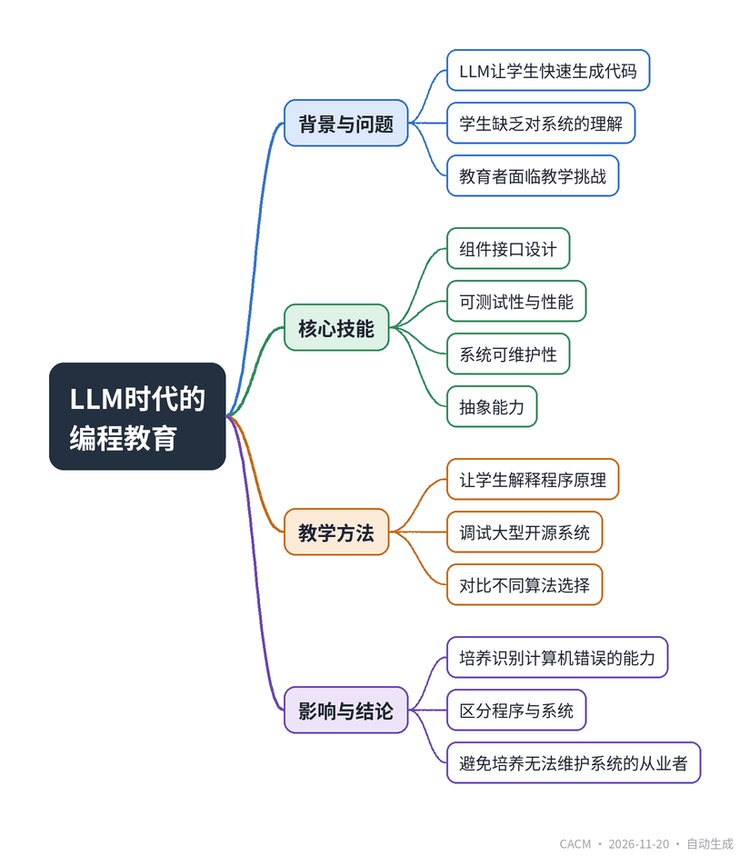

# When You Wish Upon a Prompt

## 当您向提示许愿时

**来源**：Communications of the ACM（）　|　**发布**：2026-11-20 11:08（美东）　|　**北京时间**：2026-11-20 23:08　|　**作者**：

[原文链接](https://cacm.acm.org/kode-vicious/when-you-wish-upon-a-prompt/)　·　生成于 2026-11-21 15:48

---

## 一、摘要

> 依赖LLM并不能教会你如何编写代码。

随着LLM在编程教育中的普及，学生可以轻松生成可运行的程序，但这导致他们缺乏对系统工作原理的理解。文章指出，软件工程的核心技能不是打字速度或发现语法错误，而是理解组件接口、可测试性以及系统整体构建。作者以自己高中实验报告为例，建议通过让学生解释现有程序、调试大型开源系统来培养这些技能，而不是重复实现排序算法。结论是，教育应注重培养学生判断计算机何时出错的能力，以及理解程序与系统的区别，否则将培养出无法维护系统的从业者。

## 二、核心要点

1. LLM能快速生成代码，但学生往往无法解释其工作原理，缺乏对系统的理解。
2. 软件工程的关键技能是设计组件接口、确保可测试性以及维护系统长期可维护性。
3. 作者建议通过让学生解释给定程序、调试大型开源系统来教学，而非重复实现基础算法。
4. 教育应培养学生识别计算机错误（包括LLM幻觉）的能力，这需要理解系统正确构建的形态。
5. 只有具备软件工程纪律的人才能成功使用LLM工具，因为他们能区分程序与系统。

## 三、关键词对照

| English | 中文 |
| --- | --- |
| LLM | 大语言模型 |
| software engineering | 软件工程 |
| abstraction | 抽象 |
| maintainability | 可维护性 |
| testability | 可测试性 |
| hallucination | 幻觉 |
| open source software | 开源软件 |

## 四、中英对照全文

Dear KV,

> 亲爱的KV：

I have noticed in your recent columns that, like everyone else, you are writing about LLMs and their effect on the practice of programming. As academics who have to teach the next generation of practitioners how to practice, my colleagues and I now find ourselves in the unenviable position of having to go back to the drawing board and work out ways to inculcate the necessary skills while competing with systems that help students complete tasks in considerably less time and with considerably less mental effort. It is well understood that mental effort is required to learn a topic, which is why writing notes by hand continues to result in better learning outcomes than typing them on a laptop or, even worse, absorbing a video lecture.

> 我注意到在你最近的专栏中，像其他人一样，你也在写关于LLM及其对编程实践的影响。作为必须教授下一代从业者如何实践的学者，我和同事们现在发现自己处于一个尴尬的境地：不得不重新开始，找出方法灌输必要的技能，同时还要与那些能帮助学生以更少时间和更少脑力完成任务的系统竞争。众所周知，学习一个主题需要脑力付出，这就是为什么手写笔记仍然比在笔记本电脑上打字或更糟地吸收视频讲座能带来更好的学习效果。

Since you are an older practitioner who is seeing this transition from the other side, what do you think those of us who are training your replacements should be teaching? Or is it time to let the machines do the work and just give our students our best wishes?

> 既然你是一位从另一面看待这一转变的资深从业者，你认为我们这些培训你的接班人的人应该教什么？还是时候让机器来完成工作，我们只需给学生最好的祝愿？

If Wishes Were Horses

> 如果愿望是马

Dear Wishes,

> 亲爱的愿望：

It is true that Kode Vicious, like many others in the industry, has been writing about, and more generally dealing with, the LLM craze/fad/bubble—pick a term here. As we have progressed through the past two or so years of this craze, I will call it, the thing that has struck me most is not the increase in our ability to produce more reams of code, but all the hand-wringing on all sides of, “Oh what do we do? What do we do?”

> 确实，Kode Vicious像业界许多其他人一样，一直在写关于LLM热潮/时尚/泡沫——随便选一个词——的文章，并且更普遍地应对它。随着我们走过过去大约两年的这种热潮（我这么称呼它），最让我震惊的不是我们生产更多代码的能力增强，而是各方都在绞尽脑汁：“哦，我们该怎么办？我们该怎么办？”

The key skills in software are not typing speed or the visual acuity to spot a missing dereference, but instead they are the skills of software engineering, writ large. What are these skills? They are the ones we were all supposed to be learning, during that one software engineering course everyone was required to take. As KV wrote eons ago, the best thing I ever got out of a software engineering course was reading the Mythical Man-Month by Fred Brooks, and while that book is a deserved classic, it is more about management than about the proper engineering of software artifacts.

> 软件的关键技能不是打字速度或发现缺失解引用运算符的视觉敏锐度，而是软件工程的技能，广义上说。这些技能是什么？它们是我们所有人都应该在那一门每个人必修的软件工程课程中学到的技能。正如KV很久以前写的，我从软件工程课程中得到的最好的东西是阅读Fred Brooks的《人月神话》，虽然这本书是当之无愧的经典，但它更多是关于管理而非软件制品的正确工程。

While most computing degrees during the past 50 or more years have concentrated on teaching specific technologies (programming in Fortran, or C, or Python, with a side of data structures) or instead went in the other direction into the aerie ether of functional languages and closures, very little time was spent on teaching people how to think about systems.

> 在过去50多年里，大多数计算学位都专注于教授特定技术（用Fortran、C或Python编程，外加数据结构），或者相反地走向函数式语言和闭包的高深领域，很少花时间教人们如何思考系统。

Now I know that everyone is surprised that KV can be a pedant, but let’s start with the basics. A program is a set of instructions to the computer that get the hardware to do something—hopefully something productive, but at least something. The best programs are made up of libraries, smaller pieces of code that tell the computer to do a more narrowly defined thing. Code, in all its forms, describes algorithms, abstract concepts of how a computer can do a thing. Programs are written in languages that are, supposedly, better at representing the ideas of their human creators than, say, machine code. The keys to making a good software system do not lie in the language specifics or its syntax, although one can make some truly dreadful messes of both, but rather in how the system is put together.

> 现在我知道每个人都惊讶KV可以是个学究，但让我们从基础开始。程序是给计算机的一组指令，让硬件做某事——希望是有成效的事，但至少是某事。最好的程序由库组成，库是告诉计算机做更 narrowly 定义的事情的较小代码片段。各种形式的代码描述算法，即计算机如何做某事的抽象概念。程序用语言编写，这些语言据说比机器码更能代表其人类创造者的想法。构建良好软件系统的关键不在于语言细节或其语法，尽管人们可以把两者都搞得一团糟，而在于系统如何组合在一起。

The keys to good software engineering are the interfaces between components, the testability of those components, both for correctness and performance, and how the whole system works together to yield something that is both usable and maintainable over the long term. These are the skills that software engineers need to be trained in—not being able to scan 100 lines of code for a missing asterisk. The computer can do that, and now even faster with the help of LLMs.

> 良好软件工程的关键是组件之间的接口、这些组件的可测试性（包括正确性和性能），以及整个系统如何协同工作以产生长期可用和可维护的东西。这些是软件工程师需要接受的训练——而不是能够扫描100行代码寻找缺失的星号。计算机可以做到这一点，现在借助LLM甚至更快。

When compilers first started replacing assemblers and machine code, they allowed for new levels of abstraction. And it is this topic, abstraction, that we must continue to teach, because it is at the heart of maintainable systems. With the current LLMs, anyone can generate a working program based on a wish—that is, if they wish hard enough (that is, they prompt a lot). But a program is not a system, and the only people KV has seen be successful with these new tools are those who already have the software engineering discipline to know the difference between a program and a system.

> 当编译器首次开始取代汇编器和机器码时，它们允许了新的抽象层次。而正是这个主题——抽象——我们必须继续教授，因为它是可维护系统的核心。有了当前的LLM，任何人都可以基于愿望生成一个可工作的程序——也就是说，如果他们愿望足够强烈（即，他们大量提示）。但程序不是系统，KV见过的唯一能成功使用这些新工具的人是那些已经具备软件工程纪律、知道程序与系统区别的人。

How would KV teach such topics? The first thing academia will have to do is to dedicate a lot more time to mentoring interaction, perhaps through teaching assistants who take the time to probe the designs the students show to them. It’s pretty clear that most current programming projects can be solved by the best LLMs without much work from the students. But if you ask the student, “How does it work?”, you will find they often do not know. Finding ways to get them to the point where they can explain how it works is key to training the next group of practitioners.

> KV会如何教授这些主题？学术界要做的第一件事是投入更多时间进行指导性互动，也许通过助教花时间探究学生向他们展示的设计。很明显，当前大多数编程项目可以被最好的LLM解决，学生不需要太多工作。但如果你问学生“它如何工作？”，你会发现他们通常不知道。找到方法让他们能够解释它如何工作，是培训下一批从业者的关键。

KV was lucky enough to go to high school in a state that required lab reports for all science courses (biology, chemistry, and physics). Once a week we did an experiment and then had to write it up in a typical “Hypothesis, Experimental Design, Measurements, Evaluation, Conclusions” format. For computer science students, you might just give them the whole program and a set of inputs and ask, “Why?” Now, can an LLM answer this as well? Yes, for simple systems, but it turns out that someone with experience can probe and ask questions the student failed to ask of the LLM since the student does not even know to ask them. A few rounds of this will teach the student what is and is not important in understanding a system—far more than making them implement bubble sort ever would.

> KV很幸运在一个要求所有科学课程（生物、化学和物理）提交实验报告州上高中。每周我们做一个实验，然后必须以典型的“假设、实验设计、测量、评估、结论”格式写出来。对于计算机科学学生，你也许可以给他们整个程序和一组输入，然后问“为什么？”现在，LLM也能回答这个吗？是的，对于简单系统，但事实证明，有经验的人可以探究并提出学生未能向LLM提出的问题，因为学生甚至不知道要问。几轮这样的训练将教会学生理解系统时什么重要什么不重要——远比让他们实现冒泡排序更有效。

Implementing bubble sort does not teach you about when or why to use it, or what the proper interfaces to such an algorithm might be. Questions about sorting algorithms, given the same inputs, and then asking the student to explain why you choose one over the other will actually teach them about algorithmic complexity, performance, and proper APIs.

> 实现冒泡排序不会教你何时或为何使用它，或者这种算法的正确接口可能是什么。关于排序算法的问题，给定相同输入，然后要求学生解释为什么选择一种而非另一种，实际上会教他们算法复杂度、性能和正确的API。

One of the great teaching advances that is not used often enough is the gigantic corpus of open source software that exists in the world today. It is far more educational to give students a large working system and have them debug it than it is to see if they can each, individually or in pairs, write a sorting algorithm (or whatever other piece of code you would expect a first-year student to crank out over a week or two).

> 一个未被充分利用的伟大教学进步是当今世界上存在的巨大开源软件 corpus。给学生一个大型可工作的系统并让他们调试，比看看他们每个人单独或成对编写一个排序算法（或你期望一年级学生在一两周内完成的任何其他代码）更有教育意义。

Newly minted practitioners will need a skill that many of us developed naturally, which is to know when the computer is wrong. And this is even more true when using LLMs. People say, “The LLMs lie,” or they “hallucinate,” even though anthropomorphizing computers does not help at all.

> 新入行的从业者需要一种我们许多人自然发展出的技能，即知道计算机何时出错。在使用LLM时更是如此。人们说“LLM说谎”或“产生幻觉”，尽管将计算机拟人化根本无济于事。

The ability to separate the wheat from the chaff is something every software engineer has had to learn how to do, more often on the job than in school. The wheat and the chaff used to come from other programmers. Now it also comes from the computer itself, but the mental skills to deal with it are the same as they ever were. It comes down to knowing how a system looks when it is properly put together. Teach these skills and you, as well as those of us who live long enough to use systems coded by these students, will be grateful. Teach them to spot an errant asterisk, however, and we are all going to be very, very unhappy.

> 区分好坏的能力是每个软件工程师都必须学会的，通常是在工作中而非在学校。好坏过去来自其他程序员。现在也来自计算机本身，但处理它的心理技能与以往相同。归根结底是知道一个系统正确组合时是什么样子。教授这些技能，你以及我们中活得足够长以使用这些学生编写的系统的人都会感激。然而，教他们发现错误的星号，我们都将非常非常不高兴。

KV

> KV

### Related articles
*相关文章*

The Drunken Plagiarists Kode Vicious https://queue.acm.org/detail.cfm?id=3711675

> 醉酒抄袭者 Kode Vicious https://queue.acm.org/detail.cfm?id=3711675

Is There Another System? Kode Vicious https://queue.acm.org/detail.cfm?id=3639446

> 还有另一个系统吗？ Kode Vicious https://queue.acm.org/detail.cfm?id=3639446

The Chess Player who Couldn’t Pass the Salt Kode Vicious https://queue.acm.org/detail.cfm?id=3029797

> 无法通过盐的棋手 Kode Vicious https://queue.acm.org/detail.cfm?id=3029797

---
*英文原文版权归 Communications of the ACM 及作者所有；中文译文由 AI 辅助生成，仅供学习参考。*