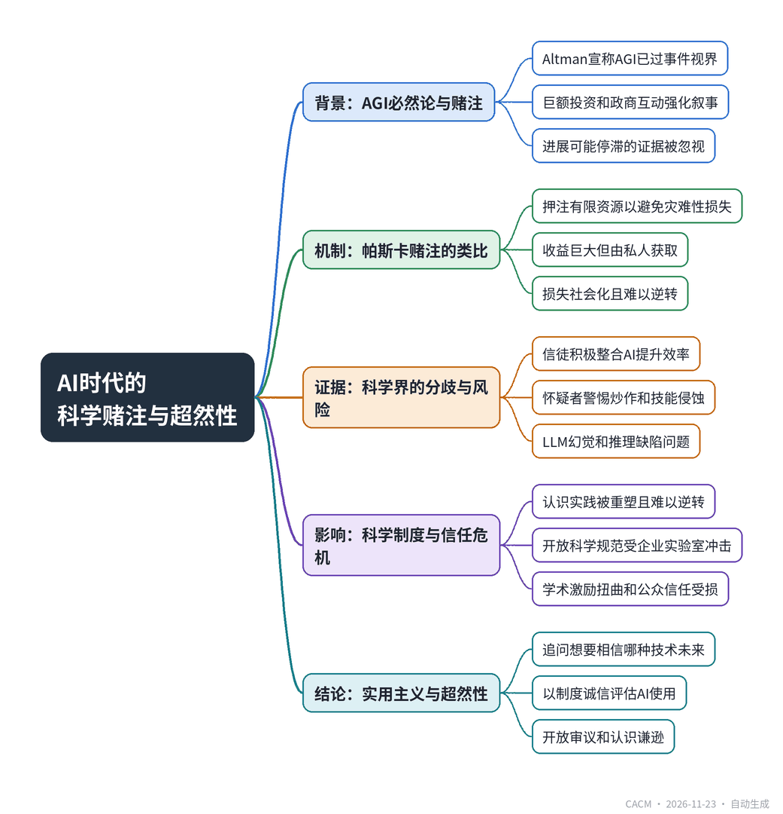

# Revisiting Pascal’s Wager: A Pragmatist Approach to Scientific Inquiry in the Age of AI

## 重访帕斯卡赌注：AI时代科学探究的实用主义进路

**来源**：Communications of the ACM（）　|　**发布**：2026-11-23 11:50（美东）　|　**北京时间**：2026-11-23 23:50　|　**作者**：

[原文链接](https://cacm.acm.org/opinion/revisiting-pascals-wager-a-pragmatist-approach-to-scientific-inquiry-in-the-age-of-ai/)　·　生成于 2026-11-24 18:31

---

## 一、摘要

> 在各方为私利押注AI必然性的社会语境中，科学家有道德义务保持一定程度的超然性。

OpenAI CEO Sam Altman宣称AGI已不可避免，巨额资金和政商互动强化了这一叙事，但证据显示进展可能停滞。这种对AGI的押注在结构上类似帕斯卡赌注：押注有限资源以避免灾难性损失并获取巨大收益。然而，该赌注并非价值中立，它由私人利益和错失恐惧驱动，并已渗透学术界——LLM能提升效率，但存在幻觉和推理缺陷，过度依赖可能侵蚀批判性思维等技能。科学界因此出现分歧：信徒积极整合AI，怀疑者则警惕炒作和过早采用的危害。文章指出，AI赌注与帕斯卡赌注有三点关键差异：AI效用原则上可实证检验；采用AI的成本会重塑难以逆转的认识实践；收益私有化而损失社会化。实用主义建议我们追问：基于所持价值和希望维系的生活方式，我们应相信哪种技术未来？科学家应保持超然性，以科学制度诚信为标准评估AI使用，并通过开放、包容的审议制定情境敏感的标准。认识谦逊至关重要，学术激励结构也需重新平衡，从产出数量转向稳健性、开放性和社会相关性。否则，科学机构的信任将受损，科学家可能沦为他人AI教会的附庸。

## 二、核心要点

1. Altman等AI领袖宣称AGI不可避免，但证据表明进展可能停滞或放缓，巨额投资和政商互动强化了这一叙事。
2. 对AGI的押注在结构上类似帕斯卡赌注，但并非价值中立，而是由私人利益和错失恐惧驱动，并已影响学术界。
3. LLM可提升研究效率，但存在幻觉和推理缺陷，过度依赖可能侵蚀批判性阅读、论证和判断等核心科学技能。
4. AI赌注与帕斯卡赌注有三点关键差异：AI效用可实证检验；采用成本会重塑难以逆转的认识实践；收益私有化而损失社会化。
5. 实用主义建议科学家保持超然性，以科学制度诚信为标准评估AI使用，并通过开放审议制定情境敏感的标准。
6. 学术激励结构需从产出数量转向稳健性、开放性和社会相关性，以抵御赌注式炒作，维护科学作为公共产品的信誉。

## 三、关键词对照

| English | 中文 |
| --- | --- |
| Pascal's Wager | 帕斯卡赌注 |
| Pragmatism | 实用主义 |
| Artificial General Intelligence (AGI) | 通用人工智能 |
| Large Language Models (LLMs) | 大语言模型 |
| Disinterestedness | 超然性 |
| Epistemic Humility | 认识谦逊 |
| Mertonian Norms | 默顿规范 |
| Epistemic Practices | 认识实践 |

## 四、中英对照全文

If OpenAI CEO Sam Altman is to be believed, “we are past the event horizon, the take-off [toward singularity] has started.” In other words, according to Altman (and many AI luminaries and advocates), artificial general intelligence (AGI) is inevitable. Hundreds of billions of dollars funneled to OpenAI and adjacent ventures, and Altman’s engagement with world leaders lend his words considerable weight. Few powerful firms appear willing to bet against this narrative of inevitability—despite evidence that progress may have stalled or at least slowed.

> 如果 OpenAI CEO Sam Altman 的话可信，那么“我们已经越过了事件视界，起飞（朝向奇点）已经开始。”换言之，根据 Altman（以及许多 AI 名人和倡导者）的说法，通用人工智能（AGI）不可避免。数千亿美元涌入 OpenAI 及相关企业，加上 Altman 与世界领导人的接触，使他的言论颇具分量。很少有强大的公司愿意押注于这种不可避免性的叙事——尽管有证据表明进展可能已经停滞或至少放缓。

The reasoning undergirding the reluctance to challenge the AGI narrative (often echoed by prominent figures including Altman himself), resembles a modern-day Pascal’s Wager, at least structurally in a logical sense: If AI will transform everything, those who adopt it early are likely to thrive; those who do not risk irrelevance. What it there to lose in betting on its success? In both the theological and technological versions, the wager is framed as a rational choice under uncertainty: Stake something finite now in order to avoid catastrophic loss and to secure potentially enormous gains.

> 支撑这种不愿挑战 AGI 叙事的推理（常被包括 Altman 本人在内的知名人物附和），类似于现代版的帕斯卡赌注，至少在逻辑结构上如此：如果 AI 将改变一切，那么尽早采用它的人可能会兴旺发达；不采用的人则面临被边缘化的风险。押注其成功有什么可失去的呢？在神学和技术版本中，赌注都被框定为不确定性下的理性选择：现在投入一些有限的东西，以避免灾难性损失并确保潜在的巨大收益。

Yet, this wager is neither an innocent rational calculus and nor is it value neutral. It is driven by considerations of private gain as well as fear of missing out while others capitalize on the opportunity. The underlying assumption here is that private gain is desirable, even at the expense of social good. This argument is seductive, especially in academia, where the pressure to publish is relentless and those who fail to do so presumably fall by the wayside or do not get tenure. Large language models (LLMs) can summarize papers, generate hypotheses, and even draft manuscripts. Consequently, researchers who embrace the use of LLMs gain substantial advantages over those who resist it, at least in efficiency. The use of AI in scholarship seems to be becoming increasingly normalized and even encouraged for a wide variety of tasks ranging from editing to “thinking.” At the same time, there is mounting evidence that LLMs do not “reason” in any meaningful sense and hallucinations remain an intractable problem. Other researchers worry about what it means to be a scientist in the age of AI if thinking is increasingly outsourced to bots, and whether overreliance on such tools erodes skills such as critical reading, argumentation, and judgment.

> 然而，这个赌注既不是无辜的理性计算，也不是价值中立的。它由对私人利益的考虑以及对错过他人利用机会的恐惧所驱动。这里的基本假设是，私人利益是可取的，即使以社会公益为代价。这个论点很有诱惑力，尤其是在学术界，发表压力无情，那些未能发表的人想必会半途而废或得不到终身教职。大型语言模型（LLM）可以总结论文、生成假设，甚至起草手稿。因此，拥抱使用 LLM 的研究人员比抵制它的人获得实质性优势，至少在效率上如此。在学术中使用 AI 似乎正变得越来越正常化，甚至被鼓励用于从编辑到“思考”的各种任务。与此同时，越来越多的证据表明，LLM 并不以任何有意义的方式“推理”，幻觉仍然是一个棘手的问题。其他研究人员担心，如果思考越来越多地外包给机器人，在 AI 时代成为科学家意味着什么，以及过度依赖此类工具是否会侵蚀批判性阅读、论证和判断等技能。

The result is not a clean split into two hostile camps, but emerging fault lines within the scientific community. On one end of the spectrum are “believers” who are eager to integrate AI into nearly every facet of their work. They point to impressive applications such as designing new proteins, generating novel research ideas, or decoding historical texts as evidence that resistance is irrational. On the other end are researchers who remain skeptical of the hype. They highlight indications that some kinds of AI development are hitting a wall and emphasize the pernicious implications of premature adoption, including loss of critical thinking and overconfidence in opaque systems. The same applies to the shifting boundary between public and private AI research. As more development moves into corporate labs bound by trade secrets and competitive pressures, norms of open science are strained. The developments are concerning—science thrives on engagement between scientists, but only when it is grounded in mutual respect and a shared commitment to evidence with the aim that a provisional consensus is reached. The loss or dilution of scientific communities poses a challenge for science.

> 结果并不是干净地分裂成两个敌对阵营，而是科学界内部出现了新的断层线。一端是“信徒”，他们渴望将 AI 融入工作的几乎每个方面。他们指出设计新蛋白质、生成新颖研究想法或解码历史文本等令人印象深刻的应用，作为抵制不理性的证据。另一端是对炒作持怀疑态度的研究人员。他们强调有迹象表明某些类型的 AI 开发正撞墙，并强调过早采用的恶性影响，包括丧失批判性思维和对不透明系统的过度自信。这同样适用于公共和私人 AI 研究之间不断变化的边界。随着更多开发转移到受商业秘密和竞争压力约束的企业实验室，开放科学的规范受到压力。这些发展令人担忧——科学依赖于科学家之间的互动，但只有当这种互动建立在相互尊重和对证据的共同承诺之上，并以达成临时共识为目标时，科学才能蓬勃发展。科学界的丧失或稀释对科学构成挑战。

### Pascal’s Wager in the Age of AI
*AI 时代的帕斯卡赌注*

To make sense of these developments, it is helpful to recall the structure—not the theology—of Pascal’s original wager. In its simplest form, the wager presents four possibilities: God exists or does not exist; one believes or does not believe. Belief combined with God’s existence supposedly yields infinite gain (salvation), whereas disbelief combined with God’s existence yields infinite loss (damnation); if God does not exist, the gains or losses are finite. From a purely calculative perspective, staking one’s finite life on belief seems rational.

> 为了理解这些发展，回顾帕斯卡原始赌注的结构——而非神学——是有帮助的。在其最简单的形式中，赌注呈现四种可能性：上帝存在或不存在；一个人相信或不信。信仰加上上帝存在据称产生无限收益（救赎），而不信加上上帝存在产生无限损失（诅咒）；如果上帝不存在，收益或损失是有限的。从纯粹计算的角度来看，将有限的生命押在信仰上似乎是理性的。

Altman’s rhetoric and the wider AGI discourse can be read as a secularized version of this matrix. One can adopt AI tools and narratives of AGI’s inevitability, or one can resist them. If AGI truly transforms everything, early adopters are depicted as enjoying extraordinary rewards—funding, influence, and prestige—while laggards’ risk institutional irrelevance. If AGI does not materialize as promised, the story goes, early adopters have sacrificed only finite resources: some time, money, and perhaps a few misdirected research efforts. Using this framing, it appears rational to “believe” in AGI’s inevitability and act accordingly. But this discourse that structurally mirrors Pascal’s wager obscures at least three features that matter for science.

> Altman 的言论和更广泛的 AGI 话语可以解读为这个矩阵的世俗化版本。人们可以采用 AI 工具和 AGI 不可避免性的叙事，也可以抵制它们。如果 AGI 真正改变一切，早期采用者被描绘成享有非凡回报——资金、影响力和声望——而落后者则面临机构边缘化的风险。如果 AGI 没有像承诺的那样实现，故事是这样的，早期采用者只牺牲了有限的资源：一些时间、金钱，也许还有一些方向错误的研究努力。使用这个框架，似乎理性地“相信”AGI 的不可避免性并据此行动。但这种在结构上镜像帕斯卡赌注的话语至少掩盖了对科学至关重要的三个特征。

First, Pascal’s original argument concerned belief in a metaphysical claim whose truth value could not be empirically settled. In contrast, the utility of AI in research—whether LLMs improve peer review, or whether particular models aid protein design—is, in principle, subject to evidence and evaluation. What looks like “belief” in AGI is often better understood as a set of expectations about technological trajectories, institutions, and markets. Here, pragmatism is helpful: for Charles Sanders Peirce, belief is not a purely mental state but is associated with a “habit of action.” Whether we label it belief or expectation, the practical issue is which habits scientists should adopt given conditions of uncertainty

> 首先，帕斯卡的原始论证涉及对一个形而上学主张的信仰，其真值无法通过经验解决。相比之下，AI 在研究中的效用——LLM 是否改善同行评审，或特定模型是否有助于蛋白质设计——原则上受证据和评估的约束。在 AGI 中看起来像“信仰”的东西，通常更好地理解为关于技术轨迹、制度和市场的一系列期望。在这里，实用主义是有帮助的：对于 Charles Sanders Peirce 来说，信仰不是纯粹的精神状态，而是与“行动习惯”相关联。无论我们称之为信仰还是期望，实际问题是科学家在不确定性条件下应该采取哪些习惯。

Second, the costs of “believing” in AI are not limited to individual researchers’ time or funding. If AI tools are adopted uncritically, they may reshape entire epistemic practices ranging from how data are collected and how claims are justified to how credit is assigned, in ways that are difficult to reverse. Unlike Pascal’s imagined sinner who can simply repent, scientific institutions cannot easily roll back infrastructures, incentives, and norms once they have been reconfigured around particular technologies.

> 其次，“相信”AI 的成本不仅限于个别研究人员的时间或资金。如果 AI 工具被不加批判地采用，它们可能会重塑整个认识实践，从数据如何收集、主张如何被证明到功劳如何分配，其方式难以逆转。与帕斯卡想象中可以简单悔改的罪人不同，科学机构一旦围绕特定技术重新配置了基础设施、激励和规范，就无法轻易回滚。

Third, the wager’s payoff structure is not neutral. In contemporary AI discourse, the implied “infinite gain” is overwhelmingly private: monopoly profits, strategic dominance, or personal success. Losses, by contrast, are often socialized—borne by those excluded from decision making, or by people that must live with the consequences of biased systems, environmental costs, or weakened scientific institutions.

> 第三，赌注的收益结构不是中立的。在当代 AI 话语中，隐含的“无限收益”绝大多数是私人的：垄断利润、战略主导地位或个人成功。相比之下，损失往往是社会化的——由被排除在决策之外的人承担，或由必须忍受有偏见系统、环境成本或科学机构削弱后果的人承担。

### The Way Forward
*前进之路*

Pragmatism suggests a different question from “Should we believe in AGI?” or “Is it rational to bet on AI?” Instead, it asks: In which technological future do we want to believe, given the values we hold and the forms of life we wish to sustain? Beliefs about the future of AI are not value neutral; they are intertwined with commitments about what counts as progress, whose interests should be served, and which risks are acceptable.

> 实用主义提出了一个不同的问题，而不是“我们应该相信 AGI 吗？”或“押注 AI 理性吗？”相反，它问：鉴于我们持有的价值观和我们希望维持的生活形式，我们希望相信哪种技术未来？关于 AI 未来的信念不是价值中立的；它们与关于什么算作进步、应该服务谁的利益以及哪些风险可接受的承诺交织在一起。

Disinterestedness is particularly relevant in an environment suffused with AI wagers. A scientist who is personally invested in an AI company, for instance, may find it difficult to evaluate contrary evidence, just as a theologian might struggle to assess arguments undermining their faith. By contrast, a disinterested scientist aims to keep inquiry open, allowing evidence and shared standards to shape beliefs rather than precommitting to AI’s success or failure.

> 在一个充满 AI 赌注的环境中，无私性尤其相关。例如，一个个人投资于 AI 公司的科学家可能会发现难以评估相反的证据，就像神学家可能难以评估破坏其信仰的论点一样。相比之下，一个无私的科学家旨在保持探究开放，让证据和共同标准塑造信念，而不是预先承诺 AI 的成功或失败。

Researchers who embrace disinterestedness can evaluate the use of AI in science—whether for text editing, coding, data analysis, or discovery—not by asking, “What do I stand to gain if this bet pays off?” but “How does this use affect the integrity of the institution of science, which is meant to serve the greater good?” Some uses of AI, such as grammar and style editing, may raise relatively modest epistemic concerns while offering accessibility benefits; others, such as automated hypothesis generation or analysis of sensitive datasets, raise deeper questions about reproducibility, bias, and the distribution of epistemic authority.

> 拥抱无私性的研究人员可以评估 AI 在科学中的使用——无论是用于文本编辑、编码、数据分析还是发现——不是通过问“如果这个赌注成功，我能得到什么？”而是“这种使用如何影响科学机构的完整性，而科学机构旨在服务更大的利益？”某些 AI 用途，如语法和风格编辑，可能引起相对温和的认识论担忧，同时提供可访问性好处；其他用途，如自动假设生成或敏感数据集分析，则引发关于可重复性、偏见和认识权威分配的更深层次问题。

Because scientific fields differ in methods, stakes, and histories, plural, context-sensitive standards are required. Blanket policies that mandate AI use or ban it outright risk both overreach and oversight. In some domains, communities may reach a broad consensus that certain AI tools are acceptable adjuncts to established practices; in others, they may conclude that heavy reliance on such tools would erode core disciplinary skills or introduce unacceptable vulnerabilities. What matters, from a pragmatist and Mertonian perspective, is that these decisions emerge from open, inclusive deliberation rather than from one-sided wagers by actors with concentrated power. To recognize and accommodate variations in beliefs, we need to create (more) spaces for thoughtful disagreement where all voices raised in good faith are welcome.

> 由于科学领域在方法、利害关系和历史方面各不相同，需要多元的、情境敏感的标准。强制使用 AI 或彻底禁止的全面政策既有过度干预的风险，也有监督不足的风险。在某些领域，社区可能达成广泛共识，认为某些 AI 工具是既定实践的可接受辅助；在其他领域，他们可能得出结论，严重依赖此类工具会侵蚀核心学科技能或引入不可接受的脆弱性。从实用主义和默顿主义的角度来看，重要的是这些决定来自开放、包容的审议，而不是来自拥有集中权力的行为者的一厢情愿的赌注。为了承认和适应信仰的差异，我们需要创造（更多）空间进行深思熟虑的分歧，欢迎所有真诚提出的声音。

This is where epistemic humility becomes crucial. No one—Altman included—has all the answers about where AI is headed or what its long-term effects will be. Uncertainty should not paralyze inquiry, but it should temper grandiose claims and encourage careful experimentation. Precisely because the stakes are high, scientists and institutions must proceed critically and collaboratively, be precise in their language, and resist overstating what current AI systems can do.

> 这就是认识谦逊变得至关重要的地方。没有人——包括 Altman——对 AI 的走向或其长期影响有所有答案。不确定性不应使探究瘫痪，但它应该缓和宏大的主张并鼓励仔细的实验。正因为利害关系重大，科学家和机构必须批判性和协作性地进行，语言要精确，并抵制夸大当前 AI 系统能做什么。

Finally, the underlying incentive structures in academia require reconsideration. AI adoption offers an opportunity for an “audit” of sorts. In grant writing, for instance, including an AI component can function as a Pascalian bet: the additional effort required is modest, yet the perceived chance of securing scarce funds is substantially higher than for proposals that refuse the AI frame—though evaluators may react the opposite way, welcoming a proposal precisely because it does not follow the herd. If researchers feel compelled to add AI components to projects simply to stay competitive, this suggests that incentives for publications and visibility may be crowding out the vocation of science as a public good. Rebalancing incentives away from sheer volume of output and toward robustness, openness, and social relevance could reduce fraud, encourage deeper engagement with societal problems, and make it easier for researchers to resist wager-based hype.

> 最后，学术界的基本激励机制需要重新考虑。AI 的采用提供了一个“审计”的机会。例如，在拨款写作中，包含 AI 组件可以起到帕斯卡赌注的作用：所需的额外努力不大，但获得稀缺资金的感觉机会远高于拒绝 AI 框架的提案——尽管评估者可能反应相反，恰恰因为提案不随大流而欢迎它。如果研究人员仅仅为了保持竞争力而觉得被迫在项目中添加 AI 组件，这表明发表和知名度的激励可能排挤了科学作为公共利益的使命。将激励从单纯的产出量重新平衡到稳健性、开放性和社会相关性，可以减少欺诈，鼓励更深入地参与社会问题，并使研究人员更容易抵制基于赌注的炒作。

The consequences of how scientists engage with AI extend beyond the university walls. To the extent that scientists abdicate their duty of disinterestedness, trust in the institution of science will be undercut, and our voices might be treated with cynicism often reserved for business moguls. The ripple effect of premature adoption of AI universities—driven by a fear of missing out—is already being felt with even students raising an alarm. After all, what good is a degree that essentially reflects proficiency in using ChatGPT?

> 科学家如何与 AI 互动的后果超出了大学围墙。如果科学家放弃无私的责任，对科学机构的信任将被削弱，我们的声音可能会被愤世嫉俗地对待，这种态度通常保留给商业大亨。大学过早采用 AI 的涟漪效应——由害怕错过驱动——已经感受到，甚至学生也发出警报。毕竟，一个本质上反映使用 ChatGPT 熟练程度的学位有什么好处？

To be sure, this dynamic concerning the implications of embracing new technology is not new. Throughout history, technological revolutions have been accompanied by fervent belief and equally fervent skepticism. What makes the current moment unique is the speed and opacity of AI development as well as the concentration of wealth associated with its development. Very often, ardent advocates of AI adoption (in the Silicon Valley) have their fortunes tied with it, which, at the very least, suggests that there might be a conflict of interest. In addition, the motives of at least some of these powerful advocates are not as pure as they seem. To assume otherwise is foolish as James Madison warned us in Federalist Paper no. 51.

> 诚然，这种关于拥抱新技术影响的动态并不新鲜。纵观历史，技术革命伴随着狂热的信仰和同样狂热的怀疑。当前时刻的独特之处在于 AI 发展的速度和不透明性，以及与其发展相关的财富集中。通常，AI 采用的热情倡导者（在硅谷）的财富与之相关，这至少表明可能存在利益冲突。此外，至少其中一些强大倡导者的动机并不像看起来那么纯粹。假设相反是愚蠢的，正如 James Madison 在《联邦党人文集》第 51 篇中警告我们的那样。

### Conclusion
*结论*

According to Sam Altman, “Successful people build companies. More successful people build countries. The most successful people build religions […] It appears to me that the best way to build a religion is actually to build a company.” The rush to embrace AI reflects a familiar Silicon Valley ethos of “moving fast and breaking things,” underwritten by the assumption that whatever is broken can later be fixed. Yet, as the nursery rhyme Humpty Dumpty reminds us, some things, once broken, cannot be put back together. Rolling back a line of code or withdrawing a model does not erase the harms it may have caused—to individuals wrongly classified, to public trust in institutions, or to the norms of scientific practice.

> 根据 Sam Altman 的说法，“成功的人建立公司。更成功的人建立国家。最成功的人建立宗教[…]在我看来，建立宗教的最佳方式实际上是建立公司。”急于拥抱 AI 反映了熟悉的硅谷精神“快速行动，打破事物”，其基础是假设任何被打破的东西以后都可以修复。然而，正如童谣 Humpty Dumpty 提醒我们的那样，有些东西一旦破碎，就无法复原。回滚一行代码或撤回一个模型并不能消除它可能造成的伤害——对错误分类的个人、对公众对机构的信任，或对科学实践的规范。

Altman’s take may, at first blush, seem to offer a compelling narrative for embracing AI: in a world of uncertainty, why not bet on the side that promises transformation? But a pragmatist perspective exposes the wager’s hidden premises about who benefits, who bears the risks, and which futures become thinkable. The future of AI is open ended and mutable; it is not simply given by any one person’s imagination, however influential.

> Altman 的观点乍一看似乎提供了一个令人信服的拥抱 AI 的叙事：在一个不确定的世界里，为什么不押注于承诺变革的一方？但实用主义视角揭示了赌注的隐藏前提：谁受益，谁承担风险，以及哪些未来变得可想象。AI 的未来是开放和可变的；它不仅仅由任何一个人的想象力所给定，无论其多么有影响力。

If science is to serve the public good in an age of rapid AI advancement, scholars and institutions must move beyond wager-based hype or fearful retreat. They must instead engage in open and critical deliberation about which technological futures to pursue, how to align them with widely shared values, and when to say “no” even in the face of seductive promises. That requires reaffirming disinterestedness, epistemic humility, and a commitment not to block the way of inquiry. Only then can scientific institutions resist becoming mere chapels in someone else’s Church of AI.

> 如果科学要在 AI 快速进步的时代服务公共利益，学者和机构必须超越基于赌注的炒作或恐惧的退缩。相反，他们必须进行开放和批判性的审议，讨论追求哪些技术未来，如何使其与广泛共享的价值观保持一致，以及何时说“不”，即使面对诱人的承诺。这需要重申无私性、认识谦逊，以及承诺不阻碍探究之路。只有这样，科学机构才能抵制成为他人 AI 教堂中的小教堂。

---
*英文原文版权归 Communications of the ACM 及作者所有；中文译文由 AI 辅助生成，仅供学习参考。*