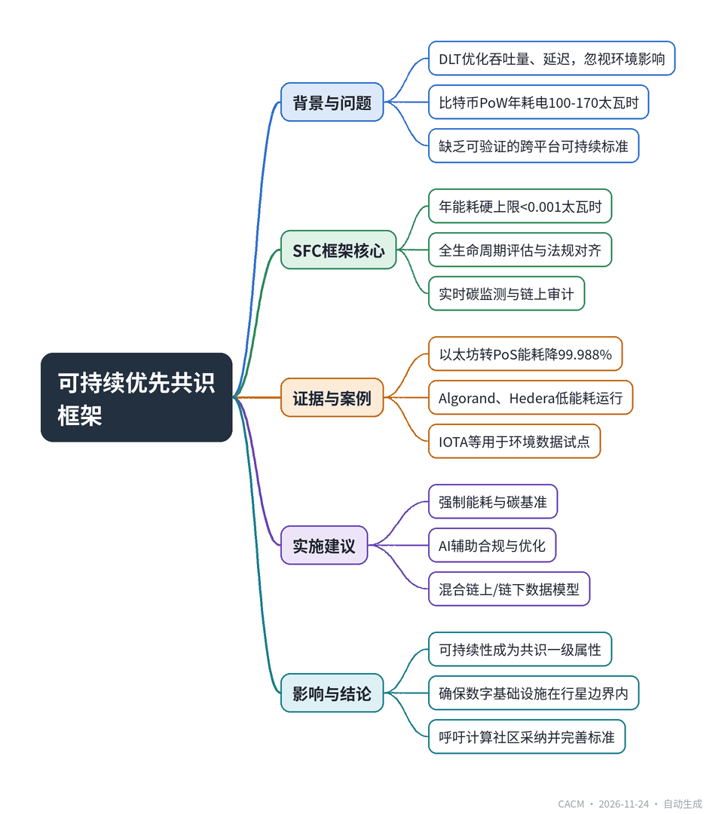

# ‘Sustainability-First Consensus’ Ledgers for a Green Digital Future

## 可持续优先共识：绿色数字未来

**来源**：Communications of the ACM（）　|　**发布**：2026-11-23 12:12（美东）　|　**北京时间**：2026-11-24 00:12　|　**作者**：

[原文链接](https://cacm.acm.org/opinion/sustainability-first-consensus-ledgers-for-a-green-digital-future/)　·　生成于 2026-11-24 18:30

---

## 一、摘要

> 提出用可测量标准评估分布式系统可持续性的框架。

分布式账本技术（DLT）过去十年主要优化吞吐量、延迟和代币激励，但缺乏可验证的跨平台环境评估标准。比特币工作量证明网络年耗电100-170太瓦时，以太坊转向权益证明后能耗降低99.988%。然而，现有框架多为描述性，缺乏统一比较基准。为此，文章提出“可持续优先共识”（SFC）框架，要求共识架构满足可量化阈值（如年能耗<0.001太瓦时）、全生命周期评估、与欧盟绿色协议等法规对齐，并支持实时碳监测。SFC基于现有低能耗系统（如Algorand、Hedera）的实证数据设定保守阈值，旨在将生态责任作为共识的一级属性，推动行业从相对效率比较转向规范性标准，确保数字基础设施扩展与1.5°C气候目标一致。

## 二、核心要点

1. 比特币PoW网络年耗电100-170太瓦时，以太坊转PoS后能耗降低99.988%，但行业仍缺统一可持续性标准。
2. SFC框架设定年能耗<0.001太瓦时的硬性上限，要求全生命周期评估和与CSRD、GHG协议等法规对齐。
3. SFC区别于现有框架：量化限制、法规整合、整体范围（含硬件生命周期和去中心化权衡）。
4. Algorand、Hedera、IOTA等低能耗架构证明生态效率与去中心化可兼得，部分宣称碳负或碳中和。
5. SFC建议强制能耗基准、政策对齐、互操作性架构、AI辅助合规和混合链上/链下数据模型。
6. 阈值基于最佳实践网络性能设定，旨在将数字基础设施限制在行星边界内，支持1.5°C目标。

## 三、关键词对照

| English | 中文 |
| --- | --- |
| Distributed Ledger Technology (DLT) | 分布式账本技术 |
| Proof-of-Work (PoW) | 工作量证明 |
| Proof-of-Stake (PoS) | 权益证明 |
| Sustainability-First Consensus (SFC) | 可持续优先共识 |
| Corporate Sustainability Reporting Directive (CSRD) | 企业可持续发展报告指令 |
| Carbon Border Adjustment Mechanism (CBAM) | 碳边境调节机制 |
| Greenhouse Gas Protocol | 温室气体核算体系 |
| Cambridge Bitcoin Electricity Consumption Index (CBECI) | 剑桥比特币电力消耗指数 |
| Crypto Carbon Ratings Institute (CCRI) | 加密碳评级研究所 |
| Directed Acyclic Graph (DAG) | 有向无环图 |
| Layer-2 | 二层网络 |
| Planetary Boundaries | 行星边界 |

## 四、中英对照全文

A distributed ledger technology (DLT) is a decentralized database system, managed by multiple participants across different locations, to enable secure, synchronized, and immutable recording of data without the need for a central administrator. The most well-known DLT is blockchain.

> 分布式账本技术（DLT）是一种去中心化的数据库系统，由跨不同位置的多个参与者共同管理，无需中央管理员即可实现安全、同步且不可篡改的数据记录。最著名的DLT是区块链。

Distributed ledger technology systems have been optimizing for throughput, latency, and token incentives during the last decade. Yet as global climate commitments tighten and computing footprints grow, the field still lacks a verifiable, cross-platform standard for evaluating the environmental impact of consensus mechanisms. The debate has largely centered on proof-of-work (PoW) versus proof-of-stake (PoS), but neither provides a comprehensive sustainability benchmark. What is missing is a unifying approach that treats ecological responsibility as a first-class property of consensus itself. This Opinion column proposes Sustainability-First Consensus (SFC): a measurable, auditable framework for evaluating against transparent sustainability criteria (see the accompanying figure). SFC establishes thresholds and requirements that any consensus architecture must meet to be considered environmentally responsible, from a “sustainability by design” perspective.

> 过去十年间，分布式账本技术系统一直在优化吞吐量、延迟和代币激励。然而，随着全球气候承诺趋严和计算足迹增长，该领域仍缺乏一个可验证的、跨平台的共识机制环境影响评估标准。争论主要围绕工作量证明（PoW）与权益证明（PoS）展开，但两者均未提供全面的可持续性基准。缺失的是一种将生态责任视为共识本身一等属性的统一方法。本观点专栏提出“可持续性优先共识”（SFC）：一个可测量、可审计的框架，依据透明的可持续性标准进行评估（见附图）。SFC确立了任何共识架构必须满足的门槛和要求，才能从“设计即可持续”的角度被视为对环境负责。

### Why Sustainability Matters for Computing
*为什么可持续性对计算至关重要*

Distributed ledgers are being woven into critical infrastructures: energy markets, supply chains, healthcare, and even climate accounting. With this evolution comes accountability. Policymakers expect digital infrastructures to meet the same sustainability thresholds as physical ones.

> 分布式账本正被编织进关键基础设施：能源市场、供应链、医疗保健，甚至气候核算。伴随这一演变而来的是问责制。政策制定者期望数字基础设施达到与物理基础设施相同的可持续性门槛。

Frameworks such as the European Union’s Green Deal, which set the goal of climate neutrality by 2050, pursued through regulations such as the Corporate Sustainability Reporting Directive (CSRD) and the Carbon Border Adjustment Mechanism (CBAM), or the United Nations Sustainable Development Goals, require verifiable, tamper-proof data. The Greenhouse Gas Protocol is the global carbon accounting standard. Its Scope 1, 2, and 3 methodologies provide the technical basis for the life-cycle and supply-chain reporting, ensuring the transparency and comparability required by modern climate policy.

> 欧盟绿色协议等框架设定了到2050年实现气候中和的目标，并通过企业可持续发展报告指令（CSRD）和碳边境调节机制（CBAM）等法规以及联合国可持续发展目标来推进，这些都需要可验证、防篡改的数据。温室气体核算体系是全球碳核算标准。其范围1、2和3的方法学为生命周期和供应链报告提供了技术基础，确保了现代气候政策所需的透明度和可比性。

### From ‘Proof-of-Work’ to ‘Sustainability-First Consensus’
*从“工作量证明”到“可持续性优先共识”*

The early critique of blockchain centered on its immense energy footprint. According to the Cambridge Bitcoin Electricity Consumption Index (CBECI), Bitcoin’s PoW network consumes between 100 terawatt-hours (TWh)–170 Two annually, on par with countries such as the Netherlands or Argentina. Before its transition to PoS, Ethereum’s consumption peaked at an estimated 94 TWh per year.

> 早期对区块链的批评集中在其巨大的能源足迹上。根据剑桥比特币电力消耗指数（CBECI），比特币的PoW网络每年消耗100至170太瓦时（TWh），与荷兰或阿根廷等国家相当。在过渡到PoS之前，以太坊的消耗量估计峰值达每年94 TWh。

According to the Crypto Carbon Ratings Institute (CCRI), Ethereum’s electricity consumption was reduced by 99.988%. Modern networks demonstrate comparable system-level efficiency: Algorand and Hedera operate at minimal energy scale. These represent orders-of-magnitude reductions in network energy consumption, compared to PoW systems.

> 根据加密碳评级研究所（CCRI），以太坊的电力消耗减少了99.988%。现代网络展示了可比的系统级效率：Algorand和Hedera以极低的能源规模运行。与PoW系统相比，这些代表了网络能耗数量级的降低。

System-level, time-based metrics (annual energy consumption, carbon intensity given defined load scenarios) provide reliable comparisons. The figures cited here illustrate relative efficiency but should be interpreted within their operational contexts.

> 系统级、基于时间的指标（年能耗、给定负载场景下的碳强度）提供了可靠的比较。此处引用的数字说明了相对效率，但应在其操作背景下解读。

Modern blockchain architectures increasingly decouple throughput from validator network size through sharding, directed acyclic graphs (DAGs), and Layer-2 solutions to scale horizontally and reduce energy use, processing transactions off-chain, payment channels for >90% mainnet footprint reduction, and employing DAG-based consensus for high-throughput, low-energy parallel processing.

> 现代区块链架构通过分片、有向无环图（DAG）和Layer-2解决方案，日益将吞吐量与验证者网络规模解耦，以实现水平扩展和降低能耗，在链下处理交易，支付通道可减少超过90%的主网足迹，并采用基于DAG的共识实现高吞吐、低能耗的并行处理。

Alternative DLT architectures—such as IOTA, Hedera, Algorand, BigchainDB—emerged to address limitations in speed, cost, and energy use. These evolving systems prioritize scalability and off-chain processing to enhance throughput without compromising network performance. These examples show that sustainability-oriented architectures are feasible and diverse, and have been explored in early pilots for environmental data collection, indicating suitability for real-time monitoring, supply-chain traceability, where efficiency and sustainability are paramount.

> 替代性DLT架构——如IOTA、Hedera、Algorand、BigchainDB——的出现是为了解决速度、成本和能耗方面的限制。这些不断发展的系统优先考虑可扩展性和链下处理，以在不影响网络性能的情况下提高吞吐量。这些例子表明，面向可持续性的架构是可行且多样的，并已在环境数据收集的早期试点中进行了探索，表明其适用于实时监控、供应链追溯等效率和可持续性至关重要的场景。

### The Problem: No Standard for Sustainability
*问题：缺乏可持续性标准*

Without such a standard, sustainability claims remain fragmented and inconsistent, lacking:

> 没有这样的标准，可持续性声明仍然碎片化且不一致，缺乏：

A consistent way to compare systems.

> 比较系统的一致方法。

A shared definition of “sustainable” consensus.

> 对“可持续”共识的共同定义。

A method for evaluating hardware life-cycle impacts.

> 评估硬件生命周期影响的方法。

A framework that integrates regulatory expectations.

> 整合监管期望的框架。

### Novelty and Distinction of SFC from Existing Frameworks
*SFC的新颖性与现有框架的区别*

While recent research by Messina, Fernández, and others provides essential technical guidelines, consensus energy catalogs, and organizational reviews, these frameworks remain largely prescriptive—focusing on implementation rather than universal evaluation. The SFC framework distinguishes itself by shifting from relative comparisons to normative standards in three key areas:

> 尽管Messina、Fernández等人最近的研究提供了基本的技术指南、共识能源目录和组织审查，但这些框架在很大程度上仍是规定性的——侧重于实施而非通用评估。SFC框架的区别在于，它在三个关键领域从相对比较转向规范性标准：

Quantifiable Limits: SFC enforces strict objective baselines (for example, <0.001 TWh/year) rather than relative efficiency comparisons.

> 可量化限制：SFC强制执行严格的客观基线（例如，<0.001 TWh/年），而非相对效率比较。

Regulatory Alignment: It integrates mandates like the EU Green Deal, CSRD, GHG, UN SDG as core architectural principles rather than afterthought compliance checks.

> 监管对齐：它将欧盟绿色协议、CSRD、GHG、联合国SDG等要求作为核心架构原则，而非事后合规检查。

Holistic Scope: Unlike models focused solely on consensus mechanisms, SFC evaluates hardware life-cycle impacts and decentralization trade-offs.

> 整体范围：与仅关注共识机制的模型不同，SFC评估硬件生命周期影响和去中心化权衡。

Ultimately, while existing frameworks guide how to operationalize sustainable systems, SFC provides the necessary evaluative layer defining what limits must be respected to remain within planetary boundaries. To operationalize this shift, the SFC framework is proposed, in which an SFC-compliant system must meet the criteria shown in the accompanying table.

> 最终，现有框架指导如何操作可持续系统，而SFC提供了必要的评估层，定义了必须遵守哪些限制才能保持在地球边界内。为了操作化这一转变，提出了SFC框架，其中符合SFC的系统必须满足附表所示的标准。

Measurement methods and data sources: Energy consumption (criterion 1) should be measured using methodologies aligned with the Cambridge Bitcoin Electricity Consumption Index for PoW systems or the Crypto Carbon Ratings Institute framework for PoS and hybrid systems, based on transparent hardware assumptions, energy grid mix data, and validated node counts. Carbon accountability (criterion 3) requires real-time monitoring of electricity carbon intensity using regional grid data (for example, ElectricityMap API, IEA carbon factors) and on-chain audit trails. Regulatory readiness (criterion 4) demands compatibility with CSRD reporting schemas and machine-readable ESG taxonomies. Implementing these criteria transforms SFC from an aspirational label into a verifiable, auditable standard. Verification of energy sources remains inconsistent and fossil fuels still play a major role.

> 测量方法和数据来源：能耗（标准1）应使用与剑桥比特币电力消耗指数（针对PoW系统）或加密碳评级研究所框架（针对PoS和混合系统）一致的方法进行测量，基于透明的硬件假设、电网组合数据和经验证的节点数量。碳问责（标准3）需要使用区域电网数据（例如，ElectricityMap API、IEA碳因子）和链上审计追踪实时监测电力碳强度。监管准备（标准4）要求与CSRD报告模式和机器可读的ESG分类法兼容。实施这些标准将SFC从理想化标签转变为可验证、可审计的标准。能源来源的验证仍然不一致，化石燃料仍发挥主要作用。

The SFC thresholds are intentionally conservative and empirically grounded, with the 0.001 TWh cap reflecting the proven capabilities of existing low-energy systems. By aligning with EU CSRD and circular economy guidelines, these criteria ensure a holistic evaluation that extends beyond runtime energy to hardware life cycles. Ultimately, these values serve as an adaptable baseline, designed to evolve as sustainability measurement practices mature. Deployments demonstrate that ecological efficiency and decentralization need not be mutually exclusive. Platforms such as Algorand, Hedera, and IOTA utilize low-energy architectures, and some state carbon-negative or carbon-neutral positions based on offsets, while modular frameworks such as Hyperledger Fabric and VeChain enable sector-specific sustainability tracking without computational waste.

> SFC阈值有意保守且基于经验，0.001 TWh的上限反映了现有低能耗系统的已证能力。通过与欧盟CSRD和循环经济指南对齐，这些标准确保了超越运行时能耗、延伸至硬件生命周期的整体评估。最终，这些值作为可调整的基线，旨在随着可持续性测量实践的成熟而演变。部署表明，生态效率与去中心化不必相互排斥。Algorand、Hedera和IOTA等平台利用低能耗架构，一些基于抵消声明碳负或碳中和立场，而Hyperledger Fabric和VeChain等模块化框架则实现了特定行业的可持续性追踪，且无计算浪费。

### The Case for a New Paradigm: Sustainability-First Consensus
*新范式的理由：可持续性优先共识*

What unites these systems is not just decentralization, it is sustainability by design. Proposing that SFC be sustained as a guiding paradigm for distributed ledgers and blockchains, on new systems, would include the following:

> 这些系统的共同点不仅是去中心化，更是设计即可持续。提议将SFC作为分布式账本和区块链的指导范式，在新系统上，将包括以下内容：

Mandatory energy and carbon benchmarks (Strict < 0.001 TWh/year system caps).

> 强制性能源和碳基准（严格<0.001 TWh/年的系统上限）。

Policy alignment with EU Green Deal, CSRD, UN SDG.

> 与欧盟绿色协议、CSRD、联合国SDG的政策对齐。

Interoperability-first architectures.

> 互操作性优先的架构。

AI-assisted compliance and optimizations.

> AI辅助的合规与优化。

Hybrid on/off-chain data models.

> 链上/链下混合数据模型。

Emerging research suggests that AI-assisted optimization may reduce overhead in certain consensus processes, such as dynamic validator selection or adaptive load balancing. Early pilots in environmental data collection also indicate potential suitability for real-time monitoring. These developments are promising, but results remain preliminary. SFC treats such innovations as complementary rather than foundational (for example, AI may enhance sustainability).

> 新兴研究表明，AI辅助优化可能减少某些共识过程的开销，例如动态验证者选择或自适应负载均衡。环境数据收集的早期试点也表明其潜在适用于实时监控。这些发展前景广阔，但结果仍是初步的。SFC将此类创新视为补充而非基础（例如，AI可能增强可持续性）。

### Rationale and Empirical Basis for SFC Thresholds
*SFC阈值的理由和经验基础*

The SFC thresholds are derived from an empirical analysis of operational low-energy DLTs. The 0.001 TWh (1 GWh) cap is set as a proposed normative limit based on the performance of best-in-class networks; for context, this is orders of magnitude lower than traditional PoW systems and remains significantly below the post-Merge Ethereum baseline (approx. 0.0026 TWh).

> SFC阈值源自对运行中的低能耗DLT的经验分析。0.001 TWh（1 GWh）的上限是基于最佳网络性能提出的规范性限制；作为背景，这比传统PoW系统低几个数量级，且仍显著低于合并后以太坊的基线（约0.0026 TWh）。

Setting the limit at this level addresses the planetary boundaries framework, specifically the boundaries for “climate change” and “novel entities” (including electronic waste). By capping energy at a negligible fraction of national grids, SFC ensures the scaling of digital infrastructure remains within the “safe operating space” required to maintain the 1.5°C global warming target. By referencing GHG Protocol Scope 2 and 3 methodologies, the framework ensures energy efficiency is not achieved by externalizing environmental costs to the hardware manufacturing supply chain. Instead, sustainability is treated as an intrinsic, measurable property of the consensus protocol itself, thus the SFC framework having direct impact on sustainability.

> 将限制设定在此水平涉及行星边界框架，特别是“气候变化”和“新实体”（包括电子废物）边界。通过将能耗限制在国家电网的可忽略比例，SFC确保数字基础设施的扩展保持在维持1.5°C全球变暖目标所需的“安全操作空间”内。通过参考GHG协议范围2和3的方法学，该框架确保能源效率不是通过将环境成本外部化到硬件制造供应链来实现的。相反，可持续性被视为共识协议本身的内在、可测量属性，因此SFC框架对可持续性有直接影响。

### Conclusion: A Call to the Computing Community
*结论：对计算社区的呼吁*

Sustainability-First Consensus reframes the future of distributed systems around verifiable ecological responsibility rather than abstract efficiency gains. The field has spent a decade optimizing for throughput, latency, and token incentives; it is time to optimize for planetary boundaries with the same rigor. The technologies capable of meeting these expectations already exist, but the industry lacks a unifying standard that distinguishes genuinely sustainable architectures from those that merely shift costs elsewhere.

> 可持续性优先共识将分布式系统的未来重新围绕可验证的生态责任，而非抽象的效率提升。该领域花了十年时间优化吞吐量、延迟和代币激励；现在是时候以同样的严谨性优化行星边界了。能够满足这些期望的技术已经存在，但行业缺乏一个统一的标准来区分真正可持续的架构与仅仅将成本转移到他处的架构。

By introducing measurable thresholds, transparent reporting requirements, and life-cycle-aware design principles, SFC offers a practical path forward for researchers, engineers, and policymakers. It challenges the community to treat sustainability not as an optional attribute but as a first-class property of consensus itself—one that can be audited, compared, and continuously improved.

> 通过引入可测量的阈值、透明的报告要求和生命周期感知的设计原则，SFC为研究人员、工程师和政策制定者提供了一条切实的前进道路。它挑战社区将可持续性视为共识本身的一等属性，而非可选属性——一种可以审计、比较和持续改进的属性。

Distributed ledgers are at an inflection point. They can either remain trapped in the narrative of wasteful energy consumption or they can evolve into enablers of sustainable infrastructure. The technical tools already exist and are evolving, and professional communities must normalize sustainability as a design imperative and insist that all future systems prove their ecological responsibility.

> 分布式账本正处于拐点。它们要么继续困在浪费能源消耗的叙事中，要么演变为可持续基础设施的赋能者。技术工具已经存在并正在发展，专业社区必须将可持续性作为设计 imperative 常态化，并坚持所有未来系统证明其生态责任。

The next generation of distributed systems will not be judged by how cleverly they avoid computation, but by how responsibly they use it. If the computing industry is serious about aligning with global climate commitments, then consensus mechanisms must evolve accordingly. SFC is just one proposal for how to begin that shift. The broader challenge and opportunity is for the community to build on it, refine it, and hold itself accountable to it.

> 下一代分布式系统的评判标准，将不再是它们规避计算的方式有多巧妙，而是它们使用计算的方式有多负责任。如果计算行业真心要与全球气候承诺保持一致，那么共识机制就必须相应演进。SFC 只是如何开启这一转变的一个提案。更广泛的挑战与机遇在于，社区要在此基础上继续构建、完善，并以此约束自身。

---
*英文原文版权归 Communications of the ACM 及作者所有；中文译文由 AI 辅助生成，仅供学习参考。*