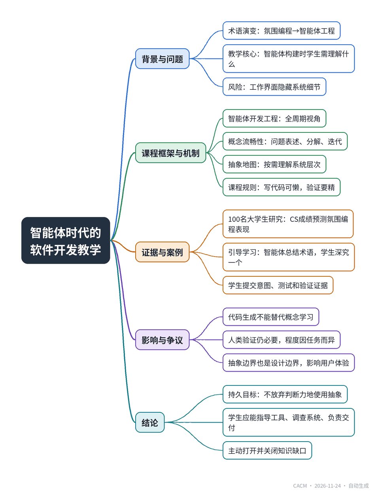

# Teaching Students to Build with Agents

## 教学生用智能体构建软件

**来源**：Communications of the ACM（Blog@CACM）　|　**发布**：2026-11-23 16:56（美东）　|　**北京时间**：2026-11-24 04:56　|　**作者**：Michal Gordon

[原文链接](https://cacm.acm.org/blogcacm/teaching-students-to-build-with-agents/)　·　生成于 2026-11-24 18:30

---

## 一、摘要

> 学生可让工具代写代码，但验证标准必须精确。

随着AI智能体在软件开发中的普及，术语从“氛围编程”演变到“智能体工程”，教学面临新挑战：当智能体承担大量构建工作时，学生需要理解什么？文章基于作者的教学实践，提出以“智能体开发工程”为课程框架，强调概念流畅性、系统抽象地图和验证责任。关键证据包括一项针对100名大学生的研究，显示计算机科学成绩能预测氛围编程表现，警示代码生成不能替代概念学习。课程规则是“写代码可懒，验证标准要精”，学生需提交意图、测试和验证证据，并通过引导学习步骤主动填补知识缺口。结论是，教育目标应超越让应用运行，培养学生指导工具、调查系统和为交付负责的能力。

## 二、核心要点

1. 术语从“氛围编程”到“智能体工程”不断变化，但核心教学问题不变：智能体构建时学生需理解什么。
2. 作者用“智能体开发工程”框定课程，强调目标理解、工作指导、行为检查和结果负责的全周期。
3. 一项100名大学生的对照研究显示，计算机科学成绩预测氛围编程表现，控制一般认知技能后仍显著。
4. 课程规则“写代码可懒，验证标准要精”：学生用AI编程测试，但需精确界定意图、验收标准和边缘案例。
5. 引导学习步骤：每步开发后让智能体总结技术术语，学生选一个深入理解并用自己的话解释。
6. 持久目标：学生能表达意图、指导智能体、按需理解系统并验证行为，同时主动打开和关闭知识缺口。

## 三、关键词对照

| English | 中文 |
| --- | --- |
| vibe coding | 氛围编程 |
| agentic engineering | 智能体工程 |
| agentic development engineering | 智能体开发工程 |
| retrieval-augmented generation (RAG) | 检索增强生成 |
| Model Context Protocol (MCP) | 模型上下文协议 |
| conceptual fluency | 概念流畅性 |
| abstraction | 抽象 |
| verification | 验证 |

## 四、中英对照全文

I teach students to build software with AI agents, and the vocabulary keeps changing. First it was vibe coding. Now we hear agentic engineering, and perhaps agentic development engineering. Each term shifts attention away from typing every line and toward directing a system that can produce, test, and revise software, but what remains is the need to empower students to feel on top of things when they are vibe coding, and to help them understand debugging, testing, and being responsible for information and for LLM costs.

> 我教学生用 AI 智能体构建软件，而相关词汇一直在变。先是 vibe coding（氛围编程）。现在我们听到 agentic engineering（智能体工程），也许还有 agentic development engineering（智能体开发工程）。每个术语都把注意力从逐行输入代码转向指挥一个能够生成、测试和修订软件的系统，但不变的是：需要让学生在进行 vibe coding 时感到掌控全局，并帮助他们理解调试、测试，以及对信息和 LLM 成本负责。

Andrej Karpathy used “vibe coding” for a deliberately loose style of working: describe a change, accept what the model produces, run it, and keep going. A year later, he contrasted its accessibility with agentic engineering’s aim of preserving professional quality while working with agents. The labels leave a teaching question open: What must students understand when agents do much of the construction?

> Andrej Karpathy 用“vibe coding”指一种刻意松散的工作方式：描述一个改动，接受模型生成的结果，运行它，然后继续。一年后，他将它的易用性与智能体工程的目标进行了对比，后者旨在与智能体协作时保持专业质量。这些标签留下了一个教学问题：当智能体完成大部分构建工作时，学生必须理解什么？

I use agentic development engineering as a possible course framing, not as an established term since the ideas keep changing. It emphasizes the full development cycle around the agent’s code: understanding the goal, directing the work, checking behavior, and taking responsibility for the result.

> 我使用“智能体开发工程”作为一个可能的课程框架，而非一个既定术语，因为相关理念仍在变化。它强调围绕智能体代码的完整开发生命周期：理解目标、指导工作、检查行为，并对结果负责。

### Build on Conceptual Fluency
*建立在概念流畅性之上*

In “How Can Vibe Coding Transform Programming Education?,” Yael Erez and Orit Hazzan argue that these tools can shift attention from syntax toward conceptual thinking: problem formulation, decomposition, and iteration. I agree. Platforms such as Lovable and Base44 let learners move quickly from an idea to an interactive application.

> 在《Vibe Coding 如何改变编程教育？》一文中，Yael Erez 和 Orit Hazzan 认为这些工具可以将注意力从语法转向概念性思维：问题表述、分解和迭代。我同意。像 Lovable 和 Base44 这样的平台让学习者能够快速从想法过渡到交互式应用。

But a working interface can hide a lot. Where does the data go after a form is submitted? Which part of the application changed? How can a student tell whether an agent’s test checks the intended behavior? A recent CACM Opinion article calls for verification and interpretability in AI-generated software. Another recent CACM viewpoint argues that introductory courses should teach students to take responsibility for AI-produced work. My contribution is to ask how that responsibility can be practiced while students are building.

> 但一个能用的界面可能隐藏很多问题。表单提交后数据去了哪里？应用的哪一部分发生了变化？学生如何判断智能体的测试是否检查了预期行为？最近一篇 CACM 观点文章呼吁对 AI 生成的软件进行验证和可解释性。另一篇最近的 CACM 观点文章认为，入门课程应教导学生对 AI 产生的工作负责。我的贡献是探讨在学生构建过程中如何实践这种责任。

I also want them to understand the rapid changes, and we discuss those. For example, Antigravity, an IDE tool used with an agent, updated to an agentic development platform that hides the code from the developer.

> 我也希望他们理解这些快速变化，我们会讨论这些。例如，Antigravity 是一个与智能体一起使用的 IDE 工具，它更新为一个对开发者隐藏代码的智能体开发平台。

### Abstraction Needs a Map
*抽象需要一张地图*

Computer science depends on abstraction. A high-level language hides machine instructions; a framework hides common implementation details; a database lets us work with structured information without handling each disk operation. Hiding detail is useful when learners still have a model of what the abstraction does and a way to investigate its boundaries.

> 计算机科学依赖于抽象。高级语言隐藏机器指令；框架隐藏常见的实现细节；数据库让我们能够处理结构化信息，而无需处理每个磁盘操作。当学习者仍然对抽象的作用有一个模型，并且有办法探究其边界时，隐藏细节是有用的。

Students do not need to implement an entire database, web framework, or deployment service. They do need a map of the system at the level their task requires: how a user action travels through the application, where data persists, how tests check behavior, how changes are tracked, and how a version reaches users. They should be able to inspect or recreate a small, representative part when that would deepen understanding.

> 学生不需要实现整个数据库、Web 框架或部署服务。他们确实需要一张在其任务所需层面上的系统地图：用户操作如何贯穿应用、数据在哪里持久化、测试如何检查行为、变更如何被跟踪，以及一个版本如何到达用户。当这能加深理解时，他们应该能够检查或重建一个小的、有代表性的部分。

For HCI, the abstraction boundary is also a design boundary. A save button that appears to work but loses state after refresh breaks the user’s mental model and trust. A validation message, permission rule, or slow deployment changes the interaction people experience. Students need enough system understanding to connect those visible effects to what the software is doing.

> 对于 HCI（人机交互），抽象边界也是设计边界。一个看似有效但刷新后丢失状态的保存按钮会破坏用户的心智模型和信任。验证消息、权限规则或缓慢的部署会改变人们体验到的交互。学生需要足够的系统理解，将这些可见效果与软件正在做的事情联系起来。

This matters even in a “vibe coding” workflow. In a controlled study of 100 tertiary students, computer science achievement predicted vibe-coding performance, including after accounting for general cognitive skills. The finding does not prescribe a curriculum, but it cautions against treating code generation as a substitute for learning the concepts that make software understandable.

> 这在“vibe coding”工作流中也很重要。在一项针对 100 名大专学生的对照研究中，计算机科学成绩预测了 vibe-coding 的表现，即使在考虑了通用认知技能之后也是如此。这一发现并未规定课程，但它告诫人们不要将代码生成视为学习那些使软件可理解的概念的替代品。

### Make Learning Part of the Cycle
*让学习成为循环的一部分*

In my course, students submit evidence of their intent, testing, and verification. They explain what they asked the agent to do, how they checked the result, and what the evidence shows. For a website feature, that may mean checking both the visible behavior and whether the expected record exists in the database. They may ask an agent to propose tests and edge cases, but they still need to judge whether those tests cover what they intended.

> 在我的课程中，学生提交他们的意图、测试和验证的证据。他们解释要求智能体做什么、如何检查结果以及证据显示了什么。对于一个网站功能，这可能意味着检查可见行为和数据库中是否存在预期记录。他们可以要求智能体提出测试和边缘情况，但他们仍然需要判断这些测试是否覆盖了他们的意图。

I summarize the course rule this way: be lazy about writing code, but precise about verification standards. Students use AI tools to program and test, and they also build features that use LLMs and retrieval-augmented generation (RAG). The course also covers tool use and the Model Context Protocol (MCP), so students encounter both agents that help build software and AI capabilities that become part of the software. “Lazy” means letting tools draft code when that is useful; precision belongs in the intent, acceptance criteria, edge cases, and evidence students use to decide whether the result works.

> 我将课程规则总结如下：在编写代码上要懒惰，但在验证标准上要精确。学生使用 AI 工具进行编程和测试，他们也构建使用 LLM 和检索增强生成（RAG）的功能。课程还涵盖工具使用和模型上下文协议（MCP），因此学生既会遇到帮助构建软件的智能体，也会遇到成为软件一部分的 AI 能力。“懒惰”意味着在有用时让工具起草代码；精确性属于意图、验收标准、边缘情况以及学生用来判断结果是否有效的证据。

What does not change is the learning curve. An agent may produce code quickly, but understanding the development cycle still takes time for beginners. Human verification remains necessary. The amount depends on the task, but students need enough knowledge to explain what the software does, test it, and consider ethical risks.

> 不变的是学习曲线。智能体可能快速生成代码，但理解开发生命周期对初学者来说仍然需要时间。人工验证仍然必要。数量取决于任务，但学生需要足够的知识来解释软件做什么、测试它并考虑伦理风险。

I use a guided-learning step. At the end of each development step, students have the agent run a custom instruction and ask for a summary of the technical terms and concepts that came up. They choose one term they want to understand better, read about it, and write a short explanation in their own words, connected to the feature they just built. This is due to the fact that they explicitly know they have a gap of knowledge that they can work with, but also need to close.

> 我使用一个引导学习步骤。在每个开发步骤结束时，学生让智能体运行自定义指令，并要求总结出现的技术术语和概念。他们选择一个想要更好理解的术语，阅读相关材料，并用他们自己的话写一个简短解释，与他们刚刚构建的功能相关联。这是因为他们明确知道自己有一个可以处理但需要弥补的知识缺口。

For example, after a feature that saves an item, an agent might list “API route,” “schema,” and “persistence.” A student chooses “API route,” reads about it, explains how a request carries information from the interface to the server. They do not have to study every unfamiliar term at once. That may work for an agent, but not for a student. They learn what black boxes are, and they know they use them. The agent helps surface possible knowledge gaps; each student chooses one to pursue. I discuss explicitly that they need to keep improving their knowledge as they work with agents. Growing knowledge helps them ask better questions, recognize weak explanations, and decide what evidence would be convincing. Their summaries also let me see where understanding is developing and where the agent’s account needs checking.

> 例如，在一个保存项目的功能之后，智能体可能会列出“API 路由”、“模式”和“持久化”。学生选择“API 路由”，阅读相关内容，解释请求如何将信息从界面传递到服务器。他们不必一次性学习所有不熟悉的术语。这对智能体可能有效，但对学生无效。他们了解什么是黑盒，并且知道他们使用了黑盒。智能体帮助揭示可能的知识缺口；每个学生选择一个来追求。我明确讨论他们需要在与智能体合作时不断改进知识。增长的知识帮助他们提出更好的问题、识别薄弱的解释，并决定什么证据会有说服力。他们的总结也让我看到理解在何处发展，以及智能体的描述在何处需要检查。

### What Should Endure
*什么应该持久*

The vocabulary will continue to change. Vibe coding may name quick experimentation; agentic engineering may name a more disciplined way to coordinate agents; agentic development engineering may keep the whole lifecycle in view. A course organized around one label or platform will age quickly.

> 词汇将继续变化。Vibe coding 可能指快速实验；智能体工程可能指一种更严格的协调智能体的方式；智能体开发工程可能保持对整个生命周期的关注。围绕一个标签或平台组织的课程将很快过时。

A more durable objective is to help students work with abstractions without surrendering their judgment. They should be able to express intent, direct an agent, understand the system as far as the task requires, and verify what it does. They should also feel capable of opening a knowledge gap and closing it with guided study.

> 一个更持久的目标是帮助学生在不放弃判断力的情况下与抽象打交道。他们应该能够表达意图、指导智能体、在任务需要的范围内理解系统，并验证它做什么。他们还应该感到有能力打开一个知识缺口并通过引导学习来弥补它。

The question is not only whether students can get an application to work. It is whether they can understand enough to steer the tools, investigate the system they change, and take responsibility for what they deliver. That is what I want to teach.

> 问题不仅在于学生能否让一个应用运行起来。而在于他们能否理解足够多来驾驭工具、调查他们改变的系统，并对他们交付的东西负责。这就是我想教的。

Disclosure: I edited this post with the assistance of ChatGPT, yet it describes my intent and experience.

> 披露：我在 ChatGPT 的协助下编辑了这篇文章，但它描述了我的意图和经验。

## 附录：参考与脚注（原文）

References

1. Andrej Karpathy: From Vibe Coding to Agentic Engineering w/ Stephanie Zhan. Sequoia Capital; https://www.youtube.com/watch?v=96jN2OCOfLs

2. Erez, Y. and Hazzan, O. How Can Vibe Coding Transform Programming Education? BLOG@CACM; https://cacm.acm.org/blogcacm/how-can-vibe-coding-transform-programming-education/

3. Mukhopadhyay, M. Can VIBE Drive Development? Threats and Opportunities, Communications; https://cacm.acm.org/opinion/can-vibe-drive-development-threats-and-opportunities/

4. Fisler, K., Krishnamurthi, S., and Littman, M. Teaching Novice Computing and Programming in the Agentic AI Era, Communications; https://doi.org/10.1145/3838277

5. Thorgeirsson, S., Weidmann, T.B., and Su, Z. Computer Science Achievement and Writing Skills Predict Vibe Coding Proficiency, Proceedings of CHI 2026; https://doi.org/10.1145/3772318.3791666

6. Google Antigravity Team. Build with Google Antigravity, our new agentic development platform, Google Developers Blog; https://developers.googleblog.com/build-with-google-antigravity-our-new-agentic-development-platform/

Michal Gordon holds a Ph.D. in computer science and applied mathematics from the Weizmann Institute of Science. Gordon teaches a new course on vibe AI programming at Indiana University Bloomington’s Luddy School of Informatics, Computing, and Engineering. Her interests include computing education and human AI interaction.

---
*英文原文版权归 Communications of the ACM 及作者所有；中文译文由 AI 辅助生成，仅供学习参考。*