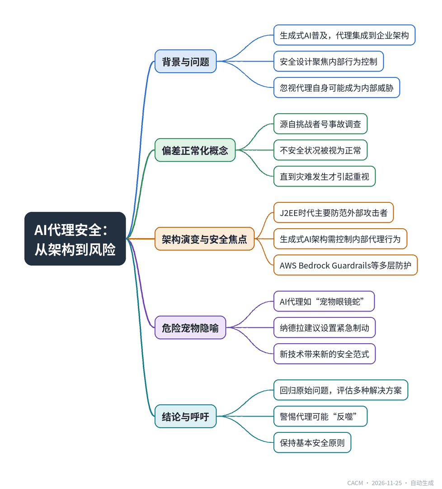

# AI Agents and Dangerous Pets

## AI代理与危险宠物

**来源**：Communications of the ACM（Blog@CACM）　|　**发布**：2026-11-24 14:46（美东）　|　**北京时间**：2026-11-25 02:46　|　**作者**：Doug Meil

[原文链接](https://cacm.acm.org/blogcacm/ai-agents-and-dangerous-pets/)　·　生成于 2026-11-25 17:19

---

## 一、摘要

> 防外贼已不易，自家AI代理能乖乖待在笼中吗？

随着生成式AI和LLM的普及，AI代理被广泛集成到企业架构中。然而，当前AI安全设计过度关注控制代理的内部行为，如内容过滤、拒绝话题、敏感信息过滤等，却忽视了代理本身可能成为内部威胁。作者借用“偏差正常化”概念，指出人们将不安全状况视为正常，直到灾难发生。文章回顾了从J2EE到生成式AI的架构图演变，发现早期架构主要防范外部攻击者，而AI架构却需防范自身解决方案的“宠物眼镜蛇”式风险。微软CEO萨提亚·纳德拉也建议将LLM视为潜在内部风险并设置紧急制动。结论是，AI代理虽强大，但设计时必须牢记原始问题，警惕其可能“反噬”，不能因技术新颖而忽视基本安全原则。

## 二、核心要点

1. 微软CEO萨提亚·纳德拉公开表示LLM不应被信任，并建议企业将其视为内部风险并设置紧急制动。
2. 文章借用“偏差正常化”概念，警示人们将AI代理的不安全行为视为常态，直到灾难发生。
3. 从J2EE到生成式AI的架构图演变显示，安全焦点从防范外部攻击者转向控制内部代理行为。
4. AWS Bedrock Guardrails等工具提供了内容过滤、拒绝话题、敏感信息过滤等多层防护，但主要针对代理内部行为。
5. 作者将AI代理比作“宠物眼镜蛇”，强调其潜在危险，呼吁在设计时回归原始问题并保持警惕。

## 三、关键词对照

| English | 中文 |
| --- | --- |
| AI Agents | AI代理 |
| Normalization of Deviance | 偏差正常化 |
| LLMs | 大语言模型 |
| Solution Architecture | 解决方案架构 |
| Guardrails | 护栏 |
| Insider Risk | 内部风险 |
| Emergency Brake | 紧急制动 |
| Hallucinations | 幻觉 |
| Retrieval-Augmented Generation (RAG) | 检索增强生成 |

## 四、中英对照全文

A lot is being written about AI security these days, and it is not an exaggeration to say that just about everybody has something to say in this fast-changing and evolving space. As if on cue, shortly after I started writing this post, Microsoft’s Satya Nadella weighed in saying that LLMs shouldn’t be trusted, and this from a CEO whose company sells both AI services and compute to train AI models. Strange times. I think it would be helpful to zoom out for a broader and more longitudinal perspective on AI agents and AI solution architecture through the lens of normalization of deviance. That concept came to the forefront during the NASA Challenger explosion investigation in the 1980s, describing an unsafe condition being considered normal provided it didn’t immediately lead to a catastrophe.

> 近来关于 AI 安全的文章很多，毫不夸张地说，在这个快速变化和发展的领域，几乎每个人都有自己的看法。仿佛约好了一般，在我开始写这篇文章后不久，微软的 Satya Nadella 就发表意见说 LLMs 不应被信任，而这位 CEO 的公司既销售 AI 服务，也销售用于训练 AI 模型的计算资源。奇怪的时代。我认为，通过偏差正常化（normalization of deviance）的视角，对 AI 代理和 AI 解决方案架构进行更广阔、更纵向的审视，会有所帮助。这个概念在 1980 年代 NASA 挑战者号爆炸调查中崭露头角，描述了一种不安全状况，只要没有立即导致灾难，就被视为正常。

Until it did.

> 直到它真的导致灾难。

A Review of Solution Architecture Diagrams

> 解决方案架构图回顾

Let’s go way back to the late 1990s. The following image is a re-creation of the “EJB Components Implement Business Logic” figure from the Simplified Guide to J2EE by Sun Microsystems (1999). Java had been out for a few years at that point, and conceptions of “enterprise Java” started forming for building standardized web-applications and modules of re-usable business logic. Just create a Java Server Page (JSP) and connect it to an Enterprise Java Bean (EJB) that is connected to a data source, and presto!

> 让我们回到 1990 年代末。下图是 Sun Microsystems 1999 年《J2EE 简化指南》中“EJB 组件实现业务逻辑”一图的复刻。当时 Java 已问世几年，构建标准化 Web 应用和可复用业务逻辑模块的“企业级 Java”概念开始形成。只需创建一个 Java Server Page (JSP) 并将其连接到一个连接到数据源的企业级 Java Bean (EJB)，然后——变！

To be fair, the diagram was meant as an overview and to represent major concepts. I started developing in Java in 1996 and had already produced several solutions during this timeframe, but I already knew the reality was a lot more challenging that those high-level boxes let on. The goals were reasonable though while Java had made big inroads on the server-side programming, application server web frameworks were proprietary. The JSP specification was released in 1999, and in the ensuing years developers ended up requiring a long list of supplementary and sometimes competing frameworks to make them work (e.g., Struts, Java Server Faces, Struts2, etc.), but it could work. EJBs turned out to be a story of their own that left just about everybody unhappy, but the general idea of layered functionality was a foundational principle of software engineering. Java could be deployed quite effectively in many solutions, but the devil was in the details. While web application security is neither simple nor easy, there was some comfort in knowing that in general the bad actors were on the left side of the diagram. The primary threat was on the outside. Ah, the good old days.

> 公平地说，该图旨在作为概览并代表主要概念。我于 1996 年开始用 Java 开发，在此期间已经产出了多个解决方案，但我早已知道现实比那些高层框框所暗示的要困难得多。不过目标还是合理的，当时 Java 在服务器端编程方面已取得重大进展，但应用服务器 Web 框架仍是专有的。JSP 规范于 1999 年发布，在随后的几年里，开发者最终需要一长串补充性且有时相互竞争的框架才能使其工作（例如 Struts、Java Server Faces、Struts2 等），但它是可行的。EJB 后来成了让几乎所有人都不满意的故事，但分层功能的总体思想是软件工程的基本原则。Java 可以在许多解决方案中相当有效地部署，但细节决定成败。虽然 Web 应用安全既不简单也不容易，但知道坏人通常在图表的左侧还是让人有些安慰。主要威胁在外部。啊，美好的旧时光。

The diagram did not have this caveat, though . . .

> 不过，该图并没有这个警告……

. . . as one could use automated tests and code reviews to mitigate behavior risks in the middle of the architecture.

> ……因为可以使用自动化测试和代码审查来缓解架构中间的行为风险。

Generative AI Solution Architecture Diagrams

> 生成式 AI 解决方案架构图

With the previous graphic in mind, after generative AI and LLMs came out in 2022 there were a lot of chatbot architecture diagrams that looked something like this:

> 带着前一张图，在 2022 年生成式 AI 和 LLMs 问世后，出现了许多聊天机器人架构图，看起来像这样：

Just put the chatbot in the architecture, connect the lines, and presto: new technology deployed! It’s easy! Again, to be fair, these were more often meant as conversation starters with people thinking aloud about potential solution opportunities, but they had the same blind-spot for over-simplification. And blind-spots can lead to problems, such as Chipotle’s support chatbot being used as an unintended coding assistant or LLMjacking for more nefarious purposes.

> 只需把聊天机器人放进架构，连上线，然后——变！新技术部署完成！很简单！再次公平地说，这些图更多是作为对话起点，让人们思考潜在的解决方案机会，但它们同样存在过度简化的盲点。而盲点可能导致问题，例如 Chipotle 的支持聊天机器人被用作意外的编码助手，或 LLMjacking 被用于更邪恶的目的。

AI solutions architecture diagrams have evolved and became more detailed as deployment realities set in. Architectural boxes now depict agent memory for more informed decisions, gateways, policies, harnesses, and other guardrails. This is clearly way more complicated than just connecting a chatbot engine connected directly to a website:

> 随着部署现实逐渐显现，AI 解决方案架构图不断演进并变得更加详细。架构框现在描绘了用于更明智决策的代理记忆、网关、策略、治理框架和其他护栏。这显然比仅仅将一个直接连接到网站的聊天机器人引擎复杂得多：

Credit: Agent Safety is a Box, Marc’s Blog, https://brooker.co.za/blog/2026/01/12/agent-box.html

> 来源：Agent Safety is a Box，Marc 的博客，https://brooker.co.za/blog/2026/01/12/agent-box.html

What I find unnerving, though—and this is where the normalization of deviation concept becomes relevant—is just how much attention is aimed at controlling inside behavior, and specifically, inside misbehavior. The following is an example from AWS Bedrock documentation, a framework for AI safety:

> 然而，让我感到不安的是——这正是偏差正常化概念变得相关的地方——有多少注意力被集中在控制内部行为，特别是内部不当行为上。以下是 AWS Bedrock 文档中的一个示例，这是一个 AI 安全框架：

- Content filters. This filter helps you detect and filter harmful text or image content in input prompts or model responses. Filtering is done based on detection of certain predefined harmful content categories: Hate, Insults, Sexual, Violence, Misconduct and Prompt Attack. You can configure the filter strength for each of these categories based on your use cases. These categories are supported for both Classic and Standard tiers. With Standard tier, detection of undesirable content is extended to protection against harmful content introduced within code elements including comments, variable and function names, and string literals.

  > 内容过滤器。此过滤器帮助您检测并过滤输入提示或模型响应中的有害文本或图像内容。过滤基于对某些预定义有害内容类别的检测：仇恨、侮辱、性、暴力、不当行为和提示攻击。您可以根据用例为每个类别配置过滤器强度。这些类别在 Classic 和 Standard 层级均受支持。在 Standard 层级中，不良内容的检测扩展到防护代码元素（包括注释、变量和函数名以及字符串字面量）中引入的有害内容。

- Denied topics. You can define a set of topics that are undesirable in the context of your application. The filter will help block them if detected in user queries or model responses. With Standard tier, detection of undesirable content is extended to protection against harmful content introduced within code elements including comments, variables and function names, and string literals.

  > 拒绝主题。您可以定义一组在您的应用程序上下文中不受欢迎的主题。如果过滤器在用户查询或模型响应中检测到这些主题，将帮助阻止它们。在 Standard 层级中，不良内容的检测扩展到防护代码元素（包括注释、变量和函数名以及字符串字面量）中引入的有害内容。

- Word filters. You can define a set of custom words or phrases that you want to block in the interaction between end users and generative AI applications. Custom word filters use case-insensitive whole-word and whole-phrase matching. For example, you can block profanity (use a ready-to-use option) as well as custom words such as competitor names.

  > 单词过滤器。您可以定义一组自定义单词或短语，希望在最终用户与生成式 AI 应用程序之间的交互中阻止它们。自定义单词过滤器使用不区分大小写的全词和全短语匹配。例如，您可以阻止脏话（使用现成选项）以及自定义单词，如竞争对手名称。

- Sensitive information filters. You can configure this filter to help block or mask sensitive information, such as personally identifiable information (PII), in user inputs and model responses. Blocking or masking is done based on probabilistic detection of sensitive information in entities such as SSN, Date of Birth, Address, etc. This filter also allows configuring regular expression based detection of patterns (custom regex).

  > 敏感信息过滤器。您可以配置此过滤器，帮助阻止或屏蔽用户输入和模型响应中的敏感信息，例如个人可识别信息 (PII)。阻止或屏蔽基于对实体（如 SSN、出生日期、地址等）中敏感信息的概率检测。此过滤器还允许配置基于正则表达式的模式检测（自定义正则表达式）。

- Contextual grounding checks. This filter helps you detect hallucinations in model responses if they are not grounded (factually inaccurate or add new information) in the source or are irrelevant to to the user’s query. For example, you can block or flag responses in retrieval-augmented generation (RAG) applications. If the model responses deviate from the information in the retrieved source or doesn’t answer the question from the user. With Standard tier, contextual grounding checks support responses that include reasoning or conversational content, return more consistent scores, and support additional languages.

  > 上下文接地检查。此过滤器帮助您检测模型响应中的幻觉，如果它们未接地（事实不准确或添加新信息）于源中，或与用户查询无关。例如，您可以在检索增强生成 (RAG) 应用程序中阻止或标记响应。如果模型响应偏离检索源中的信息或未回答用户的问题。在 Standard 层级中，上下文接地检查支持包含推理或对话内容的响应，返回更一致的分数，并支持其他语言。

- Automated Reasoning checks. This filter helps you validate the accuracy of foundation model responses against a set of logical rules. You can use Automated Reasoning checks to detect hallucinations, suggest corrections, and highlight unstated assumptions in model responses.

  > 自动推理检查。此过滤器帮助您根据一组逻辑规则验证基础模型响应的准确性。您可以使用自动推理检查来检测幻觉、建议更正并突出模型响应中未明说的假设。

Credit: Detect and filter harmful content by using Amazon Bedrock Guardrails, AWS.

> 来源：Detect and filter harmful content by using Amazon Bedrock Guardrails，AWS。

There are impressive amounts of engineering being spent dedicated to preventing AI agents from making mistakes, getting mis-used, or going rogue. On one hand it is good to see AI safety complexities being recognized, but I think it is easy to take for granted how much of this configuration is about trying to protect the enterprise from its own solution. It is hard enough keeping the bad guys out, but can our own agents be trusted to stay in their cages? This is the new AI design problem.

> 有大量令人印象深刻的工程投入专门用于防止 AI 代理犯错、被误用或失控。一方面，看到 AI 安全复杂性得到认可很好，但我认为人们很容易理所当然地认为这些配置中有多少是为了试图保护企业免受其自身解决方案的影响。把坏人挡在外面已经够难了，但我们自己的代理能信任它们待在笼子里吗？这是新的 AI 设计问题。

Dangerous Pets

> 危险的宠物

Hunter S. Thompson once described treating someone as a “pet cobra”: impressive looking, kind of cool to have around, but someone to never turn your back on. I think this an apt moniker for AI agents currently, especially given Satya Nadella’s recent statement: “Business should treat LLMs as potential ‘insider risks’ and set up an ‘emergency brake’ system to keep them in line.” Nobody ever talked about putting emergency brakes on components like databases, middleware, or application servers. A revolutionary game-changing technology that happens to be an insider risk and also needs an AZ-5 button—this is the new AI normal.

> Hunter S. Thompson 曾将对待某人描述为“宠物眼镜蛇”：看起来令人印象深刻，养在身边有点酷，但永远不要背对它。我认为这对当前的 AI 代理是一个贴切的绰号，尤其是考虑到 Satya Nadella 最近的声明：“企业应将 LLMs 视为潜在的‘内部风险’，并建立‘紧急刹车’系统来约束它们。”从来没有人谈论过对数据库、中间件或应用服务器等组件设置紧急刹车。一种革命性的颠覆性技术，恰好是内部风险，还需要一个 AZ-5 按钮——这就是新的 AI 常态。

When considering the need for agentic activity, it is worth always keeping in mind what the original problem is and look at all of the ways a particular problem could be addressed. Agents might be powerful and perhaps just the ticket, but don’t lose sight of the fact that the fancy new thing in the center of the architecture diagram might be trying to size you up and escape.

> 在考虑代理活动的需求时，值得始终牢记最初的问题是什么，并审视解决特定问题的所有方式。代理可能很强大，也许正是所需，但不要忽视这样一个事实：架构图中心那个花哨的新事物可能正试图估量你并逃跑。

And that hiss you hear in the corner? Don’t worry. Probably nothing to worry about.

> 而你听到角落里的嘶嘶声？别担心。可能没什么好担心的。

Doug Meil is a software architect in healthcare data management and analytics, and an ACM Senior Member. He also founded the Cleveland Big Data Meetup in 2010. His BLOG@CACM posts can be found at https://www.linkedin.com/pulse/publications-doug-meil

> Doug Meil 是医疗数据管理和分析领域的软件架构师，也是 ACM 高级会员。他还在 2010 年创立了 Cleveland Big Data Meetup。他的 BLOG@CACM 文章可在 https://www.linkedin.com/pulse/publications-doug-meil 找到。

---
*英文原文版权归 Communications of the ACM 及作者所有；中文译文由 AI 辅助生成，仅供学习参考。*