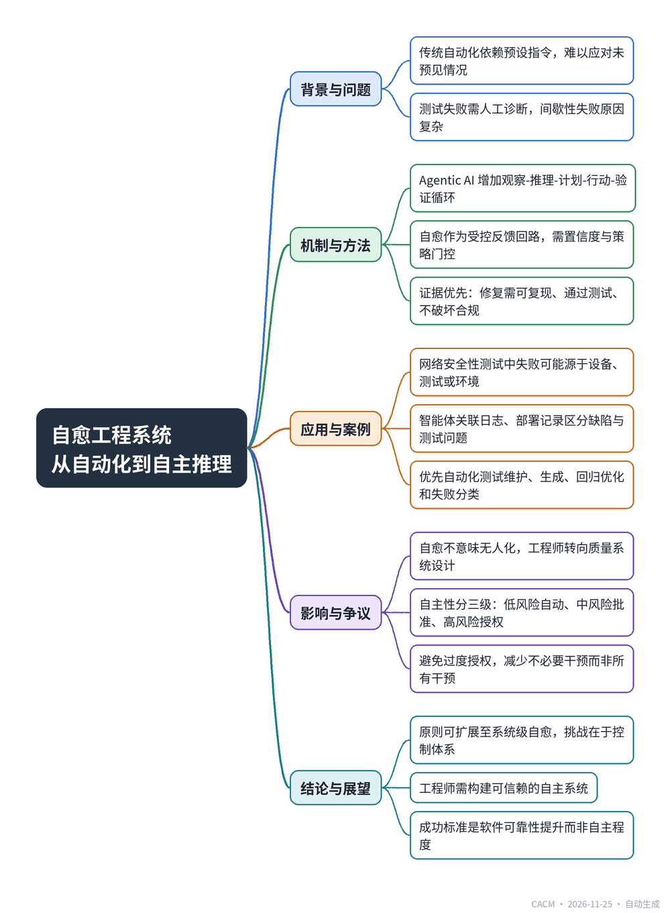

# Toward Self-Healing Engineering Systems

## 迈向自愈工程系统

**来源**：Communications of the ACM（Blog@CACM）　|　**发布**：2026-11-24 13:08（美东）　|　**北京时间**：2026-11-25 01:08　|　**作者**：Mohammed Bari Syed

[原文链接](https://cacm.acm.org/blogcacm/toward-self-healing-engineering-systems/)　·　生成于 2026-11-25 17:19

---

## 一、摘要

> Agentic AI 改变工程师的时间分配，而非取代工程师。

传统自动化依赖预设指令，难以应对 API 变更、界面元素移动等未预见情况，测试失败后仍需人工诊断。Agentic AI 引入观察、推理、规划、行动、验证、学习或上报的循环，使自动化具备适应性。文章以网络安全性测试为例，说明失败可能源于设备、流量生成器、测试或环境，智能体可关联日志、部署记录等区分缺陷与测试问题。自愈应作为受控反馈回路：观察、诊断、计划最小修正、授权行动、验证、接受或上报，并通过置信度与策略门控。作者强调证据优先，修复需可复现、通过相关测试、不破坏业务安全合规、在授权范围内。建议优先自动化测试维护、生成、回归优化和失败分类。自愈不意味无人化，需定义低中高风险自主级别，工程师转向质量系统设计。该原则可扩展至系统级自愈，但挑战在于可观测性、授权边界、审计等控制体系。结论是工程师需构建可信赖的自主系统，成功标准是软件可靠性提升而非自主程度。

## 二、核心要点

1. 传统自动化遵循触发-执行-验证-报告固定序列，Agentic AI 增加观察-推理-计划-行动-验证-学习或上报的推理循环。
2. 自愈测试的目标不是让测试通过，而是识别失败原因、做最小合理修正并提供修正有效的证据。
3. 自愈应作为受控反馈回路，每步修复需通过置信度与策略门控，失败则上报而非未经审查的尝试。
4. 作者建议优先自动化测试维护、测试生成、回归优化和失败分类四个领域，以保留工程控制。
5. 自主性分三级：低风险可自动行动，中风险需工程师批准，高风险（安全、金融交易、客户数据等）需明确人工授权。
6. 未来挑战是构建控制体系，包括可观测性、授权边界、审计、安全工具访问、回滚和可重复验证，避免过度授权。

## 三、关键词对照

| English | 中文 |
| --- | --- |
| Agentic AI | 代理式人工智能 |
| Self-Healing | 自愈 |
| QA Automation | 质量保证自动化 |
| Observability | 可观测性 |
| Regression Optimization | 回归优化 |
| Failure Triage | 失败分类 |
| Confidence Gate | 置信度门控 |
| Policy Gate | 策略门控 |
| Autonomy Levels | 自主级别 |
| Infrastructure as Code | 基础设施即代码 |

## 四、中英对照全文

In more than 20 years of QA automation and network security engineering across financial services, healthcare, pharmaceuticals, semiconductor design, and next-generation firewall testing, automation has meant teaching machines to follow instructions we already understand.

> 在金融服务、医疗保健、制药、半导体设计和下一代防火墙测试领域拥有超过20年的QA自动化和网络安全工程经验，自动化一直意味着教机器遵循我们已经理解的指令。

That model speeds delivery, but struggles with situations its designers did not anticipate.

> 这种模式加快了交付速度，但在其设计者未曾预料的情况下会陷入困境。

Tests fail when APIs change, interface elements move, or environments behave unexpectedly. Some failures are intermittent, caused by asynchronous waits, concurrency, or test-order dependencies. The framework reports the failure; a human still diagnoses it.

> 当API变更、界面元素移动或环境出现意外行为时，测试会失败。有些失败是间歇性的，由异步等待、并发或测试顺序依赖引起。框架报告失败；但仍需人工诊断。

Agentic AI introduces a different approach. An agent observes a system, reasons about what it sees, plans an action, checks the result, and continues until the task succeeds or human help is needed. Applied carefully, this makes automation adaptive—not simply faster.

> Agentic AI引入了一种不同的方法。代理观察系统，对所见进行推理，规划行动，检查结果，并持续直到任务成功或需要人工帮助。谨慎应用，这使自动化具有适应性——而不仅仅是更快。

### From Automated Execution to Autonomous Reasoning
*从自动化执行到自主推理*

Traditional automation follows a fixed sequence: Trigger → Execute → Verify → Report. Agentic automation adds a reasoning loop: Observe → Reason → Plan → Act → Verify → Learn or Escalate. That change may look small, but it alters the engineering problem.

> 传统自动化遵循固定顺序：触发 → 执行 → 验证 → 报告。代理式自动化增加了推理循环：观察 → 推理 → 规划 → 行动 → 验证 → 学习或上报。这一变化看似微小，但改变了工程问题。

If a test cannot find a button, a conventional framework reports “Element not found.” An agent could compare page versions, identify a changed identifier, verify that the business function still works, then propose an updated locator and rerun the test.

> 如果测试找不到按钮，传统框架会报告“元素未找到”。代理可以比较页面版本，识别更改的标识符，验证业务功能仍然有效，然后提出更新的定位器并重新运行测试。

This is self-healing test automation, but the term needs care. A system that edits its own tests and declares success is not necessarily intelligent or safe. The objective is not simply to make a test pass. It is to identify why it failed, make the smallest justified correction, and provide evidence that the correction is valid.

> 这是自愈测试自动化，但该术语需要谨慎对待。一个编辑自己的测试并宣布成功的系统不一定智能或安全。目标不是简单地让测试通过。而是找出失败原因，做出最小的合理修正，并提供修正有效的证据。

### A Failing Test Is Not Necessarily a Defect
*失败的测试不一定是缺陷*

A red test does not automatically mean the application is broken. In network security testing, failure may originate in the device, traffic generator, lab topology, test, or an external dependency.

> 红色测试并不自动意味着应用程序损坏。在网络安全测试中，失败可能源于设备、流量生成器、实验室拓扑、测试或外部依赖。

After an overnight deployment, a customer-order suite fails. The cause might be a changed API, obsolete locator, consumed test data, unavailable dependency, expired token, partial deployment, or genuine defect. A traditional framework may report them all alike.

> 在一夜部署后，客户订单套件失败。原因可能是API变更、定位器过时、测试数据耗尽、依赖不可用、令牌过期、部分部署或真正的缺陷。传统框架可能对所有情况一视同仁地报告。

An agent can correlate logs, traces, deployment records, code changes, test history, and environment health. It might report that the customer-status endpoint changed its response structure, moving an expected field, and that three other tests failed after the same deployment.

> 代理可以关联日志、跟踪、部署记录、代码更改、测试历史和环境健康。它可能报告客户状态端点的响应结构发生了变化，移动了预期字段，并且在同一部署后另外三个测试也失败了。

That is a meaningful shift—from detecting failure to diagnosing it.

> 这是一个有意义的转变——从检测失败到诊断失败。

### The Self-Healing Loop
*自愈循环*

Self-healing should operate as a controlled feedback loop:

> 自愈应作为一个受控的反馈循环运行：

- Observe: Gather test results, logs, traces, and environment signals.

  > 观察：收集测试结果、日志、跟踪和环境信号。

- Diagnose: Separate application defects from test or environment problems.

  > 诊断：将应用程序缺陷与测试或环境问题分开。

- Plan: Choose the smallest, lowest-risk correction.

  > 规划：选择最小、最低风险的修正。

- Act: Make only an authorized change.

  > 行动：仅进行授权更改。

- Validate: Rerun the test and related checks.

  > 验证：重新运行测试和相关检查。

- Accept or escalate: Record evidence or send the issue to an engineer.

  > 接受或上报：记录证据或将问题发送给工程师。

Every repair should pass a confidence and policy gate. A failed gate should lead to escalation, not another unreviewed attempt.

> 每次修复都应通过置信度和策略门控。未通过门控应导致上报，而不是另一次未经审查的尝试。

### Evidence Before Action
*行动前证据*

There is a temptation to describe agentic AI as fully autonomous software engineering. I am more cautious. If loosening a payment validation rule makes a failing test pass, the green result may conceal a serious defect. Before accepting an automated repair, I would require evidence that:

> 有一种诱惑是将代理式AI描述为完全自主的软件工程。我更为谨慎。如果放宽支付验证规则使失败的测试通过，绿色结果可能掩盖严重缺陷。在接受自动修复之前，我会要求证据表明：

- The failure is reproducible and the change addresses its cause.

  > 失败是可复现的，且更改解决了其根本原因。

- The repaired test passes repeatedly, as do related tests.

  > 修复后的测试反复通过，相关测试也是如此。

- Business behavior, security, and compliance requirements remain intact.

  > 业务行为、安全性和合规性要求保持不变。

- The change is within the agent’s authorized scope.

  > 更改在代理的授权范围内。

The agent should not be rewarded simply for producing a green pipeline. It should be evaluated on whether the pipeline is trustworthy.

> 代理不应仅仅因为产生绿色管道而受到奖励。它应该根据管道是否可信来评估。

### What Agents Should Automate First
*代理应首先自动化什么*

Four areas offer value while preserving engineering control.

> 四个领域在保持工程控制的同时提供价值。

Test maintenance: Identify obsolete locators, changed API contracts, unstable tests, and broken test data; recommend or make low-risk updates.

> 测试维护：识别过时的定位器、更改的API契约、不稳定的测试和损坏的测试数据；建议或进行低风险更新。

Test generation: Draft tests from requirements, APIs, and past defects. Engineers must check that they cover meaningful behavior, not just mirror implementation.

> 测试生成：根据需求、API和过去的缺陷起草测试。工程师必须检查它们覆盖有意义的行为，而不仅仅是镜像实现。

Regression optimization: Use change information and test history to select relevant tests without sacrificing critical coverage.

> 回归优化：使用变更信息和测试历史来选择相关测试，而不牺牲关键覆盖率。

Failure triage: Classify failures as new, known, environmental, intermittent, or likely regressions. This may deliver the greatest early value by separating infrastructure noise from product defects.

> 故障分类：将故障分类为新出现的、已知的、环境的、间歇性的或可能的回归。通过将基础设施噪声与产品缺陷分开，这可能带来最大的早期价值。

The shift is from asking, “Which test should I execute?” to asking, “What evidence do I need to decide whether this change is safe?”

> 转变是从问“我应该执行哪个测试？”到问“我需要什么证据来决定这个变更是否安全？”

### Self-Healing Does Not Mean Human-Free
*自愈并不意味着无人*

The future does not remove engineers from the process; it changes where they spend their time. No engineer should have to fix the same broken locator repeatedly. Engineers should, however, define what an agent is allowed to change.

> 未来不会将工程师从流程中移除；它改变了他们花费时间的地方。没有工程师应该反复修复同一个损坏的定位器。然而，工程师应该定义代理允许更改什么。

I see three practical levels of autonomy:

> 我看到三个实际的自主级别：

- Low risk: The agent can act automatically on reversible, well-understood changes.

  > 低风险：代理可以对可逆的、充分理解的更改自动采取行动。

- Medium risk: The agent proposes a change and an engineer approves it.

  > 中风险：智能体提出变更，由工程师审批。

- High risk: Changes involving security, financial transactions, customer data, production infrastructure, or business-critical behavior require explicit human authorization.

  > 高风险：涉及安全、金融交易、客户数据、生产基础设施或业务关键行为的变更，需要明确的人工授权。

Test engineers increasingly become designers of quality systems. Their expertise moves toward risk modeling, observability, reliability, security, and defining what evidence is sufficient to establish confidence.

> 测试工程师正日益成为质量系统的设计者。他们的专业能力转向风险建模、可观测性、可靠性、安全性，以及界定何种证据足以建立信心。

### From Self-Healing Tests to Self-Healing Systems
*从自愈测试到自愈系统*

The same principles can extend beyond testing. One agent might connect rising latency to a recent deployment and recommend a rollback. Another might generate tests when an API contract change affects downstream consumers. A security agent might investigate unusual access patterns and recommend containment.

> 同样的原则可以扩展到测试之外。一个智能体可以将延迟上升与最近的部署关联起来并建议回滚。另一个智能体可以在 API 契约变更影响下游消费者时生成测试。安全智能体可以调查异常访问模式并建议遏制措施。

I think of these as intelligent engineering loops: systems that continuously observe software, reason about its behavior, take controlled actions, and verify the consequences. The goal is not software that blindly repairs itself. It is software that can correct problems within defined boundaries and produce evidence people can trust.

> 我将这些视为智能工程闭环：持续观察软件、推理其行为、采取受控行动并验证后果的系统。目标不是盲目自我修复的软件，而是能够在既定边界内纠正问题并产生人们可信赖证据的软件。

### The Engineering Challenge Ahead
*未来的工程挑战*

Writing another test script is no longer the hardest part. The challenge is the control system: observability, authorization boundaries, auditability, secure tool access, rollback, repeatable validation, and confidence measures.

> 编写另一个测试脚本不再是最困难的部分。挑战在于控制系统：可观测性、授权边界、可审计性、安全的工具访问、回滚、可重复验证和信心度量。

Organizations must avoid excessive agency: granting more permissions or autonomy than a task requires. Fewer human interventions are not automatically better; success means reducing unnecessary intervention while preserving quality, safety, security, and accountability.

> 组织必须避免过度授权：授予超出任务所需的权限或自主权。更少的人工干预并不自动意味着更好；成功意味着在保持质量、安全、安保和问责的同时减少不必要的干预。

### A New Role for Software Engineers
*软件工程师的新角色*

Software engineering has moved from manual testing to scripted automation, from scripted deployments to continuous delivery, and from hand-managed servers to infrastructure as code. The next transition may be from deterministic automation to adaptive engineering systems.

> 软件工程已从手动测试走向脚本化自动化，从脚本化部署走向持续交付，从手工管理服务器走向基础设施即代码。下一次转变可能是从确定性自动化走向自适应工程系统。

That makes experience more important, not obsolete. An agent can generate thousands of actions, but it still needs engineering judgment to decide which actions are safe. Engineers who understand failure modes, distributed systems, security, and business risk are well positioned to build and govern these systems.

> 这使经验更加重要，而非过时。智能体可以生成数千个操作，但仍需要工程判断来决定哪些操作是安全的。理解故障模式、分布式系统、安全和业务风险的工程师，处于构建和治理这些系统的有利位置。

The future I see is not AI replacing engineers. It is engineers building systems in which agents help us test, repair, and improve software. The real measure of success will not be how autonomous these systems become, but how much more reliable software engineering becomes because we learned to make autonomy trustworthy.

> 我所看到的未来不是 AI 取代工程师，而是工程师构建由智能体帮助我们测试、修复和改进软件的系统。成功的真正衡量标准不是这些系统变得多么自主，而是因为我们学会了让自主性值得信赖，软件工程变得多么更加可靠。

Disclosure: Generative AI tools, including Anthropic’s Claude, were used to help condense an earlier draft, identify and check supporting references, and edit for clarity. The ideas, examples, technical arguments, and conclusions are the author’s own, drawn from his professional experience. The author reviewed the final text and takes full responsibility for its content and references.

> 披露：使用了包括 Anthropic 的 Claude 在内的生成式 AI 工具来帮助压缩早期草稿、识别和核对支持性参考文献，并为清晰度进行编辑。想法、示例、技术论证和结论均为作者本人基于其专业经验得出。作者审阅了最终文本，并对其内容和参考文献承担全部责任。

Mohammed Bari Syed is a Principal Network QA Engineer at Palo Alto Networks, with more than 20 years of experience in QA automation and network security engineering. The views expressed here are his own and do not represent those of his employer.

> Mohammed Bari Syed 是 Palo Alto Networks 的首席网络 QA 工程师，在 QA 自动化和网络安全工程方面拥有超过 20 年的经验。此处表达的观点仅代表他本人，不代表其雇主的观点。

---
*英文原文版权归 Communications of the ACM 及作者所有；中文译文由 AI 辅助生成，仅供学习参考。*